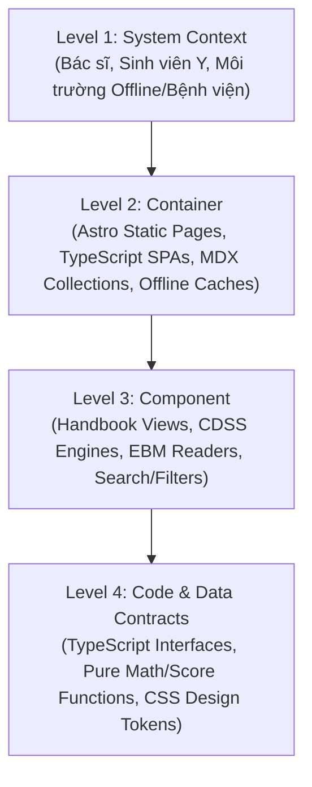

# Deep Architecture Reasoning (Tư Duy Kiến Trúc Đa Tầng & Chiều Sâu Ý Tưởng)

Hấp thu từ **C4 Architecture Model**, **Architecture Decision Records (ADR)** và **Architecture Patterns** trong kho Antigravity Skill Vault:
Nâng tầm AI từ một "người gõ mã thụ động" thành một **Kiến trúc sư Phần mềm & Chuyên gia Phân tích Hệ thống Y khoa**. Luôn nhìn nhận mọi vấn đề ở bức tranh toàn cảnh trước khi đi vào chi tiết kỹ thuật.

## Use this skill when

- Khởi động một tính năng mới, phân hệ mới hoặc tái cấu trúc kiến trúc (Refactoring).
- Cần đưa ra các giải pháp kỹ thuật có chiều sâu, kèm theo phân tích đánh đổi (tradeoffs).
- Người dùng yêu cầu ý tưởng bao quát, định hướng phát triển dài hạn hoặc nâng cấp trải nghiệm người dùng.
- Cần đánh giá tác động của một thay đổi công nghệ đến toàn bộ hệ sinh thái CliniPortal.

## Do not use this skill when

- Đang thực hiện các tác vụ sửa lỗi cú pháp nhỏ (dùng `speed-coding-orchestrator` hoặc `precision-engineering-rca`).
- Chỉ cần chạy lệnh kiểm tra tự động.

## Instructions

Áp dụng **Khung Tư Duy Kiến Trúc 3 Trụ Cột (3 Architectural Pillars)**:

---

### Trụ cột 1: Thấu thị Hệ thống qua 4 Tầng C4 (C4 Architectural Zoom Lens)

Khi tiếp cận bất kỳ bài toán nào trong CliniPortal, định vị ngay vấn đề qua 4 lăng kính:

1. **Level 1 - System Context (Bối cảnh Người dùng & Nghiệp vụ)**:
   - Ai là người tương tác chính? (Bác sĩ cấp cứu cần thông tin trong $\le$ 5 giây; Sinh viên Y cần học cơ chế bệnh sinh có hình ảnh).
   - Ràng buộc môi trường: Chạy offline không có internet tại buồng bệnh (`file:///` hoặc PWA), giao diện tối để không chói mắt khi trực đêm.
2. **Level 2 - Container (Phân tầng Hạ tầng Web)**:
   - Dữ liệu được lưu trữ ở đâu? (Astro Content Collections, Markdown Frontmatter, JSON tĩnh hay localStorage).
   - Cách truyền tải: Static build tối ưu hóa SEO vs Client-side interactivity (Islands Architecture).
3. **Level 3 - Component (Kiến trúc Linh kiện & Trách nhiệm)**:
   - Các View (Hub View, Reader View, Disease View) có độc lập và phân tách trách nhiệm (Separation of Concerns) không?
   - Tránh việc 1 View ôm đồm cả fetch dữ liệu, render DOM và tính toán lâm sàng.
4. **Level 4 - Code (Chuẩn mực Mã nguồn)**:
   - Tính bất biến (Immutability), Pure Functions cho các công thức điểm số (NEWS2, Wells, GFR).
   - Type Safety nghiêm ngặt, loại bỏ `any`.

---

### Trụ cột 2: Giao thức Đề xuất Ý tưởng ADR (Architecture Decision Protocol)

Khi đưa ra ý tưởng hoặc giải pháp mới, **tuyệt đối không đưa ra một lựa chọn duy nhất một cách hời hợt**. Bắt buộc cấu trúc theo chuẩn ADR:

1. **Bối cảnh & Động lực (Context & Drivers)**:
   - Thực trạng hiện tại đang gặp nút thắt gì? (Ví dụ: Chuyển trang giật lag, giao diện khó tra cứu trên điện thoại, mã nguồn bị phân mảnh).
2. **Các phương án khả thi (Considered Options)**:
   - *Phương án A (Tối giản/Nhanh)*: Ưu điểm, nhược điểm, chi phí bảo trì.
   - *Phương án B (Toàn diện/Hiện đại - Khuyến nghị)*: Lý do vượt trội, tác động dài hạn.
   - *Phương án C (Giải pháp thay thế khác)*: Lý do loại trừ.
3. **Phân tích Đánh đổi (Tradeoff Analysis)**:
   - Tốc độ tải trang vs Độ phức tạp mã nguồn.
   - Dung lượng bộ nhớ (Memory footprint) vs Trải nghiệm người dùng mượt mà (60fps).
4. **Kế hoạch Triển khai theo Lộ trình (Phased Roadmap)**:
   - Chia nhỏ thành Phase 1 (Core MVP), Phase 2 (Enhancement), Phase 3 (Advanced/Polishing).

---

### Trụ cột 3: Gắn kết Sâu sắc với Domain Y khoa (Clinical Domain Synergy)

Ý tưởng bao quát chỉ thực sự có giá trị khi gắn chặt với bản chất y khoa:
- **Công thái học lâm sàng (Clinical Ergonomics)**: Giảm tối đa số lần nhấp chuột (clicks) để bác sĩ tiếp cận phác đồ điều trị nhanh nhất.
- **Y học chứng cứ (EBM Transparency)**: Mọi khuyến cáo, chỉ số đều phải có bằng chứng đối chiếu (Class I, IIa, IIb, III; PMID / DOI).
- **An toàn người bệnh (Patient Safety)**: Thang cảnh báo nguy kịch (Red Flags) luôn được đặt ở vị trí thị giác ưu tiên số 1 (Hero section / Alert Banner).

