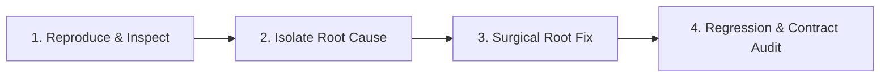

# Precision Engineering & RCA (Coding Chính Xác Tuyệt Đối)

Hấp thu từ các kỹ năng **debugging-strategies**, **error-diagnostics-smart-debug** và **code-review-excellence** trong kho Antigravity Skill Vault:
Tuyệt đối không áp dụng phương pháp "thử-sai may rủi" (guess-and-patch). Mọi sửa đổi phải dựa trên bằng chứng và giải quyết tận gốc nguyên nhân.

## Use this skill when

- Khắc phục các lỗi logic, lỗi hiển thị giao diện, lỗi TypeScript compiler hoặc lỗi runtime.
- Refactor các module quan trọng có nhiều file phụ thuộc (downstream dependencies).
- Cần đảm bảo mã nguồn mới tuân thủ nghiêm ngặt Type Contract và Design Tokens.
- Muốn triệt tiêu hiện tượng "sửa chỗ này hỏng chỗ khác" (Regression).

## Do not use this skill when

- Chỉ cần kiểm tra nhanh format hay typo đơn giản không có rủi ro logic.
- Khởi tạo file mới hoàn toàn độc lập chưa có liên kết hệ thống.

## Instructions

Thực hiện theo chu trình **4 Bước Phân Tích Nguyên Nhân Gốc Rễ (4-Step RCA Cycle)**:

### Bước 1: Tái hiện & Kiểm định Hợp đồng (Reproduce & Contract Inspection)
1. **Thu thập dữ kiện thực tế**:
   - Đọc chính xác thông báo lỗi, stack trace, hoặc trạng thái DOM bị vỡ.
   - So sánh trạng thái thực tế (Actual State) với Hợp đồng thiết kế (Expected Contract: TypeScript Interface, Props, Schema JSON).
2. **Không tự suy diễn**: Nếu lỗi mơ hồ, dùng script hoặc in logpoint xác định đúng payload dữ liệu trước khi kết luận.

### Bước 2: Cô lập Nguyên nhân Gốc rễ (Isolate Root Cause)
Phân loại chính xác bản chất lỗi thuộc nhóm nào:
- **Data Flow Issue**: Dữ liệu `null`/`undefined`, sai định dạng JSON, hoặc async timing issue (race condition).
- **Type/Interface Mismatch**: Truy cập sai thuộc tính, thiếu optional chaining `?.`, hoặc kiểu dữ liệu không tương thích.
- **Render/Lifecycle Issue**: DOM chưa sẵn sàng, event listener bị gán trùng lặp, hoặc template string bị hỏng thẻ đóng.
- **CSS Stacking / Tokens**: Xung đột `z-index`, `overflow: hidden`, hoặc hardcode màu làm hỏng Dark Mode.

> [!IMPORTANT]
> **Quy tắc Trọng yếu**: Khắc phục ở nơi sinh ra lỗi (Source of Truth), không được "vá víu triệu chứng" ở nơi hiển thị cuối (không chèn thêm các lớp bọc vô nghĩa `try/catch` rỗng hay `!important`).

### Bước 3: Sửa đổi Gốc rễ Tối thiểu (Surgical Root Fix)
1. Thực hiện sửa đổi nhỏ nhất có thể nhưng giải quyết triệt để nguồn cơn của lỗi.
2. Bảo toàn toàn bộ các hợp đồng kiểu dữ liệu (TypeScript types):
   - Đảm bảo `strictNullChecks` được thỏa mãn.
   - Định nghĩa rõ ràng kiểu dữ liệu trả về của hàm, không lạm dụng `any`.
3. Giữ nguyên các chú thích y khoa (EBM comments) và tài liệu API hiện hữu.

### Bước 4: Kiểm toán Hồi quy & Downstream Callers (Regression & Contract Audit)
1. **Downstream Callers Check**:
   - Rà soát nhanh các file đang import hoặc gọi hàm/component vừa sửa.
   - Đảm bảo tham số truyền vào và kiểu trả về không làm gãy các module phụ thuộc.
2. **Double Verification**:
   - Chạy lệnh typecheck (`astro check` hoặc `tsc --noEmit`).
   - Kiểm tra hiển thị cả 2 chế độ: Light Mode và Dark Mode.
   - Đảm bảo không còn bất kỳ warning hoặc console error nào.

