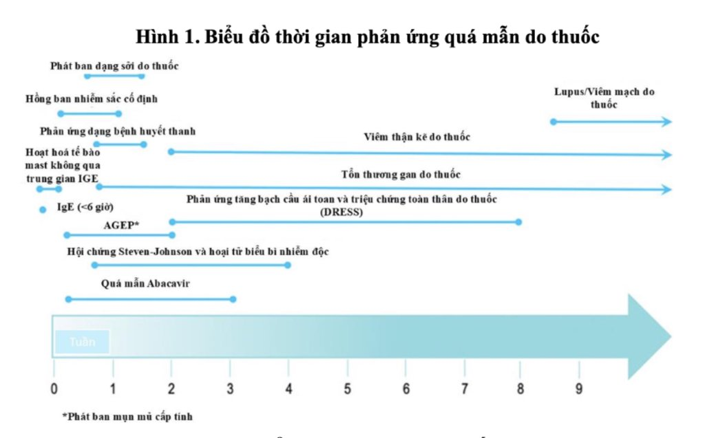
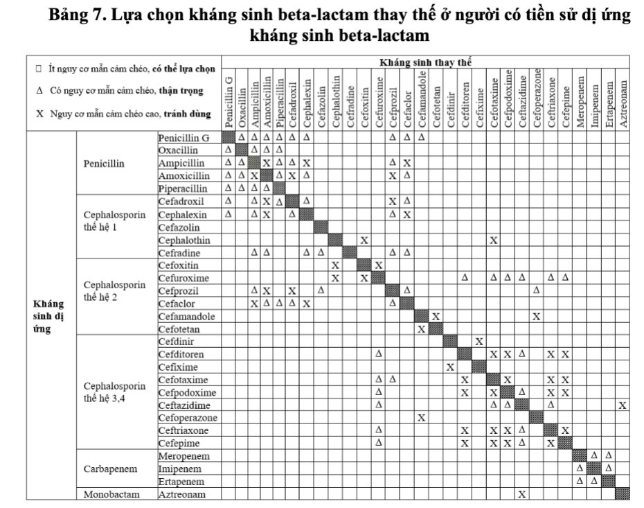

# 🛡️ TIẾP CẬN CHẨN ĐOÁN & ĐIỀU TRỊ DỊ ỨNG THUỐC

  <i class="fa-solid fa-stethoscope"></i> Tiếp Cận Lâm Sàng • TC-HM-02
  <i class="fa-solid fa-shield-virus"></i> CK09 • Huyết Học – Miễn Dịch
  <i class="fa-solid fa-certificate"></i> QĐ 3592/QĐ-BYT (2026) • TT 51/2017/TT-BYT

<ApproachQuickNav />

<section class="stats-strip" aria-label="Thông số chốt lâm sàng dị ứng thuốc">
  

    

      
5 – 10%

      
Tỷ lệ dị ứng thuốc trong tổng số phản ứng có hại do thuốc (ADR)

    

    

      
&le; 1 giờ

      
Cửa sổ điển hình dị ứng nhanh / phản vệ (tối đa &lt; 6 giờ sau dùng thuốc)

    

    

      
Adrenaline IM

      
Thuốc cứu mạng đầu tay khi phản vệ từ độ II trở lên (nhắc mỗi 5–15 phút)

    

    

      
2 – 8 tuần

      
Thời gian khởi phát DRESS; SJS/TEN thường xuất hiện sau 4–28 ngày

    

  

</section>

  
<i class="fa-solid fa-bullseye"></i> MỤC TIÊU HỌC TẬP &amp; PHẠM VI TÀI LIỆU

  
Nội dung được chuẩn hóa từ tài liệu chuyên môn ban hành kèm theo <strong>Quyết định số 3592/QĐ-BYT ngày 20/11/2026 của Bộ Y tế</strong> về <em>"Hướng dẫn chẩn đoán và điều trị các bệnh về Dị ứng – Miễn dịch lâm sàng"</em> và <strong>Thông tư 51/2017/TT-BYT</strong>:

  <ol style="margin: 0;">
    <li><strong>Phân biệt được 4 type cơ chế miễn dịch (Gell &amp; Coombs)</strong> cùng phản ứng <strong>giả dị ứng</strong> không qua IgE và các yếu tố nguy cơ từ người bệnh / dược chất.</li>
    <li><strong>Nhận diện sớm kiểu hình dị ứng nhanh vs chậm</strong>, sàng lọc <strong>Red Flags</strong> đe dọa tính mạng (Phản vệ, SJS/TEN, DRESS, AGEP) và vận dụng thành thạo thang điểm <strong>SCORTEN</strong>, <strong>RegiSCAR 2007</strong>.</li>
    <li><strong>Chỉ định đúng xét nghiệm <em>in vivo</em> và <em>in vitro</em></strong> (SPT, IDT, Patch test, DPT, sIgE, Tryptase, BAT, LTT) và tuân thủ nghiêm ngặt chống chỉ định test kích thích.</li>
    <li><strong>Thực hành kê đơn thay thế kháng sinh Beta-lactam an toàn</strong> dựa trên tương đồng chuỗi bên R1/R2 và triển khai phác đồ điều trị chuẩn cho Phản vệ, SJS/TEN, DRESS, cũng như <strong>giảm mẫn cảm nhanh 12–16 bước</strong>.</li>
  </ol>

## 1. Đại Cương, Định Nghĩa & Các Yếu Tố Nguy Cơ {#sec-1}

### 1.1. Định Nghĩa & Gánh Nặng Lâm Sàng

- **Dị ứng thuốc (*Drug Allergy*)** là một loại phản ứng có hại do thuốc (*adverse drug reaction – ADR*) **không thể dự đoán trước**, bao gồm một loạt các phản ứng quá mẫn qua trung gian miễn dịch với các cơ chế và biểu hiện lâm sàng khác nhau.
- Dị ứng thuốc chiếm khoảng **5 – 10%** tổng số các phản ứng có hại do thuốc.
- Mọi loại thuốc đều có thể gây dị ứng; tuy nhiên, **4 nhóm thuốc có tỷ lệ gặp cao nhất** trên lâm sàng gồm:
  1. **Thuốc kháng sinh** (đặc biệt nhóm beta-lactam, sulfonamide).
  2. **Thuốc chống viêm giảm đau không steroid (NSAIDs)**.
  3. **Thuốc chống co giật có vòng thơm** (carbamazepine, phenytoin, phenobarbital, lamotrigine).
  4. **Allopurinol**.

### 1.2. Các Yếu Tố Nguy Cơ Phát Triển Dị Ứng Thuốc

Nguy cơ phát triển dị ứng thuốc liên quan mật thiết đến cả **yếu tố vật chủ (người bệnh)** và **yếu tố của bản thân dược chất**:

#### Bảng 2. Các yếu tố liên quan với tăng nguy cơ dị ứng thuốc

<table class="table-modern">
  <thead>
    <tr>
      <th style="width: 24%;">Nhóm yếu tố</th>
      <th>Yếu tố cụ thể và đặc điểm lâm sàng</th>
    </tr>
  </thead>
  <tbody>
    <tr>
      <td><strong>Liên quan đến người bệnh</strong> <em>(Host factors)</em></td>
      <td>
        • <strong>Độ tuổi:</strong> Thanh niên / trung niên &gt; trẻ sơ sinh / người già. 
        • <strong>Giới tính:</strong> Nữ giới có nguy cơ cao hơn nam giới. 
        • <strong>Đa hình di truyền:</strong> Liên quan chặt chẽ đến alen kháng nguyên bạch cầu người (<strong>HLA</strong>), ví dụ <code>HLA-B&#42;1502</code>, <code>HLA-B&#42;5801</code>... 
        • <strong>Nhiễm virus phối hợp:</strong> Nhiễm HIV, Epstein-Barr Virus (EBV), Herpes virus. 
        • <strong>Tiền sử dị ứng thuốc trước đây.</strong> <em>(Lưu ý: Tiền sử cơ địa dị ứng không làm tăng tần suất dị ứng thuốc nói chung nhưng làm tăng mức độ nghiêm trọng nếu xảy ra phản ứng).</em>
      </td>
    </tr>
    <tr>
      <td><strong>Liên quan đến thuốc</strong> <em>(Drug factors)</em></td>
      <td>
        • <strong>Bản chất phân tử:</strong> Hợp chất có trọng lượng phân tử cao (protein lạ, insulin) hoặc thuốc có khả năng tạo liên kết <strong>hapten</strong> mạnh với protein huyết tương (như penicillin) có tính sinh miễn dịch cao hơn. 
        • <strong>Đường dùng:</strong> Đường bôi ngoài da &gt; đường tiêm tĩnh mạch / tiêm bắp &gt; đường uống. 
        • <strong>Liều lượng &amp; tần suất:</strong> Dùng thường xuyên, kéo dài hoặc lặp lại nhiều đợt có nguy cơ cao hơn dùng liều duy nhất.
      </td>
    </tr>
  </tbody>
</table>

---

## 2. Cơ Chế Bệnh Sinh: Phân Loại Gell & Coombs & Giả Dị Ứng {#sec-2}

Theo **Gell và Coombs**, phản ứng quá mẫn được phân loại thành **bốn type kinh điển**:

- **Type I (quá mẫn tức thì):** Qua trung gian kháng thể **IgE**.
- **Type II:** Phản ứng gây độc tế bào qua trung gian kháng thể **IgG** hoặc **IgM**.
- **Type III:** Gây ra do sự lắng đọng **phức hợp miễn dịch** và hoạt hóa bổ thể.
- **Type IV:** Phản ứng quá mẫn chậm qua trung gian miễn dịch tế bào (**tế bào T**).

Hiện nay, với sự tiến bộ trong nghiên cứu miễn dịch học, hiểu biết về các phân nhóm tế bào T (**Th1, Th2, Th17, tế bào T gây độc**) và phản ứng viêm mô đã mở rộng phân loại dị ứng thuốc. Bên cạnh đó, các tác nhân trị liệu có trọng lượng phân tử cao như **kháng thể đơn dòng (mAbs)** có nguồn gốc từ chuột thường chứa cấu trúc ngoại lai, dễ dẫn đến nguy cơ dị ứng **Type I** hoặc **Type III**.

  

    
<i class="fa-solid fa-diagram-project" style="color: var(--color-primary, #e11d48);"></i> SƠ ĐỒ 5 CƠ CHẾ QUÁ MẪN THUỐC (GELL &amp; COOMBS TYPE I–IV &amp; GIẢ DỊ ỨNG)

    Pure Editorial SVG
  

  

    <svg xmlns="http://www.w3.org/2000/svg" viewBox="0 0 960 365" width="100%" height="100%" style="background: var(--color-surface, #ffffff); border-radius: 12px; font-family: system-ui, -apple-system, sans-serif;">
      <defs>
        <marker id="daArr" viewBox="0 0 10 10" refX="8" refY="5" markerWidth="7" markerHeight="7" orient="auto-start-reverse">
          <path d="M 0 1 L 10 5 L 0 9 z" fill="var(--color-text-muted, #64748b)" />
        </marker>
      </defs>

      {/* Root Box */}
      <rect x="255" y="16" width="450" height="48" rx="10" fill="rgba(225, 29, 72, 0.12)" stroke="#e11d48" stroke-width="2" />
      <text x="480" y="37" text-anchor="middle" font-size="14" font-weight="800" fill="#e11d48">
        PHẢN ỨNG QUÁ MẪN THUỐC (5 CƠ CHẾ LÂM SÀNG)
      </text>
      <text x="480" y="54" text-anchor="middle" font-size="11" font-weight="600" fill="var(--color-text, #0f172a)">
        4 Type miễn dịch đặc hiệu (Gell &amp; Coombs) + Phản ứng Giả dị ứng (Không qua IgE)
      </text>

      {/* Orthogonal 5-Way Connector */}
      <line x1="480" y1="64" x2="480" y2="88" stroke="var(--color-text-muted, #64748b)" stroke-width="2" />
      <line x1="104" y1="88" x2="856" y2="88" stroke="var(--color-text-muted, #64748b)" stroke-width="2" />
      <line x1="104" y1="88" x2="104" y2="112" stroke="var(--color-text-muted, #64748b)" stroke-width="1.8" marker-end="url(#daArr)" />
      <line x1="292" y1="88" x2="292" y2="112" stroke="var(--color-text-muted, #64748b)" stroke-width="1.8" marker-end="url(#daArr)" />
      <line x1="480" y1="88" x2="480" y2="112" stroke="var(--color-text-muted, #64748b)" stroke-width="1.8" marker-end="url(#daArr)" />
      <line x1="668" y1="88" x2="668" y2="112" stroke="var(--color-text-muted, #64748b)" stroke-width="1.8" marker-end="url(#daArr)" />
      <line x1="856" y1="88" x2="856" y2="112" stroke="var(--color-text-muted, #64748b)" stroke-width="1.8" marker-end="url(#daArr)" />

      {/* Col 1: Type I */}
      <rect x="18" y="114" width="172" height="232" rx="10" fill="rgba(225, 29, 72, 0.08)" stroke="#e11d48" stroke-width="1.8" />
      <rect x="18" y="114" width="172" height="44" rx="10" fill="rgba(225, 29, 72, 0.16)" />
      <text x="104" y="133" text-anchor="middle" font-size="12" font-weight="800" fill="#e11d48">TYPE I (TỨC THÌ)</text>
      <text x="104" y="149" text-anchor="middle" font-size="10" font-weight="600" fill="var(--color-text, #0f172a)">Qua trung gian IgE</text>
      <text x="104" y="178" text-anchor="middle" font-size="10.5" fill="var(--color-text, #0f172a)">IgE gắn dưỡng bào</text>
      <text x="104" y="194" text-anchor="middle" font-size="10.5" fill="var(--color-text, #0f172a)">giải phóng Histamine,</text>
      <text x="104" y="210" text-anchor="middle" font-size="10.5" fill="var(--color-text, #0f172a)">Tryptase từ Mast cell</text>
      <text x="104" y="240" text-anchor="middle" font-size="10.5" font-weight="700" fill="#e11d48">• Phản vệ (Anaphylaxis)</text>
      <text x="104" y="258" text-anchor="middle" font-size="10.5" fill="var(--color-text, #0f172a)">• Mày đay, phù mạch</text>
      <text x="104" y="276" text-anchor="middle" font-size="10.5" fill="var(--color-text, #0f172a)">• Co thắt phế quản</text>
      <text x="104" y="324" text-anchor="middle" font-size="10" font-weight="800" fill="#e11d48">Khởi phát ≤ 1–6 giờ</text>

      {/* Col 2: Type II */}
      <rect x="206" y="114" width="172" height="232" rx="10" fill="rgba(217, 119, 6, 0.08)" stroke="#d97706" stroke-width="1.8" />
      <rect x="206" y="114" width="172" height="44" rx="10" fill="rgba(217, 119, 6, 0.16)" />
      <text x="292" y="133" text-anchor="middle" font-size="12" font-weight="800" fill="#d97706">TYPE II (ĐỘC TẾ BÀO)</text>
      <text x="292" y="149" text-anchor="middle" font-size="10" font-weight="600" fill="var(--color-text, #0f172a)">Kháng thể IgG / IgM</text>
      <text x="292" y="178" text-anchor="middle" font-size="10.5" fill="var(--color-text, #0f172a)">Gây độc tế bào máu,</text>
      <text x="292" y="194" text-anchor="middle" font-size="10.5" fill="var(--color-text, #0f172a)">hoạt hóa bổ thể phá hủy</text>
      <text x="292" y="210" text-anchor="middle" font-size="10.5" fill="var(--color-text, #0f172a)">màng tế bào đích</text>
      <text x="292" y="240" text-anchor="middle" font-size="10.5" font-weight="700" fill="#d97706">• Thiếu máu tan máu</text>
      <text x="292" y="258" text-anchor="middle" font-size="10.5" fill="var(--color-text, #0f172a)">• Giảm tiểu cầu</text>
      <text x="292" y="276" text-anchor="middle" font-size="10.5" fill="var(--color-text, #0f172a)">• Giảm bạch cầu hạt</text>
      <text x="292" y="324" text-anchor="middle" font-size="10" font-weight="800" fill="#d97706">Xét nghiệm: CBC, Coombs</text>

      {/* Col 3: Type III */}
      <rect x="394" y="114" width="172" height="232" rx="10" fill="rgba(124, 58, 237, 0.08)" stroke="#7c3aed" stroke-width="1.8" />
      <rect x="394" y="114" width="172" height="44" rx="10" fill="rgba(124, 58, 237, 0.16)" />
      <text x="480" y="133" text-anchor="middle" font-size="12" font-weight="800" fill="#7c3aed">TYPE III (PHỨC HỢP)</text>
      <text x="480" y="149" text-anchor="middle" font-size="10" font-weight="600" fill="var(--color-text, #0f172a)">Lắng đọng KN–KT</text>
      <text x="480" y="178" text-anchor="middle" font-size="10.5" fill="var(--color-text, #0f172a)">Lắng đọng phức hợp</text>
      <text x="480" y="194" text-anchor="middle" font-size="10.5" fill="var(--color-text, #0f172a)">miễn dịch tại thành mạch</text>
      <text x="480" y="210" text-anchor="middle" font-size="10.5" fill="var(--color-text, #0f172a)">&amp; hoạt hóa bổ thể</text>
      <text x="480" y="240" text-anchor="middle" font-size="10.5" font-weight="700" fill="#7c3aed">• Bệnh huyết thanh</text>
      <text x="480" y="258" text-anchor="middle" font-size="10.5" fill="var(--color-text, #0f172a)">• Viêm thận kẽ cấp</text>
      <text x="480" y="276" text-anchor="middle" font-size="10.5" fill="var(--color-text, #0f172a)">• Viêm mạch máu</text>
      <text x="480" y="324" text-anchor="middle" font-size="10" font-weight="800" fill="#7c3aed">Thường gặp: mAbs, KS</text>

      {/* Col 4: Type IV */}
      <rect x="582" y="114" width="172" height="232" rx="10" fill="rgba(2, 132, 199, 0.08)" stroke="#0284c7" stroke-width="1.8" />
      <rect x="582" y="114" width="172" height="44" rx="10" fill="rgba(2, 132, 199, 0.16)" />
      <text x="668" y="133" text-anchor="middle" font-size="12" font-weight="800" fill="#0284c7">TYPE IV (QUÁ MẪN CHẬM)</text>
      <text x="668" y="149" text-anchor="middle" font-size="10" font-weight="600" fill="var(--color-text, #0f172a)">Tế bào T mẫn cảm</text>
      <text x="668" y="178" text-anchor="middle" font-size="10.5" fill="var(--color-text, #0f172a)">Hoạt hóa đại thực bào</text>
      <text x="668" y="194" text-anchor="middle" font-size="10.5" fill="var(--color-text, #0f172a)">&amp; Th1/Th2/Th17/CTL</text>
      <text x="668" y="210" text-anchor="middle" font-size="10.5" fill="var(--color-text, #0f172a)">gây viêm/hoại tử mô</text>
      <text x="668" y="240" text-anchor="middle" font-size="10.5" font-weight="700" fill="#0284c7">• SJS / TEN, DRESS, AGEP</text>
      <text x="668" y="258" text-anchor="middle" font-size="10.5" fill="var(--color-text, #0f172a)">• Ngoại ban dát sẩn (MPE)</text>
      <text x="668" y="276" text-anchor="middle" font-size="10.5" fill="var(--color-text, #0f172a)">• Viêm da tiếp xúc, FDE</text>
      <text x="668" y="324" text-anchor="middle" font-size="10" font-weight="800" fill="#0284c7">Khởi phát ngày – 8 tuần</text>

      {/* Col 5: Non-allergic hypersensitivity */}
      <rect x="770" y="114" width="172" height="232" rx="10" fill="rgba(13, 148, 136, 0.08)" stroke="#0d9488" stroke-width="1.8" />
      <rect x="770" y="114" width="172" height="44" rx="10" fill="rgba(13, 148, 136, 0.16)" />
      <text x="856" y="133" text-anchor="middle" font-size="12" font-weight="800" fill="#0d9488">GIẢ DỊ ỨNG</text>
      <text x="856" y="149" text-anchor="middle" font-size="10" font-weight="600" fill="var(--color-text, #0f172a)">Không qua IgE / T-cell</text>
      <text x="856" y="178" text-anchor="middle" font-size="10.5" fill="var(--color-text, #0f172a)">Kích thích trực tiếp</text>
      <text x="856" y="194" text-anchor="middle" font-size="10.5" fill="var(--color-text, #0f172a)">mast/basophil giải phóng</text>
      <text x="856" y="210" text-anchor="middle" font-size="10.5" fill="var(--color-text, #0f172a)">histamine, LT, kinin</text>
      <text x="856" y="240" text-anchor="middle" font-size="10.5" font-weight="700" fill="#0d9488">• Red Man (Vancomycin)</text>
      <text x="856" y="258" text-anchor="middle" font-size="10.5" fill="var(--color-text, #0f172a)">• Phản vệ giả cản quang</text>
      <text x="856" y="276" text-anchor="middle" font-size="10.5" fill="var(--color-text, #0f172a)">• NSAIDs, Opioid, ACEi</text>
      <text x="856" y="324" text-anchor="middle" font-size="10" font-weight="800" fill="#0d9488">Lâm sàng giống Type I</text>
    </svg>
  

#### Bảng 1. Phân loại cơ chế dị ứng thuốc theo Gell và Coombs

<table class="table-modern">
  <thead>
    <tr>
      <th>Loại hình phản ứng</th>
      <th>Cơ chế miễn dịch</th>
      <th>Biểu hiện lâm sàng điển hình</th>
    </tr>
  </thead>
  <tbody>
    <tr>
      <td><strong>Type I (phản vệ)</strong></td>
      <td>Qua trung gian <strong>IgE</strong>, gắn trên thụ thể dưỡng bào làm giải phóng các chất trung gian hóa học từ tế bào mast</td>
      <td>Mày đay, phù mạch, phản vệ, co thắt phế quản</td>
    </tr>
    <tr>
      <td><strong>Type II</strong></td>
      <td>Gây độc tế bào qua trung gian <strong>IgG/IgM</strong>, hoạt hóa bổ thể</td>
      <td>Thiếu máu tan máu, giảm tiểu cầu, giảm bạch cầu</td>
    </tr>
    <tr>
      <td><strong>Type III</strong></td>
      <td>Lắng đọng phức hợp miễn dịch kháng nguyên – kháng thể, hoạt hóa hệ thống bổ thể</td>
      <td>Bệnh huyết thanh, viêm thận kẽ, viêm mạch</td>
    </tr>
    <tr>
      <td><strong>Type IV</strong></td>
      <td>Hoạt hóa đại thực bào, phản ứng qua trung gian <strong>tế bào T mẫn cảm</strong></td>
      <td>Viêm da dị ứng tiếp xúc, DRESS, AGEP, SJS/TEN</td>
    </tr>
    <tr>
      <td><strong>Giả dị ứng</strong> <em>(Non-allergic hypersensitivity)</em></td>
      <td>Giải phóng trực tiếp hoạt chất trung gian từ tế bào mast/basophil mà <strong>không qua IgE</strong></td>
      <td>Hội chứng Red man (Vancomycin), phản vệ giả do thuốc cản quang, morphin, NSAID</td>
    </tr>
  </tbody>
</table>

  
<i class="fa-solid fa-gem"></i> ĐIỂM CHỐT PHÂN BIỆT PHẢN ỨNG GIẢ DỊ ỨNG

  
<strong>Phản ứng giả dị ứng</strong> không liên quan đến việc sinh kháng thể hay tế bào T mẫn cảm, nhưng <strong>biểu hiện lâm sàng thường không thể phân biệt được với phản ứng dị ứng thực sự</strong>. Thuốc kích thích trực tiếp giải phóng hoặc hoạt hóa histamine, prostaglandin, leukotriene, kinin. Nguyên nhân hay gặp nhất là: <strong>NSAIDs, Opioid và thuốc ức chế men chuyển (ACEi)</strong>.

*Liên kết nền tảng:* Xem thêm cơ chế sốc phản vệ & đáp ứng miễn dịch tại [Cơ Chế Bệnh Sinh (CCBS)](#/basic-medical/co-che-benh-sinh) và sinh lý hệ miễn dịch tại [Giải Phẫu & Sinh Lý](#/basic-medical/giai-phau-sinh-ly).

---

## 3. Đặc Điểm Lâm Sàng, Red Flags & Tổn Thương Cơ Quan {#sec-3}

### 3.1. Kiểu Hình Lâm Sàng Theo Thời Gian Xuất Hiện Phản Ứng

Thời gian khởi phát từ lúc dùng thuốc đến khi xuất hiện triệu chứng là **cơ sở cốt lõi để định hướng cơ chế**:

- **Dị ứng nhanh (quá mẫn tức thì):** Thường xảy ra trong vòng **1 giờ**, một số trường hợp có thể kéo dài đến **dưới 6 giờ** sau dùng thuốc. Thường qua trung gian IgE (hoặc cơ chế kích hoạt mast cell trực tiếp), biểu hiện lâm sàng gồm mày đay, phù mạch, co thắt phế quản, tụt huyết áp hoặc **phản vệ đe dọa tính mạng**.
- **Dị ứng chậm (quá mẫn muộn):** Thường xuất hiện sau nhiều ngày, vài tuần đến vài tháng. Đa số là ban dát sẩn lành tính. Tuy nhiên, các thể nặng bao gồm **phản ứng bất lợi nghiêm trọng ở da (SCAR)**:
  - Hội chứng phản ứng thuốc có tăng bạch cầu ái toan và triệu chứng toàn thân (**DRESS**).
  - Ban mụn mủ cấp tính toàn thân (**AGEP**).
  - Hội chứng **Stevens – Johnson (SJS)** và hoại tử thượng bì nhiễm độc (**TEN**).
- **Phản ứng giống bệnh huyết thanh (SSLR):** Có sốt, đau/viêm khớp, ban đỏ đa dạng hoặc tổn thương dạng mày đay kéo dài **&gt; 24 giờ**; khác với bệnh huyết thanh kinh điển, SSLR hiếm khi gây tổn thương thận hay giảm bổ thể máu.
- **Thể tổn thương tạng đơn độc:** Viêm thận kẽ, tổn thương gan, giảm 3 dòng tế bào máu, viêm mạch máu.

<figure class="physio-figure" style="display: flex; flex-direction: column; align-items: center; justify-content: center; text-align: center; margin: 2rem auto;">
  
  <figcaption style="margin-top: 0.85rem; font-size: 0.88rem; color: var(--color-text-muted, #64748b); font-style: italic; text-align: center; max-width: 840px; line-height: 1.55;">
    <strong>Hình 1. Biểu đồ thời gian phản ứng quá mẫn do thuốc.</strong> Đối chiếu khung thời gian khởi phát từ lúc dùng thuốc (theo giờ đến 9+ tuần) giữa phản ứng tức thì qua IgE (&lt; 6 giờ) / hoạt hóa tế bào mast không qua IgE với các thể quá mẫn chậm (AGEP, FDE, MPE, SSLR, quá mẫn Abacavir, SJS/TEN, DRESS, tổn thương gan/viêm thận kẽ và Lupus/viêm mạch do thuốc). <em>Nguồn: Quyết định 3592/QĐ-BYT (2026) — Bộ Y tế.</em>
  </figcaption>
</figure>

#### Bảng 3. Khoảng thời gian khởi phát điển hình của các thể dị ứng thuốc

<table class="table-modern">
  <thead>
    <tr>
      <th>Kiểu phản ứng</th>
      <th>Khoảng thời gian từ lúc dùng thuốc đến khi xuất hiện</th>
    </tr>
  </thead>
  <tbody>
    <tr>
      <td><strong>Mày đay, hen phế quản, phản vệ</strong></td>
      <td><strong>&le; 1 giờ</strong> (hiếm khi kéo dài đến 6 giờ)</td>
    </tr>
    <tr>
      <td><strong>Hồng ban nhiễm sắc cố định (FDE)</strong></td>
      <td><strong>&le; 48 giờ</strong> sau khi bắt đầu phơi nhiễm</td>
    </tr>
    <tr>
      <td><strong>AGEP (Ban mụn mủ cấp tính)</strong></td>
      <td><strong>1 – 12 ngày</strong> sau khi dùng thuốc</td>
    </tr>
    <tr>
      <td><strong>Phát ban dát sẩn (MPE)</strong></td>
      <td><strong>4 – 14 ngày</strong> sau khi dùng thuốc</td>
    </tr>
    <tr>
      <td><strong>SJS / TEN</strong></td>
      <td><strong>4 – 28 ngày</strong> sau khi bắt đầu phơi nhiễm</td>
    </tr>
    <tr>
      <td><strong>DRESS</strong></td>
      <td><strong>2 – 8 tuần</strong> sau khi bắt đầu phơi nhiễm</td>
    </tr>
  </tbody>
</table>

### 3.2. Dấu Hiệu Báo Động Đỏ (Red Flags) & Phân Tầng Khẩn Cấp

  
<i class="fa-solid fa-triangle-exclamation"></i> DẤU HIỆU BÁO ĐỘNG ĐỎ (RED FLAGS) ĐE DỌA TÍNH MẠNG TRONG DỊ ỨNG THUỐC

  <ol style="margin: 0;">
    <li><strong>Phản vệ độ II trở lên (khởi phát vài giây – vài giờ):</strong> Khó thở, thở rít thanh quản, co thắt phế quản, tụt huyết áp (HA tâm thu người lớn &lt; 90 mmHg hoặc giảm &gt; 30% nền), ngất, rối loạn ý thức, đại tiểu tiện không tự chủ, đau quặn bụng/nôn ói liên tục.</li>
    <li><strong>Cảnh báo SJS / TEN:</strong> Sốt cao, đau rát da dữ dội, trợt loét các hốc niêm mạc tự nhiên (miệng, mắt, sinh dục), bọng nước và bong tróc thượng bì như bỏng (SJS &lt; 10% BSA, thể lửng 10–30% BSA, TEN &gt; 30% BSA).</li>
    <li><strong>Cảnh báo DRESS:</strong> Tam chứng sốt cao (38–40&deg;C) + ban da thâm nhiễm lan rộng &gt; 50% BSA + phù mặt &amp; hạch to toàn thân sau dùng thuốc 2–8 tuần; kèm tăng bạch cầu ái toan và tổn thương nội tạng (gan ALT &ge; 5&times; ULN, thận, phổi, tim, thực bào máu).</li>
    <li><strong>Cảnh báo AGEP / Tổn thương huyết học – mạch máu nặng:</strong> Hàng loạt mụn mủ vô khuẩn lan tỏa trên nền ban đỏ rầm rộ; thiếu máu tan máu, giảm bạch cầu hạt (&lt; 0,5 G/L), giảm tiểu cầu nặng; ban xuất huyết sờ thấy được / hoại tử đầu chi.</li>
  </ol>

| Tầng lâm sàng | Mức độ | Tiêu chuẩn nhận diện | Thái độ xử trí tức thì |
| :--- | :---: | :--- | :--- |
| **Phản vệ độ II–IV / SJS–TEN / DRESS nặng** | <UrgencyPill level="emergent" label="TỐI KHẨN (CẤP CỨU)" /> | Tụt HA, phù thanh quản/khó thở; loét đa hốc niêm mạc, bong trợt da; sốt cao + ban thâm nhiễm + suy gan/thận | **Ngừng ngay thuốc nghi ngờ**; tiêm bắp **Adrenaline** tức thì nếu phản vệ &ge; độ II; hồi sức dịch – đường thở &amp; chuyển ICU / Đơn vị chuyên khoa nếu SCARs |
| **Phản vệ độ I / AGEP / Tổn thương tạng đơn độc** | <UrgencyPill level="urgent" label="KHẨN CẤP (THEO DÕI SÁT)" /> | Mày đay/phù mạch cấp chưa suy hô hấp–tuần hoàn (có thể chuyển nặng bất cứ lúc nào); AGEP; viêm thận kẽ, viêm gan, giảm dòng tế bào máu | Ngừng thuốc thủ phạm, dùng Methylprednisolone / Diphenhydramine, **theo dõi sát tối thiểu 24 giờ** (phản vệ độ I) hoặc nhập viện đánh giá chức năng tạng |
| **Ban dát sẩn nhẹ (MPE) / Hồng ban cố định (FDE)** | <UrgencyPill level="routine" label="ĐÁNH GIÁ HỆ THỐNG" /> | Sinh hiệu ổn, không sốt cao, không tổn thương niêm mạc, không đau rát da hay suy tạng | Ngừng thuốc nghi ngờ, kháng histamine H1 &plusmn; corticoid, dặn dấu hiệu báo động và hẹn tái khám chuyên khoa Dị ứng sau 4 tuần – 6 tháng |

### 3.3. Triệu Chứng Lâm Sàng Theo Cơ Quan Tổn Thương

#### Bảng 4. Tổng hợp biểu hiện lâm sàng và các thuốc gây dị ứng thường gặp

<table class="table-modern">
  <thead>
    <tr>
      <th>Biểu hiện cơ quan</th>
      <th>Đặc điểm lâm sàng</th>
      <th>Nhóm thuốc nguyên nhân thường gặp</th>
    </tr>
  </thead>
  <tbody>
    <tr>
      <td><strong>Da: Ngoại ban dát sẩn (MPE)</strong></td>
      <td>Dát và sẩn nhỏ lan tỏa, bắt nguồn từ thân mình rồi lan ra các chi; tiến triển qua nhiều ngày.</td>
      <td>Allopurinol, penicillin, cephalosporin, thuốc chống co giật, sulfonamide, kháng thể đơn dòng.</td>
    </tr>
    <tr>
      <td><strong>Da: Mày đay, phù mạch</strong></td>
      <td>Khởi phát nhanh trong vài phút đến vài giờ; sẩn phù ngứa, phù môi/mắt; nguy cơ tiến triển phản vệ.</td>
      <td>Kháng sinh, thuốc ức chế men chuyển, thuốc giãn cơ, thuốc cản quang, NSAID, kháng thể đơn dòng.</td>
    </tr>
    <tr>
      <td><strong>Da: Hồng ban nhiễm sắc cố định</strong></td>
      <td>Mảng tăng sắc tố xuất hiện tái diễn tại <strong>cùng một vị trí</strong> mỗi khi tiếp xúc lại với thuốc thủ phạm.</td>
      <td>Sulfonamide, tetracycline, NSAIDs, aspirin, thuốc an thần, thuốc chống co giật, hóa chất chống ung thư.</td>
    </tr>
    <tr>
      <td><strong>Da: AGEP</strong></td>
      <td>Xuất hiện hàng loạt mụn mủ nhỏ vô khuẩn, không nang lông trên nền ban đỏ lan tỏa rầm rộ.</td>
      <td>Kháng sinh nhóm beta-lactam, macrolide, hydroxychloroquine, thuốc chống thấp khớp, thuốc chống ung thư.</td>
    </tr>
    <tr>
      <td><strong>Da: SJS / TEN</strong></td>
      <td>Sốt, đau rát da, loét các hốc tự nhiên (miệng, mắt, sinh dục); bong tróc lớp biểu bì như bỏng. • <strong>SJS:</strong> Diện tích bong tróc <strong>&lt; 10%</strong> BSA. • <strong>Thể lửng (SJS/TEN overlap):</strong> 10 – 30% BSA. • <strong>TEN:</strong> Diện tích bong tróc <strong>&gt; 30%</strong> BSA (đe dọa tính mạng cao).</td>
      <td>Sulfonamide, allopurinol, nevirapine, thuốc chống co giật (carbamazepine, phenytoin, lamotrigine), NSAIDs (oxicam), kháng thể đơn dòng.</td>
    </tr>
    <tr>
      <td><strong>Huyết học</strong></td>
      <td>Thiếu máu tan máu miễn dịch, giảm tiểu cầu, giảm bạch cầu trung tính.</td>
      <td>Penicillin, cephalosporin, sulfonamide, quinine, heparin, thiazide, thuốc chống co giật.</td>
    </tr>
    <tr>
      <td><strong>Gan</strong></td>
      <td>Viêm gan tế bào gan, vàng da ứ mật.</td>
      <td>Sulfonamide, carbamazepine, erythromycin, phenothiazine, allopurinol, thuốc chống lao.</td>
    </tr>
    <tr>
      <td><strong>Thận</strong></td>
      <td>Viêm thận kẽ cấp tính, viêm cầu thận, suy thận cấp.</td>
      <td>Penicillin, sulfonamide, allopurinol, PPI, NSAID, thuốc ức chế men chuyển.</td>
    </tr>
    <tr>
      <td><strong>Đa cơ quan: Phản vệ</strong></td>
      <td>Mày đay, phù mạch kèm co thắt thanh quản/phế quản, suy hô hấp, nôn ói, đau bụng quặn, tụt huyết áp.</td>
      <td>Kháng sinh, thuốc giãn cơ, thuốc gây mê, thuốc cản quang, protein tái tổ hợp.</td>
    </tr>
    <tr>
      <td><strong>Đa cơ quan: DRESS</strong></td>
      <td>Tam chứng: Ban da thâm nhiễm lan rộng + Sốt cao + Nổi hạch to toàn thân; kèm tăng bạch cầu ái toan, suy gan, thận.</td>
      <td>Thuốc chống động kinh/co giật, allopurinol, minocycline, sulfonamide, strontium ranelate.</td>
    </tr>
    <tr>
      <td><strong>Đa cơ quan: Bệnh huyết thanh / SSLR</strong></td>
      <td>Sốt, nổi mày đay kéo dài, đau khớp, sưng hạch.</td>
      <td>Kháng thể dị loại, kháng thể đơn dòng (infliximab), allopurinol, bupropion, cefaclor.</td>
    </tr>
    <tr>
      <td><strong>Đa cơ quan: Lupus do thuốc (DILE)</strong></td>
      <td>Sốt, đau cơ, viêm đa khớp, ban da dạng lupus; tự kháng thể kháng Histone dương tính.</td>
      <td>Hydralazine, procainamide, isoniazid, quinidine, minocycline, thuốc kháng TNF-$\alpha$.</td>
    </tr>
    <tr>
      <td><strong>Đa cơ quan: Viêm mạch máu</strong></td>
      <td>Ban xuất huyết có thể sờ thấy ở da, hoại tử đầu chi, viêm mạch nội tạng.</td>
      <td>Sulfonamide, hydralazine, penicillamine, propylthiouracil (PTU), kháng sinh.</td>
    </tr>
  </tbody>
</table>

---

## 4. Tiêu Chuẩn Chẩn Đoán: Phản Vệ, SCORTEN & RegiSCAR {#sec-4}

Việc chẩn đoán bắt buộc phải **khai thác tỉ mỉ tiền sử dùng thuốc** qua 4 trụ cột hệ thống:

  

    
<i class="fa-solid fa-pills"></i> 1. Toàn Bộ Dược Phẩm

    
Rà soát tất cả thuốc kê đơn, thuốc không kê đơn (OTC), thực phẩm chức năng và thảo dược đã dùng.

  

  

    
<i class="fa-solid fa-syringe"></i> 2. Liều &amp; Đường Dùng

    
Ghi nhận chính xác thời điểm bắt đầu, liều lượng, đường dùng (bôi, uống, tiêm) và số đợt lặp lại.

  

  

    
<i class="fa-solid fa-clock"></i> 3. Cửa Sổ Thời Gian

    
Xác định chính xác khoảng thời gian từ lúc phơi nhiễm đến khi xuất hiện triệu chứng đầu tiên (giờ vs ngày vs tuần).

  

  

    
<i class="fa-solid fa-file-medical"></i> 4. Tiền Sử Dung Nạp

    
Hỏi tiền sử dung nạp tốt hoặc phản ứng dị ứng trước đây với chính thuốc đó hay nhóm thuốc cùng cấu trúc.

  

### 4.1. Tiêu Chuẩn Chẩn Đoán Phản Vệ (Theo Thông Tư 51/2017/TT-BYT)

Chẩn đoán phản vệ khi xuất hiện **1 trong 3 bệnh cảnh lâm sàng** sau:

1. **Bệnh cảnh 1:** Xuất hiện trong vài giây đến vài phút ở **da, niêm mạc** (mày đay, ngứa, phù môi – lưỡi) **VÀ kèm theo ít nhất 1 trong 2 tiêu chuẩn sau**:
   - Triệu chứng hô hấp: Khó thở, thở rít thanh quản, ran rít.
   - Tụt huyết áp hoặc các dấu hiệu rối loạn chức năng cơ quan đích (ngất, rối loạn ý thức, đại tiểu tiện không tự chủ).
2. **Bệnh cảnh 2:** Có **ít nhất 2 trong 4 triệu chứng** sau xuất hiện nhanh (vài giây đến vài giờ) sau khi tiếp xúc yếu tố nghi ngờ:
   - Biểu hiện ở da, niêm mạc (mày đay, phù mạch, đỏ bừng).
   - Triệu chứng hô hấp (khó thở, thở rít, co thắt phế quản).
   - Tụt huyết áp hoặc hậu quả của tụt huyết áp.
   - Triệu chứng tiêu hóa liên tục (đau quặn bụng, nôn ói).
3. **Bệnh cảnh 3:** Tụt huyết áp xuất hiện trong vài giây đến vài giờ sau khi tiếp xúc với một thuốc/dị nguyên mà **người bệnh đã từng có tiền sử dị ứng**:
   - **Trẻ em:** Giảm ít nhất 30% huyết áp tâm thu hoặc huyết áp tâm thu thấp hơn tiêu chuẩn theo tuổi.
   - **Người lớn:** Huyết áp tâm thu **&lt; 90 mmHg** hoặc giảm **&gt; 30%** so với huyết áp tâm thu nền.

### 4.2. Đánh Giá Mức Độ Nặng Hội Chứng SJS/TEN Theo Thang Điểm SCORTEN

Thang điểm **SCORTEN** được đánh giá trong vòng **24 giờ đầu (Ngày 1)** và đánh giá lại vào **Ngày 3** để tiên lượng nguy cơ tử vong:

#### Bảng 5. Thang điểm SCORTEN

<table class="table-modern">
  <thead>
    <tr>
      <th>Yếu tố tiên lượng (Mỗi yếu tố = 1 điểm)</th>
      <th>Tiêu chuẩn</th>
    </tr>
  </thead>
  <tbody>
    <tr>
      <td><strong>1. Tuổi</strong></td>
      <td>&gt; 40 tuổi</td>
    </tr>
    <tr>
      <td><strong>2. Tần số tim</strong></td>
      <td>&gt; 120 chu kỳ/phút</td>
    </tr>
    <tr>
      <td><strong>3. Bệnh ác tính đi kèm</strong></td>
      <td>Có bệnh ung thư hoặc bệnh lý huyết học ác tính</td>
    </tr>
    <tr>
      <td><strong>4. Diện tích da bong tróc ban đầu</strong></td>
      <td>&gt; 10% diện tích bề mặt cơ thể (BSA)</td>
    </tr>
    <tr>
      <td><strong>5. Nồng độ Urê huyết thanh</strong></td>
      <td>&gt; 10 mmol/L</td>
    </tr>
    <tr>
      <td><strong>6. Nồng độ Glucose máu</strong></td>
      <td>&gt; 14 mmol/L</td>
    </tr>
    <tr>
      <td><strong>7. Bicarbonat huyết thanh ($\text{HCO}_3^-$)</strong></td>
      <td>&lt; 20 mmol/L</td>
    </tr>
  </tbody>
</table>

**Quy đổi nguy cơ tử vong theo tổng điểm SCORTEN:**
- **0 – 1 điểm:** Tỷ lệ tử vong **3,2%**.
- **2 điểm:** Tỷ lệ tử vong **12,2%**.
- **3 điểm:** Tỷ lệ tử vong **35,8%**.
- **4 điểm:** Tỷ lệ tử vong **58,3%**.
- **&ge; 5 điểm:** Tỷ lệ tử vong lên tới **90%**.

### 4.3. Tiêu Chuẩn Chẩn Đoán DRESS Theo Thang Điểm RegiSCAR 2007

Nghi ngờ **DRESS** khi bệnh nhân có sốt cao ($38 - 40^\circ\text{C}$), ban da dạng sởi hoặc thâm nhiễm lan rộng, phù mặt, hạch to và có tiền sử dùng thuốc nguy cơ cao trước đó **2 – 6 tuần**.

#### Bảng 6. Hệ thống tính điểm RegiSCAR cho DRESS

<table class="table-modern">
  <thead>
    <tr>
      <th>Tiêu chuẩn đánh giá</th>
      <th style="text-align: center;">&minus;1 điểm</th>
      <th style="text-align: center;">0 điểm</th>
      <th style="text-align: center;">+1 điểm</th>
      <th style="text-align: center;">+2 điểm</th>
    </tr>
  </thead>
  <tbody>
    <tr>
      <td><strong>Sốt &ge; $38.5^\circ\text{C}$</strong></td>
      <td style="text-align: center;">Không</td>
      <td style="text-align: center;">Có</td>
      <td style="text-align: center;"></td>
      <td style="text-align: center;"></td>
    </tr>
    <tr>
      <td><strong>Hạch to &gt; 1 cm ở &ge; 2 vị trí khác nhau</strong></td>
      <td style="text-align: center;"></td>
      <td style="text-align: center;">Không</td>
      <td style="text-align: center;">Có</td>
      <td style="text-align: center;"></td>
    </tr>
    <tr>
      <td><strong>Tăng bạch cầu ái toan máu ngoại vi:</strong> • Số lượng tuyệt đối ($\times 10^9\text{/L}$) • Tỷ lệ % (nếu tổng BC &lt; $4.0 \times 10^9\text{/L}$)</td>
      <td style="text-align: center;"></td>
      <td style="text-align: center;">&lt; 0,7 &lt; 10%</td>
      <td style="text-align: center;">0,7 – 1,499 10 – 19,9%</td>
      <td style="text-align: center;">&ge; 1,5 &ge; 20%</td>
    </tr>
    <tr>
      <td><strong>Bạch cầu lympho không điển hình</strong></td>
      <td style="text-align: center;"></td>
      <td style="text-align: center;">Không / Không rõ</td>
      <td style="text-align: center;">Có</td>
      <td style="text-align: center;"></td>
    </tr>
    <tr>
      <td><strong>Tổn thương da:</strong> • Ban da lan rộng &gt; 50% diện tích cơ thể • Đặc điểm gợi ý DRESS (phù mặt, xuất huyết, bong vảy...) • Mô bệnh học da phù hợp DRESS</td>
      <td style="text-align: center;">Không Không</td>
      <td style="text-align: center;">Không rõ Không rõ Có / Không rõ</td>
      <td style="text-align: center;">Có Có</td>
      <td style="text-align: center;"></td>
    </tr>
    <tr>
      <td><strong>Tổn thương các cơ quan nội tạng:</strong> <em>(Gan, thận, phổi, tim/cơ, tụy, tạng khác)</em></td>
      <td style="text-align: center;"></td>
      <td style="text-align: center;">Không / Không rõ</td>
      <td style="text-align: center;">Có 1 tạng</td>
      <td style="text-align: center;">Có &ge; 2 tạng</td>
    </tr>
    <tr>
      <td><strong>Thời gian bệnh tiến triển kéo dài &ge; 15 ngày</strong></td>
      <td style="text-align: center;">Không</td>
      <td style="text-align: center;">Có</td>
      <td style="text-align: center;"></td>
      <td style="text-align: center;"></td>
    </tr>
    <tr>
      <td><strong>Loại trừ các căn nguyên nhiễm trùng/tự miễn khác:</strong> <em>(ANA, Cấy máu, Kháng thể Viêm gan A/B/C, Chlamydia/Mycoplasma)</em></td>
      <td style="text-align: center;"></td>
      <td style="text-align: center;">Không rõ</td>
      <td style="text-align: center;">Không tìm thấy căn nguyên kháca</td>
      <td style="text-align: center;"></td>
    </tr>
  </tbody>
</table>

*Ghi chú a: Khi không có xét nghiệm nào dương tính và có ít nhất &ge; 3 nguyên nhân được kiểm tra âm tính.*

**Phân loại kết luận theo tổng điểm RegiSCAR:**
- **&lt; 2 điểm:** Loại trừ DRESS (chẩn đoán âm tính).
- **2 – 3 điểm:** Có thể mắc DRESS.
- **4 – 5 điểm:** Khả năng cao mắc DRESS.
- **&gt; 5 điểm:** Chẩn đoán xác định DRESS.

---

## 5. Các Xét Nghiệm Chẩn Đoán Dị Ứng Thuốc (In Vivo & In Vitro) {#sec-5}

### 5.1. Xét Nghiệm *In Vivo* (Trên Cơ Thể Người Bệnh)

- **Test lẩy da (*Skin Prick Test – SPT*):**
  - Là xét nghiệm đầu tay để xác định dị ứng nhanh qua trung gian IgE (**Type I**). Dung dịch thuốc được chuẩn hóa, chứng dương (histamine phosphate $10\text{ mg/mL}$) và chứng âm (nước muối sinh lý $0.9\%$).
  - Đọc kết quả sau **15 – 20 phút**; dương tính khi đường kính sẩn **&ge; 3 mm** so với chứng âm.
- **Test nội bì (*Intradermal Test – IDT*):**
  - Chỉ định khi test lẩy da âm tính nhưng bệnh sử vẫn nghi ngờ cao phản ứng dị ứng nhanh qua IgE. Có độ nhạy cao hơn test lẩy da (đặc biệt với kháng sinh beta-lactam). Độ nhạy chung của test da **&gt; 70%**.
- **Test áp da (*Patch Test*):**
  - Là phương pháp *in vivo* tốt nhất để chẩn đoán phản ứng dị ứng chậm (**Type IV**), đặc biệt là ban dát sẩn ngoại ban hoặc hồng ban nhiễm sắc cố định (thực hiện ngay trên vùng da từng tổn thương). Test có độ tin cậy cao với **Abacavir**. Ít giá trị trong chẩn đoán SJS/TEN.
  - Đọc kết quả ở các thời điểm **48 giờ, 72 giờ và 96 giờ**.
- **Test kích thích thuốc (*Drug Provocation Test – DPT*):**
  - Được coi là **tiêu chuẩn vàng** để xác định thuốc gây dị ứng hoặc để loại trừ quá mẫn, dỡ bỏ nhãn dị ứng (đặc biệt nhãn dị ứng Penicillin).
  - Thuốc được đưa vào cơ thể với liều tăng dần dưới sự giám sát chặt chẽ tại bệnh viện.

  
<i class="fa-solid fa-ban"></i> CHỐNG CHỈ ĐỊNH TUYỆT ĐỐI TEST KÍCH THÍCH THUỐC (DPT)

  
Tuyệt đối không thực hiện DPT khi bệnh nhân có tiền sử phản ứng đe dọa tính mạng gồm: <strong>phản vệ độ 3 trở lên, các thể SCAR (SJS, TEN, DRESS, AGEP), viêm mạch do thuốc, thiếu máu tan máu, tổn thương nội tạng nặng</strong>.

### 5.2. Xét Nghiệm *In Vitro* (Trong Phòng Xét Nghiệm)

- **Định lượng IgE đặc hiệu với thuốc (sIgE):** Thực hiện bằng xét nghiệm miễn dịch huyết thanh. An toàn, không có nguy cơ gây phản vệ cho người bệnh và không bị ảnh hưởng bởi thuốc kháng histamine đang dùng. Nhược điểm là giá trị dự đoán âm tính thấp (kết quả âm tính không loại trừ được dị ứng) và độ nhạy giảm dần sau 1 năm kể từ thời điểm dị ứng.
- **Đo nồng độ Tryptase và Histamine huyết thanh:**
  - Có giá trị xác nhận phản ứng dị ứng tức thì qua trung gian IgE (hoạt hóa dưỡng bào trong phản vệ).
  - **Đặc biệt có ý nghĩa quyết định** trong các trường hợp nghi ngờ **phản vệ chu phẫu** (trong quá trình gây mê phẫu thuật), khi các triệu chứng da có thể vắng mặt mà chỉ có trụy mạch, ngừng tim.
- **Công thức máu và nghiệm pháp Coombs (trực tiếp/gián tiếp):** Hỗ trợ chẩn đoán phản ứng độc tế bào **Type II** (thiếu máu tan máu tự miễn do thuốc, giảm tiểu cầu do thuốc).
- **Xét nghiệm kích hoạt bạch cầu ái kiềm (*Basophil Activation Test – BAT*):** Đo lường sự biểu lộ **CD63** hoặc **CD203c** trên màng basophil qua dòng chảy tế bào (*Flow cytometry*); rất hữu ích cho chẩn đoán dị ứng beta-lactam, thuốc giãn cơ và NSAIDs.
- **Xét nghiệm chuyển dạng lympho bào (*Lymphocyte Transformation Test – LTT*):** Đánh giá sự tăng sinh của tế bào T mẫn cảm khi nuôi cấy với thuốc nghi ngờ; có độ nhạy rất cao (**&gt; 90%**) đối với hội chứng **DRESS**, tuy nhiên độ nhạy thấp hơn trong SJS/TEN.

#### Bảng Tóm Tắt Đối Chiếu Chiến Lược Xét Nghiệm

<table class="table-modern">
  <thead>
    <tr>
      <th>Nhóm</th>
      <th>Kỹ thuật</th>
      <th>Cơ chế mục tiêu</th>
      <th>Điểm chốt diễn giải &amp; Giới hạn</th>
    </tr>
  </thead>
  <tbody>
    <tr>
      <td rowspan="4"><strong>In vivo</strong></td>
      <td><strong>SPT (Lẩy da)</strong></td>
      <td>Type I (IgE)</td>
      <td>Đầu tay; đọc sau 15–20 phút; (+) khi sẩn &ge; 3 mm so với chứng âm.</td>
    </tr>
    <tr>
      <td><strong>IDT (Nội bì)</strong></td>
      <td>Type I (IgE)</td>
      <td>Làm khi SPT (&minus;) nhưng nghi cao; nhạy &gt; 70% (đặc biệt beta-lactam).</td>
    </tr>
    <tr>
      <td><strong>Patch test (Áp da)</strong></td>
      <td>Type IV (Chậm)</td>
      <td>Đọc 48h, 72h, 96h; tốt cho MPE, FDE, Abacavir; ít giá trị trong SJS/TEN.</td>
    </tr>
    <tr>
      <td><strong>DPT (Kích thích)</strong></td>
      <td>Tiêu chuẩn vàng</td>
      <td>Xác định / dỡ nhãn dị ứng (Penicillin); <strong>CCĐ tuyệt đối</strong> phản vệ &ge; độ III &amp; SCARs.</td>
    </tr>
    <tr>
      <td rowspan="5"><strong>In vitro</strong></td>
      <td><strong>sIgE huyết thanh</strong></td>
      <td>Type I (IgE)</td>
      <td>An toàn, không bị nhiễu bởi kháng H1; NPV thấp, giảm nhạy sau 1 năm.</td>
    </tr>
    <tr>
      <td><strong>Tryptase / Histamine</strong></td>
      <td>Hoạt hóa Mast cell</td>
      <td>Xác nhận phản vệ tức thì; <strong>quyết định trong phản vệ chu phẫu</strong>.</td>
    </tr>
    <tr>
      <td><strong>CBC &amp; Coombs</strong></td>
      <td>Type II (Độc tế bào)</td>
      <td>Thiếu máu tan máu tự miễn, giảm tiểu cầu / bạch cầu do thuốc.</td>
    </tr>
    <tr>
      <td><strong>BAT (CD63 / CD203c)</strong></td>
      <td>Hoạt hóa Basophil</td>
      <td>Flow cytometry; giá trị cao cho beta-lactam, giãn cơ, NSAIDs.</td>
    </tr>
    <tr>
      <td><strong>LTT (Chuyển dạng lympho)</strong></td>
      <td>Type IV (Tế bào T)</td>
      <td>Độ nhạy <strong>&gt; 90% trong DRESS</strong>; nhạy thấp hơn trong SJS/TEN.</td>
    </tr>
  </tbody>
</table>

---

## 6. Lưu Đồ Tiếp Cận & Bảng Thay Thế Kháng Sinh Beta-Lactam {#sec-6}

  

    
<i class="fa-solid fa-diagram-project" style="color: var(--color-primary, #e11d48);"></i> LƯU ĐỒ TIẾP CẬN CHẨN ĐOÁN &amp; XỬ TRÍ DỊ ỨNG THUỐC (QĐ 3592/QĐ-BYT)

    Pure Editorial SVG
  

  

    <svg xmlns="http://www.w3.org/2000/svg" viewBox="0 0 960 645" width="100%" height="100%" style="background: var(--color-surface, #ffffff); border-radius: 12px; font-family: system-ui, -apple-system, sans-serif;">
      <defs>
        <marker id="algArr" viewBox="0 0 10 10" refX="8" refY="5" markerWidth="7" markerHeight="7" orient="auto-start-reverse">
          <path d="M 0 1 L 10 5 L 0 9 z" fill="var(--color-text-muted, #64748b)" />
        </marker>
        <marker id="algRed" viewBox="0 0 10 10" refX="8" refY="5" markerWidth="7" markerHeight="7" orient="auto-start-reverse">
          <path d="M 0 1 L 10 5 L 0 9 z" fill="#e11d48" />
        </marker>
        <marker id="algBlue" viewBox="0 0 10 10" refX="8" refY="5" markerWidth="7" markerHeight="7" orient="auto-start-reverse">
          <path d="M 0 1 L 10 5 L 0 9 z" fill="#0284c7" />
        </marker>
      </defs>

      {/* Main Title */}
      <text x="480" y="28" text-anchor="middle" font-size="15.5" font-weight="800" fill="var(--color-text, #0f172a)">
        THUẬT TOÁN TIẾP CẬN LÂM SÀNG BỆNH NHÂN NGHI NGỜ DỊ ỨNG THUỐC
      </text>

      {/* Entry Node */}
      <rect x="240" y="44" width="480" height="50" rx="10" fill="rgba(225, 29, 72, 0.12)" stroke="#e11d48" stroke-width="2" />
      <text x="480" y="65" text-anchor="middle" font-size="13" font-weight="800" fill="#e11d48">
        BƯỚC 1: NGỪNG NGAY THUỐC NGHI NGỜ &amp; ĐÁNH GIÁ SINH HIỆU
      </text>
      <text x="480" y="83" text-anchor="middle" font-size="11" font-weight="600" fill="var(--color-text, #0f172a)">
        Khai thác toàn bộ thuốc (kê đơn, OTC, thảo dược), thời điểm khởi phát &amp; tiền sử dị ứng
      </text>

      {/* Orthogonal split */}
      <line x1="480" y1="94" x2="480" y2="118" stroke="var(--color-text-muted, #64748b)" stroke-width="2" />
      <line x1="235" y1="118" x2="725" y2="118" stroke="var(--color-text-muted, #64748b)" stroke-width="2" />
      <line x1="235" y1="118" x2="235" y2="144" stroke="#e11d48" stroke-width="2" marker-end="url(#algRed)" />
      <line x1="725" y1="118" x2="725" y2="144" stroke="#0284c7" stroke-width="2" marker-end="url(#algBlue)" />

      {/* Left Branch Header: Immediate */}
      <rect x="35" y="146" width="400" height="48" rx="10" fill="rgba(225, 29, 72, 0.12)" stroke="#e11d48" stroke-width="2" />
      <text x="235" y="167" text-anchor="middle" font-size="12.5" font-weight="800" fill="#e11d48">
        DỊ ỨNG NHANH (TỨC THÌ: ≤ 1 GIỜ, TỐI ĐA &lt; 6 GIỜ)
      </text>
      <text x="235" y="184" text-anchor="middle" font-size="10.5" font-weight="600" fill="var(--color-text, #0f172a)">
        Cơ chế IgE (Type I) hoặc Giả dị ứng (NSAIDs, Opioid, cản quang)
      </text>

      {/* Right Branch Header: Delayed */}
      <rect x="525" y="146" width="400" height="48" rx="10" fill="rgba(2, 132, 199, 0.12)" stroke="#0284c7" stroke-width="2" />
      <text x="725" y="167" text-anchor="middle" font-size="12.5" font-weight="800" fill="#0284c7">
        DỊ ỨNG CHẬM (MUỘN: &gt; 6 GIỜ, NGÀY ĐẾN 2–8 TUẦN)
      </text>
      <text x="725" y="184" text-anchor="middle" font-size="10.5" font-weight="600" fill="var(--color-text, #0f172a)">
        Cơ chế Tế bào T (Type IV) hoặc Type II / Type III / SSLR
      </text>

      {/* Sub-split Left */}
      <line x1="235" y1="194" x2="235" y2="216" stroke="#e11d48" stroke-width="1.8" />
      <line x1="125" y1="216" x2="345" y2="216" stroke="#e11d48" stroke-width="1.8" />
      <line x1="125" y1="216" x2="125" y2="238" stroke="#e11d48" stroke-width="1.8" marker-end="url(#algRed)" />
      <line x1="345" y1="216" x2="345" y2="238" stroke="var(--color-text-muted, #64748b)" stroke-width="1.8" marker-end="url(#algArr)" />

      {/* Left Box 1: Anaphylaxis Grade II-IV */}
      <rect x="20" y="240" width="210" height="232" rx="10" fill="rgba(225, 29, 72, 0.09)" stroke="#e11d48" stroke-width="2" />
      <text x="125" y="262" text-anchor="middle" font-size="12" font-weight="800" fill="#e11d48">PHẢN VỆ ĐỘ II – III – IV</text>
      <text x="125" y="279" text-anchor="middle" font-size="10" font-weight="600" fill="var(--color-text-muted, #64748b)">Hô hấp / Tụt HA / Tiêu hóa</text>
      <line x1="36" y1="290" x2="214" y2="290" stroke="var(--color-border, #e2e8f0)" stroke-width="1.2" />
      <text x="125" y="311" text-anchor="middle" font-size="10.5" font-weight="800" fill="#e11d48">1. ADRENALINE TIÊM BẮP</text>
      <text x="125" y="328" text-anchor="middle" font-size="10" fill="var(--color-text, #0f172a)">NL: 1/2–1 ống • TE: ≤ 1/3 ống</text>
      <text x="125" y="344" text-anchor="middle" font-size="10" fill="var(--color-text, #0f172a)">Nhắc mỗi 5–15 phút</text>
      <text x="125" y="366" text-anchor="middle" font-size="10.5" fill="var(--color-text, #0f172a)">2. Nằm đầu thấp, thở Oxy</text>
      <text x="125" y="384" text-anchor="middle" font-size="10.5" fill="var(--color-text, #0f172a)">3. NaCl 0,9% (1–2 L / 10–20)</text>
      <text x="125" y="402" text-anchor="middle" font-size="10.5" fill="var(--color-text, #0f172a)">4. Diphenhydramine +</text>
      <text x="125" y="418" text-anchor="middle" font-size="10.5" fill="var(--color-text, #0f172a)">Methylprednisolone TM</text>
      <text x="125" y="454" text-anchor="middle" font-size="10" font-weight="700" fill="#e11d48">Theo dõi sát tối thiểu 72 giờ</text>

      {/* Left Box 2: Grade I / Urticaria */}
      <rect x="246" y="240" width="198" height="232" rx="10" fill="rgba(217, 119, 6, 0.08)" stroke="#d97706" stroke-width="1.8" />
      <text x="345" y="262" text-anchor="middle" font-size="12" font-weight="800" fill="#d97706">PHẢN VỆ ĐỘ I / MÀY ĐAY</text>
      <text x="345" y="279" text-anchor="middle" font-size="10" font-weight="600" fill="var(--color-text-muted, #64748b)">Chỉ biểu hiện da – niêm mạc</text>
      <line x1="262" y1="290" x2="428" y2="290" stroke="var(--color-border, #e2e8f0)" stroke-width="1.2" />
      <text x="345" y="314" text-anchor="middle" font-size="10.5" fill="var(--color-text, #0f172a)">• Methylprednisolone</text>
      <text x="345" y="332" text-anchor="middle" font-size="10.5" fill="var(--color-text, #0f172a)">  hoặc Diphenhydramine</text>
      <text x="345" y="352" text-anchor="middle" font-size="10.5" fill="var(--color-text, #0f172a)">• Kháng H1 thế hệ 2 / 1</text>
      <text x="345" y="378" text-anchor="middle" font-size="10.5" font-weight="700" fill="#d97706">Cảnh giác chuyển độ nặng</text>
      <text x="345" y="396" text-anchor="middle" font-size="10.5" fill="var(--color-text, #0f172a)">bất cứ lúc nào!</text>
      <text x="345" y="454" text-anchor="middle" font-size="10" font-weight="700" fill="#d97706">Theo dõi sát ít nhất 24 giờ</text>

      {/* Sub-split Right */}
      <line x1="725" y1="194" x2="725" y2="216" stroke="#0284c7" stroke-width="1.8" />
      <line x1="615" y1="216" x2="835" y2="216" stroke="#0284c7" stroke-width="1.8" />
      <line x1="615" y1="216" x2="615" y2="238" stroke="#e11d48" stroke-width="1.8" marker-end="url(#algRed)" />
      <line x1="835" y1="216" x2="835" y2="238" stroke="#0284c7" stroke-width="1.8" marker-end="url(#algBlue)" />

      {/* Right Box 1: SCARs */}
      <rect x="498" y="240" width="234" height="232" rx="10" fill="rgba(124, 58, 237, 0.09)" stroke="#7c3aed" stroke-width="2" />
      <text x="615" y="262" text-anchor="middle" font-size="12" font-weight="800" fill="#7c3aed">THỂ NẶNG: SCARs</text>
      <text x="615" y="279" text-anchor="middle" font-size="10" font-weight="600" fill="var(--color-text-muted, #64748b)">SJS/TEN • DRESS • AGEP</text>
      <line x1="514" y1="290" x2="716" y2="290" stroke="var(--color-border, #e2e8f0)" stroke-width="1.2" />
      <text x="615" y="311" text-anchor="middle" font-size="10.5" font-weight="700" fill="#e11d48">• SJS / TEN (SCORTEN N1 &amp; N3):</text>
      <text x="615" y="328" text-anchor="middle" font-size="10" fill="var(--color-text, #0f172a)">Phòng 25–28°C • Dịch 2mL×kg×%BSA</text>
      <text x="615" y="344" text-anchor="middle" font-size="10" fill="var(--color-text, #0f172a)">Chăm sóc mắt/niêm • IVIg / CyA / CS</text>
      <text x="615" y="368" text-anchor="middle" font-size="10.5" font-weight="700" fill="#7c3aed">• DRESS (RegiSCAR 2007):</text>
      <text x="615" y="385" text-anchor="middle" font-size="10" fill="var(--color-text, #0f172a)">Prednisolone 0,8–1 mg/kg (2–3 tuần)</text>
      <text x="615" y="401" text-anchor="middle" font-size="10" fill="var(--color-text, #0f172a)">Giảm chậm 4–6 tuần • Kháng virus</text>
      <text x="615" y="426" text-anchor="middle" font-size="10" font-weight="700" fill="#e11d48">CCĐ TUYỆT ĐỐI: DPT &amp; Giảm mẫn cảm</text>
      <text x="615" y="454" text-anchor="middle" font-size="10" font-weight="700" fill="#7c3aed">Điều trị tại Đơn vị chuyên khoa</text>

      {/* Right Box 2: Non-SCAR Delayed */}
      <rect x="748" y="240" width="192" height="232" rx="10" fill="rgba(13, 148, 136, 0.08)" stroke="#0d9488" stroke-width="1.8" />
      <text x="844" y="262" text-anchor="middle" font-size="12" font-weight="800" fill="#0d9488">THỂ NHẸ / TẠNG LẺ</text>
      <text x="844" y="279" text-anchor="middle" font-size="10" font-weight="600" fill="var(--color-text-muted, #64748b)">MPE • FDE • SSLR • Tạng đơn</text>
      <line x1="762" y1="290" x2="926" y2="290" stroke="var(--color-border, #e2e8f0)" stroke-width="1.2" />
      <text x="844" y="314" text-anchor="middle" font-size="10.5" fill="var(--color-text, #0f172a)">• Ngừng thuốc thủ phạm</text>
      <text x="844" y="334" text-anchor="middle" font-size="10.5" fill="var(--color-text, #0f172a)">• Thay thuốc không liên quan</text>
      <text x="844" y="354" text-anchor="middle" font-size="10.5" fill="var(--color-text, #0f172a)">  (tra Bảng 7 Beta-lactam)</text>
      <text x="844" y="378" text-anchor="middle" font-size="10.5" fill="var(--color-text, #0f172a)">• Corticoid 1–2 mg/kg/24h</text>
      <text x="844" y="396" text-anchor="middle" font-size="10.5" fill="var(--color-text, #0f172a)">  + Kháng histamine H1</text>
      <text x="844" y="454" text-anchor="middle" font-size="10" font-weight="700" fill="#0d9488">Tầm soát gan, thận, máu</text>

      {/* Convergence Arrows to Follow-up */}
      <line x1="235" y1="472" x2="235" y2="508" stroke="var(--color-text-muted, #64748b)" stroke-width="1.8" marker-end="url(#algArr)" />
      <line x1="725" y1="472" x2="725" y2="508" stroke="var(--color-text-muted, #64748b)" stroke-width="1.8" marker-end="url(#algArr)" />

      {/* Bottom Follow-up & Prevention Banner */}
      <rect x="20" y="510" width="920" height="114" rx="10" fill="rgba(2, 132, 199, 0.08)" stroke="#0284c7" stroke-width="1.8" />
      <text x="480" y="534" text-anchor="middle" font-size="12.5" font-weight="800" fill="#0284c7">
        SAU HỒI PHỤC (4 TUẦN – 6 THÁNG): THĂM DÒ CHUYÊN KHOA • GIẢM MẪN CẢM • DỰ PHÒNG
      </text>
      <text x="480" y="558" text-anchor="middle" font-size="11" font-weight="600" fill="var(--color-text, #0f172a)">
        • Dị ứng nhanh: SPT → IDT → DPT (khi không CCĐ) • Định lượng sIgE / BAT • Cân nhắc Giảm mẫn cảm nhanh 12–16 bước nếu bắt buộc dùng thuốc
      </text>
      <text x="480" y="580" text-anchor="middle" font-size="11" font-weight="600" fill="var(--color-text, #0f172a)">
        • Dị ứng chậm / SCARs: Theo dõi biến chứng gần (3–6 tuần) &amp; bệnh tự miễn muộn (3–6 tháng) • Test áp da / Phân tích gen HLA / LTT
      </text>
      <text x="480" y="604" text-anchor="middle" font-size="11" font-weight="800" fill="#e11d48">
        → BẮT BUỘC CẤP THẺ THEO DÕI DỊ ỨNG THUỐC &amp; BÁO CÁO CẢNH GIÁC DƯỢC (ADR)
      </text>
    </svg>
  

### 6.1. Nguyên Tắc Chung Trong Điều Trị Dị Ứng Thuốc

- **Ngừng ngay việc sử dụng loại thuốc gây dị ứng**.
- Khi có sẵn, **nên thay thế bằng các loại thuốc có cấu trúc hóa học không liên quan**.
- **Cần cân nhắc cẩn thận khả năng phản ứng chéo** giữa các thuốc khi lựa chọn thuốc thay thế (đặc biệt là bảng lựa chọn kháng sinh beta-lactam thay thế ở người có tiền sử dị ứng).
- **Điều trị triệu chứng dị ứng** bằng các nhóm thuốc phù hợp: corticosteroid, thuốc kháng histamine, adrenaline (bắt buộc đối với phản ứng phản vệ)...
- **Xem xét giảm mẫn cảm với thuốc** trong trường hợp bắt buộc phải dùng thuốc đã từng gây dị ứng nhưng không tìm được thuốc thay thế phù hợp.
- Các phản ứng thuốc nghiêm trọng như **SJS, TEN, DRESS** cần được điều trị tại các đơn vị chuyên khoa.

<figure class="physio-figure" style="display: flex; flex-direction: column; align-items: center; justify-content: center; text-align: center; margin: 2rem auto;">
  
  <figcaption style="margin-top: 0.85rem; font-size: 0.88rem; color: var(--color-text-muted, #64748b); font-style: italic; text-align: center; max-width: 860px; line-height: 1.55;">
    <strong>Hình 2 (Bảng 7 nguyên bản). Ma trận lựa chọn kháng sinh beta-lactam thay thế theo từng hoạt chất.</strong> Tra cứu nhanh mức độ phản ứng chéo giữa 29 kháng sinh beta-lactam (Penicillin, Cephalosporin thế hệ 1–4, Carbapenem, Monobactam Aztreonam): ô trống = ít nguy cơ mẫn cảm chéo (có thể lựa chọn), &Delta; = có nguy cơ mẫn cảm chéo (thận trọng), X = nguy cơ mẫn cảm chéo cao (tránh dùng). Nhấn vào ảnh để phóng to tra cứu chi tiết từng cặp thuốc. <em>Nguồn: Quyết định 3592/QĐ-BYT (2026) — Bộ Y tế.</em>
  </figcaption>
</figure>

### 6.2. Lựa Chọn Kháng Sinh Beta-Lactam Thay Thế Ở Người Có Tiền Sử Dị Ứng

#### Bảng 7. Lựa chọn kháng sinh beta-lactam thay thế ở người có tiền sử dị ứng kháng sinh beta-lactam

*Quy ước ký hiệu trong bảng phân tầng nguy cơ:*
- **[ Trống / Ít nguy cơ ]**: Ít nguy cơ mẫn cảm chéo, **có thể lựa chọn**.
- **$\Delta$ (Thận trọng)**: Có nguy cơ mẫn cảm chéo, **cần thận trọng**.
- **X (Tránh dùng)**: Nguy cơ mẫn cảm chéo cao, **tránh dùng**.

<table class="table-modern">
  <thead>
    <tr>
      <th>Kháng sinh gây dị ứng</th>
      <th>Nhóm Penicillin <em>(Penicillin G, Oxacillin, Ampicillin, Amoxicillin, Piperacillin)</em></th>
      <th>Cephalosporin TH 1 <em>(Cefazolin, Cephalexin, Cefadroxil, Cefradine, Cefalotin)</em></th>
      <th>Cephalosporin TH 2 <em>(Cefuroxime, Cefprozil, Cefaclor, Cefamandole, Cefotetan, Cefoxitin)</em></th>
      <th>Cephalosporin TH 3, 4 <em>(Cefotaxime, Ceftriaxone, Ceftazidime, Cefixime, Cefpodoxime, Cefdinir, Cefditoren, Cefepime, Cefoperazone)</em></th>
      <th>Carbapenem <em>(Imipenem, Meropenem, Ertapenem)</em></th>
      <th>Monobactam <em>(Aztreonam)</em></th>
    </tr>
  </thead>
  <tbody>
    <tr>
      <td><strong>Penicillin G / Oxacillin</strong></td>
      <td><strong style="color: #d97706;">&Delta;</strong> (đồng nhóm Penicillin)</td>
      <td>Ít nguy cơ</td>
      <td>Ít nguy cơ (trừ Cefamandole có thể <strong style="color: #d97706;">&Delta;</strong>)</td>
      <td>Ít nguy cơ</td>
      <td>Ít nguy cơ</td>
      <td>Ít nguy cơ</td>
    </tr>
    <tr>
      <td><strong>Ampicillin / Amoxicillin</strong></td>
      <td><strong style="color: #e11d48;">X</strong> (giữa Ampicillin &amp; Amoxicillin) / <strong style="color: #d97706;">&Delta;</strong> (với Penicillin khác)</td>
      <td><strong style="color: #e11d48;">X</strong> (với Cephalexin, Cefadroxil do cùng chuỗi bên amino)</td>
      <td><strong style="color: #e11d48;">X</strong> (với Cefaclor, Cefprozil)</td>
      <td>Ít nguy cơ</td>
      <td>Ít nguy cơ</td>
      <td>Ít nguy cơ</td>
    </tr>
    <tr>
      <td><strong>Piperacillin</strong></td>
      <td><strong style="color: #d97706;">&Delta;</strong> (trong nhóm Penicillin)</td>
      <td>Ít nguy cơ</td>
      <td>Ít nguy cơ</td>
      <td>Ít nguy cơ</td>
      <td>Ít nguy cơ</td>
      <td>Ít nguy cơ</td>
    </tr>
    <tr>
      <td><strong>Cephalosporin thế hệ 1</strong> <em>(Cephalexin, Cefadroxil, Cefazolin...)</em></td>
      <td><strong style="color: #d97706;">&Delta;</strong> (thận trọng với Penicillin tương đồng chuỗi bên)</td>
      <td><strong style="color: #e11d48;">X</strong> (giữa Cephalexin &amp; Cefadroxil) / <strong style="color: #d97706;">&Delta;</strong> (trong nhóm)</td>
      <td><strong style="color: #e11d48;">X</strong> / <strong style="color: #d97706;">&Delta;</strong> (với Cefaclor, Cefprozil nếu cùng chuỗi bên)</td>
      <td>Ít nguy cơ</td>
      <td>Ít nguy cơ</td>
      <td>Ít nguy cơ</td>
    </tr>
    <tr>
      <td><strong>Cephalosporin thế hệ 2</strong> <em>(Cefuroxime, Cefaclor, Cefprozil...)</em></td>
      <td>Ít nguy cơ (trừ nhóm có chuỗi bên giống Aminopenicillin)</td>
      <td><strong style="color: #e11d48;">X</strong> / <strong style="color: #d97706;">&Delta;</strong> (nếu tương đồng chuỗi R1)</td>
      <td><strong style="color: #e11d48;">X</strong> (nếu cùng chuỗi bên) / <strong style="color: #d97706;">&Delta;</strong></td>
      <td><strong style="color: #d97706;">&Delta;</strong> (thận trọng với Ceftriaxone/Cefotaxime nếu có chuỗi bên tương đồng)</td>
      <td>Ít nguy cơ</td>
      <td>Ít nguy cơ</td>
    </tr>
    <tr>
      <td><strong>Cephalosporin thế hệ 3, 4</strong> <em>(Ceftriaxone, Cefotaxime, Ceftazidime...)</em></td>
      <td>Ít nguy cơ</td>
      <td>Ít nguy cơ</td>
      <td><strong style="color: #d97706;">&Delta;</strong> (tùy thuốc)</td>
      <td><strong style="color: #e11d48;">X</strong> (giữa Ceftriaxone &amp; Cefotaxime do chung nhóm thế Methoxyimino)</td>
      <td>Ít nguy cơ</td>
      <td><strong style="color: #e11d48;">X</strong> (giữa <strong>Ceftazidime &amp; Aztreonam</strong> do tương đồng chuỗi bên R1)</td>
    </tr>
    <tr>
      <td><strong>Carbapenem</strong> <em>(Imipenem, Meropenem...)</em></td>
      <td>Ít nguy cơ (tỷ lệ mẫn cảm chéo thực tế rất thấp &lt; 1%)</td>
      <td>Ít nguy cơ</td>
      <td>Ít nguy cơ</td>
      <td>Ít nguy cơ</td>
      <td><strong style="color: #d97706;">&Delta;</strong> (thận trọng khi đổi chéo trong nhóm Carbapenem)</td>
      <td>Ít nguy cơ</td>
    </tr>
    <tr>
      <td><strong>Aztreonam (Monobactam)</strong></td>
      <td>Ít nguy cơ</td>
      <td>Ít nguy cơ</td>
      <td>Ít nguy cơ</td>
      <td>Ít nguy cơ (<strong style="color: #e11d48;">tránh Ceftazidime</strong>)</td>
      <td>Ít nguy cơ</td>
      <td>An toàn</td>
    </tr>
  </tbody>
</table>

  
<i class="fa-solid fa-gem"></i> GHI CHÚ LÂM SÀNG QUAN TRỌNG VỀ CHUỖI BÊN BETA-LACTAM

  
Phản ứng chéo giữa các kháng sinh beta-lactam chủ yếu do <strong>sự tương đồng của cấu trúc chuỗi bên (R1/R2)</strong> chứ không đơn thuần chỉ do vòng beta-lactam kinh điển.

---

## 7. Phác Đồ Điều Trị Đặc Hiệu Các Thể Dị Ứng Thuốc {#sec-7}

### 7.1. Phản Ứng Phản Vệ (Theo Thông Tư 51/2017/TT-BYT)

Quy trình xử trí phản vệ tuân thủ nghiêm ngặt theo **Thông tư số 51/2017/TT-BYT** của Bộ Y tế:

- **Adrenaline là thuốc thiết yếu, quan trọng hàng đầu cứu sống người bệnh**, phải được **tiêm bắp ngay** khi chẩn đoán phản vệ từ **độ II trở lên**.
- **a. Xử trí phản vệ nhẹ (Độ I):**
  - Phản vệ nhẹ chỉ có triệu chứng ở da, niêm mạc nhưng **có thể chuyển biến thành nặng hoặc nguy kịch bất cứ lúc nào**.
  - Dùng thuốc: **Methylprednisolone** hoặc **Diphenhydramine** uống hoặc tiêm tùy tình trạng.
  - Tiếp tục theo dõi sát ít nhất **24 giờ** để xử trí kịp thời nếu chuyển độ.
- **b. Xử trí phản vệ mức độ nặng và nguy kịch (Độ II, III, IV):**
  - Khẩn trương xử trí đồng thời theo diễn biến:
    1. **Ngừng ngay tiếp xúc** với thuốc hoặc dị nguyên.
    2. **Tiêm bắp ngay Adrenaline** (dung dịch $1\text{ mg}/1\text{ mL}$, ống $1\text{ mL}$):
       - **Người lớn:** Tiêm bắp **$1/2 - 1$ ống**.
       - **Trẻ em:** Tiêm bắp theo cân nặng (thường **&le; $1/3$ ống**).
       - Tiêm nhắc lại sau mỗi **5 – 15 phút** (có thể **&lt; 5 phút**) cho đến khi huyết áp ổn định (HA tâm thu người lớn &ge; $90\text{ mmHg}$, trẻ em &ge; $70\text{ mmHg}$) và hết các triệu chứng hô hấp.
    3. Đặt người bệnh nằm ngửa, đầu thấp, chân cao (nếu nôn hoặc khó thở thì điều chỉnh phù hợp).
    4. Khai thông đường thở, thở oxy qua mặt nạ, chuẩn bị sẵn sàng đặt nội khí quản hoặc mở khí quản cấp cứu nếu phù thanh môn.
    5. Thiết lập đường truyền tĩnh mạch riêng: Truyền nhanh **NaCl 0,9%** (người lớn **1 – 2 lít**, trẻ em **10 – 20 mL/kg**).
    6. Thuốc phối hợp sau khi đã dùng Adrenaline: Kháng histamine (**Diphenhydramine $10 - 50\text{ mg}$**), Glucocorticoid (**Methylprednisolone $1 - 2\text{ mg/kg}$**) tĩnh mạch.

### 7.2. Điều Trị Hội Chứng Stevens – Johnson / Hoại Tử Thượng Bì Nhiễm Độc (SJS/TEN)

#### 7.2.1. Các Bước Tiếp Cận Ban Đầu (8 Bước Cốt Lõi)

1. **Ngừng ngay lập tức** bất kỳ loại thuốc nào nghi ngờ gây ra SJS/TEN.
2. Thiết lập đường truyền tĩnh mạch ngoại vi (ưu tiên đặt ở vùng da lành không bị tổn thương); bắt đầu hồi sức dịch thích hợp.
3. Đánh giá khả năng ăn uống đường miệng; nếu không thể, **đặt ống thông mũi – dạ dày (bằng silicon)** để nuôi ăn sớm.
4. Đặt ống thông tiểu khi tiểu khó, bí tiểu hoặc để theo dõi sát lượng nước tiểu (duy trì **$0.5 - 1\text{ mL/kg/giờ}$**) nhằm kiểm soát cân bằng dịch – điện giải.
5. **Chăm sóc tại phòng cách ly đặc biệt:** Kiểm soát độ ẩm, nằm đệm giảm áp lực, nhiệt độ môi trường giữ ổn định từ **$25^\circ\text{C}$ đến $28^\circ\text{C}$**.
6. **Đánh giá điểm SCORTEN** vào **Ngày thứ 1** và **Ngày thứ 3** để tiên lượng tỷ lệ tử vong.
7. Phối hợp liên chuyên khoa: Mắt, Da liễu, Tai Mũi Họng, Bỏng, Hồi sức tích cực, Sản phụ khoa. **Khám mắt hàng ngày**.
8. Xem xét liệu pháp điều trị toàn thân sớm trong vòng **24 – 48 giờ** đầu.

#### 7.2.2. Chăm Sóc Tổn Thương Chuyên Biệt Theo Cơ Quan

<table class="table-modern">
  <thead>
    <tr>
      <th style="width: 24%;">Cơ quan / Mục tiêu</th>
      <th>Quy trình chăm sóc chuyên biệt chuẩn</th>
    </tr>
  </thead>
  <tbody>
    <tr>
      <td><strong>a. Chăm sóc da</strong></td>
      <td>
        • <strong>Ưu tiên bảo tồn da tối đa:</strong> Lớp biểu bì bong trợt được giữ nguyên tại chỗ như một màng sinh học tự nhiên bảo vệ mô hạt bên dưới. 
        • Hút dịch bọng nước lớn hoặc ở vị trí tì đè vô khuẩn. 
        • Thường xuyên bôi thuốc làm mềm da lên toàn bộ bề mặt da tổn thương để hỗ trợ hàng rào bảo vệ, hạn chế mất nước qua da. 
        • Dùng băng gạc không dính (băng sinh học chống loét, gạc có phủ hydrogel/nano bạc) thay tối thiểu <strong>1 lần/ngày</strong>.
      </td>
    </tr>
    <tr>
      <td><strong>b. Hồi sức bù dịch</strong></td>
      <td>
        • Tính lượng dịch bù trong 24 giờ đầu theo công thức: <strong>$2\text{ mL} \times \text{kg cân nặng} \times \%\text{ diện tích da bong trợt (BSA)}$</strong>. 
        • Bù đủ dịch tĩnh mạch ban đầu, sau đó tăng dần dịch qua đường ruột. Theo dõi nồng độ <strong>lactate huyết thanh</strong> liên tục để đánh giá tưới máu mô.
      </td>
    </tr>
    <tr>
      <td><strong>c. Chế độ dinh dưỡng</strong></td>
      <td>
        • Bắt đầu nuôi ăn sớm qua đường tiêu hóa để tránh teo niêm mạc ruột và chống nhiễm khuẩn từ ruột. 
        • Nhu cầu năng lượng: <strong>20 – 25 kcal/kg/ngày</strong> trong giai đoạn cấp tính; tăng lên <strong>25 – 30 kcal/kg/ngày</strong> trong giai đoạn phục hồi.
      </td>
    </tr>
    <tr>
      <td><strong>d. Giảm đau</strong></td>
      <td>
        • Đánh giá đau mỗi <strong>4 giờ</strong>. 
        • Đau nhẹ: Paracetamol (có thể phối hợp Codeine hoặc Tramadol). 
        • Đau vừa – nặng: Sử dụng <strong>Opioid</strong> (Morphine hoặc Fentanyl) tiêm tĩnh mạch hoặc qua bơm tiêm tự kiểm soát đau (PCA). 
        • <strong>Tránh dùng NSAIDs</strong> vì nguy cơ làm nặng thêm tổn thương thận và loét dạ dày.
      </td>
    </tr>
    <tr>
      <td><strong>e. Điều trị tổn thương mắt</strong> <em>(Phòng mù lòa)</em></td>
      <td>
        • Khám mắt hàng ngày bởi bác sĩ chuyên khoa mắt. 
        • Rửa mắt, vệ sinh dử mắt và nhỏ mắt bôi trơn bề mặt bằng nước mắt nhân tạo (Sodium hyaluronate hoặc Carmellose không chất bảo quản) <strong>mỗi 2 giờ/lần</strong>. 
        • Sử dụng kháng sinh nhỏ mắt phổ rộng (như Moxifloxacin hoặc Levofloxacin 4 lần/ngày) khi có loét trợt giác mạc. 
        • Dùng Corticosteroid nhỏ mắt tại chỗ để chống viêm kết mạc. 
        • Cân nhắc thủ thuật <strong>ghép màng ối (AMT)</strong> sớm nếu tổn thương mất biểu mô giác mạc/kết mạc diện rộng không đáp ứng điều trị nội khoa.
      </td>
    </tr>
    <tr>
      <td><strong>g. Tổn thương miệng &amp; họng</strong></td>
      <td>
        • Bôi parafin trắng mềm lên môi cứ mỗi <strong>2 giờ/lần</strong>. 
        • Súc miệng bảo vệ niêm mạc bằng nước muối sinh lý ấm. 
        • Giảm đau họng: Súc miệng bằng dung dịch Benzydamine HCl mỗi 3 giờ, hoặc bôi Gel Lidocaine 2% trước bữa ăn. 
        • Súc miệng sát khuẩn bằng Hydrogen peroxide 1,5% hoặc Chlorhexidine digluconate 0,2% pha loãng (2 – 3 lần/ngày). 
        • Điều trị nấm Candida miệng phối hợp bằng Nystatin hỗn dịch (100.000 UI &times; 4 lần/ngày) hoặc gel Miconazole. 
        • Cân nhắc súc miệng bằng Betamethasone natri phosphat (0,5 mg trong 10 mL nước, nhổ bỏ sau 3 phút, 4 lần/ngày).
      </td>
    </tr>
    <tr>
      <td><strong>h. Niêm mạc tiết niệu – sinh dục</strong></td>
      <td>
        • Bôi mỡ parafin mềm lên da/niêm mạc sinh dục mỗi <strong>4 giờ/lần</strong>. 
        • Bôi corticosteroid tác dụng mạnh tại chỗ 1 lần/ngày lên vùng niêm mạc tổn thương chưa loét. 
        • Nữ giới: Đặt dụng cụ nong âm đạo hoặc tampon bọc Mepitel để <strong>dự phòng biến chứng dính âm đạo</strong>. 
        • Đặt thông tiểu lưu cho mọi bệnh nhân có tổn thương sinh dục để tránh chít hẹp niệu đạo về sau.
      </td>
    </tr>
    <tr>
      <td><strong>i. Chăm sóc đường thở</strong></td>
      <td>
        • Hội chẩn sớm Hồi sức tích cực (HSTC) nếu có suy hô hấp. 
        • Cân nhắc nội soi phế quản sớm để hút rửa, loại bỏ mảng biểu mô phế quản bong tróc, ngăn ngừa xẹp phổi và tắc nghẽn.
      </td>
    </tr>
    <tr>
      <td><strong>k. Kiểm soát nhiễm trùng &amp; hỗ trợ</strong></td>
      <td>
        • Không dùng kháng sinh dự phòng toàn thân; <strong>chỉ dùng kháng sinh phổ rộng khi có bằng chứng nhiễm trùng lâm sàng và vi sinh vật rõ ràng</strong>. 
        • Dự phòng loét dạ dày tá tràng do stress bằng thuốc ức chế bơm proton (PPI). 
        • Dự phòng thuyên tắc huyết khối tĩnh mạch bằng Heparin trọng lượng phân tử thấp (LMWH) cho bệnh nhân nằm bất động. 
        • Dùng <strong>G-CSF</strong> khi có giảm bạch cầu trung tính (<strong>&lt; 0,5 G/L</strong>).
      </td>
    </tr>
  </tbody>
</table>

#### 7.2.3. Các Biện Pháp Điều Trị Toàn Thân Đặc Hiệu Trong SJS/TEN

- **Corticoid toàn thân:**
  - Khuyến cáo dùng liều trung bình đến cao: **$0.5 - 2\text{ mg/kg/ngày}$** hoặc truyền tĩnh mạch Methylprednisolone dạng xung (*pulse*) **$125 - 500\text{ mg/ngày}$ trong 2 – 4 ngày đầu** cho bệnh nhân nặng có tổn thương &ge; 5% BSA kèm tổn thương mắt hoặc nội tạng.
  - Giúp giảm tổn thương niêm mạc mắt và da nhưng cần theo dõi sát nguy cơ nhiễm trùng.
- **Globulin miễn dịch truyền tĩnh mạch (IVIg):**
  - Dùng sớm giúp ngăn chặn quá trình chết tế bào biểu bì theo chương trình do **Fas–FasL**, giảm nguy cơ nhiễm trùng và rút ngắn thời gian nằm viện.
  - Liều dùng: **$0.5 - 4\text{ g/kg}$**, chia đều truyền tĩnh mạch trong **2 – 5 ngày**.
- **Cyclosporine:**
  - Liều dùng: **$3 - 5\text{ mg/kg/ngày}$** đường uống trong **10 – 14 ngày**, sau đó giảm dần liều. Thuốc có tác dụng ức chế chọn lọc tế bào T gây độc, giảm tỷ lệ tử vong rõ rệt. Thận trọng và theo dõi chức năng thận.
- **Etanercept (Ức chế TNF-$\alpha$):**
  - Liều: **$25\text{ mg}$ tiêm dưới da 2 lần/tuần** (hoặc **$50\text{ mg} \times 2$ lần/tuần** với bệnh nhân &gt; 65 kg) cho đến khi tái tạo biểu bì. Có hiệu quả ngay cả trong giai đoạn muộn.
- **Thay huyết tương (*Plasmapheresis*):** Chỉ định cho các trường hợp nặng không đáp ứng với các trị liệu trên.

### 7.3. Điều Trị Hội Chứng DRESS

- **Nguyên tắc cốt lõi:** Phát hiện sớm và **dừng ngay lập tức** tất cả các thuốc nghi ngờ.
- **a. DRESS mức độ nhẹ:**
  - *Đặc điểm:* Không có tổn thương tạng nguy hiểm (ALT &lt; 5 lần ULN, Bilirubin và ALP &lt; 2 lần ULN, thận bình thường).
  - *Điều trị:* **Dùng Corticosteroid bôi tại chỗ** loại hoạt tính mạnh, kết hợp thuốc kháng histamine.
- **b. DRESS mức độ trung bình đến nặng:**
  - *Đặc điểm:* Men gan ALT &ge; 5 lần ULN, hoặc tổn thương thận cấp (creatinin tăng &gt; 2 lần bình thường, thiểu niệu), viêm phổi, viêm cơ tim, viêm tụy, hoặc có hội chứng thực bào máu.
  - **Corticoid toàn thân:** Uống hoặc tiêm tĩnh mạch **Prednisolone $0.8 - 1.0\text{ mg/kg/ngày}$** (hoặc Methylprednisolone tương đương) trong **2 – 3 tuần**, sau đó **giảm liều từ từ trong vòng 4 – 6 tuần** (tránh giảm liều đột ngột vì bệnh rất dễ bùng phát tái diễn).
  - Trường hợp kháng trị hoặc không dung nạp Corticoid: Phối hợp **Cyclosporine** ($3 - 5\text{ mg/kg/ngày}$ trong 5 – 7 ngày rồi giảm liều).
  - Các lựa chọn thay thế khác: **IVIg** ($2\text{ g/kg}$ chia truyền trong 3 – 5 ngày; ưu tiên khi nghi ngờ nhiễm virus nặng) hoặc thay huyết tương.
  - Nếu có bằng chứng tái hoạt động nhiễm virus nội sinh (**HHV-6, CMV, EBV**): Phối hợp thuốc kháng virus **Ganciclovir $5\text{ mg/kg/ngày}$** tĩnh mạch trong 1 tuần, sau đó duy trì bằng **Valganciclovir** đường uống.

### 7.4. Điều Trị Các Thể Dị Ứng Thuốc Khác (Mày Đay, Phù Quincke, Ban Đỏ, Bệnh Huyết Thanh...)

- **Ngừng ngay** thuốc nghi ngờ gây dị ứng.
- **Glucocorticoid:** Khởi đầu liều tương đương Prednisolone **$1 - 2\text{ mg/kg/24 giờ}$** (uống hoặc tiêm tùy mức độ).
- **Thuốc kháng histamine H1:** Sử dụng các thuốc thế hệ 2 (Cetirizine, Levocetirizine, Loratadine, Desloratadine, Fexofenadine) hoặc thế hệ 1 (Diphenhydramine, Chlorpheniramine) tùy biểu hiện và độ tuổi.

---

## 8. Giảm Mẫn Cảm Nhanh Với Thuốc (Rapid Drug Desensitization) {#sec-8}

### 8.1. Định Nghĩa & Nguyên Lý

- **Định nghĩa:** Là phương pháp tạo ra **trạng thái dung nạp thuốc tạm thời** bằng cách đưa vào cơ thể lượng thuốc rất nhỏ và tăng dần liều sau những khoảng thời gian cố định cho đến khi đạt đủ liều điều trị.
- **Bản chất:** Chỉ mang tính chất **tạm thời**; nếu ngừng thuốc sau một khoảng thời gian (vài ngày đến vài tuần), trạng thái mẫn cảm dị ứng sẽ quay trở lại.
- **Nguyên lý:**
  - Giảm mẫn cảm với phản ứng tức thì (**Type I qua IgE**): Dùng liều tăng dần dưới ngưỡng gây giải phóng ồ ạt hóa chất trung gian, làm cạn kiệt dần bọng chứa histamine và chất trung gian tại tế bào mast/basophil hoặc ức chế thụ thể bề mặt.
  - Cho phép người bệnh sử dụng được thuốc thiết yếu đầu tay cứu sống mà không có thuốc thay thế tương đương (thuốc ung thư, kháng sinh, thuốc điều trị lao, aspirin/NSAID).

### 8.2. Chỉ Định & Chống Chỉ Định

- **Chỉ định (4 nhóm):**
  1. Người bệnh bắt buộc phải dùng thuốc điều trị tối ưu (không có thuốc thay thế hoặc thay thế làm giảm hiệu quả điều trị).
  2. Bệnh nhân có kết quả **test lẩy da hoặc test nội bì dương tính**.
  3. Bệnh nhân test da âm tính nhưng làm **test kích thích dương tính**.
  4. Bệnh nhân có tiền sử dị ứng rõ rệt, nghi ngờ rất cao nhưng không đủ điều kiện làm test.

  
<i class="fa-solid fa-ban"></i> CHỐNG CHỈ ĐỊNH (HẾT SỨC THẬN TRỌNG HOẶC CHỐNG CHỈ ĐỊNH TUYỆT ĐỐI)

  <ul style="margin: 0;">
    <li>Có tiền sử mắc các phản ứng đe dọa tính mạng thể chậm: <strong>SJS, TEN, DRESS, AGEP</strong>, viêm mạch do thuốc.</li>
    <li>Bệnh nhân có biến chứng <strong>suy đa phủ tạng nặng, tổn thương tế bào máu nặng</strong>, hoặc bệnh nhân <strong>đang dùng thuốc chẹn beta không thể dừng</strong>.</li>
  </ul>

### 8.3. Quy Trình Thực Hiện Giảm Mẫn Cảm Nhanh (12 – 16 Bước)

1. Khám, đánh giá toàn trạng, chuẩn bị sẵn **hộp cấp cứu phản vệ** và ký cam kết đồng ý thực hiện.
2. Lập đường truyền tĩnh mạch, gắn máy monitor theo dõi liên tục mạch, huyết áp, $\text{SpO}_2$.
3. **Pha chế dung dịch thuốc:** Pha loãng thành các nồng độ bậc 10 liên tiếp: **$1/10.000 \rightarrow 1/1.000 \rightarrow 1/100 \rightarrow 1/10 \rightarrow$ nồng độ nguyên bản ($1/1$)**. Dán nhãn phân biệt rõ từng chai.
4. Tiến hành đưa thuốc (tiêm truyền tĩnh mạch bằng bơm tiêm điện hoặc uống) qua **12 – 16 bước**.
5. Mỗi bước cách nhau **15 – 30 phút**; liều bước sau **gấp đôi** liều bước trước.
6. Kiểm tra sinh hiệu trước mỗi lần tăng liều.
7. **Xử trí khi xảy ra phản ứng:** Nếu xuất hiện triệu chứng dị ứng, phải **tạm dừng ngay**, xử trí theo mức độ phản ứng, sau đó điều chỉnh lại tốc độ hoặc hạ xuống bước liều dung nạp trước đó.
8. Liệu pháp thành công khi bệnh nhân tiếp nhận đủ liều đích điều trị mà không xuất hiện phản ứng nặng.

---

## 9. Theo Dõi, Tái Khám, Dự Phòng, Pearls & Trích Dẫn {#sec-9}

### 9.1. Theo Dõi & Tái Khám Sau Đợt Dị Ứng

<table class="table-modern">
  <thead>
    <tr>
      <th style="width: 26%;">Nhóm phản ứng</th>
      <th>Theo dõi giai đoạn cấp &amp; Cận cấp</th>
      <th>Lịch tái khám &amp; Thăm dò căn nguyên</th>
    </tr>
  </thead>
  <tbody>
    <tr>
      <td><strong>Dị ứng nhanh</strong> <em>(Quá mẫn tức thì / Phản vệ)</em></td>
      <td>Theo dõi sát tại cơ sở y tế trong ít nhất <strong>72 giờ</strong>.</td>
      <td>Hẹn tái khám sau <strong>4 tuần đến 6 tháng</strong> kể từ khi hết phản ứng dị ứng để làm <strong>Test lẩy da, Test nội bì hoặc Test kích thích</strong> nhằm xác định chính xác dị nguyên.</td>
    </tr>
    <tr>
      <td><strong>Dị ứng chậm</strong> <em>(Ban da, SCARs)</em></td>
      <td>Theo dõi sát trong <strong>3 – 6 tuần đầu</strong> sau xuất viện để đánh giá biến chứng gần: nhiễm trùng thứ phát, sẹo dính kết mạc mắt, chít hẹp niêm mạc sinh dục, tiết niệu, miệng.</td>
      <td>• Đánh giá lại sau <strong>3 – 6 tháng</strong> để tầm soát biến chứng muộn (bệnh tự miễn hệ thống: Lupus ban đỏ hệ thống, xơ cứng bì, viêm tuyến giáp tự miễn...). • Tái khám sau <strong>4 tuần – 6 tháng</strong> để làm <strong>Test áp da</strong> hoặc phân tích gen <strong>HLA</strong> tìm nguyên nhân.</td>
    </tr>
  </tbody>
</table>

### 9.2. Ba Trụ Cột Dự Phòng Dị Ứng Thuốc

  

    
<i class="fa-solid fa-user-shield"></i> Đối Với Người Bệnh

    

      • Tuyệt đối không tự ý mua và dùng thuốc khi không có đơn của bác sĩ. 
      • Không dùng đơn thuốc của người khác hoặc cho người khác dùng đơn của mình. 
      • Không dùng thuốc mất nhãn, biến màu, có vẩn cặn hoặc quá hạn sử dụng. 
      • Đọc kỹ tờ hướng dẫn sử dụng; báo cáo ngay tiền sử dị ứng thuốc và cơ địa dị ứng trước khi kê đơn. 
      • <strong>Luôn mang theo Thẻ theo dõi dị ứng thuốc</strong> hoặc đeo vòng cảnh báo dị ứng mọi lúc, mọi nơi.
    

  

  

    
<i class="fa-solid fa-user-doctor"></i> Đối Với Bác Sĩ &amp; Dược Sĩ

    

      • Chỉ kê đơn khi thật sự cần thiết, đúng chỉ định, đúng người bệnh. 
      • <strong>Bắt buộc khai thác tỉ mỉ tiền sử dị ứng</strong> trước khi kê đơn bất kỳ loại thuốc nào. 
      • Cân nhắc cẩn thận khi kê các thuốc nguy cơ dị ứng cao; <strong>không điều trị bao vây</strong>. 
      • Hướng dẫn chu đáo người bệnh nhận biết các dấu hiệu sớm của dị ứng thuốc. 
      • <strong>Cấp thẻ theo dõi dị ứng thuốc</strong> sau khi xác định được tác nhân gây dị ứng.
    

  

  

    
<i class="fa-solid fa-building-shield"></i> Đối Với Nhà Quản Lý Y Tế

    

      • Tuyên truyền, giáo dục cộng đồng sử dụng thuốc an toàn, hợp lý. 
      • Quản lý nghiêm ngặt quy trình cấp phép, sản xuất, xuất nhập khẩu và kinh doanh dược phẩm. 
      • Cập nhật nhanh chóng thông tin cảnh giác dược và báo cáo các phản ứng có hại của thuốc (<strong>ADR</strong>) trên hệ thống toàn quốc.
    

  

### 9.3. Thông Điệp Lâm Sàng Cốt Lõi (*Take-Home Messages*)

  
<i class="fa-solid fa-gem"></i> 5 NGUYÊN TẮC VÀNG TRONG TIẾP CẬN &amp; XỬ TRÍ DỊ ỨNG THUỐC

  <ol style="margin: 0;">
    <li><strong>Ngừng ngay thuốc nghi ngờ &amp; định hướng theo đồng hồ khởi phát:</strong> &le; 1–6 giờ hướng tới quá mẫn tức thì / phản vệ; 4–28 ngày hướng tới SJS/TEN; 2–8 tuần hướng tới DRESS.</li>
    <li><strong>Phản vệ độ II trở lên = Adrenaline tiêm bắp ngay lập tức:</strong> Không trì hoãn bằng kháng histamine hay corticoid; theo dõi sát tối thiểu 24 giờ (độ I) đến 72 giờ (phản vệ nặng).</li>
    <li><strong>SJS/TEN &amp; DRESS là cấp cứu đa chuyên khoa:</strong> Tính <strong>SCORTEN</strong> (Ngày 1 &amp; Ngày 3) và <strong>RegiSCAR</strong>; trong SJS/TEN giữ nhiệt phòng 25–28&deg;C, bù dịch $2\text{ mL} \times \text{kg} \times \%\text{ BSA}$, bảo vệ mắt mỗi 2 giờ và tránh NSAIDs; trong DRESS giảm liều corticoid từ từ trong 4–6 tuần.</li>
    <li><strong>Thay thế Beta-lactam theo chuỗi bên R1/R2:</strong> Tránh chéo Ampicillin/Amoxicillin với Cephalexin/Cefadroxil/Cefaclor/Cefprozil; tránh chéo Ceftriaxone với Cefotaxime; tránh chéo Ceftazidime với Aztreonam.</li>
    <li><strong>Bảo toàn an toàn test chẩn đoán &amp; cấp thẻ dị ứng:</strong> Chống chỉ định tuyệt đối DPT và Giảm mẫn cảm nhanh ở tiền sử SJS/TEN/DRESS/AGEP hoặc phản vệ &ge; độ III; luôn cấp <strong>Thẻ theo dõi dị ứng thuốc</strong> cho người bệnh.</li>
  </ol>

  <strong>Tài Liệu Tham Khảo (Chuẩn AMA):</strong>
  <ol>
    <li>Bộ Y tế Việt Nam. <em>Hướng dẫn chẩn đoán và điều trị các bệnh về Dị ứng – Miễn dịch lâm sàng</em> (Ban hành kèm theo Quyết định số 3592/QĐ-BYT ngày 20/11/2026). Bộ Y tế; 2026.</li>
    <li>Bộ Y tế Việt Nam. <em>Thông tư số 51/2017/TT-BYT hướng dẫn phòng, chẩn đoán và xử trí phản vệ</em>. Bộ Y tế; 2017.</li>
    <li>Bastuji-Garin S, Fouchard N, Bertocchi M, Roujeau JC, Revuz J, Wolkenstein P. SCORTEN: a severity-of-illness score for toxic epidermal necrolysis. <em>J Invest Dermatol</em>. 2000;115(2):149-153. doi:10.1046/j.1523-1747.2000.00061.x</li>
    <li>Kardaun SH, Sidoroff A, Valeyrie-Allanore L, et al. Variability in the clinical pattern of cutaneous side-effects of drugs with systemic symptoms: does a DRESS syndrome really exist? <em>Br J Dermatol</em>. 2007;156(3):609-611. doi:10.1111/j.1365-2133.2006.07704.x</li>
    <li>Khan DA, Banerji A, Blumenthal KG, et al. Drug allergy: a 2022 practice parameter update. <em>J Allergy Clin Immunol</em>. 2022;150(6):1333-1393. doi:10.1016/j.jaci.2022.08.028</li>
  </ol>

  <a href="#/basic-medical/tiep-can" class="btn btn-primary"><i class="fa-solid fa-arrow-left"></i> Quay lại Tiếp Cận Lâm Sàng</a>
  <a href="#/basic-medical/tiep-can/ck03-truyen-nhiem-sot/tc-03-sot-phat-ban" class="btn"><i class="fa-solid fa-virus"></i> Xem Sốt Kèm Phát Ban</a>
  <a href="#/basic-medical/khang-sinh" class="btn"><i class="fa-solid fa-capsules"></i> Mở Kháng Sinh Học Lâm Sàng</a>

