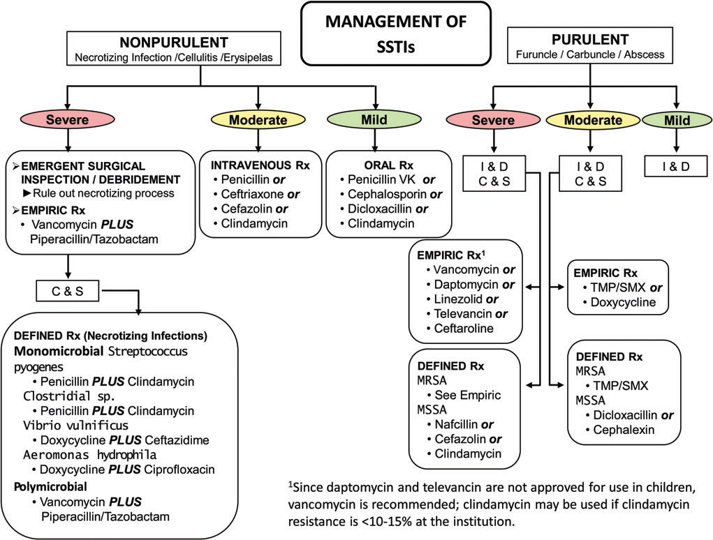
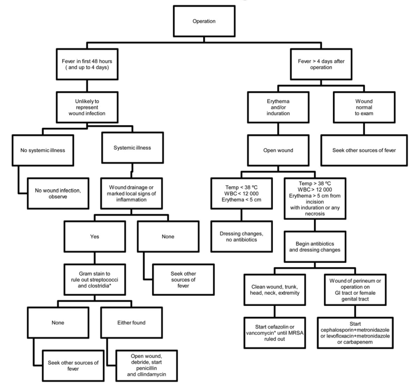

  

    

      
Có Mủ vs Không Mủ

      
Phân đôi tiếp cận điều trị: Áp xe do Tụ cầu vs Viêm mô tế bào do Liên cầu

    

    

      
I&amp;D Là Cốt Lõi

      
Áp xe nhẹ chỉ cần rạch dẫn lưu tốt; vết mổ bắt buộc cắt chỉ dẫn lưu trước

    

    

      
Clindamycin Kháng Độc Tố

      
Phối hợp bắt buộc với Penicillin trong hoại tử do liên cầu (hiệu ứng Eagle)

    

    

      
Prednisone 40mg/7d

      
Cân nhắc steroid bổ trợ giảm viêm mô tế bào ở người không đái tháo đường

    

  

  

    

      
⚖️

      

        
Phân Tầng Tam Cấp SIRS (Nhẹ - Vừa - Nặng)

        
Định hình quyết định điều trị ngoại trú vs nhập viện; phân định rõ vai trò của I&amp;D đơn thuần vs kháng sinh uống vs kháng sinh tĩnh mạch phổ rộng.

      

    

    

      
🚨

      

        
Khẩn Cấp Ngoại Khoa &amp; Kháng Độc Tố

        
Phẫu thuật thám sát cắt lọc cấp cứu là nguyên tắc sống còn trong viêm cân mạc hoại tử; dùng kháng sinh ức chế tổng hợp protein diệt độc tố vi khuẩn.

      

    

    

      
🛡️

      

        
Dự Phòng Toàn Diện &amp; Bảo Vệ Cơ Địa Yếu

        
Xử trí vết cắn dự phòng sớm bằng Amoxicillin-Clavulanate; Penicillin dự phòng cho thể tái phát; tầm soát nấm/vi trùng cơ hội ở bệnh nhân sốt giảm bạch cầu.

      

    

  

  
<i class="fa-solid fa-bolt"></i> Tóm Tắt Một Câu Cốt Lõi (Nature Executive Summary):

  
Hướng dẫn IDSA 2014 tái định hình thực hành lâm sàng toàn cầu bằng việc <strong>phân đôi tiếp cận SSTI thành hai nhánh Có mủ (do Tụ cầu, ưu tiên I&amp;D cơ học) và Không mủ (do Liên cầu, ưu tiên Penicillin/Cephalosporin)</strong> theo 3 mức độ nghiêm trọng của hội chứng SIRS, đồng thời thiết lập nguyên tắc vàng phối hợp Clindamycin kháng độc tố trong nhiễm trùng hoại tử và hạn chế lạm dụng kháng sinh bao phủ MRSA diện rộng.

  

    <i class="fa-solid fa-user-group"></i> Population (Quần thể bệnh nhân)
    
Trẻ em và người lớn mắc các thể SSTI: từ nhiễm trùng nông (chốc lở, chốc loét, áp xe da, viêm mô tế bào) đến nhiễm trùng mô sâu đe dọa tính mạng (viêm cân mạc hoại tử, nhiễm trùng vết mổ, SSTI ở bệnh nhân sốt giảm bạch cầu).

  

  

    <i class="fa-solid fa-syringe"></i> Intervention (Chiến lược can thiệp IDSA)
    
Phân đôi Có mủ vs Không mủ theo 3 tầng SIRS; rạch dẫn lưu (I&amp;D) cơ học đơn thuần cho áp xe nhẹ; Penicillin + Clindamycin cho hoại tử do Liên cầu (hiệu ứng Eagle); kháng sinh nhắm trúng đích theo kháng sinh đồ.

  

  

    <i class="fa-solid fa-vial"></i> Comparison (Thực hành tiền nhiệm)
    
Lạm dụng kháng sinh bao phủ MRSA/Gram âm diện rộng cho mọi thể viêm mô tế bào không mủ; dùng kháng sinh thường quy cho vết mổ sau khi đã dẫn lưu tốt; hoặc lạm dụng oxy cao áp (HBO) chưa chứng minh hiệu quả.

  

  

    <i class="fa-solid fa-trophy"></i> Outcomes (Kết cục lâm sàng)
    
Giảm tỷ lệ tử vong do sốc nhiễm độc hoại tử; rút ngắn số ngày nằm viện; tối ưu hóa chi phí điều trị và ngăn ngừa phát sinh các chủng vi khuẩn kháng thuốc (VRE, VRSA).

  

  

    <a href="#sec-tong-quan-phan-loai-grade" class="quickmenu-item active">1. Tổng Quan &amp; GRADE</a>
    <a href="#sec-luu-do-ssti-chinh" class="quickmenu-item">2. Lưu Đồ SSTI (Figure 1)</a>
    <a href="#sec-choc-lo-khang-sinh-tu-cau" class="quickmenu-item">3. Chốc Lở &amp; Tụ Cầu (Table 2)</a>
    <a href="#sec-nhiem-trung-vet-mo-ssi" class="quickmenu-item">4. Nhiễm Trùng Vết Mổ (Figure 2)</a>
    <a href="#sec-hoai-tu-viem-co-mu" class="quickmenu-item">5. Hoại Tử &amp; Viêm Cơ Mủ (Table 4)</a>
    <a href="#sec-vet-can-phong-tai-phat" class="quickmenu-item">6. Vết Cắn &amp; Phòng Tái Phát</a>
    <a href="#sec-suy-giam-mien-dich-steroid" class="quickmenu-item">7. Suy Giảm Miễn Dịch &amp; Steroid</a>
    <a href="#sec-nhiem-trung-dac-biet-mcq" class="quickmenu-item">8. Bệnh Đặc Biệt &amp; 5 MCQ</a>
  

  <!-- ==================== SECTION 1 ==================== -->
  

    

      📜
      <h2 class="sec-title">1. Tổng Quan, Hệ Thống Phân Loại SSTI &amp; Phương Pháp Luận GRADE (Table 1)</h2>
    

    

      

        💡
        

          <strong>Cột Mốc Lịch Sử Của Hướng Dẫn Lâm Sàng IDSA 2014 (Clinical Infectious Diseases):</strong>
          Được xuất bản bởi Hiệp hội Bệnh truyền nhiễm Hoa Kỳ (IDSA), hướng dẫn thực hành năm 2014 (Stevens et al.) là văn kiện bản lề định hình toàn bộ cách tiếp cận nhiễm trùng da và mô mềm trên phạm vi toàn cầu. Điểm cách mạng lớn nhất là việc <strong>phân đôi hoàn toàn SSTI thành hai nhánh: Nhiễm trùng có mủ (Purulent) và Không mủ (Non-purulent)</strong>, từ đó giải quyết triệt để tình trạng lạm dụng kháng sinh bao phủ MRSA không cần thiết cho viêm mô tế bào đơn thuần.
        

      

      
Phương Pháp Luận GRADE Đánh Giá Bằng Chứng &amp; Khuyến Cáo (Table 1 IDSA)

      

        <table class="regimen-table">
          <thead>
            <tr>
              <th style="width: 25%;">Sức Mạnh Khuyến Cáo &amp; Mức Bằng Chứng</th>
              <th style="width: 25%;">Cân Bằng Lợi Ích / Tác Hại</th>
              <th style="width: 25%;">Chất Lượng Phương Pháp Luận</th>
              <th style="width: 25%;">Ý Nghĩa Áp Dụng Lâm Sàng</th>
            </tr>
          </thead>
          <tbody>
            <tr>
              <td class="source-cell">Mạnh, Cao (Strong, High)</td>
              <td>Lợi ích vượt trội rõ rệt tác hại.</td>
              <td>Thử nghiệm RCTs thực hiện tốt, kết quả nhất quán.</td>
              <td>Áp dụng cho hầu hết bệnh nhân; nghiên cứu mới khó làm thay đổi kết luận.</td>
            </tr>
            <tr>
              <td class="source-cell">Mạnh, TB (Strong, Moderate)</td>
              <td>Lợi ích vượt trội rõ rệt tác hại.</td>
              <td>RCTs có giới hạn phương pháp hoặc nghiên cứu quan sát mạnh.</td>
              <td>Áp dụng cho đa số bệnh nhân; nghiên cứu mới có thể tác động.</td>
            </tr>
            <tr>
              <td class="source-cell">Mạnh, Thấp (Strong, Low)</td>
              <td>Lợi ích vượt trội rõ rệt tác hại.</td>
              <td>Nghiên cứu quan sát, RCTs có sai sót hoặc bằng chứng gián tiếp.</td>
              <td>Có thể thay đổi khi có bằng chứng chất lượng cao hơn.</td>
            </tr>
            <tr>
              <td class="source-cell">Yếu, Cao/TB (Weak, High/Mod)</td>
              <td>Lợi ích và tác hại cân bằng sít sao.</td>
              <td>Bằng chứng nhất quán từ RCTs hoặc nghiên cứu quan sát.</td>
              <td>Hành động tối ưu phụ thuộc vào cá thể hóa hoàn cảnh và giá trị bệnh nhân.</td>
            </tr>
            <tr>
              <td class="source-cell">Yếu, Thấp/Rất thấp</td>
              <td>Còn mơ hồ lớn về lợi ích/tác hại.</td>
              <td>Quan sát lâm sàng không hệ thống hoặc bằng chứng rất gián tiếp.</td>
              <td>Các giải pháp khác có giá trị tương đương; ước tính hiệu quả không chắc chắn.</td>
            </tr>
          </tbody>
        </table>
      

      
Ma Trận Điểm Nghẽn Lâm Sàng Cốt Lõi (Core Pain Points Matrix)

      

        <table class="regimen-table">
          <thead>
            <tr>
              <th style="width: 22%;">Điểm Nghẽn Lâm Sàng</th>
              <th style="width: 26%;">Biểu Hiện Thực Tế</th>
              <th style="width: 26%;">Cơ Chế Bệnh Sinh / Giải Thích</th>
              <th style="width: 26%;">Giải Pháp Khuyến Cáo IDSA 2014</th>
            </tr>
          </thead>
          <tbody>
            <tr>
              <td class="source-cell"><strong>Lạm dụng kháng sinh cho Áp xe nhẹ</strong></td>
              <td>Kê đơn Vancomycin hoặc kháng sinh uống diện rộng cho mọi ổ áp xe nhỏ dưới da.</td>
              <td>Kháng sinh không thể thấu nhập vào lõi ổ áp xe có vỏ bọc xơ và hoại tử vô mạch.</td>
              <td><strong>Rạch và dẫn lưu (I&amp;D) đơn thuần</strong> là đủ để chữa khỏi hoàn toàn; không cần kháng sinh.</td>
            </tr>
            <tr>
              <td class="source-cell"><strong>Bao phủ MRSA thừa thãi trong Viêm mô tế bào</strong></td>
              <td>Kê đơn Vancomycin / TMP-SMX cho viêm mô tế bào điển hình không mủ.</td>
              <td>Hơn 90% viêm mô tế bào không mủ do <em>Streptococcus</em> gây ra, rất hiếm khi do Tụ cầu vàng.</td>
              <td>Ưu tiên Penicillin VK, Cephalexin hoặc Cefazolin; chỉ nhắm MRSA khi có mủ, chấn thương xuyên thấu hoặc nghiện ma túy tiêm truyền.</td>
            </tr>
            <tr>
              <td class="source-cell"><strong>Thất bại của Penicillin trong Hoại tử (Hiệu ứng Eagle)</strong></td>
              <td>Bệnh nhân viêm cân mạc hoại tử do Liên cầu A tử vong dù đã truyền Penicillin liều tối đa.</td>
              <td>Mật độ vi khuẩn cực cao tại mô hoại tử rơi vào pha tĩnh (stationary phase), làm giảm biểu hiện PBPs khiến Penicillin mất tác dụng diệt khuẩn.</td>
              <td>Bắt buộc phối hợp <strong>Clindamycin</strong> (ức chế dịch mã tại ribosom 50S, dập tắt bão ngoại độc tố sinh sốc độc tố).</td>
            </tr>
            <tr>
              <td class="source-cell"><strong>Trì hoãn mổ cắt lọc để chờ chẩn đoán hình ảnh</strong></td>
              <td>Chờ kết quả chụp MRI / CT trước khi quyết định mở thám sát vết mổ hoại tử.</td>
              <td>Viêm cân mạc hoại tử lan nhanh dọc theo các lá cân với tốc độ vài cm mỗi giờ, dẫn đến sốc nhiễm trùng không hồi phục.</td>
              <td><strong>Phẫu thuật thám sát khẩn cấp</strong> ngay khi có dấu hiệu nghi ngờ; tuyệt đối không trì hoãn vì chẩn đoán hình ảnh.</td>
            </tr>
          </tbody>
        </table>
      

    

  

  <!-- ==================== SECTION 2 ==================== -->
  

    

      🔬
      <h2 class="sec-title">2. Lưu Đồ Quản Lý SSTI Có Mủ &amp; Không Mủ: Figure 1 &amp; Sơ Đồ Vector Editorial</h2>
    

    

      <!-- FIGURE 1 ORIGINAL CARD -->
      

        
        

          
Figure 1. Lưu Đồ Phân Loại &amp; Quản Lý SSTI Có Mủ &amp; Không Mủ (IDSA 2014)

          Lưu đồ bản lề chia tách hai nhánh bệnh lý song song (Không mủ do Liên cầu bên trái vs Có mủ do Tụ cầu bên phải) với 3 mức độ nghiêm trọng độc lập: Nhẹ (Mild), Trung bình (Moderate) và Nặng (Severe).
        

      

      <!-- EDITORIAL SVG STUDIO 2.0 FIGURE 1 -->
      

        

          

            <i class="fa-solid fa-diagram-project" style="color: var(--color-primary, #0284c7);"></i>
            LƯU ĐỒ PHÂN TẦNG QUẢN LÝ SSTI CÓ MỦ &amp; KHÔNG MỦ (IDSA 2014 FIGURE 1)
          

          Editorial SVG Studio 2.0
        

        

          <svg class="med-svg" viewBox="0 0 1140 820" width="100%" height="100%" preserveAspectRatio="xMidYMid meet" xmlns="http://www.w3.org/2000/svg">
            <defs>
              <marker id="arr-blue" viewBox="0 0 10 10" refX="8" refY="5" markerWidth="6" markerHeight="6" orient="auto-start-reverse">
                <path d="M 0 1.5 L 8 5 L 0 8.5 z" fill="#0284c7"/>
              </marker>
              <marker id="arr-green" viewBox="0 0 10 10" refX="8" refY="5" markerWidth="6" markerHeight="6" orient="auto-start-reverse">
                <path d="M 0 1.5 L 8 5 L 0 8.5 z" fill="#10b981"/>
              </marker>
              <marker id="arr-amber" viewBox="0 0 10 10" refX="8" refY="5" markerWidth="6" markerHeight="6" orient="auto-start-reverse">
                <path d="M 0 1.5 L 8 5 L 0 8.5 z" fill="#d97706"/>
              </marker>
              <marker id="arr-red" viewBox="0 0 10 10" refX="8" refY="5" markerWidth="6" markerHeight="6" orient="auto-start-reverse">
                <path d="M 0 1.5 L 8 5 L 0 8.5 z" fill="#dc2626"/>
              </marker>
            </defs>

            <!-- 1. Root Header Box -->
            <g transform="translate(395, 18)">
              <rect width="350" height="54" rx="10" fill="var(--color-surface, #ffffff)" stroke="#0284c7" stroke-width="2"/>
              <rect x="0" y="0" width="350" height="54" rx="10" fill="#0284c7" fill-opacity="0.08"/>
              <text x="175" y="22" text-anchor="middle" font-size="10.5" font-weight="800" fill="#0284c7" letter-spacing="1.2">IDSA 2014 CLINICAL PRACTICE GUIDELINE</text>
              <text x="175" y="41" text-anchor="middle" font-size="13.5" font-weight="700" fill="var(--color-text, #0f172a)">Nhiễm Trùng Da &amp; Mô Mềm (SSTIs)</text>
            </g>

            <!-- Connectors from Root to 2 Category Columns -->
            <path d="M 570 72 L 570 102" fill="none" stroke="#0284c7" stroke-width="2"/>
            <path d="M 295 102 L 845 102" fill="none" stroke="#0284c7" stroke-width="2"/>
            <path d="M 295 102 L 295 125" fill="none" stroke="#0284c7" stroke-width="2" marker-end="url(#arr-blue)"/>
            <path d="M 845 102 L 845 125" fill="none" stroke="#0284c7" stroke-width="2" marker-end="url(#arr-blue)"/>

            <!-- 2. LEFT COLUMN: NONPURULENT SSTIs (Viêm mô tế bào / Viêm quầng) -->
            <g transform="translate(45, 125)">
              <rect width="500" height="56" rx="10" fill="var(--color-surface, #ffffff)" stroke="#0284c7" stroke-width="2"/>
              <rect x="0" y="0" width="500" height="56" rx="10" fill="#0284c7" fill-opacity="0.08"/>
              <text x="250" y="24" text-anchor="middle" font-size="12" font-weight="800" fill="#0284c7" letter-spacing="0.5">NHIỄM TRÙNG KHÔNG MỦ (NONPURULENT)</text>
              <text x="250" y="43" text-anchor="middle" font-size="11" font-weight="600" fill="var(--color-text-muted, #64748b)">Viêm mô tế bào, Viêm quầng, Hoại tử — Chủ yếu do Liên cầu (Streptococcus)</text>
            </g>

            <!-- 3. RIGHT COLUMN: PURULENT SSTIs (Nhọt, Hậu bối, Áp xe da) -->
            <g transform="translate(595, 125)">
              <rect width="500" height="56" rx="10" fill="var(--color-surface, #ffffff)" stroke="#d97706" stroke-width="2"/>
              <rect x="0" y="0" width="500" height="56" rx="10" fill="#d97706" fill-opacity="0.08"/>
              <text x="250" y="24" text-anchor="middle" font-size="12" font-weight="800" fill="#d97706" letter-spacing="0.5">NHIỄM TRÙNG CÓ MỦ (PURULENT)</text>
              <text x="250" y="43" text-anchor="middle" font-size="11" font-weight="600" fill="var(--color-text-muted, #64748b)">Nhọt, Hậu bối, Áp xe da — Chủ yếu do Tụ cầu (Staphylococcus aureus / MRSA)</text>
            </g>

            <!-- LEFT BUS LINE: Independent severity branches -->
            <path d="M 295 181 L 295 620" fill="none" stroke="#0284c7" stroke-width="1.8" stroke-dasharray="4 2"/>
            <path d="M 295 210 L 295 220" fill="none" stroke="#10b981" stroke-width="2" marker-end="url(#arr-green)"/>
            <path d="M 295 330 L 295 340" fill="none" stroke="#d97706" stroke-width="2" marker-end="url(#arr-amber)"/>
            <path d="M 295 470 L 295 480" fill="none" stroke="#dc2626" stroke-width="2" marker-end="url(#arr-red)"/>

            <!-- LEFT TIER 1: MILD NONPURULENT -->
            <g transform="translate(45, 220)">
              <rect width="500" height="100" rx="9" fill="var(--color-surface, #ffffff)" stroke="#10b981" stroke-width="1.6"/>
              <rect x="0" y="0" width="500" height="28" rx="9" fill="#10b981" fill-opacity="0.12"/>
              <text x="14" y="19" font-size="11.5" font-weight="800" fill="#059669">🟢 NHẸ (MILD): Viêm mô tế bào / Viêm quầng điển hình, KHÔNG có SIRS</text>
              <text x="14" y="47" font-size="10.8" font-weight="700" fill="var(--color-text, #0f172a)">Kháng sinh đường uống ngoại trú (Phổ hẹp bao phủ Liên cầu):</text>
              <text x="14" y="66" font-size="10.2" fill="var(--color-text-muted, #475569)">• Penicillin VK 250-500 mg PO q6h hoặc Cephalexin 500 mg PO q6h</text>
              <text x="14" y="84" font-size="10.2" fill="var(--color-text-muted, #475569)">• Dicloxacillin 500 mg q6h (Dị ứng Penicillin: Clindamycin 300-450 mg PO q6h). Liệu trình: 5 ngày</text>
            </g>

            <!-- LEFT TIER 2: MODERATE NONPURULENT -->
            <g transform="translate(45, 340)">
              <rect width="500" height="120" rx="9" fill="var(--color-surface, #ffffff)" stroke="#d97706" stroke-width="1.6"/>
              <rect x="0" y="0" width="500" height="28" rx="9" fill="#d97706" fill-opacity="0.12"/>
              <text x="14" y="19" font-size="11.5" font-weight="800" fill="#b45309">🟡 TRUNG BÌNH (MODERATE): Viêm mô tế bào kèm dấu hiệu toàn thân (SIRS)</text>
              <text x="14" y="47" font-size="10.8" font-weight="700" fill="var(--color-text, #0f172a)">Nhập viện điều trị kháng sinh đường tĩnh mạch (IV):</text>
              <text x="14" y="66" font-size="10.2" fill="var(--color-text-muted, #475569)">• Penicillin G (2-4 triệu UI IV mỗi 4-6h) hoặc Cefazolin (1g IV mỗi 8h)</text>
              <text x="14" y="84" font-size="10.2" fill="var(--color-text-muted, #475569)">• Ceftriaxone (1g IV mỗi 24h) hoặc Clindamycin (600 mg IV mỗi 8h)</text>
              <text x="14" y="103" font-size="9.8" fill="var(--color-primary, #0284c7)" font-weight="600">👉 Chuyển sang kháng sinh uống khi hết sốt và triệu chứng tại chỗ thoái lui</text>
            </g>

            <!-- LEFT TIER 3: SEVERE NONPURULENT -->
            <g transform="translate(45, 480)">
              <rect width="500" height="280" rx="9" fill="var(--color-surface, #ffffff)" stroke="#dc2626" stroke-width="2"/>
              <rect x="0" y="0" width="500" height="30" rx="9" fill="#dc2626" fill-opacity="0.14"/>
              <text x="14" y="20" font-size="11.5" font-weight="800" fill="#dc2626">🔴 NẶNG (SEVERE): Thất bại KS uống / Bọng nước / Hoại tử mô / Sốc 🚨</text>
              <text x="14" y="50" font-size="11" font-weight="800" fill="#dc2626">1. HỘI CHẨN NGOẠI KHOA THÁM SÁT &amp; CẮT LỌC HOẠI TỬ CẤP CỨU</text>
              <text x="14" y="68" font-size="10.2" fill="var(--color-text-muted, #475569)">Tuyệt đối không trì hoãn phẫu thuật để chờ chẩn đoán hình ảnh (MRI/CT).</text>
              <text x="14" y="90" font-size="10.8" font-weight="700" fill="var(--color-text, #0f172a)">2. Kháng sinh kinh nghiệm phổ rộng (Empiric IV Rx):</text>
              <text x="14" y="108" font-size="10.2" fill="var(--color-text-muted, #475569)">• Vancomycin (15-20 mg/kg q8-12h) + Piperacillin-tazobactam (3.375g q6h)</text>
              <text x="14" y="126" font-size="10.2" fill="var(--color-text-muted, #475569)">• Hoặc Linezolid / Daptomycin + Meropenem 1g IV mỗi 8h</text>
              <text x="14" y="148" font-size="10.8" font-weight="700" fill="#0284c7">3. Kháng sinh đích khi có vi sinh xác định (Defined Targeted Rx):</text>
              <text x="14" y="167" font-size="10" fill="var(--color-text, #0f172a)">• <tspan font-weight="700">S. pyogenes (Liên cầu A):</tspan> Penicillin G + Clindamycin (ức chế bão ngoại độc tố)</text>
              <text x="14" y="186" font-size="10" fill="var(--color-text, #0f172a)">• <tspan font-weight="700">Clostridial spp. (Hoại thư sinh hơi):</tspan> Penicillin G + Clindamycin</text>
              <text x="14" y="205" font-size="10" fill="var(--color-text, #0f172a)">• <tspan font-weight="700">Vibrio vulnificus (Nhiễm trùng nước mặn):</tspan> Doxycycline + Ceftazidime</text>
              <text x="14" y="224" font-size="10" fill="var(--color-text, #0f172a)">• <tspan font-weight="700">Aeromonas hydrophila (Nhiễm trùng nước ngọt):</tspan> Ciprofloxacin + Doxycycline</text>
              <text x="14" y="243" font-size="10" fill="var(--color-text, #0f172a)">• <tspan font-weight="700">Viêm cân mạc đa khuẩn (Type I):</tspan> Vancomycin + Piperacillin-tazobactam</text>
              <text x="14" y="265" font-size="9.5" fill="#dc2626" font-weight="700">⚠️ Hiệu ứng Eagle: Bắt buộc dùng Clindamycin cùng Penicillin trong Liên cầu A hoại tử</text>
            </g>

            <!-- RIGHT BUS LINE: Independent severity branches -->
            <path d="M 845 181 L 845 620" fill="none" stroke="#d97706" stroke-width="1.8" stroke-dasharray="4 2"/>
            <path d="M 845 210 L 845 220" fill="none" stroke="#10b981" stroke-width="2" marker-end="url(#arr-green)"/>
            <path d="M 845 330 L 845 340" fill="none" stroke="#d97706" stroke-width="2" marker-end="url(#arr-amber)"/>
            <path d="M 845 470 L 845 480" fill="none" stroke="#dc2626" stroke-width="2" marker-end="url(#arr-red)"/>

            <!-- RIGHT TIER 1: MILD PURULENT -->
            <g transform="translate(595, 220)">
              <rect width="500" height="100" rx="9" fill="var(--color-surface, #ffffff)" stroke="#10b981" stroke-width="1.6"/>
              <rect x="0" y="0" width="500" height="28" rx="9" fill="#10b981" fill-opacity="0.12"/>
              <text x="14" y="19" font-size="11.5" font-weight="800" fill="#059669">🟢 NHẸ (MILD): Nhọt, Hậu bối, Áp xe da đơn thuần, KHÔNG có SIRS</text>
              <text x="14" y="47" font-size="11.5" font-weight="800" fill="#059669">👉 RẠCH VÀ DẪN LƯU (I&amp;D) ĐƠN THUẦN LÀ NỀN TẢNG ĐIỀU TRỊ</text>
              <text x="14" y="66" font-size="10.5" font-weight="700" fill="#dc2626">⛔ KHÔNG CẦN DÙNG KHÁNG SINH TOÀN THÂN THƯỜNG QUY (Class I, LOE A)</text>
              <text x="14" y="84" font-size="10" fill="var(--color-text-muted, #475569)">Chườm ấm, dẫn lưu triệt để ổ mủ, thay băng hàng ngày; tái khám đánh giá sau 48h</text>
            </g>

            <!-- RIGHT TIER 2: MODERATE PURULENT -->
            <g transform="translate(595, 340)">
              <rect width="500" height="120" rx="9" fill="var(--color-surface, #ffffff)" stroke="#d97706" stroke-width="1.6"/>
              <rect x="0" y="0" width="500" height="28" rx="9" fill="#d97706" fill-opacity="0.12"/>
              <text x="14" y="19" font-size="11.5" font-weight="800" fill="#b45309">🟡 TRUNG BÌNH (MODERATE): Áp xe kèm dấu hiệu đáp ứng viêm toàn thân (SIRS)</text>
              <text x="14" y="47" font-size="10.8" font-weight="700" fill="var(--color-text, #0f172a)">I&amp;D + Lấy mủ cấy vi sinh &amp; Kháng sinh đồ (C&amp;S) + Kháng sinh uống:</text>
              <text x="14" y="66" font-size="10.2" fill="var(--color-text-muted, #475569)">• <tspan font-weight="700">Kháng sinh kinh nghiệm uống (phủ CA-MRSA):</tspan> TMP-SMX (1-2 viên DS bid) hoặc Doxycycline (100 mg bid)</text>
              <text x="14" y="85" font-size="10.2" fill="var(--color-text-muted, #475569)">• <tspan font-weight="700">Kháng sinh đích khi có C&amp;S:</tspan></text>
              <text x="24" y="103" font-size="10" fill="var(--color-text, #0f172a)">- Đích MRSA: Tiếp tục TMP-SMX. Đích MSSA: Đổi sang Cephalexin 500mg q6h hoặc Dicloxacillin</text>
            </g>

            <!-- RIGHT TIER 3: SEVERE PURULENT -->
            <g transform="translate(595, 480)">
              <rect width="500" height="280" rx="9" fill="var(--color-surface, #ffffff)" stroke="#dc2626" stroke-width="2"/>
              <rect x="0" y="0" width="500" height="30" rx="9" fill="#dc2626" fill-opacity="0.14"/>
              <text x="14" y="20" font-size="11.5" font-weight="800" fill="#dc2626">🔴 NẶNG (SEVERE): Thất bại I&amp;D + KS uống / SIRS nặng / Sốc / Suy giảm MD</text>
              <text x="14" y="50" font-size="11" font-weight="800" fill="#dc2626">1. I&amp;D DẪN LƯU + CẤY MỦ &amp; CẤY MÁU + NHẬP VIỆN KHÁNG SINH TĨNH MẠCH (IV)</text>
              <text x="14" y="68" font-size="10.2" fill="var(--color-text-muted, #475569)">Đánh giá hoại tử mô sâu hoặc biến chứng huyết khối tĩnh mạch nhiễm trùng.</text>
              <text x="14" y="90" font-size="10.8" font-weight="700" fill="var(--color-text, #0f172a)">2. Kháng sinh kinh nghiệm đường tĩnh mạch (Empiric IV Rx):</text>
              <text x="14" y="108" font-size="10.2" fill="var(--color-text-muted, #475569)">• Vancomycin (15-20 mg/kg IV mỗi 8-12h, mục tiêu AUC/MIC 400-600)</text>
              <text x="14" y="126" font-size="10.2" fill="var(--color-text-muted, #475569)">• Daptomycin (4-6 mg/kg IV mỗi 24h) hoặc Linezolid (600 mg IV/PO mỗi 12h)</text>
              <text x="14" y="144" font-size="10.2" fill="var(--color-text-muted, #475569)">• Telavancin (10 mg/kg IV mỗi 24h) hoặc Ceftaroline (600 mg IV mỗi 12h)</text>
              <text x="14" y="167" font-size="10.8" font-weight="700" fill="#0284c7">3. Kháng sinh đích khi có kháng sinh đồ (Defined Targeted Rx):</text>
              <text x="14" y="186" font-size="10" fill="var(--color-text, #0f172a)">• <tspan font-weight="700">Xác định MRSA:</tspan> Tiếp tục Vancomycin, Daptomycin hoặc Linezolid</text>
              <text x="14" y="205" font-size="10" fill="var(--color-text, #0f172a)">• <tspan font-weight="700">Xác định MSSA:</tspan> Hạ bậc xuống Nafcillin / Oxacillin 2g IV mỗi 4h hoặc Cefazolin 1-2g IV mỗi 8h</text>
              <text x="14" y="224" font-size="10" fill="var(--color-text-muted, #475569)">• Thay thế cho MSSA nếu dị ứng nhẹ Penicillin: Cefazolin; dị ứng nặng: Vancomycin</text>
              <text x="14" y="250" font-size="9.8" fill="#059669" font-weight="700">💡 Khuyến cáo: Hạ bậc từ Vancomycin sang Nafcillin/Cefazolin khi có MSSA giúp giảm tỷ lệ thất bại</text>
            </g>
          </svg>
        

        

          
 Nhóm Nhẹ: I&amp;D đơn thuần cho áp xe có mủ (không cần KS); Kháng sinh uống phổ hẹp cho viêm mô tế bào không mủ

          
 Nhóm Trung bình kèm SIRS: Cấy vi sinh + TMP-SMX/Doxycycline uống (có mủ) hoặc Cefazolin/Penicillin G IV (không mủ)

          
 Nhóm Nặng/Hoại tử: Thám sát phẫu thuật khẩn cấp + Vancomycin/Pip-Tazo; Eagle effect dùng Penicillin + Clindamycin

        

      

      <!-- EBM RECOMMENDATION CARDS FOR FIGURE 1 (SPEC RULE) -->
      

        

          <i class="fa-solid fa-circle-check"></i> CLASS I (MẠNH)
          <i class="fa-solid fa-layer-group"></i> MỨC A (Đa RCTs)
        

        

          <strong>Rạch và dẫn lưu (I&amp;D) là can thiệp nền tảng duy nhất bắt buộc</strong> cho các ổ áp xe da, nhọt hoặc hậu bối mức độ nhẹ. <strong>KHÔNG khuyến cáo sử dụng kháng sinh toàn thân thường quy</strong> ở bệnh nhân áp xe đơn thuần không kèm theo dấu hiệu đáp ứng viêm toàn thân (SIRS).
        

      

      

        

          <i class="fa-solid fa-circle-check"></i> CLASS I (MẠNH)
          <i class="fa-solid fa-layer-group"></i> MỨC A
        

        

          Ở bệnh nhân viêm mô tế bào / viêm quầng không mủ mức độ nhẹ, <strong>khuyến cáo sử dụng kháng sinh đường uống phổ hẹp có hoạt tính chống Liên cầu (Streptococcus pyogenes)</strong> như Penicillin VK, Cephalexin hoặc Dicloxacillin trong 5 ngày. Không cần phối hợp kháng sinh bao phủ CA-MRSA ngoại trừ trường hợp có vết thương xuyên thấu, tiền sử nhiễm MRSA hoặc thất bại điều trị ban đầu.
        

      

      

        

          <i class="fa-solid fa-circle-check"></i> CLASS I (MẠNH)
          <i class="fa-solid fa-layer-group"></i> MỨC B-NR
        

        

          Khi nghi ngờ nhiễm trùng da hoại tử (bọng nước, hoại tử da, đau dữ dội vượt quá biểu hiện bên ngoài, tụt huyết áp hoặc suy tạng), <strong>bắt buộc hội chẩn ngoại khoa để thám sát phẫu thuật và cắt lọc mô hoại tử khẩn cấp</strong>. Tuyệt đối không trì hoãn can thiệp phẫu thuật để chờ kết quả chẩn đoán hình ảnh (MRI/CT).
        

      

      

        ⚠️
        

          <strong>TIÊU CHUẨN ĐÁNH GIÁ ĐÁP ỨNG VIÊM TOÀN THÂN (SIRS):</strong>
           Xác định có SIRS khi có từ 2 trong 4 tiêu chuẩn lâm sàng sau:
           • <strong>Thân nhiệt:</strong> &gt; 38°C hoặc &lt; 36°C
           • <strong>Nhịp tim:</strong> &gt; 90 lần/phút
           • <strong>Nhịp thở:</strong> &gt; 24 lần/phút (hoặc PaCO₂ &lt; 32 mmHg)
           • <strong>Bạch cầu máu (WBC):</strong> &gt; 12.000 /µL hoặc &lt; 4.000 /µL (hoặc tế bào non bands ≥ 10%)
        

      

    

  

  <!-- ==================== SECTION 3 ==================== -->
  

    

      💊
      <h2 class="sec-title">3. Chốc Lở, Chốc Loét &amp; Bảng Liều Kháng Sinh Tụ Cầu / Liên Cầu (Table 2)</h2>
    

    

      
Đánh Giá &amp; Điều Trị Chốc Lở (Impetigo) &amp; Chốc Loét (Ecthyma)

      

        

          

          
Chốc Lở Nhẹ / Thương Tổn Khu Trú 🧴

          

            
• <strong>Điều trị tại chỗ:</strong> Sử dụng thuốc mỡ bôi ngoài da.

            
• <strong>Mupirocin 2%</strong> hoặc <strong>Retapamulin 1%</strong> bôi 2 lần/ngày (BID) trong vòng <strong>5 ngày</strong> (Khuyến cáo mạnh, bằng chứng cao).

            
• Tránh lạm dụng kháng sinh uống nếu tổn thương nhỏ và ít.

          

        

        

          

          
Chốc Lở Lan Rộng / Chốc Loét (Ecthyma) 💊

          

            
• <strong>Điều trị toàn thân:</strong> Chỉ định kháng sinh đường uống trong <strong>7 ngày</strong> (Khuyến cáo mạnh, bằng chứng cao).

            
• Nhạy methicillin (MSSA): <strong>Dicloxacillin</strong> (250mg QID) hoặc <strong>Cephalexin</strong> (250mg QID).

            
• Nghi ngờ/xác định MRSA: <strong>TMP-SMX</strong>, <strong>Doxycycline</strong>, hoặc <strong>Clindamycin</strong>.

          

        

      

      
Liệu Pháp Kháng Sinh Điều Trị Nhiễm Trùng Da Do Tụ Cầu &amp; Liên Cầu (Table 2 IDSA)

      

        <table class="regimen-table">
          <thead>
            <tr>
              <th style="width: 25%;">Nhóm Bệnh &amp; Tác Nhân</th>
              <th style="width: 35%;">Kháng Sinh Đường Uống (PO)</th>
              <th style="width: 40%;">Kháng Sinh Truyền Tĩnh Mạch (IV)</th>
            </tr>
          </thead>
          <tbody>
            <tr>
              <td class="source-cell"><strong>Chốc lở / Chốc loét</strong></td>
              <td>
                • Dicloxacillin 250 mg QID 
                • Cephalexin 250 mg QID 
                • Clindamycin 300 - 450 mg TID/QID 
                • Amoxicillin-Clavulanate 875/125 mg BID
              </td>
              <td>(Thường điều trị ngoại trú đường uống hoặc tại chỗ).</td>
            </tr>
            <tr>
              <td class="source-cell">Tụ cầu nhạy methicillin (MSSA)</td>
              <td>
                • <strong>Dicloxacillin</strong> 500 mg QID (ưu tiên) 
                • <strong>Cephalexin</strong> 500 mg QID (thuận tiện dung nạp) 
                • Clindamycin 300 - 450 mg TID
              </td>
              <td>
                • <strong>Nafcillin hoặc Oxacillin</strong> 1 - 2 g IV mỗi 4 giờ (lựa chọn hàng đầu) 
                • <strong>Cefazolin</strong> 1 g IV mỗi 8 giờ (dị ứng penicillin nhẹ) 
                • Clindamycin 600 mg IV mỗi 8 giờ
              </td>
            </tr>
            <tr>
              <td class="source-cell">Tụ cầu kháng methicillin (MRSA)</td>
              <td>
                • <strong>TMP-SMX DS</strong> (800/160 mg) 1-2 viên BID 
                • <strong>Doxycycline / Minocycline</strong> 100 mg BID 
                • <strong>Linezolid</strong> 600 mg BID (sinh khả dụng 100%) 
                • Clindamycin 300 - 450 mg TID
              </td>
              <td>
                • <strong>Vancomycin</strong> 15 - 20 mg/kg IV mỗi 8-12h (hàng đầu; mục tiêu đáy 15-20 µg/mL) 
                • <strong>Daptomycin</strong> 4 mg/kg IV mỗi 24 giờ 
                • <strong>Linezolid</strong> 600 mg IV mỗi 12 giờ 
                • <strong>Ceftaroline</strong> 600 mg IV mỗi 12 giờ
              </td>
            </tr>
          </tbody>
        </table>
      

    

  

  <!-- ==================== SECTION 4 ==================== -->
  

    

      ✂️
      <h2 class="sec-title">4. Nhiễm Trùng Vết Mổ (SSIs): Lưu Đồ Figure 2 &amp; Bảng Phác Đồ (Table 3)</h2>
    

    

      

        ⚠️
        

          <strong>Nguyên Tắc Cốt Lõi Về Xử Trí Nhiễm Trùng Vết Mổ (SSIs):</strong>
           • <strong>Can thiệp ngoại khoa là bắt buộc:</strong> Cắt chỉ khâu, mở vết mổ và dẫn lưu dịch mủ là can thiệp nền tảng quan trọng nhất.
           • <strong>Không dùng kháng sinh thường quy:</strong> Nếu đã dẫn lưu tốt và vết mổ không lan rộng, không cần dùng kháng sinh.
           • <strong>Chỉ định dùng kháng sinh toàn thân:</strong> Khi có ít nhất 1 trong các tiêu chuẩn sau: (1) Hồng ban/chai cứng lan rộng <strong>&gt; 5 cm</strong> từ mép vết mổ; (2) Nhiệt độ <strong>&gt; 38.5°C</strong>; (3) Nhịp tim <strong>&gt; 110 lần/phút</strong>; (4) Bạch cầu <strong>&gt; 12.000 /µL</strong>.
        

      

      <!-- FIGURE 2 CARD -->
      

        
        

          
Figure 2. Lưu Đồ Quản Lý &amp; Điều Trị Nhiễm Trùng Vết Mổ (IDSA 2014)

          Thuật toán phân biệt sốt sớm (&le; 48 giờ sau mổ nghi ngờ Liên cầu/Clostridium) vs sốt muộn (&gt; 4 ngày sau mổ) và phân tầng can thiệp theo mức độ hồng ban quanh mép mổ.
        

      

      <!-- EDITORIAL SVG STUDIO 2.0 FIGURE 2 -->
      

        

          

            <i class="fa-solid fa-diagram-project" style="color: var(--color-primary, #0284c7);"></i>
            LƯU ĐỒ XỬ TRÍ SỐT SAU MỔ &amp; NHIỄM TRÙNG VẾT MỔ SSIs (IDSA 2014 FIGURE 2)
          

          Editorial SVG Studio 2.0
        

        

          <svg class="med-svg" viewBox="0 0 1140 780" width="100%" height="100%" preserveAspectRatio="xMidYMid meet" xmlns="http://www.w3.org/2000/svg">
            <defs>
              <marker id="arr-ssi-blue" viewBox="0 0 10 10" refX="8" refY="5" markerWidth="6" markerHeight="6" orient="auto-start-reverse">
                <path d="M 0 1.5 L 8 5 L 0 8.5 z" fill="#0284c7"/>
              </marker>
              <marker id="arr-ssi-green" viewBox="0 0 10 10" refX="8" refY="5" markerWidth="6" markerHeight="6" orient="auto-start-reverse">
                <path d="M 0 1.5 L 8 5 L 0 8.5 z" fill="#10b981"/>
              </marker>
              <marker id="arr-ssi-amber" viewBox="0 0 10 10" refX="8" refY="5" markerWidth="6" markerHeight="6" orient="auto-start-reverse">
                <path d="M 0 1.5 L 8 5 L 0 8.5 z" fill="#d97706"/>
              </marker>
              <marker id="arr-ssi-red" viewBox="0 0 10 10" refX="8" refY="5" markerWidth="6" markerHeight="6" orient="auto-start-reverse">
                <path d="M 0 1.5 L 8 5 L 0 8.5 z" fill="#dc2626"/>
              </marker>
            </defs>

            <!-- 1. Root Header Box -->
            <g transform="translate(370, 18)">
              <rect width="400" height="52" rx="10" fill="var(--color-surface, #ffffff)" stroke="#0284c7" stroke-width="2"/>
              <rect x="0" y="0" width="400" height="52" rx="10" fill="#0284c7" fill-opacity="0.08"/>
              <text x="200" y="22" text-anchor="middle" font-size="10.5" font-weight="800" fill="#0284c7" letter-spacing="1">IDSA 2014 CLINICAL PRACTICE GUIDELINE</text>
              <text x="200" y="40" text-anchor="middle" font-size="13" font-weight="700" fill="var(--color-text, #0f172a)">Sốt Sau Phẫu Thuật &amp; Nghi Nhiễm Trùng Vết Mổ (SSIs)</text>
            </g>

            <!-- Connector to Step 1 Decision -->
            <path d="M 570 70 L 570 95" fill="none" stroke="#0284c7" stroke-width="2" marker-end="url(#arr-ssi-blue)"/>

            <!-- 2. Step 1 Decision: Time of Onset -->
            <g transform="translate(380, 95)">
              <rect width="380" height="48" rx="8" fill="var(--color-surface, #ffffff)" stroke="#d97706" stroke-width="1.8"/>
              <rect x="0" y="0" width="380" height="48" rx="8" fill="#d97706" fill-opacity="0.07"/>
              <text x="190" y="20" text-anchor="middle" font-size="10.5" font-weight="800" fill="#d97706">THỜI ĐIỂM KHỞI PHÁT SỐT SAU PHẪU THUẬT</text>
              <text x="190" y="37" text-anchor="middle" font-size="12" font-weight="700" fill="var(--color-text, #0f172a)">Sốt Sớm (&le; 48 giờ) Hay Sốt Muộn (&gt; 4 ngày)?</text>
            </g>

            <!-- Split Paths to Early vs Late -->
            <path d="M 380 119 L 295 119 L 295 170" fill="none" stroke="#d97706" stroke-width="2" marker-end="url(#arr-ssi-amber)"/>
            <path d="M 760 119 L 845 119 L 845 170" fill="none" stroke="#0284c7" stroke-width="2" marker-end="url(#arr-ssi-blue)"/>

            <!-- 3. LEFT COLUMN: EARLY FEVER (<= 48H) -->
            <g transform="translate(45, 170)">
              <rect width="500" height="52" rx="9" fill="var(--color-surface, #ffffff)" stroke="#d97706" stroke-width="1.8"/>
              <rect x="0" y="0" width="500" height="52" rx="9" fill="#d97706" fill-opacity="0.08"/>
              <text x="250" y="22" text-anchor="middle" font-size="12" font-weight="800" fill="#d97706">SỐT SỚM TRONG VÒNG 48 GIỜ ĐẦU (&le; 48H)</text>
              <text x="250" y="40" text-anchor="middle" font-size="10.5" font-weight="600" fill="var(--color-text-muted, #64748b)">Hiếm khi do SSI thường gặp; chủ yếu do xẹp phổi hoặc phản ứng viêm phẫu thuật</text>
            </g>

            <!-- Connectors under Early Fever -->
            <path d="M 170 222 L 170 248" fill="none" stroke="#10b981" stroke-width="1.8" marker-end="url(#arr-ssi-green)"/>
            <path d="M 420 222 L 420 248" fill="none" stroke="#dc2626" stroke-width="2" marker-end="url(#arr-ssi-red)"/>

            <!-- Early Fever - Normal Incision -->
            <g transform="translate(45, 248)">
              <rect width="240" height="160" rx="9" fill="var(--color-surface, #ffffff)" stroke="#10b981" stroke-width="1.6"/>
              <rect x="0" y="0" width="240" height="26" rx="9" fill="#10b981" fill-opacity="0.12"/>
              <text x="120" y="18" text-anchor="middle" font-size="11" font-weight="800" fill="#059669">🟢 VẾT MỔ BÌNH THƯỜNG</text>
              <text x="12" y="46" font-size="10.5" font-weight="800" fill="#059669">👉 KHÔNG DÙNG KHÁNG SINH</text>
              <text x="12" y="66" font-size="10" fill="var(--color-text, #0f172a)">• Đánh giá nguyên nhân sốt hô hấp</text>
              <text x="12" y="84" font-size="10" fill="var(--color-text, #0f172a)">• Vật lý trị liệu hô hấp, thở sâu</text>
              <text x="12" y="102" font-size="10" fill="var(--color-text, #0f172a)">• Tập phế dung kế (Spirometry)</text>
              <text x="12" y="122" font-size="9.5" fill="var(--color-text-muted, #64748b)">• Vận động sớm sau mổ</text>
              <text x="12" y="142" font-size="9.5" fill="var(--color-text-muted, #64748b)">• Tiếp tục theo dõi vết mổ mỗi ngày</text>
            </g>

            <!-- Early Fever - Abnormal Incision -->
            <g transform="translate(305, 248)">
              <rect width="240" height="160" rx="9" fill="var(--color-surface, #ffffff)" stroke="#dc2626" stroke-width="2"/>
              <rect x="0" y="0" width="240" height="26" rx="9" fill="#dc2626" fill-opacity="0.14"/>
              <text x="120" y="18" text-anchor="middle" font-size="11" font-weight="800" fill="#dc2626">🔴 VẾT MỔ BẤT THƯỜNG 🚨</text>
              <text x="12" y="46" font-size="10.5" font-weight="800" fill="#dc2626">👉 MỞ VẾT MỔ THÁM SÁT</text>
              <text x="12" y="66" font-size="10" fill="var(--color-text, #0f172a)">• Đau nhiều, phù nề, rỉ dịch mủ</text>
              <text x="12" y="84" font-size="10" fill="var(--color-text, #0f172a)">• Khí dưới da, đổi màu da mép mổ</text>
              <text x="12" y="104" font-size="10.2" font-weight="700" fill="#0284c7">👉 NHUỘM GRAM TỨC THÌ:</text>
              <text x="12" y="124" font-size="9.8" fill="var(--color-text, #0f172a)">Tìm Liên cầu A hoặc Clostridium</text>
              <text x="12" y="144" font-size="9.2" fill="#dc2626" font-weight="600">Nguy cơ hoại tử tiến triển tối cấp</text>
            </g>

            <!-- Connector from Abnormal Incision to Gram Stain -->
            <path d="M 420 408 L 420 435" fill="none" stroke="#dc2626" stroke-width="2" marker-end="url(#arr-ssi-red)"/>

            <!-- Early Fever - Gram Stain Decision Box -->
            <g transform="translate(45, 435)">
              <rect width="500" height="320" rx="9" fill="var(--color-surface, #ffffff)" stroke="#dc2626" stroke-width="1.8"/>
              <rect x="0" y="0" width="500" height="28" rx="9" fill="#dc2626" fill-opacity="0.12"/>
              <text x="14" y="19" font-size="11.5" font-weight="800" fill="#dc2626">🔬 ĐÁNH GIÁ NHUỘM GRAM DỊCH VẾT MỔ SỚM (&le; 48H)</text>

              <!-- Positive Gram Stain -->
              <rect x="14" y="38" width="472" height="175" rx="7" fill="var(--color-surface-2, #fef2f2)" stroke="#fecaca" stroke-width="1.2"/>
              <text x="24" y="58" font-size="11" font-weight="800" fill="#dc2626">🔴 DƯƠNG TÍNH VỚI LIÊN CẦU A HOẶC CLOSTRIDIUM:</text>
              <text x="24" y="78" font-size="10.2" fill="var(--color-text, #0f172a)">• <tspan font-weight="700">Hình thái vi sinh:</tspan> Cầu khuẩn Gram (+) chuỗi dài (Streptococcus pyogenes) hoặc Trực khuẩn Gram (+) to, không nha bào (Clostridium perfringens)</text>
              <text x="24" y="98" font-size="10.8" font-weight="800" fill="#dc2626">👉 HÀNH ĐỘNG CẤP CỨU:</text>
              <text x="34" y="118" font-size="10.2" font-weight="700" fill="var(--color-text, #0f172a)">1. PHẪU THUẬT MỞ RỘNG VẾT MỔ &amp; CẮT LỌC HOẠI TỬ CẤP CỨU</text>
              <text x="34" y="138" font-size="10.2" font-weight="700" fill="#0284c7">2. KHÁNG SINH TĨNH MẠCH TỨC THÌ (Eagle Effect Regimen):</text>
              <text x="44" y="158" font-size="10" font-weight="700" fill="var(--color-text, #0f172a)">Penicillin G (2-4 triệu UI IV mỗi 4 giờ) + Clindamycin (900 mg IV mỗi 8 giờ)</text>
              <text x="44" y="176" font-size="9.4" fill="var(--color-text-muted, #475569)">(Clindamycin ức chế dịch mã độc tố và giải phóng cytokin của Liên cầu A)</text>
              <text x="34" y="198" font-size="9.6" fill="#dc2626" font-weight="700">⚠️ Nếu nghi ngờ đa khuẩn: Bổ sung kháng sinh gram âm (Aminoglycoside hoặc Cefepime)</text>

              <!-- Negative Gram Stain -->
              <rect x="14" y="222" width="472" height="85" rx="7" fill="var(--color-surface-2, #f8fafc)" stroke="#e2e8f0" stroke-width="1.2"/>
              <text x="24" y="242" font-size="10.8" font-weight="800" fill="#475569">⚪ ÂM TÍNH / KHÔNG CÓ VI KHUẨN SINH HOẠI TỬ:</text>
              <text x="24" y="262" font-size="10" fill="var(--color-text, #0f172a)">• Không phát hiện hình ảnh vi khuẩn hoại tử tối cấp trên tiêu bản nhuộm Gram.</text>
              <text x="24" y="280" font-size="10" fill="var(--color-text, #0f172a)">• Tiếp tục đánh giá các nguồn sốt khác ngoài vết mổ (Viêm phổi, Nhiễm trùng tiểu, DVT).</text>
              <text x="24" y="298" font-size="9.5" fill="#0284c7" font-weight="600">👉 Chăm sóc tại chỗ vết mổ và theo dõi diễn tiến nhiệt độ mỗi 4 giờ.</text>
            </g>

            <!-- 4. RIGHT COLUMN: LATE FEVER (> 4 DAYS) -->
            <g transform="translate(595, 170)">
              <rect width="500" height="52" rx="9" fill="var(--color-surface, #ffffff)" stroke="#0284c7" stroke-width="1.8"/>
              <rect x="0" y="0" width="500" height="52" rx="9" fill="#0284c7" fill-opacity="0.08"/>
              <text x="250" y="22" text-anchor="middle" font-size="12" font-weight="800" fill="#0284c7">SỐT XUẤT HIỆN MUỘN (&gt; 4 NGÀY SAU MỔ)</text>
              <text x="250" y="40" text-anchor="middle" font-size="10.5" font-weight="600" fill="var(--color-text-muted, #64748b)">Khám kỹ mép vết mổ tìm dấu hiệu hồng ban, chai cứng, đau chói, tụ dịch</text>
            </g>

            <!-- Connectors under Late Fever -->
            <path d="M 720 222 L 720 248" fill="none" stroke="#64748b" stroke-width="1.8" marker-end="url(#arr-ssi-blue)"/>
            <path d="M 970 222 L 970 248" fill="none" stroke="#d97706" stroke-width="2" marker-end="url(#arr-ssi-amber)"/>

            <!-- Late Fever - Normal Incision -->
            <g transform="translate(595, 248)">
              <rect width="240" height="160" rx="9" fill="var(--color-surface, #ffffff)" stroke="#64748b" stroke-width="1.6"/>
              <rect x="0" y="0" width="240" height="26" rx="9" fill="#64748b" fill-opacity="0.12"/>
              <text x="120" y="18" text-anchor="middle" font-size="11" font-weight="800" fill="#334155">⚪ VẾT MỔ BÌNH THƯỜNG</text>
              <text x="12" y="46" font-size="10.5" font-weight="800" fill="#0284c7">TÌM NGUỒN SỐT NGOÀI VẾT MỔ:</text>
              <text x="12" y="66" font-size="10" fill="var(--color-text, #0f172a)">• Nhiễm trùng tiết niệu (UTI sau sonde)</text>
              <text x="12" y="84" font-size="10" fill="var(--color-text, #0f172a)">• Viêm tĩnh mạch huyết khối (DVT/PE)</text>
              <text x="12" y="102" font-size="10" fill="var(--color-text, #0f172a)">• Nhiễm khuẩn huyết đường truyền (CLABSI)</text>
              <text x="12" y="122" font-size="9.5" fill="var(--color-text-muted, #64748b)">• Áp xe sâu trong ổ bụng/vùng chậu</text>
              <text x="12" y="142" font-size="9.5" fill="var(--color-text-muted, #64748b)">• Sốt do thuốc (Drug fever)</text>
            </g>

            <!-- Late Fever - Abnormal Incision -->
            <g transform="translate(855, 248)">
              <rect width="240" height="160" rx="9" fill="var(--color-surface, #ffffff)" stroke="#d97706" stroke-width="2"/>
              <rect x="0" y="0" width="240" height="26" rx="9" fill="#d97706" fill-opacity="0.14"/>
              <text x="120" y="18" text-anchor="middle" font-size="11" font-weight="800" fill="#b45309">🟡 VẾT MỔ NHIỄM TRÙNG</text>
              <text x="12" y="46" font-size="10.5" font-weight="800" fill="#b45309">👉 CẮT CHỈ MỞ DẪN LƯU</text>
              <text x="12" y="66" font-size="10" fill="var(--color-text, #0f172a)">• Mở vết mổ, tháo sạch dịch mủ</text>
              <text x="12" y="84" font-size="10" fill="var(--color-text, #0f172a)">• Kiểm tra toàn vẹn cân mạc</text>
              <text x="12" y="104" font-size="10.2" font-weight="700" fill="#0284c7">👉 ĐÁNH GIÁ MỨC ĐỘ NẶNG:</text>
              <text x="12" y="124" font-size="9.8" fill="var(--color-text, #0f172a)">Hồng ban quanh mép mổ &gt; 5 cm?</text>
              <text x="12" y="144" font-size="9.2" fill="#d97706" font-weight="600">Dấu hiệu SIRS toàn thân đi kèm?</text>
            </g>

            <!-- Connector from Abnormal Incision to Late Management -->
            <path d="M 970 408 L 970 435" fill="none" stroke="#d97706" stroke-width="2" marker-end="url(#arr-ssi-amber)"/>

            <!-- Late Fever - Stratified Management Box -->
            <g transform="translate(595, 435)">
              <rect width="500" height="320" rx="9" fill="var(--color-surface, #ffffff)" stroke="#0284c7" stroke-width="1.8"/>
              <rect x="0" y="0" width="500" height="28" rx="9" fill="#0284c7" fill-opacity="0.12"/>
              <text x="14" y="19" font-size="11.5" font-weight="800" fill="#0284c7">💊 PHÂN TẦNG ĐIỀU TRỊ KHÁNG SINH THEO VỊ TRÍ PHẪU THUẬT</text>

              <!-- Mild Superficial Branch -->
              <rect x="14" y="38" width="472" height="85" rx="7" fill="var(--color-surface-2, #f0fdf4)" stroke="#bbf7d0" stroke-width="1.2"/>
              <text x="24" y="58" font-size="10.8" font-weight="800" fill="#059669">🟢 NHẸ / NÔNG (Hồng ban &le; 5 cm, KHÔNG có SIRS):</text>
              <text x="24" y="78" font-size="10.5" font-weight="800" fill="#059669">👉 CẮT CHỈ MỞ DẪN LƯU ĐƠN THUẦN — KHÔNG CẦN KHÁNG SINH (Class I, LOE A)</text>
              <text x="24" y="98" font-size="10" fill="var(--color-text, #0f172a)">• Mở chỉ khâu tại vùng tụ dịch, dẫn lưu sạch mủ, thay băng gạc ẩm hàng ngày.</text>
              <text x="24" y="114" font-size="9.5" fill="var(--color-text-muted, #475569)">• Theo dõi sát; nếu hồng ban lan rộng &gt; 5 cm mới bắt đầu cân nhắc kháng sinh.</text>

              <!-- Severe Systemic Branch -->
              <rect x="14" y="132" width="472" height="175" rx="7" fill="var(--color-surface-2, #fef2f2)" stroke="#fecaca" stroke-width="1.2"/>
              <text x="24" y="152" font-size="10.8" font-weight="800" fill="#dc2626">🔴 NẶNG / TOÀN THÂN (Hồng ban &gt; 5 cm, Sốt &gt; 38.5°C, Mạch &gt; 110, WBC &gt; 12k):</text>
              <text x="24" y="172" font-size="10.2" font-weight="800" fill="#dc2626">👉 MỞ RỘNG DẪN LƯU + BẮT ĐẦU KHÁNG SINH TĨNH MẠCH (IV) TOÀN THÂN:</text>
              <text x="24" y="192" font-size="10" font-weight="700" fill="#0284c7">1. Phẫu thuật sạch thân mình / đầu mặt cổ / chi:</text>
              <text x="34" y="210" font-size="9.8" fill="var(--color-text, #0f172a)">• <tspan font-weight="700">Cefazolin</tspan> 1-2g IV mỗi 8h (bao phủ MSSA và Streptococci)</text>
              <text x="34" y="228" font-size="9.8" fill="var(--color-text, #0f172a)">• Nghi ngờ MRSA hoặc dị ứng beta-lactam: <tspan font-weight="700">Vancomycin</tspan> hoặc Daptomycin</text>
              <text x="24" y="248" font-size="10" font-weight="700" fill="#0284c7">2. Phẫu thuật ống tiêu hóa / tiết niệu / sinh dục:</text>
              <text x="34" y="266" font-size="9.8" fill="var(--color-text, #0f172a)">• <tspan font-weight="700">Ceftriaxone</tspan> 1-2g IV mỗi 24h + <tspan font-weight="700">Metronidazole</tspan> 500mg IV mỗi 8h</text>
              <text x="34" y="284" font-size="9.8" fill="var(--color-text, #0f172a)">• Hoặc Cefoxitin, Ertapenem 1g IV mỗi 24h, hoặc Piperacillin-tazobactam 3.375g q6h</text>
              <text x="24" y="302" font-size="9.2" fill="#dc2626" font-weight="600">Đánh giá khả năng bục miệng nối hoặc áp xe tồn lưu trong ổ bụng khi sốt kéo dài</text>
            </g>
          </svg>
        

        

          
 Sốt sớm vết mổ bình thường: Xẹp phổi/viêm sau mổ, tập thở, không dùng kháng sinh

          
 Sốt sớm có hoại tử/chảy mủ: Mở vết mổ khẩn + nhuộm Gram tìm Liên cầu A/Clostridium (Penicillin + Clindamycin)

          
 Sốt muộn mép mổ &le; 5 cm: Cắt chỉ mở dẫn lưu đơn thuần, KHÔNG cần kháng sinh

          
 Sốt muộn hồng ban &gt; 5 cm hoặc sốt cao: Mở dẫn lưu + Kháng sinh IV theo vị trí mổ sạch vs tiêu hóa/tiết niệu

        

      

      <!-- EBM RECOMMENDATION CARDS FOR SSI (SPEC RULE) -->
      

        

          <i class="fa-solid fa-circle-check"></i> CLASS I (MẠNH)
          <i class="fa-solid fa-layer-group"></i> MỨC A
        

        

          <strong>Cắt chỉ khâu và mở vết mổ để dẫn lưu triệt để ổ tụ dịch/mủ là can thiệp nền tảng bắt buộc hàng đầu</strong> cho mọi trường hợp nhiễm trùng vết mổ sau phẫu thuật. Ở bệnh nhân nhiễm trùng nông mép mổ với hồng ban &le; 5 cm và không có dấu hiệu toàn thân, <strong>KHÔNG CẦN SỬ DỤNG KHÁNG SINH TOÀN THÂN</strong> sau khi đã dẫn lưu vết mổ thỏa đáng.
        

      

      

        

          <i class="fa-solid fa-circle-check"></i> CLASS I (MẠNH)
          <i class="fa-solid fa-layer-group"></i> MỨC B-NR
        

        

          Bệnh nhân sốt trong vòng 48 giờ đầu sau phẫu thuật có kèm theo biểu hiện vết mổ đau chói dữ dội, phù nề, xuất tiết dịch màu nước rửa thịt hoặc khí dưới da, <strong>bắt buộc phải mở vết mổ thám sát lớp cân mạc ngay lập tức và lấy dịch nhuộm Gram khẩn cấp</strong> để phát hiện sớm <em>Streptococcus pyogenes</em> hoặc <em>Clostridium</em> spp. và điều trị phối hợp Penicillin G + Clindamycin.
        

      

      
Kháng Sinh Điều Trị Nhiễm Trùng Vết Mổ Nông (Table 3 IDSA)

      

        <table class="regimen-table">
          <thead>
            <tr>
              <th style="width: 30%;">Vị Trí Phẫu Thuật Ban Đầu</th>
              <th style="width: 35%;">Phác Đồ Đơn Trị Liệu (IV)</th>
              <th style="width: 35%;">Phác Đồ Phối Hợp Kháng Sinh</th>
            </tr>
          </thead>
          <tbody>
            <tr>
              <td class="source-cell"><strong>Đường ruột, sinh dục, tiết niệu</strong></td>
              <td>
                • Piperacillin-Tazobactam 3.375g q6h IV 
                • Meropenem 1g q8h IV 
                • Ertapenem 1g q24h IV
              </td>
              <td>
                • Ceftriaxone 1g q24h + Metronidazole 500mg q8h 
                • Ciprofloxacin 400mg q12h + Metronidazole 500mg q8h 
                • Levofloxacin 750mg q24h + Metronidazole 500mg q8h
              </td>
            </tr>
            <tr>
              <td class="source-cell"><strong>Thân mình, chi (xa nách/tầng sinh môn)</strong></td>
              <td>
                • Cefazolin 1g q8h IV 
                • Oxacillin/Nafcillin 2g q6h IV 
                • Cephalexin 500mg QID PO 
                • Vancomycin 15 mg/kg q12h IV (nếu nghi MRSA)
              </td>
              <td>Bổ sung Vancomycin hoặc Daptomycin nếu bệnh nhân có nguy cơ cao khư trú hoặc nhiễm MRSA.</td>
            </tr>
            <tr>
              <td class="source-cell"><strong>Vùng nách hoặc tầng sinh môn</strong></td>
              <td>N/A (Bắt buộc phối hợp phủ trực khuẩn Gram âm và kỵ khí)</td>
              <td>Metronidazole 500mg q8h IV phối hợp với: • Ciprofloxacin 400mg q12h IV • Levofloxacin 750mg q24h IV • Ceftriaxone 1g q24h IV</td>
            </tr>
          </tbody>
        </table>
      

    

  

  <!-- ==================== SECTION 5 ==================== -->
  

    

      ☣️
      <h2 class="sec-title">5. Nhiễm Trùng Hoại Tử Mô Sâu &amp; Viêm Cơ Mủ (Pyomyositis): Table 4</h2>
    

    

      

        🚨
        

          <strong>Cấp Cứu Tối Khẩn: Viêm Cân Mạc Hoại Tử (Necrotizing Fasciitis)</strong>
           • <strong>Cắt lọc ngoại khoa khẩn cấp (Surgical Debridement):</strong> Không được trì hoãn phẫu thuật để chờ kết quả xét nghiệm hay chụp phim.
           • <strong>Kháng sinh kinh nghiệm phổ rộng:</strong> <strong>Vancomycin hoặc Linezolid</strong> PHỐI HỢP VỚI <strong>Piperacillin-Tazobactam hoặc Carbapenem</strong> (Meropenem/Imipenem).
           • <strong>Oxy cao áp (HBO):</strong> <em>Không khuyến cáo thường quy</em> do chưa chứng minh được lợi ích vượt trội và làm chậm trễ hồi sức phẫu thuật.
        

      

      
Phác Đồ Điều Trị Đích Cho Nhiễm Trùng Hoại Tử Theo Tác Nhân (Table 4 IDSA)

      

        <table class="regimen-table">
          <thead>
            <tr>
              <th style="width: 25%;">Tác Nhân Gây Bệnh</th>
              <th style="width: 35%;">Phác Đồ Kháng Sinh Hàng Đầu (IV)</th>
              <th style="width: 40%;">Lưu Ý Sinh Lý Bệnh &amp; Thay Thế Khi Dị Ứng Penicillin</th>
            </tr>
          </thead>
          <tbody>
            <tr>
              <td class="source-cell">Liên cầu khuẩn nhóm A (S. pyogenes)</td>
              <td><strong>Penicillin G</strong> (2-4 triệu ĐV q4-6h) + <strong>Clindamycin</strong> (600-900mg q8h IV)</td>
              <td>
                <strong style="color: #dc2626;">HIỆU ỨNG EAGLE &amp; KHÁNG ĐỘC TỐ:</strong> Clindamycin ức chế tổng hợp protein ribosom, triệt tiêu sản sinh ngoại độc tố liên cầu (SpeA/B/C) độc lập với pha phát triển vi khuẩn. 
                <em>Dị ứng penicillin:</em> Vancomycin, Linezolid hoặc Daptomycin.
              </td>
            </tr>
            <tr>
              <td class="source-cell">Hoại tử cơ do Clostridium (Gas Gangrene)</td>
              <td><strong>Penicillin G</strong> (2-4 triệu ĐV q4-6h) + <strong>Clindamycin</strong> (600-900mg q8h IV)</td>
              <td>Clindamycin ức chế độc tố alpha-toxin gây tan máu và sốc hoại tử tế bào cơ. Cắt lọc triệt để mô cơ hoại tử sinh hơi.</td>
            </tr>
            <tr>
              <td class="source-cell"><strong>Vibrio vulnificus</strong> (nước mặn/hải sản)</td>
              <td><strong>Doxycycline</strong> (100mg BID) + <strong>Ceftriaxone</strong> (1-2g q24h) hoặc Ceftazidime</td>
              <td>Thường gặp ở bệnh nhân có bệnh gan mạn tính/xơ gan, ăn hàu sống hoặc vết thương tiếp xúc nước biển.</td>
            </tr>
            <tr>
              <td class="source-cell"><strong>Aeromonas hydrophila</strong> (nước ngọt)</td>
              <td><strong>Doxycycline</strong> (100mg BID) + <strong>Ciprofloxacin</strong> (400mg q12h) hoặc Ceftriaxone</td>
              <td>Gặp sau chấn thương xây xước tiếp xúc với bùn đất, sông suối nước ngọt.</td>
            </tr>
            <tr>
              <td class="source-cell"><strong>Nhiễm trùng đa khuẩn (Polymicrobial)</strong></td>
              <td><strong>Vancomycin</strong> + <strong>Piperacillin-Tazobactam</strong></td>
              <td>Dị ứng penicillin: Metronidazole + Ciprofloxacin/Aminoglycoside + Vancomycin.</td>
            </tr>
          </tbody>
        </table>
      

      
Viêm Cơ Mủ (Pyomyositis)

      

        

          

          
Chẩn Đoán &amp; Dẫn Lưu 🧲

          

            
• <strong>Chụp cộng hưởng từ (MRI):</strong> Phương pháp chẩn đoán hình ảnh lựa chọn hàng đầu.

            
• Bắt buộc cấy máu và cấy mủ ổ áp xe cơ.

            
• Dẫn lưu mủ sớm qua da (dưới hướng dẫn siêu âm/CT) hoặc phẫu thuật mở.

          

        

        

          

          
Kháng Sinh &amp; Thời Gian Điều Trị ⏱️

          

            
• Khởi đầu kinh nghiệm: <strong>Vancomycin truyền tĩnh mạch</strong>.

            
• Nếu phân lập được MSSA: Đổi sang <strong>Cefazolin</strong> hoặc Nafcillin.

            
• Chuyển sang kháng sinh uống khi lâm sàng cải thiện và cấy máu âm tính. Tổng thời gian điều trị khuyến cáo: <strong>2 đến 3 tuần</strong>.

          

        

      

    

  

  <!-- ==================== SECTION 6 ==================== -->
  

    

      🐾
      <h2 class="sec-title">6. Vết Thương Do Động Vật / Người Cắn (Table 5) &amp; Phòng Ngừa SSTI Tái Phát</h2>
    

    

      
Xử Trí Vết Thương Do Động Vật (Chó, Mèo) Hoặc Con Người Cắn

      

        

          

          

            
🛡️

            
Kháng Sinh Dự Phòng Sớm (Preemptive 3 - 5 Ngày)

          

          

            Chỉ định dự phòng kháng sinh sớm 3 - 5 ngày cho vết cắn chưa có biểu hiện nhiễm trùng nếu có yếu tố nguy cơ: <strong>suy giảm miễn dịch, cắt lách, bệnh gan mạn tính, phù nề tại chỗ, vết cắn ở bàn tay hoặc mặt, hoặc nghi ngờ tổn thương màng xương/bao khớp</strong>.
          

          
Dự phòng 3 - 5 ngày

        

        

          

          

            
💊

            
Kháng Sinh Lựa Chọn Hàng Đầu: Amoxicillin-Clavulanate

          

          

            Phải bao phủ được <em>Pasteurella multocida</em> (chó/mèo) hoặc <em>Eikenella corrodens</em> (người) cùng vi khuẩn kỵ khí vùng miệng. <strong>Amoxicillin-Clavulanate 875/125 mg uống mỗi 12 giờ</strong> là lựa chọn số 1. Truyền tĩnh mạch: Ampicillin-Sulbactam 1.5 - 3.0g q6-8h.
          

          
Ưu tiên Augmentin / Unasyn

        

      

      

        💡
        

          <strong>Quy Tắc Đóng Vết Thương &amp; Vắc-xin Phòng Ngừa:</strong>
           • <strong>Không khâu đóng kín vết thương sơ khởi (No Primary Closure):</strong> Để hở vết thương dẫn lưu tự nhiên. Ngoại lệ: Vết thương vùng mặt có thể khâu đóng sơ khởi sau khi tưới rửa áp lực lớn và dùng kháng sinh dự phòng.
           • <strong>Phòng ngừa uốn ván:</strong> Tiêm giải độc tố uốn ván (ưu tiên Tdap) nếu mũi tiêm gần nhất &gt; 10 năm. Đánh giá chỉ định tiêm phòng dại theo dịch tễ địa phương.
        

      

      
Chiến Lược Phòng Ngừa SSTI Tái Phát (Recurrent SSTI)

      

        

          

          
Áp Xe Tái Phát (Tụ Cầu) 🧼

          

            <ul class="clin-card-list">
              <li>Loại trừ nguyên nhân cơ học: nang lông tuyến bã vùng cụt, viêm tuyến mồ hôi mủ, dị vật.</li>
              <li>Cấy mủ và điều trị kháng sinh đích ngắn ngày (<strong>5 - 10 ngày</strong>).</li>
              <li><strong>Khử khuẩn 5 ngày:</strong> Mỡ Mupirocin 2% tra mũi BID + tắm Chlorhexidine 4% hàng ngày + giặt khăn tắm sạch.</li>
              <li>Tầm soát rối loạn bạch cầu trung tính nếu tái phát từ nhỏ.</li>
            </ul>
          

        

        

          

          
Viêm Mô Tế Bào Tái Phát (Liên Cầu) 💊

          

            <ul class="clin-card-list">
              <li>Kiểm soát tối đa yếu tố nền: phù chi dưới, béo phì, chàm, suy tĩnh mạch, nấm kẽ ngón chân.</li>
              <li>Nếu tái phát <strong>≥ 3 đến 4 đợt / năm</strong> dù đã kiểm soát tốt yếu tố thuận lợi:</li>
              <li>👉 <strong>Penicillin VK 250 mg uống 2 lần/ngày (BID)</strong> kéo dài từ <strong>4 đến 52 tuần</strong> (hoặc Benzathine Penicillin G tiêm bắp mỗi 2 - 4 tuần).</li>
            </ul>
          

        

      

    

  

  <!-- ==================== SECTION 7 ==================== -->
  

    

      🛡️
      <h2 class="sec-title">7. Corticosteroid Bổ Trợ &amp; SSTI Ở Bệnh Nhân Suy Giảm Miễn Dịch (Table 6, 7)</h2>
    

    

      
Liệu Pháp Kháng Viêm Corticosteroid Bổ Trợ Trong Viêm Mô Tế Bào

      

        ⭐
        

          <strong>Khuyến Cáo Số 19 Của IDSA (Weak, Moderate Evidence):</strong>
          Xem xét bổ sung corticosteroid đường toàn thân: <strong>Prednisone 40 mg uống hàng ngày trong vòng 7 ngày</strong> ở những bệnh nhân <strong>người lớn KHÔNG BỊ ĐÁI THÁO ĐƯỜNG</strong> bị viêm mô tế bào.
           • <em>Lợi ích:</em> Giảm phản ứng viêm mô kẽ quá mức, đẩy nhanh tốc độ thoái lui của hồng ban, sưng nề và rút ngắn thời gian nằm viện.
           • <strong style="color: #dc2626;">Chống chỉ định:</strong> Bệnh nhân đái tháo đường, nghi ngờ hoại tử mô sâu hoặc suy giảm miễn dịch nặng.
        

      

      
SSTI Ở Bệnh Nhân Sốt Giảm Bạch Cầu Trung Tính (Fever &amp; Neutropenia)

      

        

          

          
Phác Đồ Kháng Sinh Khởi Đầu 💉

          

            
• Nhập viện cấp cứu, dùng ngay kháng sinh tĩnh mạch phổ rộng bao phủ đồng thời trực khuẩn mủ xanh (*P. aeruginosa*) và MRSA:

            
👉 <strong>Vancomycin + Cefepime</strong> (hoặc Meropenem/Imipenem hoặc Piperacillin-Tazobactam).

            
• Thời gian điều trị chuẩn: <strong>7 đến 14 ngày</strong>.

            
• Hoãn rạch dẫn lưu áp xe cho đến khi mức bạch cầu trung tính hồi phục.

          

        

        

          

          
Sốt Kéo Dài / Tái Diễn (Sau 4 - 7 Ngày) 🍄

          

            
• <strong>Bắt buộc bổ sung thuốc chống nấm theo kinh nghiệm:</strong>

            
• <em>Candida spp.:</em> Dùng nhóm <strong>Echinocandin</strong> (Caspofungin, Micafungin, Anidulafungin).

            
• <em>Aspergillus ngoài da:</em> <strong>Voriconazole</strong> (điều trị 6 đến 12 tuần).

            
• <em>Mucorales:</em> <strong>Liposomal Amphotericin B</strong> hoặc Posaconazole.

          

        

      

      
Liều Chuẩn Thuốc Kháng Nấm &amp; Thuốc Chống Đa Kháng (Table 6 &amp; Table 7 IDSA)

      

        <table class="regimen-table">
          <thead>
            <tr>
              <th style="width: 25%;">Tên Thuốc</th>
              <th style="width: 35%;">Liều Dùng Khuyến Cáo</th>
              <th style="width: 40%;">Nhận Xét Lâm Sàng Cốt Lõi</th>
            </tr>
          </thead>
          <tbody>
            <tr>
              <td class="source-cell"><strong>Voriconazole</strong></td>
              <td>Tải 6 mg/kg IV q12h x 2 liều, sau đó 4 mg/kg q12h (Uống: 200mg q12h)</td>
              <td>Lựa chọn hàng đầu cho nấm Aspergillus. Theo dõi nồng độ thuốc trong máu; thận trọng tích lũy cyclodextrin khi suy thận.</td>
            </tr>
            <tr>
              <td class="source-cell"><strong>Liposomal Amphotericin B</strong></td>
              <td>3 - 5 mg/kg/ngày IV</td>
              <td>Hoạt tính mạnh trên nấm Mucorales/Rhizopus; không có tác dụng trên loài <em>Fusarium</em>.</td>
            </tr>
            <tr>
              <td class="source-cell"><strong>Vancomycin</strong></td>
              <td>15 - 20 mg/kg IV mỗi 8-12 giờ</td>
              <td>Duy trì nồng độ đáy huyết thanh (trough) từ <strong>15 - 20 µg/mL</strong> trong nhiễm trùng nặng.</td>
            </tr>
            <tr>
              <td class="source-cell"><strong>Daptomycin</strong></td>
              <td>4 - 6 mg/kg/ngày IV</td>
              <td>Bao phủ tốt cầu khuẩn ruột kháng vancomycin (VRE) và MRSA. Theo dõi nồng độ CPK hàng tuần.</td>
            </tr>
            <tr>
              <td class="source-cell"><strong>Colistin</strong></td>
              <td>Tải 5 mg/kg, sau đó duy trì 2.5 mg/kg mỗi 12 giờ</td>
              <td>Dành cho trực khuẩn Gram âm đa kháng; độc tính cao trên thận; không có tác dụng trên Gram dương và kỵ khí.</td>
            </tr>
          </tbody>
        </table>
      

    

  

  <!-- ==================== SECTION 8 ==================== -->
  

    

      🔬
      <h2 class="sec-title">8. Nhiễm Trùng Da Đặc Biệt (Than, Mèo Cào...), Cheat-Sheet &amp; 5 MCQ</h2>
    

    

      
Phác Đồ Cho Các Bệnh Nhiễm Trùng Da Đặc Thù &amp; Dịch Tễ

      

        <table class="regimen-table">
          <thead>
            <tr>
              <th style="width: 25%;">Bệnh Lý &amp; Tác Nhân</th>
              <th style="width: 35%;">Phác Đồ Kháng Sinh Khuyến Cáo</th>
              <th style="width: 40%;">Thời Gian &amp; Lưu Ý Dịch Tễ</th>
            </tr>
          </thead>
          <tbody>
            <tr>
              <td class="source-cell"><strong>Bệnh Than ngoài da</strong> (<em>Bacillus anthracis</em>)</td>
              <td>
                • Thể tự nhiên: <strong>Penicillin V</strong> 500mg QID PO (7 - 10 ngày). 
                • Thể khủng bố sinh học: <strong>Ciprofloxacin</strong> 500mg BID hoặc <strong>Levofloxacin</strong> 500mg daily.
              </td>
              <td>Thể khủng bố sinh học bắt buộc điều trị <strong>60 ngày</strong> do nguy cơ hít phải bào tử dạng khí dung.</td>
            </tr>
            <tr>
              <td class="source-cell"><strong>Bệnh Mèo cào</strong> (<em>Bartonella henselae</em>)</td>
              <td><strong>Azithromycin</strong> uống trong <strong>5 ngày</strong>: • &gt; 45 kg: 500 mg Ngày 1, sau đó 250 mg/ngày (Ngày 2-5). • &lt; 45 kg: 10 mg/kg Ngày 1, sau đó 5 mg/kg/ngày.</td>
              <td>Giúp rút ngắn thời gian sưng viêm hạch bạch huyết vùng.</td>
            </tr>
            <tr>
              <td class="source-cell"><strong>Bệnh Dạng hồng ban</strong> (<em>Erysipelothrix rhusiopathiae</em>)</td>
              <td><strong>Penicillin V</strong> 500mg QID PO hoặc <strong>Amoxicillin</strong> 500mg TID PO trong <strong>7 đến 10 ngày</strong>.</td>
              <td>Thường gặp ở người chế biến thịt gia súc, thủy hải sản sau khi bị đâm gai/xương.</td>
            </tr>
            <tr>
              <td class="source-cell"><strong>Dịch hạch thể hạch</strong> (<em>Yersinia pestis</em>)</td>
              <td><strong>Streptomycin</strong> 15 mg/kg IM mỗi 12 giờ HOẶC <strong>Doxycycline</strong> 100 mg BID (thay thế: Gentamicin).</td>
              <td>Lây qua vết cắn bọ chét từ loài gặm nhấm; chẩn đoán bằng cấy dịch chọc hút hạch sưng mủ (buboes).</td>
            </tr>
            <tr>
              <td class="source-cell"><strong>Bệnh Tularemia</strong> (<em>Francisella tularensis</em>)</td>
              <td>• Nặng: <strong>Streptomycin</strong> 15 mg/kg IM q12h hoặc Gentamicin. • Nhẹ: <strong>Doxycycline</strong> 100 mg BID hoặc Tetracycline.</td>
              <td><strong style="color: #dc2626;">CẢNH BÁO BSL-3:</strong> Bắt buộc báo trước cho phòng xét nghiệm vi sinh vì nguy cơ lây nhiễm phòng lab cực cao.</td>
            </tr>
          </tbody>
        </table>
      

      
Cheat-Sheet Tóm Tắt Khung Xử Trí IDSA 2014

      

        ⚡
        

          • <strong>Áp xe da nhẹ:</strong> Chỉ rạch dẫn lưu (I&amp;D); KHÔNG cần kháng sinh. 
          • <strong>Áp xe da trung bình/nặng:</strong> I&amp;D + TMP-SMX / Doxycycline (uống) hoặc Vancomycin (tĩnh mạch). 
          • <strong>Viêm mô tế bào nhẹ:</strong> Cephalexin / Penicillin VK 500mg QID uống. 
          • <strong>Nhiễm trùng vết mổ:</strong> Cắt chỉ dẫn lưu; chỉ dùng kháng sinh nếu hồng ban &gt; 5cm hoặc có sốt &gt; 38.5°C. 
          • <strong>Viêm cân mạc hoại tử do Liên cầu A:</strong> Mổ khẩn + Penicillin + Clindamycin (hiệu ứng Eagle). 
          • <strong>Vết cắn động vật/người:</strong> Amoxicillin-Clavulanate 875/125mg BID; không khâu kín (trừ mặt). 
          • <strong>Viêm mô tế bào tái phát:</strong> Penicillin VK 250mg BID dự phòng dài hạn.
        

      

      
5 Câu Hỏi Trắc Nghiệm Tự Lượng Giá Lâm Sàng (MCQ Quiz)

      

        
Câu 1: Theo lưu đồ phân tầng IDSA 2014 (Figure 1), thái độ xử trí phù hợp nhất đối với một ổ áp xe da đơn thuần mức độ nhẹ (không kèm theo sốt, không có dấu hiệu SIRS) là gì?

        

          
A. Rạch và dẫn lưu (I&amp;D) đơn thuần, chưa cần chỉ định dùng kháng sinh

          
B. Kê đơn kháng sinh Vancomycin truyền tĩnh mạch

          
C. Kê đơn kháng sinh Cephalexin uống trong 10 ngày mà không cần rạch mủ

          
D. Tiêm bắp Penicillin G liều duy nhất

        

        

          <strong>Giải thích:</strong> Theo IDSA 2014, áp xe da mức độ nhẹ chỉ cần can thiệp rạch và dẫn lưu (I&amp;D) cơ học sạch mủ là đủ để khỏi bệnh; không có chỉ định dùng kháng sinh thường quy.
        

      

      

        
Câu 2: Trong phác đồ điều trị viêm cân mạc hoại tử do Liên cầu khuẩn tan huyết beta nhóm A (S. pyogenes), vai trò của việc bắt buộc phối hợp Clindamycin cùng với Penicillin liều cao là gì?

        

          
A. Nhằm bao phủ trực khuẩn Gram âm đường ruột

          
B. Tăng cường khả năng thẩm thấu vào dịch não tủy

          
C. Ức chế quá trình tổng hợp protein của vi khuẩn để triệt tiêu sinh ngoại độc tố (hiệu ứng Eagle)

          
D. Giảm tác dụng phụ gây suy thận của Penicillin

        

        

          <strong>Giải thích:</strong> Penicillin mất tác dụng khi mật độ vi khuẩn quá cao ở pha tĩnh (hiệu ứng Eagle). Clindamycin gắn vào tiểu đơn vị 50S của ribosom, ức chế mạnh mẽ sự sinh tổng hợp ngoại độc tố gây sốc nhiễm độc của liên cầu độc lập với pha phát triển của vi khuẩn.
        

      

      

        
Câu 3: Một bệnh nhân sau mổ ruột thừa 5 ngày xuất hiện sốt nhẹ 37.8°C, mép vết mổ viêm đỏ nhẹ dưới 2 cm, bạch cầu máu 9.500 /µL, không có mủ chảy ra. Hướng xử trí đúng theo IDSA 2014 là gì?

        

          
A. Khởi đầu ngay truyền tĩnh mạch Piperacillin-Tazobactam

          
B. Chỉ cần thay băng, chăm sóc vết thương tại chỗ và KHÔNG dùng kháng sinh toàn thân

          
C. Cho uống Ciprofloxacin kết hợp Metronidazole trong 14 ngày

          
D. Đưa ngay vào phòng mổ để cắt lọc diện rộng

        

        

          <strong>Giải thích:</strong> Theo lưu đồ nhiễm trùng vết mổ IDSA (Figure 2), ở nhóm nhẹ (hồng ban &lt; 5cm, nhiệt độ &lt; 38.5°C, WBC &lt; 12.000 /µL), chỉ cần mở dẫn lưu nếu có dịch và thay băng tại chỗ, không có chỉ định dùng kháng sinh toàn thân.
        

      

      

        
Câu 4: Kháng sinh đường uống nào là lựa chọn hàng đầu để điều trị vết thương do chó hoặc mèo cắn nhằm bao phủ cả vi khuẩn hiếu khí (Pasteurella multocida) và vi khuẩn kỵ khí?

        

          
A. Cephalexin

          
B. Clindamycin đơn trị liệu

          
C. Ciprofloxacin đơn trị liệu

          
D. Amoxicillin-Clavulanate

        

        

          <strong>Giải thích:</strong> Amoxicillin-Clavulanate (875/125 mg uống BID) là lựa chọn số 1 cho vết cắn động vật/người nhờ bao phủ tốt cả tụ cầu, liên cầu, kỵ khí và vi khuẩn đặc thù Pasteurella multocida (Clindamycin và Cephalexin bỏ sót Pasteurella).
        

      

      

        
Câu 5: Đối với bệnh nhân người lớn không mắc đái tháo đường bị viêm mô tế bào có phản ứng sưng đỏ viêm tại chỗ nặng, hướng dẫn IDSA 2014 khuyến cáo cân nhắc liệu pháp bổ trợ nào?

        

          
A. Prednisone 40 mg uống hàng ngày trong 7 ngày

          
B. Liệu pháp oxy cao áp (HBO) trong 10 ngày

          
C. Truyền Immunoglobulin (IVIG) liều cao

          
D. Bôi mỡ Retapamulin 1% toàn thân

        

        

          <strong>Giải thích:</strong> Khuyến cáo số 19 của IDSA 2014 gợi ý có thể xem xét bổ sung Prednisone 40 mg/ngày trong 7 ngày ở bệnh nhân viêm mô tế bào không đái tháo đường để giảm phù nề viêm và rút ngắn thời gian nằm viện.
        

      

      
Thẩm Định Phương Pháp Luận &amp; Nguy Cơ Sai Lệch (Nature Critical Appraisal)

      

        

          
<i class="fa-solid fa-shield-halved"></i> Đánh Giá Bằng Chứng &amp; Nguy Cơ Sai Lệch (GRADE &amp; Methodological Appraisal)

          <i class="fa-solid fa-circle-check"></i> Giá Trị Thực Hành: GOLD STANDARD
        

        

          

            
Phân Đôi Purulent / Non-purulent

            
Đột phá thực hành

            
Giảm ngoạn mục việc kê đơn kháng sinh diệt MRSA không cần thiết cho viêm mô tế bào liên cầu.

          

          

            
Cơ Chế Kháng Độc Tố (Eagle Effect)

            
Bằng chứng cơ chế vững chắc

            
Khẳng định vai trò sống còn của Clindamycin trong dập tắt ngoại độc tố sinh sốc của Streptococcus pyogenes.

          

          

            
Bằng Chứng Bổ Trợ Corticosteroid

            
Nguy cơ sai lệch trung bình

            
Dựa trên số lượng RCTs hạn chế; cần thận trọng tuyệt đối ở bệnh nhân đái tháo đường hoặc suy giảm miễn dịch.

          

          

            
Tiến Triển Dịch Tễ MRSA Sau 2014

            
Cần ngoại kiểm theo dịch tễ

            
Tỷ lệ CA-MRSA và chủng mang gen Panton-Valentine Leukocidin (PVL) thay đổi tùy theo khu vực địa lý bệnh viện.

          

        

      

      

        
<i class="fa-solid fa-gavel"></i> PHÁN QUYẾT LÂM SÀNG: PRACTICE-CHANGING GUIDELINE

        <h4>Văn kiện kinh điển tái định hình nền tảng điều trị nhiễm trùng da và mô mềm toàn cầu</h4>
        
Hướng dẫn thực hành IDSA 2014 là cột mốc lịch sử đưa ra thuật toán phân tầng khoa học và công thái học nhất cho SSTI. Bằng cách định nghĩa rõ vai trò của dẫn lưu cơ học và phân định rạch ròi căn nguyên Tụ cầu vs Liên cầu, hướng dẫn này đã trở thành kim chỉ nam trong quản lý kháng sinh và bảo vệ tính mạng bệnh nhân trong nhiễm trùng hoại tử.

        

          
<strong>Khung Tham Chiếu Bệnh Viện:</strong> Là nền tảng để Bộ Y tế Việt Nam, CDC Hoa Kỳ và WHO xây dựng các phác đồ điều trị SSTI, viêm mô tế bào và áp xe da.

          
<strong>Quản Lý Sử Dụng Kháng Sinh:</strong> Giúp ngăn chặn việc lạm dụng Vancomycin đường tĩnh mạch, rút ngắn ngày nằm viện và bảo vệ phổ kháng sinh quý giá.

        

        

          <i class="fa-solid fa-lightbulb"></i> <strong>3 Hạt Ngọc Lâm Sàng Thực Chiến:</strong>
          <ol style="margin-left: 1.2rem; margin-top: 0.4rem; line-height: 1.7;">
            <li><strong>Áp xe da nhẹ không cần kháng sinh:</strong> Rạch và dẫn lưu sạch mủ (I&amp;D) là biện pháp quyết định chữa khỏi hoàn toàn; đừng kê kháng sinh cho áp xe nhẹ.</li>
            <li><strong>Hiệu ứng Eagle là có thật:</strong> Trong viêm cân mạc hoại tử do Liên cầu A, Penicillin mất tác dụng diệt khuẩn ở mật độ cao; bắt buộc phối hợp Clindamycin để ức chế tổng hợp ngoại độc tố.</li>
            <li><strong>Nhiễm trùng vết mổ:</strong> Can thiệp ngoại khoa (cắt chỉ, mở mép, dẫn lưu) luôn đi trước; chỉ dùng kháng sinh khi hồng ban lan rộng &gt; 5 cm hoặc có biểu hiện đáp ứng viêm toàn thân (SIRS).</li>
          </ol>
        

      

      
Danh Mục Tài Liệu Tham Khảo Chuẩn AMA

      

        <strong>Tài liệu gốc chính thức:</strong>
        <ol style="margin-left: 1.5rem; margin-top: 0.5rem; line-height: 1.8;">
          <li>Stevens DL, Bisno AL, Chambers HF, et al. Practice guidelines for the diagnosis and management of skin and soft tissue infections: 2014 update by the Infectious Diseases Society of America. <em>Clin Infect Dis</em>. 2014;59(2):147-159. doi:10.1093/cid/ciu444.</li>
          <li>Guyatt GH, Oxman AD, Kunz R, et al. Going from evidence to recommendations. <em>BMJ</em>. 2008;336(7652):1049-1051. doi:10.1136/bmj.39493.646875.AE.</li>
          <li>Stevens DL, Bryant AE. Severe group A streptococcal infections. In: Ferretti JJ, Stevens DL, Fischetti VA, eds. <em>Streptococcus pyogenes: Basic Biology to Clinical Manifestations</em>. Oklahoma City: University of Oklahoma Health Sciences Center; 2016.</li>
          <li>Liu C, Bayer A, Cosgrove SE, et al. Clinical practice guidelines by the Infectious Diseases Society of America for the treatment of methicillin-resistant Staphylococcus aureus infections in adults and children. <em>Clin Infect Dis</em>. 2011;52(3):e18-55. doi:10.1093/cid/ciq146.</li>
        </ol>
      

    

  

<!-- BOTTOM NAV -->

  

    <a href="#/ebm/kho-guidelines" class="btn btn-primary">
      <i class="fa-solid fa-arrow-left"></i> Quay lại Kho Guidelines
    </a>
    <a href="#sec-tong-quan-phan-loai-grade" class="btn">
      <i class="fa-solid fa-arrow-up"></i> Lên đầu trang
    </a>
  

