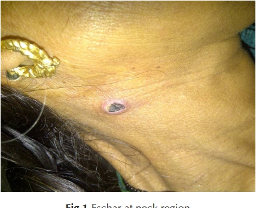
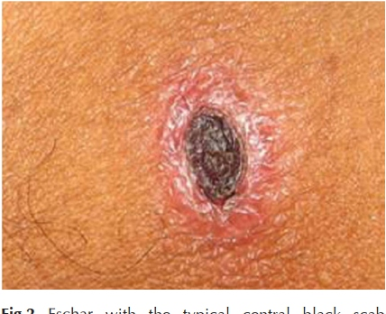
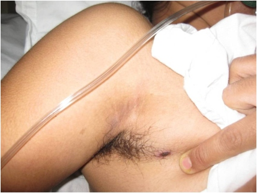
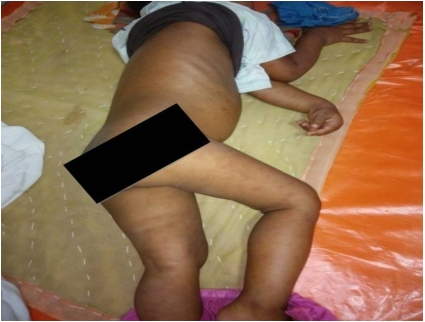
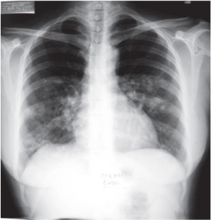
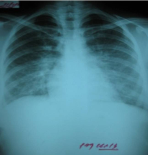
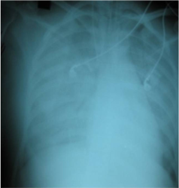

<div class="stats-strip">
  <div class="stats-grid">
    <div class="stat-card">
      <div class="stat-val green">30–45%</div>
      <div class="stat-lbl">Tỷ lệ tử vong nếu không chẩn đoán & điều trị kịp thời</div>
    </div>
    <div class="stat-card">
      <div class="stat-val blue">Doxycycline</div>
      <div class="stat-lbl">Kháng sinh đầu tay (200 mg/ngày × 7 ngày)</div>
    </div>
    <div class="stat-card">
      <div class="stat-val amber">OD > 0.5</div>
      <div class="stat-lbl">Ngưỡng ELISA IgM dương tính xác định nhiễm gần</div>
    </div>
    <div class="stat-card">
      <div class="stat-val red">Chống Chỉ Định</div>
      <div class="stat-lbl">Doxycycline cho phụ nữ mang thai (Thay bằng Azithromycin)</div>
    </div>
  </div>
</div>

<div class="pillars">
  <div class="pillars-inner">
    <div class="pillar p1">
      <div class="pillar-icon">🎯</div>
      <div>
        <div class="pillar-title">Trụ Cột 1: Chẩn Đoán Lâm Sàng & Vết Eschar</div>
        <div class="pillar-desc">Nghi ngờ bệnh Rickettsia ở bệnh nhân sốt cấp tính chưa rõ nguyên nhân ≥ 5 ngày (hoặc &lt; 5 ngày nếu phát hiện vết loét hoại tử Eschar đặc trưng).</div>
      </div>
    </div>
    <div class="pillar p2">
      <div class="pillar-icon">⚖️</div>
      <div>
        <div class="pillar-title">Trụ Cột 2: Khởi Trị Kháng Sinh Kinh Nghiệm Sớm</div>
        <div class="pillar-desc">Khởi trị ngay Doxycycline (hoặc Azithromycin cho thai phụ) dựa trên nghi ngờ lâm sàng, không trì hoãn chờ xét nghiệm khẳng định.</div>
      </div>
    </div>
    <div class="pillar p3">
      <div class="pillar-icon">🛡️</div>
      <div>
        <div class="pillar-title">Trụ Cột 3: Quản Lý Biến Chứng & Chuyển Tuyến</div>
        <div class="pillar-desc">Nhận diện sớm các biến chứng ARDS, suy thận, viêm não; chuyển tuyến cấp cứu và dùng kháng sinh đường tĩnh mạch (IV) kịp thời.</div>
      </div>
    </div>
  </div>
</div>

<div class="quickmenu" id="quickmenu">
  <div class="quickmenu-inner">
    <a href="#sec-1" class="quickmenu-item active">1. Định Nghĩa & Dịch Tễ</a>
    <a href="#sec-2" class="quickmenu-item">2. Tiêu Chuẩn Chẩn Đoán</a>
    <a href="#sec-3" class="quickmenu-item">3. Điều Trị Kháng Sinh</a>
    <a href="#sec-4" class="quickmenu-item">4. Lưu Đồ Thuật Toán</a>
    <a href="#sec-5" class="quickmenu-item">5. Tình Huống Đặc Biệt</a>
    <a href="#sec-6" class="quickmenu-item">6. Theo Dõi & Tham Khảo</a>
  </div>
</div>

<div class="page-content">

  <!-- MỤC 1: ĐỊNH NGHĨA & PHÂN LOẠI -->
  <div class="sec-card" id="sec-1">
    <div class="sec-hdr">
      <span class="sec-hdr-icon">🔬</span>
      <h2 class="sec-title">1. Định Nghĩa, Dịch Tễ & Phân Loại Lâm Sàng Bệnh Rickettsia</h2>
    </div>
    <div class="sec-body">
      <div class="infobox info">
        <span class="infobox-icon">💡</span>
        <div>
          <strong>Bản chất dịch tễ & Tầm quan trọng tại Ấn Độ:</strong>
          Bệnh Rickettsia do các vi khuẩn Gram âm nội bào bắt buộc thuộc lớp Alphaproteobacteria (các chi <em>Rickettsia</em>, <em>Orientia</em>, <em>Ehrlichia</em>, <em>Anaplasma</em>, <em>Coxiella</em>) gây ra. Bệnh lây truyền từ động vật sang người (zoonosis) qua các vật chủ trung gian như ấu trùng mò (chiggers), ve (ticks), bọ trét (fleas) hoặc rận (lice). Sốt mò (Scrub typhus) do <em>Orientia tsutsugamushi</em> là thể bệnh phổ biến nhất tại Ấn Độ, chiếm tới 50% các trường hợp sốt cấp tính chưa rõ nguyên nhân nhập viện ở một số vùng trọng điểm.
        </div>
      </div>

      <div class="updates-grid">
        <div class="update-card">
          <div class="update-card-accent" style="background: #0284c7;"></div>
          <div class="update-card-header">
            <div class="update-card-icon" style="background: rgba(2, 132, 199, 0.1); color: #0284c7;">🌾</div>
            <div class="update-card-title">Nhóm Sốt Mò (Scrub Typhus Group)</div>
          </div>
          <div class="update-card-body">
            <ul style="margin-left: 1rem; line-height: 1.7;">
              <li><strong>Tác nhân:</strong> <em>Orientia tsutsugamushi</em>.</li>
              <li><strong>Vật chủ trung gian:</strong> Ấu trùng mò Trombiculid (chiggers). Ấu trùng hút máu bệnh nhân trong 1–3 ngày.</li>
              <li><strong>Ổ chứa tự nhiên:</strong> Các loài chuột đồng (đặc biệt là chi <em>Rattus</em>).</li>
              <li><strong>Môi trường sinh thái ("Mite islands"):</strong> Nông trường bỏ hoang, đồng cỏ, bờ sông, rẫy cây bụi, vườn nhà kém chăm sóc. Bệnh mang tính mùa vụ rõ rệt theo sự phát triển của mò.</li>
            </ul>
          </div>
          <div class="update-verdict verdict-blue">Phổ biến nhất tại Ấn Độ</div>
        </div>

        <div class="update-card">
          <div class="update-card-accent" style="background: #f59e0b;"></div>
          <div class="update-card-header">
            <div class="update-card-icon" style="background: rgba(245, 158, 11, 0.1); color: #f59e0b;">🦗</div>
            <div class="update-card-title">Nhóm Sốt Phát Ban (Typhus Group)</div>
          </div>
          <div class="update-card-body">
            <ul style="margin-left: 1rem; line-height: 1.7;">
              <li><strong>Epidemic typhus (Dịch tễ):</strong> Tác nhân <em>Rickettsia prowazekii</em>, truyền qua rận người (Louse), ổ chứa là con người.</li>
              <li><strong>Murine typhus (Nội địa):</strong> Tác nhân <em>Rickettsia typhi</em>, truyền qua bọ trét (Flea), ổ chứa chính là loài chuột.</li>
              <li><strong>Đặc điểm:</strong> Thường gặp ở vùng điều kiện vệ sinh kém, ô nhiễm hoặc có sự bùng phát loài gặm nhấm.</li>
            </ul>
          </div>
          <div class="update-verdict verdict-amber">Cần lưu ý phân biệt</div>
        </div>

        <div class="update-card">
          <div class="update-card-accent" style="background: #10b981;"></div>
          <div class="update-card-header">
            <div class="update-card-icon" style="background: rgba(16, 185, 129, 0.1); color: #10b981;">🕷️</div>
            <div class="update-card-title">Nhóm Sốt Ve (Spotted Fever Group - SFG)</div>
          </div>
          <div class="update-card-body">
            <ul style="margin-left: 1rem; line-height: 1.7;">
              <li><strong>Indian Tick Typhus:</strong> Tác nhân <em>Rickettsia conorii</em>, truyền qua ve (Tick), ổ chứa là chó và gặm nhấm.</li>
              <li><strong>Rocky Mountain Spotted Fever:</strong> Tác nhân <em>Rickettsia rickettsii</em> truyền qua ve.</li>
              <li><strong>Rickettsialpox:</strong> Tác nhân <em>Rickettsia akari</em> truyền qua mạt, ổ chứa là chuột nhà.</li>
            </ul>
          </div>
          <div class="update-verdict verdict-green">Tỷ lệ phát ban cao</div>
        </div>

        <div class="update-card">
          <div class="update-card-accent" style="background: #8b5cf6;"></div>
          <div class="update-card-header">
            <div class="update-card-icon" style="background: rgba(139, 92, 246, 0.1); color: #8b5cf6;">🐄</div>
            <div class="update-card-title">Các Bệnh do Rickettsia Khác</div>
          </div>
          <div class="update-card-body">
            <ul style="margin-left: 1rem; line-height: 1.7;">
              <li><strong>Sốt Q (Q fever):</strong> Tác nhân <em>Coxiella burnetii</em>, truyền qua đường không khí/sữa, ổ chứa là trâu, bò, dê, cừu.</li>
              <li><strong>Trench fever (Sốt chiến hào):</strong> Tác nhân <em>Rochalimaea quintana</em> (Bartonella quintana) truyền qua rận.</li>
            </ul>
          </div>
          <div class="update-verdict verdict-purple">Lây truyền đa dạng</div>
        </div>
      </div>
    </div>
  </div>

  <!-- MỤC 2: TIÊU CHUẨN CHẨN ĐOÁN & THANG ĐIỂM -->
  <div class="sec-card" id="sec-2">
    <div class="sec-hdr">
      <span class="sec-hdr-icon">📐</span>
      <h2 class="sec-title">2. Tiêu Chuẩn Chẩn Đoán Ca Bệnh & Cận Lâm Sàng Huyết Thanh / Phân Tử</h2>
    </div>
    <div class="sec-body">
      <div class="infobox warning">
        <span class="infobox-icon">⚠️</span>
        <div>
          <strong>Cảnh báo lâm sàng & Bẫy chẩn đoán:</strong>
          Các triệu chứng sớm của bệnh Rickettsia thường không đặc hiệu (sốt cấp tính, đau đầu, ho, đau mỏi cơ, nôn ói) rất dễ nhầm lẫn với Dengue, Sốt rét, Typhoid, Leptospirosis hoặc Viêm phổi. <strong>Vết loét Eschar</strong> (vết loét hoại tử có vảy đen trung tâm kích thước ≤ 1 cm, không đau, giống vết thuốc lá cháy) là manh mối vô cùng giá trị của Sốt mò (xuất hiện với tỷ lệ 7–97%). Cần thăm khám kỹ các vùng nếp gấp ẩm (nách, bẹn, cổ, quanh hậu môn, bìu) vì Eschar tại đây có thể không có vảy đen mà thể hiện dưới dạng vết loét nông đáy vàng.
        </div>
      </div>

      {/* KHỐI HÌNH ẢNH LÂM SÀNG: VẾT LOÉT ESCHAR & PHÁT BAN (FIGURES 1 - 4) */}
      <div class="sec-subtitle" id="fig-clinical" style="margin-top: 1.5rem;">
        <i class="fa-solid fa-camera"></i> Hình Ảnh Lâm Sàng Đặc Trưng: Vết Loét Eschar &amp; Ban Da (Figures 1–4)
      </div>
      <p style="font-size: 0.9rem; line-height: 1.6; margin-bottom: 1rem;">
        Vết loét hoại tử <strong>Eschar</strong> là dấu ấn lâm sàng có giá trị quyết định hàng đầu trong chẩn đoán sớm sốt mò (<em>Scrub typhus</em>). Tổn thương bắt đầu từ một nốt sẩn nhỏ tại vị trí ấu trùng mò đốt, sau đó bọng nước vỡ tạo thành vết loét nông, trung tâm đóng vảy hoại tử đen sẫm (nhạt dần ở các nếp gấp ẩm) và không đau. Đi kèm là phát ban dát sẩn toàn thân xuất hiện từ ngày thứ 3 đến ngày thứ 5.
      </p>

      {/* FIG 1 & FIG 2 */}
      <div class="grid-2col">
        <div class="fig-card" id="fig-1">
          
          <div class="fig-caption">
            <div class="fig-title">Figure 1. Vết Loét Hoại Tử Eschar Vùng Cổ (Eschar at neck region)</div>
            Tổn thương loét hoại tử do ấu trùng mò (chigger) đốt tại vùng cổ bên. Vết loét hình oval nhỏ (&le; 1 cm) với trung tâm đóng vảy đen, bờ viền xung huyết nhẹ, hoàn toàn không đau và không ngứa.
          </div>
        </div>

        <div class="fig-card" id="fig-2">
          
          <div class="fig-caption">
            <div class="fig-title">Figure 2. Vết Loét Eschar Điển Hình Dạng Tàn Thuốc Lá Cháy (Typical cigarette burn scab)</div>
            Cận cảnh tổn thương Eschar kinh điển: Vảy đen hoại tử ở trung tâm trên nền quầng viêm đỏ phù nề, tạo hình ảnh gợi ý vết tàn thuốc lá châm trên da. Đây là dấu hiệu lâm sàng mang tính khẳng định tức thì cho sốt mò.
          </div>
        </div>
      </div>

      {/* FIG 3 & FIG 4 */}
      <div class="grid-2col" style="margin-top: 1.25rem;">
        <div class="fig-card" id="fig-3">
          
          <div class="fig-caption">
            <div class="fig-title">Figure 3. Vết Loét Eschar Ẩn Kín Tại Nếp Gấp Vùng Nách (Eschar in axilla)</div>
            Vết loét Eschar nằm sâu trong hố nách. Do tổn thương không đau và nằm ở vùng nếp gấp da kín đáo, ẩm ướt, bệnh nhân rất khó phát hiện; bác sĩ lâm sàng cần chủ động vạch tìm tỉ mỉ tại nách, bẹn, bìu và nếp lằn vú.
          </div>
        </div>

        <div class="fig-card" id="fig-4">
          
          <div class="fig-caption">
            <div class="fig-title">Figure 4. Phát Ban Dát Sẩn Toàn Thân (Rash on body)</div>
            Ban dát sẩn (maculopapular rash) màu hồng đỏ phân bố lan tỏa trên thân mình, bụng và chi ở bệnh nhi mắc sốt mò. Ban thường xuất hiện vào ngày 3–5 của sốt, có thể kèm theo gan lách to và nổi hạch vùng.
          </div>
        </div>
      </div>

      <!-- BẢNG TIÊU CHUẨN CHẨN ĐOÁN -->
      <div class="table-card" style="margin-top: 1.75rem;">
        <div class="table-header">
          <div class="table-title">
            <i class="fa-solid fa-calculator"></i> Bảng 1. Phân Tầng Ca Bệnh & Tiêu Chuẩn Xét Nghiệm Cận Lâm Sàng
          </div>
          <span class="table-badge"><i class="fa-solid fa-square-check"></i> Quy chuẩn DHR-ICMR</span>
        </div>
        <div class="table-wrapper">
          <table class="diagnostic-table">
            <thead>
              <tr>
                <th style="width: 22%;">Cấp Độ Chẩn Đoán</th>
                <th style="width: 53%;">Tiêu Chuẩn Lâm Sàng & Ngưỡng Xét Nghiệm</th>
                <th style="width: 25%;">Định Hướng Xử Trí</th>
              </tr>
            </thead>
            <tbody>
              <tr>
                <td class="source-cell"><strong>Ca Bệnh Nghi Ngờ (Suspected Case)</strong></td>
                <td>Sốt cấp tính không rõ nguyên nhân ≥ 5 ngày (hoặc sốt &lt; 5 ngày NẾU CÓ vết loét Eschar). Có thể kèm đau đầu, phát ban (dạng dát sẩn/chấm xuất huyết sau 3–5 ngày), hạch to, hoặc tổn thương đa cơ quan (gan, phổi, thận).</td>
                <td><span class="score-badge score-neu">Khởi trị kháng sinh kinh nghiệm ngay</span></td>
              </tr>
              <tr>
                <td class="source-cell"><strong>Ca Bệnh Có Khả Năng (Probable Case)</strong></td>
                <td>Ca bệnh nghi ngờ + Phản ứng Weil-Felix có hiệu giá thể kháng thể ≥ 1:80 (với kháng nguyên OX2, OX19, OXK) HOẶC xét nghiệm ELISA IgM có Mật độ quang (OD) > 0.5.</td>
                <td><span class="score-badge score-pos">Khẳng định chẩn đoán lâm sàng</span></td>
              </tr>
              <tr>
                <td class="source-cell"><strong>Ca Bệnh Xác Định (Confirmed Case)</strong></td>
                <td>Phát hiện DNA Rickettsia trong mẫu Eschar hoặc máu toàn phần bằng PCR (mục tiêu gen 56 Kda / 47 Kda trong 7–10 ngày đầu) HOẶC Hiệu giá kháng thể tăng ≥ 4 lần giữa 2 mẫu huyết thanh cấp và hồi phục bằng IFA / IPA.</td>
                <td><span class="score-badge score-pos">Tiêu chuẩn vàng xét nghiệm</span></td>
              </tr>
              <tr class="total-row">
                <td colspan="2"><strong>XÉT NGHIỆM HỖ TRỢ</strong></td>
                <td><strong>Bất thường cận lâm sàng</strong></td>
              </tr>
              <tr>
                <td class="source-cell"><strong>Huyết học & Sinh hóa</strong></td>
                <td>Bạch cầu bình thường giai đoạn đầu, tăng > 11,000/mm³ giai đoạn muộn. Giảm tiểu cầu (&lt; 100,000/mm³) chiếm đa số. Tăng transaminase ALT/AST.</td>
                <td>Giám sát mức độ nặng</td>
              </tr>
              <tr>
                <td class="source-cell"><strong>X-quang Ngực (Chest X-ray)</strong></td>
                <td>Tổn thương thâm nhiễm kẽ 2 đáy phổi (interstitial infiltrates / reticulonodular opacities), tiến triển thành đông đặc phế nang lan tỏa 2 bên trong hội chứng ARDS (<a href="#fig-xray" style="font-weight: 600; text-decoration: underline;">Xem Figure 5–7 bên dưới</a>).</td>
                <td>Cảnh báo biến chứng ARDS nguy kịch</td>
              </tr>
            </tbody>
          </table>
        </div>
      </div>

      {/* KHỐI HÌNH ẢNH X-QUANG PHỔI: TỔN THƯƠNG MÔ KẼ & TIẾN TRIỂN ARDS (FIGURES 5 - 7) */}
      <div class="sec-subtitle" id="fig-xray" style="margin-top: 2rem;">
        <i class="fa-solid fa-lungs"></i> Hình Ảnh Tổn Thương X-Quang Ngực &amp; Động Học Tiến Triển ARDS (Figures 5–7)
      </div>
      <p style="font-size: 0.9rem; line-height: 1.6; margin-bottom: 1rem;">
        Tổn thương phổi trong sốt mò là hậu quả của hiện tượng viêm nội mô vi mạch máu lan tỏa (microvascular endothelial injury / vasculitis) do <em>Orientia tsutsugamushi</em>. Hình ảnh X-quang ngực giai đoạn sớm biểu hiện thâm nhiễm mô kẽ hoặc nốt lưới hai đáy phổi; nếu không được can thiệp kháng sinh kịp thời, tổn thương có thể tiến triển bùng phát sang <strong>Hội chứng Suy hô hấp Cấp tiến triển (ARDS)</strong> đe dọa tính mạng chỉ sau 48 giờ.
      </p>

      {/* FIG 5, FIG 6 & FIG 7 */}
      <div class="grid-3col">
        <div class="fig-card" id="fig-5">
          
          <div class="fig-caption">
            <div class="fig-title">Figure 5. Thâm Nhiễm Kẽ Hai Đáy Phổi (Bilateral Interstitial Infiltrates)</div>
            Phim X-quang ngực của bệnh nhân mắc sốt mò: Các đám mờ thâm nhiễm dạng mô kẽ (interstitial infiltrates) lan tỏa đối xứng ưu thế ở hai đáy phổi, phản ánh tình trạng tổn thương vi mạch phế nang giai đoạn đầu.
          </div>
        </div>

        <div class="fig-card" id="fig-6">
          
          <div class="fig-caption">
            <div class="fig-title">Figure 6. Trước Điều Trị: Đám Mờ Dạng Nốt Lưới (Before Treatment)</div>
            Bệnh nhân nữ 30 tuổi, sốt 10 ngày, ho khan 5 ngày kèm khó thở. X-quang ngực trước điều trị ghi nhận tổn thương dạng nốt lưới mô kẽ (reticulonodular opacities) rõ nét ở hai đáy phổi trước khi khởi trị đặc hiệu.
          </div>
        </div>

        <div class="fig-card" id="fig-7">
          
          <div class="fig-caption">
            <div class="fig-title">Figure 7. Tiến Triển ARDS Nguy Kịch (Acute Respiratory Distress Syndrome)</div>
            Phim chụp cùng bệnh nhân trên sau 2 ngày nhập viện hồi sức tuyến 3 với khó thở dữ dội. Tổn thương tiến triển cấp tính thành các đám mờ đông đặc phế nang lan tỏa 2 bên phế trường (air-space consolidation) gợi ý ARDS nặng.
          </div>
        </div>
      </div>

      <div class="infobox info" style="margin-top: 1rem;">
        <span class="infobox-icon">💡</span>
        <div>
          <strong>Hạt ngọc chẩn đoán hình ảnh (Clinical Pearl):</strong>
          Đối chiếu <strong>Figure 6</strong> và <strong>Figure 7</strong> minh chứng tốc độ suy sụp hô hấp cực nhanh trong sốt mò biến chứng. Khi phát hiện bệnh nhân sốt mò có ho khan và khó thở kèm tổn thương kẽ đáy phổi trên X-quang, cần xem đây là dấu hiệu báo động đỏ để chỉ định chuyển tuyến hồi sức cấp cứu và khởi trị ngay kháng sinh đường tĩnh mạch (IV Doxycycline hoặc IV Azithromycin).
        </div>
      </div>
    </div>
  </div>

  <!-- MỤC 3: CHIẾN LƯỢC ĐIỀU TRỊ & PHÁC ĐỒ DƯỢC LÝ -->
  <div class="sec-card" id="sec-3">
    <div class="sec-hdr">
      <span class="sec-hdr-icon">💊</span>
      <h2 class="sec-title">3. Chiến Lược Điều Trị Kháng Sinh Kinh Nghiệm & Phác Đồ Liều Dùng Cụ Thể</h2>
    </div>
    <div class="sec-body">

      <div class="rec-card cor-1">
        <div class="rec-header">
          <span class="badge-cor-1"><i class="fa-solid fa-circle-check"></i> CLASS I (CHỈ ĐỊNH BẮT BUỘC)</span>
          <span class="badge-loe-a"><i class="fa-solid fa-layer-group"></i> LOE B-NR</span>
        </div>
        <div class="rec-body">
          <strong>KHỞI TRỊ KINH NGHIỆM LẬP TỨC:</strong> Khởi trị kháng sinh ngay khi nghi ngờ bệnh Rickettsia lâm sàng mà không được trì hoãn để chờ kết quả xét nghiệm khẳng định. Doxycycline là thuốc lựa chọn hàng đầu cho tất cả người lớn và trẻ em mắc bệnh không biến chứng.
        </div>
      </div>

      <div class="rec-card cor-2a">
        <div class="rec-header">
          <span class="badge-cor-2a"><i class="fa-solid fa-circle-info"></i> CLASS IIa (LỰA CHỌN THAY THẾ)</span>
          <span class="badge-loe-b"><i class="fa-solid fa-layer-group"></i> LOE B-R</span>
        </div>
        <div class="rec-body">
          <strong>AZITHROMYCIN TRONG THỦY TỔ CHỦNG KHÁNG THUỐC:</strong> Azithromycin là lựa chọn ưu tiên hàng đầu ở phụ nữ mang thai, bệnh nhân không dung nạp Doxycycline, hoặc ở những vùng ghi nhận chủng <em>O. tsutsugamushi</em> kháng Doxycycline/Chloramphenicol tại Đông Nam Á.
        </div>
      </div>

      <div class="rec-card cor-3">
        <div class="rec-header">
          <span class="badge-cor-3"><i class="fa-solid fa-triangle-exclamation"></i> CLASS III: HARM (CHỐNG CHỈ ĐỊNH)</span>
          <span class="badge-loe-a"><i class="fa-solid fa-layer-group"></i> LOE C-EO</span>
        </div>
        <div class="rec-body">
          <strong>CHỐNG CHỈ ĐỊNH DOXYCYCLINE CHO THAI PHỤ:</strong> Tuyệt đối không dùng Doxycycline cho phụ nữ đang mang thai do nguy cơ độc tính trên xương và răng thai nhi. Chuyển sang Azithromycin 500 mg/ngày.
        </div>
      </div>

      <!-- BẢNG PHÁC ĐỒ LIỀU LƯỢNG CHI TIẾT -->
      <div class="table-card" style="margin-top: 1.5rem;">
        <div class="table-header">
          <div class="table-title">
            <i class="fa-solid fa-pills"></i> Bảng 2. Danh Mục Kháng Sinh, Phác Đồ Liều Dùng Theo Nhóm Bệnh Nhân & Tuyến Điều Trị
          </div>
          <span class="table-badge"><i class="fa-solid fa-prescription-bottle-medical"></i> Hướng dẫn DHR-ICMR</span>
        </div>
        <div class="table-wrapper">
          <table class="regimen-table">
            <thead>
              <tr>
                <th style="width: 22%;">Nhóm Bệnh Nhân</th>
                <th style="width: 28%;">Thuốc & Liều Dùng Uống (Ngoại Trú / Nhẹ)</th>
                <th style="width: 28%;">Thuốc & Liều Dùng Tiêm Truyền (IV) (Nặng / Biến Chứng)</th>
                <th style="width: 22%;">Thời Gian & Lưu Ý</th>
              </tr>
            </thead>
            <tbody>
              <tr>
                <td class="source-cell">
                  <span class="rx-tag preferred">Đầu tay</span>
                  <strong>Người lớn (&ge; 45 kg)</strong>
                </td>
                <td>
                  <strong>Doxycycline:</strong> 200 mg/ngày chia 2 lần (100 mg mỗi 12h).<br />
                  <em>Hoặc</em> <strong>Azithromycin:</strong> 500 mg uống 1 lần/ngày.
                </td>
                <td>
                  <strong>IV Doxycycline:</strong> 100 mg × 2 lần/ngày pha trong 100 ml NaCl 0.9% truyền IV trong 30 phút.<br />
                  <em>Hoặc</em> <strong>IV Azithromycin:</strong> 500 mg/ngày pha 250 ml NaCl 0.9% truyền IV trong 1 giờ (1–2 ngày) rồi chuyển uống.
                </td>
                <td>Uống Doxycycline với nhiều nước lúc ăn, tư thế ngồi/đứng. Liệu trình 7–15 ngày (hoặc 5 ngày với Azithromycin).</td>
              </tr>
              <tr>
                <td class="source-cell">
                  <span class="rx-tag alternative">Trẻ em</span>
                  <strong>Trẻ em (&lt; 45 kg)</strong>
                </td>
                <td>
                  <strong>Doxycycline:</strong> 4.5 mg/kg body weight/ngày chia 2 lần.<br />
                  <em>Hoặc</em> <strong>Azithromycin:</strong> 10 mg/kg body weight uống 1 lần/ngày.
                </td>
                <td>Theo chỉ định chuyên khoa nhi / chuyển tuyến nội trú nếu có biến chứng nặng.</td>
                <td>Liệu trình Doxycycline 7 ngày, Azithromycin 5 ngày.</td>
              </tr>
              <tr>
                <td class="source-cell">
                  <span class="rx-tag alternative">Thai kỳ</span>
                  <strong>Phụ nữ mang thai</strong>
                </td>
                <td>
                  <strong>Azithromycin:</strong> 500 mg uống 1 lần/ngày trong 5 ngày.
                </td>
                <td>
                  <strong>IV Azithromycin:</strong> 500 mg/ngày truyền tĩnh mạch trong 1–2 ngày đầu, sau đó chuyển uống đủ 5 ngày.
                </td>
                <td>Doxycycline chống chỉ định tuyệt đối. Azithromycin là lựa chọn duy nhất an toàn.</td>
              </tr>
              <tr>
                <td class="source-cell">
                  <span class="rx-tag alternative">Dự phòng</span>
                  <strong>Lựa chọn thay thế (IV)</strong>
                </td>
                <td>
                  -
                </td>
                <td>
                  <strong>IV Chloramphenicol:</strong> 50–100 mg/kg/ngày chia 4 lần (mỗi 6h) truyền IV trong 1 giờ.
                </td>
                <td>Chuyển sang đường uống khi lâm sàng cải thiện để hoàn thành 7–15 ngày.</td>
              </tr>
            </tbody>
          </table>
        </div>
      </div>

    </div>
  </div>

  <!-- MỤC 4: LƯU ĐỒ THUẬT TOÁN XỬ TRÍ -->
  <div class="sec-card" id="sec-4">
    <div class="sec-hdr">
      <span class="sec-hdr-icon">🗺️</span>
      <h2 class="sec-title">4. Lưu Đồ Thuật Toán Phân Nhánh Xử Trí Theo Cấp Độ Tuyến Y Tế</h2>
    </div>
    <div class="sec-body">
      <p style="font-size: 0.9rem; color: var(--color-text-muted); margin-bottom: 1.25rem;">
        Quy trình tiếp nhận, sàng lọc, xử trí ban đầu và phân tuyến chuyển cấp cứu theo khuyến cáo DHR-ICMR:
      </p>

      <div class="flow-track-container">
        <!-- Bước 1 -->
        <div class="flow-track-step">
          <div class="flow-track-rail">
            <div class="flow-track-marker marker-blue">01</div>
            <div class="flow-track-line"></div>
          </div>
          <div class="flow-track-content accent-blue">
            <div class="flow-step-header">
              <div class="flow-step-title"><i class="fa-solid fa-stethoscope" style="color: #0284c7;"></i> Bước 1: Tiếp Nhận & Sàng Lọc Ban Đầu Tại Y Tế Cơ Sở (Primary Level)</div>
              <span class="flow-step-badge flow-badge-blue">Tuyến cơ sở</span>
            </div>
            <div class="flow-step-text">
              Bệnh nhân sốt cấp tính chưa rõ nguyên nhân &ge; 5 ngày (hoặc sốt &lt; 5 ngày kèm vết Eschar) sau khi đã loại trừ Sốt rét, Dengue, Typhoid.
              <br />
              &rarr; <strong>Hành động:</strong> Cho uống ngay Doxycycline 200 mg/ngày (hoặc Azithromycin cho thai phụ). Nếu bệnh nhân đến trong tình trạng nặng, cho liều Doxycycline đầu tiên ngay trước khi chuyển viện.
            </div>
          </div>
        </div>

        <!-- Bước 2: Phân Nhánh Biến Chứng -->
        <div class="flow-track-step">
          <div class="flow-track-rail">
            <div class="flow-track-marker marker-teal">02</div>
            <div class="flow-track-line"></div>
          </div>
          <div class="flow-track-content accent-teal">
            <div class="flow-step-header">
              <div class="flow-step-title"><i class="fa-solid fa-code-branch" style="color: #0d9488;"></i> Bước 2: Đánh Giá Mức Độ Nặng & Phân Nhánh Điều Trị</div>
              <span class="flow-step-badge flow-badge-amber">Phân nhánh</span>
            </div>
            <div class="flow-step-text">
              <div class="flow-branch-grid">
                <div class="flow-branch-card accent-green">
                  <div class="flow-branch-title" style="color: #047857;"><i class="fa-solid fa-circle-check"></i> Nhánh 1: Thể Không Biến Chứng</div>
                  <div class="flow-branch-desc">Sốt, đau đầu, mệt mỏi nhưng sinh hiệu ổn định, không khó thở, không tổn thương cơ quan. Duy trì phác đồ uống Doxycycline 7 ngày (hoặc Azithromycin 5 ngày) tại ngoại trú.</div>
                </div>
                <div class="flow-branch-card accent-rose">
                  <div class="flow-branch-title" style="color: #be123c;"><i class="fa-solid fa-triangle-exclamation"></i> Nhánh 2: Thể Có Biến Chứng Nặng</div>
                  <div class="flow-branch-desc">Có dấu hiệu ARDS (ho khô, khó thở, thâm nhiễm 2 đáy phổi), Suy thận cấp, Viêm não - màng não, Vàng da, Sốc nhiễm khuẩn. Khẩn cấp chuyển tuyến 2/3 (Secondary/Tertiary Hospital).</div>
                </div>
              </div>
            </div>
          </div>
        </div>

        <!-- Bước 3 -->
        <div class="flow-track-step">
          <div class="flow-track-rail">
            <div class="flow-track-marker marker-purple">03</div>
          </div>
          <div class="flow-track-content accent-purple">
            <div class="flow-step-header">
              <div class="flow-step-title"><i class="fa-solid fa-shield-halved" style="color: #7c3aed;"></i> Bước 3: Hồi Sức Tích Cực & Kháng Sinh IV Tại Tuyến Chuyên Khoa (Secondary/Tertiary Level)</div>
              <span class="flow-step-badge flow-badge-purple">Tuyến ICU / Chuyên khoa</span>
            </div>
            <div class="flow-step-text">
              Làm xét nghiệm ELISA IgM, Weil-Felix, PCR máu/Eschar và X-quang ngực.
              <br />
              &rarr; <strong>Phác đồ IV:</strong> Khởi trị IV Doxycycline 100 mg q12h hoặc IV Azithromycin 500 mg/ngày (hoặc IV Chloramphenicol). Kết hợp hồi sức ARDS (thở máy/thở oxy), lọc máu cấp cứu nếu suy thận, điều trị hỗ trợ sốc và rối loạn đông máu.
            </div>
          </div>
        </div>
      </div>

    </div>
  </div>

  <!-- MỤC 5: TÌNH HUỐNG ĐẶC BIỆT -->
  <div class="sec-card" id="sec-5">
    <div class="sec-hdr">
      <span class="sec-hdr-icon">🛡️</span>
      <h2 class="sec-title">5. Xử Trí Tình Huống Lâm Sàng Đặc Biệt & Biến Chứng Nặng Nổi Trội</h2>
    </div>
    <div class="sec-body">
      <div class="updates-grid">
        <div class="update-card">
          <div class="update-card-accent" style="background: #ef4444;"></div>
          <div class="update-card-header">
            <div class="update-card-icon" style="background: rgba(239, 68, 68, 0.1); color: #ef4444;">🫁</div>
            <div class="update-card-title">Biến Chứng Phổi & Hội Chứng ARDS</div>
          </div>
          <div class="update-card-body">
            <p style="font-size: 0.9rem; line-height: 1.6;">
              Viêm phổi là biến chứng phổ biến nhất của sốt mò. Bệnh nhân biểu hiện ho khô, khó thở tiến triển nhanh. X-quang ngực giai đoạn đầu cho thấy tổn thương thâm nhiễm kẽ nốt xơ (reticulonodular opacities) 2 đáy phổi, sau đó nhanh chóng lan rộng thành đông đặc phế nang 2 bên gợi ý ARDS đe dọa tính mạng. Cần cho IV Azithromycin hoặc IV Doxycycline phối hợp hỗ trợ hô hấp tích cực.
            </p>
            <div class="infobox danger" style="margin-top: 0.85rem; padding: 0.65rem 0.9rem;">
              <span class="infobox-icon">🫁</span>
              <div style="font-size: 0.84rem; line-height: 1.5;">
                <strong>Đối chiếu tiến triển hình ảnh học:</strong> Xem chuỗi phim X-quang ngực đối sánh từ tổn thương nốt lưới mô kẽ sang đông đặc ARDS toàn bộ phế trường sau 2 ngày tại <a href="#fig-xray" style="color: #ef4444; font-weight: 700; text-decoration: underline;">Figure 5, 6 &amp; 7 (Mục 2)</a>.
              </div>
            </div>
          </div>
          <div class="update-verdict verdict-red">Biến chứng gây tử vong hàng đầu</div>
        </div>

        <div class="update-card">
          <div class="update-card-accent" style="background: #8b5cf6;"></div>
          <div class="update-card-header">
            <div class="update-card-icon" style="background: rgba(139, 92, 246, 0.1); color: #8b5cf6;">🤰</div>
            <div class="update-card-title">Phụ Nữ Mang Thai</div>
          </div>
          <div class="update-card-body">
            <p style="font-size: 0.9rem; line-height: 1.6;">
              Nhiễm Rickettsia trong thai kỳ làm tăng nguy cơ sảy thai, thai chết lưu và sinh non. Doxycycline chống chỉ định tuyệt đối do ảnh hưởng sự phát triển xương và răng thai nhi. <strong>Azithromycin (500 mg/ngày × 5 ngày)</strong> là kháng sinh duy nhất an toàn và hiệu quả cao được khuyến cáo chính thức bởi DHR-ICMR.
            </p>
          </div>
          <div class="update-verdict verdict-purple">Bảo vệ an toàn thai kỳ</div>
        </div>

        <div class="update-card">
          <div class="update-card-accent" style="background: #f59e0b;"></div>
          <div class="update-card-header">
            <div class="update-card-icon" style="background: rgba(245, 158, 11, 0.1); color: #f59e0b;">💊</div>
            <div class="update-card-title">Chủng Kháng Doxycycline / Chloramphenicol</div>
          </div>
          <div class="update-card-body">
            <p style="font-size: 0.9rem; line-height: 1.6;">
              Một số khu vực tại Đông Nam Á đã ghi nhận các chủng <em>O. tsutsugamushi</em> giảm nhạy cảm hoặc kháng Doxycycline và Chloramphenicol. Các thử nghiệm lâm sàng xác nhận những chủng này vẫn nhạy cảm hoàn toàn với <strong>Azithromycin</strong>.
            </p>
          </div>
          <div class="update-verdict verdict-amber">Cần chuyển sang Azithromycin</div>
        </div>
      </div>
    </div>
  </div>

  <!-- MỤC 6: THEO DÕI & TÀI LIỆU THAM KHẢO -->
  <div class="sec-card" id="sec-6">
    <div class="sec-hdr">
      <span class="sec-hdr-icon">📋</span>
      <h2 class="sec-title">6. Kế Hoạch Theo Dõi, Tiêu Chuẩn Xuất Viện & Tài Liệu Tham Khảo</h2>
    </div>
    <div class="sec-body">
      <div class="infobox success">
        <span class="infobox-icon">✅</span>
        <div>
          <strong>Bảng kiểm an toàn lâm sàng & Tiêu chuẩn xuất viện:</strong>
          <ul style="margin: 0.5rem 0 0 1.2rem; line-height: 1.6;">
            <li><strong>Đáp ứng điều trị:</strong> Bệnh nhân hết sốt rõ rệt trong vòng 24–48 giờ sau khi khởi trị Doxycycline/Azithromycin đúng phác đồ.</li>
            <li><strong>Tiêu chuẩn xuất viện:</strong> Hết sốt &ge; 48 giờ, lâm sàng cải thiện hoàn toàn, không còn khó thở, chức năng gan/thận phục hồi, số lượng tiểu cầu hồi phục &gt; 100,000/mm³.</li>
            <li><strong>Dấu hiệu cảnh báo cần tái khám ngay:</strong> Tái sốt, khó thở xuất hiện trở lại, đau đầu dữ dội, nôn ói nhiều hoặc mệt thẫn thờ.</li>
          </ul>
        </div>
      </div>

      <div class="citation-box" style="margin-top: 1.5rem;">
        <strong>Trích dẫn tài liệu tham khảo chính thức (AMA Format):</strong><br />
        1. Task Force on Rickettsial Diseases, Department of Health Research & Indian Council of Medical Research. <em>DHR-ICMR Guidelines for Diagnosis and Management of Rickettsial Diseases in India</em>. New Delhi: Indian Council of Medical Research; Published February 2015:1-19.
      </div>
    </div>
  </div>

</div>

<div style="margin-top: 1.5rem;">
  <div class="btn-row">
    <a href="#/ebm/kho-guidelines" class="btn btn-primary">
      <i class="fa-solid fa-arrow-left"></i> Quay lại Kho Guidelines
    </a>
    <a href="#sec-1" class="btn">
      <i class="fa-solid fa-arrow-up"></i> Lên đầu trang
    </a>
  </div>
</div>
```