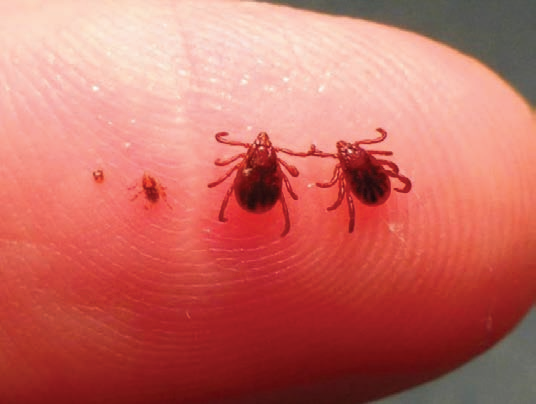
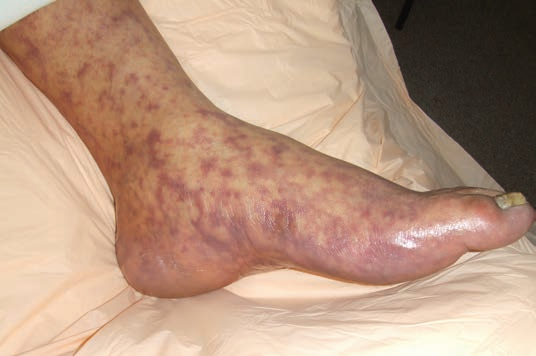
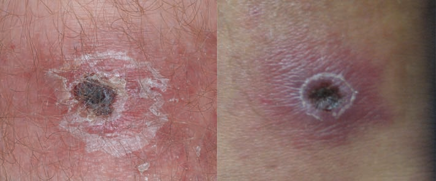
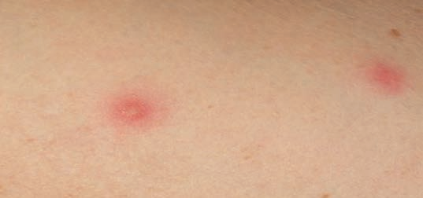
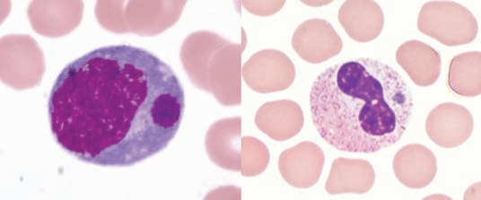

<div class="stats-strip">
  <div class="stats-grid">
    <div class="stat-card">
      <div class="stat-val red">5%–10%</div>
      <div class="stat-lbl">Tỷ lệ tử vong RMSF (lên tới 40%–50% nếu điều trị muộn sau ngày thứ 8–9)</div>
    </div>
    <div class="stat-card">
      <div class="stat-val blue">Doxycycline</div>
      <div class="stat-lbl">Kháng sinh lựa chọn hàng đầu cho MỌI lứa tuổi (bao gồm trẻ em < 8 tuổi)</div>
    </div>
    <div class="stat-card">
      <div class="stat-val green">Tăng ≥ 4 lần</div>
      <div class="stat-lbl">Hiệu giá IFA IgG mẫu kép (cấp & hồi phục) xác định chẩn đoán</div>
    </div>
    <div class="stat-card">
      <div class="stat-val amber">0%</div>
      <div class="stat-lbl">Tỷ lệ đổi màu răng ở trẻ em điều trị Doxycycline ngắn ngày</div>
    </div>
  </div>
</div>

<div class="pillars">
  <div class="pillars-inner">
    <div class="pillar p1">
      <div class="pillar-icon">🎯</div>
      <div>
        <div class="pillar-title">Trụ Cột 1: Nhận Biết Dịch Tễ & Lâm Sàng Sớm</div>
        <div class="pillar-desc">Nghi ngờ bệnh Rickettsia ở bệnh nhân sốt cấp tính chưa rõ nguyên nhân kèm đau đầu, đau cơ, phát ban hoặc vết Eschar có yếu tố nguy cơ tiếp xúc với ve hoặc di chuyển vùng dịch tễ.</div>
      </div>
    </div>
    <div class="pillar p2">
      <div class="pillar-icon">⚖️</div>
      <div>
        <div class="pillar-title">Trụ Cột 2: Điều Trị Kháng Sinh Kinh Nghiệm Ngay</div>
        <div class="pillar-desc">Khởi trị ngay Doxycycline 100 mg q12h ở người lớn hoặc 2.2 mg/kg q12h ở trẻ em (&lt; 45 kg) dựa trên nghi ngờ lâm sàng, tuyệt đối không trì hoãn chờ kết quả xét nghiệm.</div>
      </div>
    </div>
    <div class="pillar p3">
      <div class="pillar-icon">🛡️</div>
      <div>
        <div class="pillar-title">Trụ Cột 3: Quản Lý An Toàn & Tránh Bẫy Lâm Sàng</div>
        <div class="pillar-desc">Khẳng định Doxycycline an toàn cho trẻ &lt; 8 tuổi; cấm dùng Sulfonamide/Fluoroquinolone; xử trí đúng cho thai phụ và kiểm soát biến chứng ARDS/tổn thương đa cơ quan.</div>
      </div>
    </div>
  </div>
</div>

<div class="quickmenu" id="quickmenu">
  <div class="quickmenu-inner">
    <a href="#sec-1" class="quickmenu-item active">1. Định Nghĩa & Dịch Tễ</a>
    <a href="#sec-2" class="quickmenu-item">2. Tiêu Chuẩn Chẩn Đoán</a>
    <a href="#sec-3" class="quickmenu-item">3. Điều Trị Kháng Sinh</a>
    <a href="#sec-4" class="quickmenu-item">4. Lưu Đồ Thuật Toán</a>
    <a href="#sec-5" class="quickmenu-item">5. Tình Huống Đặc Biệt</a>
    <a href="#sec-6" class="quickmenu-item">6. Theo Dõi & Tham Khảo</a>
  </div>
</div>

<div class="page-content">

  <!-- MỤC 1: ĐỊNH NGHĨA & PHÂN LOẠI -->
  <div class="sec-card" id="sec-1">
    <div class="sec-hdr">
      <span class="sec-hdr-icon">🔬</span>
      <h2 class="sec-title">1. Định Nghĩa, Dịch Tễ & Phân Loại Lâm Sàng Bệnh Rickettsia Lây Truyền Qua Ve</h2>
    </div>
    <div class="sec-body">
      <div class="infobox info">
        <span class="infobox-icon">💡</span>
        <div>
          <strong>Cập nhật dịch tễ học & Tiếp cận One Health (CDC 2016):</strong>
          Bệnh Rickettsia lây truyền qua ve (Tickborne Rickettsial Diseases) là nhóm bệnh nhiễm vi khuẩn Gram âm nội bào bắt buộc thuộc bộ <em>Rickettsiales</em>. Trong thập kỷ qua, tỷ lệ mắc bệnh ghi nhận tại Mỹ tăng đáng kể. Bệnh có biểu hiện lâm sàng ban đầu không đặc hiệu nhưng có thể tiến triển nhanh chóng gây tổn thương đa cơ quan và tử vong nếu không được điều trị bằng Doxycycline kịp thời. Tiếp cận sức khỏe toàn diện (One Health) kết hợp y học con người, thú y và sinh thái ve là nền tảng để kiểm soát bệnh.
        </div>
      </div>

      <div class="updates-grid">
        <div class="update-card">
          <div class="update-card-accent" style="background: #ef4444;"></div>
          <div class="update-card-header">
            <div class="update-card-icon" style="background: rgba(239, 68, 68, 0.1); color: #ef4444;">🕷️</div>
            <div class="update-card-title">Rocky Mountain Spotted Fever (RMSF)</div>
          </div>
          <div class="update-card-body">
            <ul style="margin-left: 1rem; line-height: 1.7;">
              <li><strong>Tác nhân:</strong> <em>Rickettsia rickettsii</em>. Thể bệnh nguy hiểm nhất với tỷ lệ tử vong cao nhất.</li>
              <li><strong>Vật chủ lây truyền chính:</strong> Ve chó Mỹ (<em>Dermacentor variabilis</em>), ve gỗ Rocky Mountain (<em>Dermacentor andersoni</em>), và ve chó nâu (<em>Rhipicephalus sanguineus</em> ở Arizona & biên giới Mexico).</li>
              <li><strong>Đặc điểm:</strong> Tấn công tế bào nội mô mạch máu gây viêm mạch hệ thống (vasculitis), rò rỉ vi mạch, giảm tiểu cầu, phù não và ARDS. Tỷ lệ tử vong ở trẻ em &lt; 10 tuổi cao gấp 5 lần so với các lứa tuổi khác nếu điều trị trễ.</li>
            </ul>
          </div>
          <div class="update-verdict verdict-red">Nguy cơ tử vong cao nhất</div>
        </div>

        <div class="update-card">
          <div class="update-card-accent" style="background: #0284c7;"></div>
          <div class="update-card-header">
            <div class="update-card-icon" style="background: rgba(2, 132, 199, 0.1); color: #0284c7;">🩺</div>
            <div class="update-card-title">Các Bệnh SFG Rickettsioses Khác</div>
          </div>
          <div class="update-card-body">
            <ul style="margin-left: 1rem; line-height: 1.7;">
              <li><strong><em>Rickettsia parkeri</em> rickettsiosis:</strong> Truyền qua ve Gulf Coast (<em>Amblyomma maculatum</em>). Lâm sàng nhẹ hơn RMSF, đặc trưng bởi vết loét hoại tử <strong>Eschar</strong> tại vị trí ve cắn và ban mụn nước/mụn mủ.</li>
              <li><strong><em>Rickettsia species 364D</em>:</strong> Truyền qua ve Pacific Coast (<em>Dermacentor occidentalis</em>) tại California. Biểu hiện vết Eschar kèm hạch vùng to.</li>
            </ul>
          </div>
          <div class="update-verdict verdict-blue">Thường có vết Eschar</div>
        </div>

        <div class="update-card">
          <div class="update-card-accent" style="background: #f59e0b;"></div>
          <div class="update-card-header">
            <div class="update-card-icon" style="background: rgba(245, 158, 11, 0.1); color: #f59e0b;">🔬</div>
            <div class="update-card-title">Nhóm Bệnh Ehrlichioses</div>
          </div>
          <div class="update-card-body">
            <ul style="margin-left: 1rem; line-height: 1.7;">
              <li><strong><em>Ehrlichia chaffeensis</em> (HME):</strong> Truyền qua ve lone star (<em>Amblyomma americanum</em>). Ưu thế xâm nhập bạch cầu đơn nhân (monocytes), hình thành thể thể dâu (morulae). Biểu hiện sốt, đau đầu, triệu chứng tiêu hóa nổi trội; 20% có biểu hiện thần kinh trung ương. Tỷ lệ tử vong khoảng 3%.</li>
              <li><strong><em>Ehrlichia ewingii</em> & EML agent:</strong> Thâm nhiễm bạch cầu hạt; tác nhân EML truyền qua ve <em>Ixodes scapularis</em> ở Minnesota/Wisconsin.</li>
            </ul>
          </div>
          <div class="update-verdict verdict-amber">Triệu chứng tiêu hóa & thần kinh</div>
        </div>

        <div class="update-card">
          <div class="update-card-accent" style="background: #10b981;"></div>
          <div class="update-card-header">
            <div class="update-card-icon" style="background: rgba(16, 185, 129, 0.1); color: #10b981;">🌿</div>
            <div class="update-card-title">Human Anaplasmosis (HGA)</div>
          </div>
          <div class="update-card-body">
            <ul style="margin-left: 1rem; line-height: 1.7;">
              <li><strong>Tác nhân:</strong> <em>Anaplasma phagocytophilum</em>. Ưu thế xâm nhập bạch cầu hạt trung tính (granulocytes).</li>
              <li><strong>Vật chủ lây truyền:</strong> Ve chân đen (<em>Ixodes scapularis</em> ở Đông Bắc/Trung Tây Mỹ; <em>Ixodes pacificus</em> ở Bờ Tây).</li>
              <li><strong>Lưu ý đồng nhiễm:</strong> Cùng vector truyền bệnh Lyme (<em>Borrelia burgdorferi</em>) và Babesiosis (<em>Babesia microti</em>). Tỷ lệ tử vong &lt; 1%. Phát ban rất hiếm (&lt; 10%).</li>
            </ul>
          </div>
          <div class="update-verdict verdict-green">Tỷ lệ đồng nhiễm Lyme cao</div>
        </div>
      </div>

      {/* FIGURE 1: VECTOR & DỊCH TỄ HỌC */}
      <div class="sec-subtitle" id="fig-vector" style="margin-top: 1.75rem;">
        <i class="fa-solid fa-bug"></i> Vector Truyền Bệnh: Kích Thước Các Giai Đoạn Phát Triển Của Ve (Figure 1)
      </div>
      <p style="font-size: 0.9rem; line-height: 1.6; margin-bottom: 1rem;">
        Một trong những bẫy chẩn đoán dịch tễ học lớn nhất là bệnh nhân thường không nhớ có tiền sử bị ve cắn. Ấu trùng (larva) và thiếu trùng (nymph) của loài ve chó nâu (<em>Rhipicephalus sanguineus</em>) cũng như các loài ve <em>Dermacentor</em>, <em>Amblyomma</em> có kích thước siêu nhỏ bé so với đầu ngón tay người, tiết dịch gây tê cục bộ khiến vết cắn hoàn toàn không đau và rất khó phát hiện bằng mắt thường nếu không chú ý.
      </p>

      <div class="fig-card" id="fig-1">
        
        <div class="fig-caption">
          <div class="fig-title">Figure 1. Kích Thước Các Giai Đoạn Phát Triển Của Ve Chó Nâu So Với Ngón Tay Người (Larva, Nymph &amp; Adult Stages)</div>
          So sánh kích thước trực quan của ấu trùng (larva - ngoài cùng bên trái), thiếu trùng (nymph) và hai cá thể ve trưởng thành (adults) của loài <em>Rhipicephalus sanguineus</em> (ve chó nâu) trên đầu ngón tay người. Ấu trùng và thiếu trùng có kích thước chỉ khoảng 1–2 mm, vết cắn không đau và không để lại phản ứng viêm ngứa rõ rệt, giải thích vì sao 40%–45% bệnh nhân RMSF và 32% bệnh nhân Ehrlichiosis không hề có tiền sử nhận biết bị ve cắn.
        </div>
      </div>
    </div>
  </div>

  <!-- MỤC 2: TIÊU CHUẨN CHẨN ĐOÁN & CẬN LÂM SÀNG -->
  <div class="sec-card" id="sec-2">
    <div class="sec-hdr">
      <span class="sec-hdr-icon">📐</span>
      <h2 class="sec-title">2. Tiêu Chuẩn Chẩn Đoán Ca Bệnh & Cận Lâm Sàng Huyết Thanh / Phân Tử</h2>
    </div>
    <div class="sec-body">
      <div class="infobox warning">
        <span class="infobox-icon">⚠️</span>
        <div>
          <strong>Cảnh báo bẫy chẩn đoán lâm sàng & Cận lâm sàng:</strong>
          <ul>
            <li><strong>Tam chứng cổ điển (Sốt, Phát ban, Tiền sử ve cắn):</strong> Chỉ xuất hiện ở một số ít bệnh nhân khi khám lần đầu. Tiền sử ve cắn không được ghi nhận ở 40%–45% bệnh nhân RMSF và 32% bệnh nhân Ehrlichiosis do vết cắn của ấu trùng/thiếu trùng rất nhỏ và không đau. KHÔNG BAO GIỜ loại trừ bệnh Rickettsia chỉ vì thiếu tiền sử ve cắn.</li>
            <li><strong>Đặc điểm ban trong RMSF:</strong> Ban đầu xuất hiện vào ngày 2–4 của sốt dưới dạng dát hồng nhỏ blanching ở cổ tay, cổ chân, lòng bàn tay, lòng bàn chân rồi lan vào thân mình. Đến ngày 5–6 tiến triển thành ban chấm xuất huyết (petechial rash) - dấu hiệu muộn. Ban có thể không rõ ở người da màu.</li>
            <li><strong>Bẫy xét nghiệm huyết thanh tuần đầu:</strong> Xét nghiệm IFA IgG / IgM tuần đầu có độ nhạy rất thấp. Kết quả âm tính tuần đầu KHÔNG ĐƯỢC dùng để loại trừ bệnh hoặc ngưng kháng sinh!</li>
          </ul>
        </div>
      </div>

      {/* KHỐI HÌNH ẢNH LÂM SÀNG DA LIỄU: BAN DA & VẾT ESCHAR (FIGURES 2 - 4) */}
      <div class="sec-subtitle" id="fig-derm" style="margin-top: 1.75rem;">
        <i class="fa-solid fa-camera"></i> Hình Ảnh Lâm Sàng Đặc Trưng: Ban Da RMSF, Vết Eschar &amp; Ban Mụn Nước (Figures 2–4)
      </div>
      <p style="font-size: 0.9rem; line-height: 1.6; margin-bottom: 1rem;">
        Biểu hiện da liễu có sự phân hóa sâu sắc giữa các thể bệnh Rickettsia lây qua ve: <strong>RMSF</strong> biểu hiện ban chấm xuất huyết / tử ban muộn ở lòng bàn tay, lòng bàn chân phản ánh viêm hoại tử vi mạch máu nặng; trong khi <strong><em>R. parkeri</em></strong> đặc trưng bởi vết loét hoại tử <strong>Eschar</strong> và ban dạng sẩn mụn nước với diễn tiến lâm sàng lành tính hơn nhiều.
      </p>

      {/* FIG 2, FIG 3 & FIG 4 */}
      <div class="grid-3col">
        <div class="fig-card" id="fig-2">
          
          <div class="fig-caption">
            <div class="fig-title">Figure 2. Ban Xuất Huyết / Tử Ban Ở Lòng Bàn Chân Trong RMSF (Late-Stage Petechial Purpuric Rash)</div>
            Ban chấm xuất huyết và tử ban muộn (petechial purpuric rash) liên kết thành mảng lớn ở lòng bàn chân của bệnh nhân mắc RMSF. Ban thường xuất hiện từ ngày 5–6 của bệnh, báo hiệu tổn thương hoại tử nội mô mạch máu lan tỏa và nguy cơ tử vong cao.
          </div>
        </div>

        <div class="fig-card" id="fig-3">
          
          <div class="fig-caption">
            <div class="fig-title">Figure 3. Các Hình Thái Của Vết Loét Hoại Tử Eschar Trong Nhiễm R. parkeri (Various Appearances of Eschars)</div>
            Hình thái đa dạng của vết loét Eschar ở bệnh nhân nhiễm <em>Rickettsia parkeri</em>: Vết loét hoại tử có vảy đen trung tâm tróc vảy quanh bờ (trái) và sẩn loét trung tâm hoại tử bao bọc bởi quầng hồng ban đỏ tím (phải). Là dấu hiệu lâm sàng phân biệt cốt lõi với RMSF (RMSF hiếm khi có Eschar).
          </div>
        </div>

        <div class="fig-card" id="fig-4">
          
          <div class="fig-caption">
            <div class="fig-title">Figure 4. Ban Sẩn Mụn Nước Trong Bệnh Do Rickettsia parkeri (Vesiculopapular Rash)</div>
            Tổn thương sẩn mụn nước (vesiculopapular lesions) trên nền quầng hồng ban ở bệnh nhân nhiễm <em>R. parkeri</em>. Khác với ban xuất huyết hoại tử của RMSF, ban trong <em>R. parkeri</em> thường có bọng nước nhỏ ở đỉnh sẩn, sau đó vỡ tạo mài và lành tính.
          </div>
        </div>
      </div>

      <!-- BẢNG TIÊU CHUẨN CHẨN ĐOÁN & GIÁ TRỊ XÉT NGHIỆM -->
      <div class="table-card" style="margin-top: 1.75rem;">
        <div class="table-header">
          <div class="table-title">
            <i class="fa-solid fa-calculator"></i> Bảng 1. So Sánh Đặc Điểm Xét Nghiệm Cận Lâm Sàng & Giá Trị Chẩn Đoán Khẳng Định (CDC 2016)
          </div>
          <span class="table-badge"><i class="fa-solid fa-square-check"></i> Quy chuẩn CDC</span>
        </div>
        <div class="table-wrapper">
          <table class="diagnostic-table">
            <thead>
              <tr>
                <th style="width: 22%;">Phương Pháp Xét Nghiệm</th>
                <th style="width: 53%;">Mẫu Bệnh Phẩm, Thời Điểm & Ngưỡng Khẳng Định</th>
                <th style="width: 25%;">Ưu Điểm & Hạn Chế Lâm Sàng</th>
              </tr>
            </thead>
            <tbody>
              <tr>
                <td class="source-cell"><strong>Huyết Thanh Học IFA IgG (Reference Standard)</strong></td>
                <td>Mẫu huyết thanh kép (Acute & Convalescent) lấy cách nhau 2–4 tuần. Chẩn đoán xác định khi hiệu giá thể tăng <strong>≥ 4 lần</strong>. Hiệu giá đơn lẻ ≥ 1:64 chỉ có giá trị hỗ trợ.</td>
                <td><span class="score-badge score-pos">Tiêu chuẩn vàng huyết thanh</span><br /><small>Âm tính trong tuần đầu; IFA IgM độ hiệu chỉnh thấp, không dùng đơn độc.</small></td>
              </tr>
              <tr>
                <td class="source-cell"><strong>Real-time PCR Phân Tử</strong></td>
                <td>
                  • <strong>Máu toàn phần (EDTA):</strong> Rất nhạy với <em>Ehrlichia</em> và <em>Anaplasma</em> (tuần 1, trước khi dùng kháng sinh). Nhạy kém với RMSF ở máu ngoại vi.<br />
                  • <strong>Sinh thiết / Swab Eschar hoặc Ban da:</strong> Rất nhạy với RMSF, <em>R. parkeri</em>, <em>364D</em>.
                </td>
                <td><span class="score-badge score-pos">Khẳng định sớm tuần đầu</span><br /><small>Nên lấy máu/bệnh phẩm trước hoặc trong 48h đầu dùng Doxycycline.</small></td>
              </tr>
              <tr>
                <td class="source-cell"><strong>Nhuộm Hóa Mô Miễn Dịch (IHC)</strong></td>
                <td>Mẫu sinh thiết da (punch biopsy ≥ 4 mm) tại ban da hoặc vết Eschar, hoặc mẫu mô tử thi (phổi, não, gan, thận, lách) cố định formalin.</td>
                <td><span class="score-badge score-neu">Độ hiệu chỉnh 100%</span><br /><small>Độ nhạy 70% với RMSF; đặc biệt giá trị chẩn đoán tử thi.</small></td>
              </tr>
              <tr>
                <td class="source-cell"><strong>Soi Lam Máu Ngoại Vi (Morulae)</strong></td>
                <td>Nhuộm Wright-Giemsa tiêu bản máu ngoại vi hoặc Buffy coat. Quan sát thể thể dâu (morulae) trong bạch cầu đơn nhân (HME) hoặc bạch cầu hạt (HGA/E. ewingii) (<a href="#fig-5" style="font-weight: 600; text-decoration: underline;">Xem Figure 5 bên dưới</a>).</td>
                <td><span class="score-badge score-neu">Gợi ý nhanh tuần 1</span><br /><small>Độ nhạy thấp; không có giá trị với RMSF hay SFG.</small></td>
              </tr>
              <tr class="total-row">
                <td colspan="2"><strong>DẤU HIỆU SINH HÓA/HUYẾT HỌC THƯỜNG GẶP</strong></td>
                <td><strong>Bất thường cận lâm sàng</strong></td>
              </tr>
              <tr>
                <td class="source-cell"><strong>Công thức máu & Sinh hóa</strong></td>
                <td>Giảm tiểu cầu (&lt; 150,000/mm³), giảm bạch cầu (HME/HGA), tăng bạch cầu dải (immature neutrophils), tăng nhẹ Transaminase AST/ALT, giảm natri máu (hyponatremia do tiết ADH thích ứng).</td>
                <td>Có thể bình thường giai đoạn rất sớm</td>
              </tr>
            </tbody>
          </table>
        </div>
      </div>

      {/* FIGURE 5: HUYẾT HỌC SOI LAM MÁU THỂ MORULAE */}
      <div class="sec-subtitle" id="fig-5" style="margin-top: 2rem;">
        <i class="fa-solid fa-microscope"></i> Tiêu Bản Lam Máu Ngoại Vi: Thể Thể Dâu (Morulae) Trong Bạch Cầu (Figure 5)
      </div>
      <p style="font-size: 0.9rem; line-height: 1.6; margin-bottom: 1rem;">
        Soi lam máu ngoại vi nhuộm Wright hoặc Giemsa là xét nghiệm vi sinh trực tiếp nhanh nhất có thể phát hiện các cụm vi khuẩn nội bào được gọi là <strong>thể thể dâu (morulae)</strong>. Tuy nhiên, độ nhạy của phương pháp này thay đổi lớn phụ thuộc vào kinh nghiệm người soi và loài tác nhân: phát hiện ở 20%–75% ca bệnh Anaplasmosis nhưng chỉ dưới 20% ca bệnh do <em>Ehrlichia chaffeensis</em>.
      </p>

      <div class="fig-card" id="fig-blood-morulae">
        
        <div class="fig-caption">
          <div class="fig-title">Figure 5. Tiêu Bản Nhuộm Wright Lam Máu Ngoại Vi Phát Hiện Thể Thể Dâu (Morulae in Peripheral Blood Smears)</div>
          Hình ảnh tiêu bản máu ngoại vi nhuộm Wright phóng đại độ phân giải cao:
          <ul style="margin: 0.4rem 0 0 1.2rem; line-height: 1.6;">
            <li><strong>Bên trái (Left):</strong> Thể dâu nằm trong bào tương bạch cầu đơn nhân (<em>intramonocytic morula</em>) ở bệnh nhân nhiễm <em>Ehrlichia chaffeensis</em> (HME). Thể dâu là một không bào chứa đầy các vi khuẩn <em>Ehrlichia</em> phân chia.</li>
            <li><strong>Bên phải (Right):</strong> Thể dâu nằm trong bào tương bạch cầu hạt trung tính (<em>intragranulocytic morula</em>), điển hình trong nhiễm <em>Anaplasma phagocytophilum</em> (HGA) hoặc <em>Ehrlichia ewingii</em>.</li>
          </ul>
        </div>
      </div>

      <div class="infobox info" style="margin-top: 1rem;">
        <span class="infobox-icon">💡</span>
        <div>
          <strong>Hạt ngọc cận lâm sàng (Hematology Pearl):</strong>
          Mặc dù sự hiện diện của morulae trên lam máu có giá trị khẳng định chẩn đoán rất cao để tiếp tục phác đồ Doxycycline, một kết quả soi lam âm tính KHÔNG BAO GIỜ được dùng để loại trừ bệnh hay trì hoãn điều trị. Nếu nghi ngờ lâm sàng cao, luôn gửi mẫu máu toàn phần chống đông EDTA làm xét nghiệm Real-time PCR trước khi chỉ định liều Doxycycline đầu tiên.
        </div>
      </div>
    </div>
  </div>

  <!-- MỤC 3: CHIẾN LƯỢC ĐIỀU TRỊ & PHÁC ĐỒ DƯỢC LÝ -->
  <div class="sec-card" id="sec-3">
    <div class="sec-hdr">
      <span class="sec-hdr-icon">💊</span>
      <h2 class="sec-title">3. Chiến Lược Điều Trị Kháng Sinh Kinh Nghiệm & Phác Đồ Liều Dùng Cụ Thể</h2>
    </div>
    <div class="sec-body">

      <div class="rec-card cor-1">
        <div class="rec-header">
          <span class="badge-cor-1"><i class="fa-solid fa-circle-check"></i> CLASS I (MẠNH / BẮT BUỘC KHỞI TRỊ)</span>
          <span class="badge-loe-a"><i class="fa-solid fa-layer-group"></i> LOE B-NR</span>
        </div>
        <div class="rec-body">
          <strong>DOXYCYCLINE LÀ LỰA CHỌN HÀNG ĐẦU CHO MỌI BỆNH NHÂN:</strong> Doxycycline là thuốc điều trị lựa chọn hàng đầu cho MỌI bệnh nhân ở MỌI lứa tuổi (bao gồm trẻ em &lt; 8 tuổi) nghi ngờ mắc bệnh Rickettsia lây truyền qua ve. Phải khởi trị kinh nghiệm NGAY LẬP TỨC khi nghi ngờ lâm sàng, không trì hoãn chờ xét nghiệm. Bệnh nhân điều trị Doxycycline muộn sau ngày thứ 5 của bệnh có nguy cơ tử vong cao gấp nhiều lần.
        </div>
      </div>

      <div class="rec-card cor-2a">
        <div class="rec-header">
          <span class="badge-cor-2a"><i class="fa-solid fa-circle-info"></i> CLASS IIa (LỰA CHỌN THAY THẾ CÓ ĐIỀU KIỆN)</span>
          <span class="badge-loe-b"><i class="fa-solid fa-layer-group"></i> LOE C-LD</span>
        </div>
        <div class="rec-body">
          <strong>RIFAMPIN TRONG ANAPLASMOSIS NHẸ Ở THAI PHỤ / DỊ ỨNG:</strong> Rifampin (300 mg uống 2 lần/ngày ở người lớn; 10 mg/kg 2 lần/ngày ở trẻ em, tối đa 300 mg/liều) có thể cân nhắc làm giải pháp thay thế điều trị Anaplasmosis thể nhẹ ở phụ nữ mang thai hoặc bệnh nhân dị ứng nặng với Tetracycline. <em>Lưu ý: Rifampin KHÔNG CÓ HIỆU QUẢ điều trị RMSF và không diệt được Borrelia burgdorferi nếu có đồng nhiễm Lyme!</em>
        </div>
      </div>

      <div class="rec-card cor-3">
        <div class="rec-header">
          <span class="badge-cor-3"><i class="fa-solid fa-triangle-exclamation"></i> CLASS III: HARM (CẤM CHỈ ĐỊNH NGUY HẠI)</span>
          <span class="badge-loe-a"><i class="fa-solid fa-layer-group"></i> LOE B-NR</span>
        </div>
        <div class="rec-body">
          <strong>CẤM DÙNG SULFONAMIDE & FLUOROQUINOLONE:</strong> Chống chỉ định dùng Trimethoprim-Sulfamethoxazole (TMP-SMX) hoặc các Sulfonamide khác vì đã được chứng minh làm tăng độ nặng và nguy cơ tử vong ở bệnh nhân RMSF/Ehrlichiosis. Không khuyến cáo Fluoroquinolone vì làm chậm cắt sốt và tăng tỷ lệ biến cố xấu. Chloramphenicol có tỷ lệ tử vong cao hơn Doxycycline trong RMSF và hoàn toàn KHÔNG CÓ HIỆU QUẢ đối với Ehrlichia/Anaplasma.
        </div>
      </div>

      <!-- BẢNG PHÁC ĐỒ LIỀU LƯỢNG CHI TIẾT -->
      <div class="table-card" style="margin-top: 1.5rem;">
        <div class="table-header">
          <div class="table-title">
            <i class="fa-solid fa-pills"></i> Bảng 2. Phác Đồ Liều Dùng Doxycycline Chuẩn Theo Cân Nặng & Lứa Tuổi (CDC 2016)
          </div>
          <span class="table-badge"><i class="fa-solid fa-prescription-bottle-medical"></i> Kháng sinh mục tiêu</span>
        </div>
        <div class="table-wrapper">
          <table class="regimen-table">
            <thead>
              <tr>
                <th style="width: 22%;">Nhóm Bệnh Nhân</th>
                <th style="width: 28%;">Liều Dùng (Uống HOẶC Tiêm Truyền IV)</th>
                <th style="width: 20%;">Liều Tối Đa</th>
                <th style="width: 30%;">Thời Gian Điều Trị & Lưu Ý An Toàn</th>
              </tr>
            </thead>
            <tbody>
              <tr>
                <td class="source-cell">
                  <span class="rx-tag preferred">Đầu tay</span>
                  <strong>Người lớn (&ge; 45 kg)</strong>
                </td>
                <td><strong>100 mg</strong> uống hoặc IV mỗi 12 giờ (2 lần/ngày).</td>
                <td>100 mg / liều</td>
                <td>Điều trị ít nhất 3 ngày sau khi hết sốt VÀ có cải thiện lâm sàng rõ rệt. Liệu trình tối thiểu <strong>5–7 ngày</strong> (rớt sốt thường trong 24–48h).</td>
              </tr>
              <tr>
                <td class="source-cell">
                  <span class="rx-tag preferred">Đầu tay</span>
                  <strong>Trẻ em (&lt; 45 kg / &lt; 100 lbs)</strong>
                </td>
                <td><strong>2.2 mg/kg</strong> cân nặng uống hoặc IV mỗi 12 giờ (2 lần/ngày).</td>
                <td>100 mg / liều</td>
                <td>Liệu trình tối thiểu <strong>5–7 ngày</strong>. <em>Cơn sốt cắt trong 24–48h. Không gây nhuộm màu răng vĩnh viễn với liệu trình ngắn.</em></td>
              </tr>
              <tr>
                <td class="source-cell">
                  <span class="rx-tag alternative">Nghi ngờ Lyme</span>
                  <strong>Bệnh nhân Anaplasmosis có nghi ngờ đồng nhiễm Lyme</strong>
                </td>
                <td>
                  Người lớn: Doxycycline 100 mg q12h.<br />
                  Trẻ em: Doxycycline 2.2 mg/kg q12h.
                </td>
                <td>100 mg / liều</td>
                <td>Kéo dài liệu trình Doxycycline lên <strong>10 ngày</strong> để đảm bảo điều trị triệt để đồng nhiễm <em>Borrelia burgdorferi</em>.</td>
              </tr>
              <tr>
                <td class="source-cell">
                  <span class="rx-tag alternative">Thay thế</span>
                  <strong>Anaplasmosis nhẹ ở Thai phụ / Dị ứng Doxycycline</strong>
                </td>
                <td>
                  <strong>Rifampin:</strong><br />
                  • Người lớn: 300 mg uống 2 lần/ngày.<br />
                  • Trẻ em: 10 mg/kg 2 lần/ngày.
                </td>
                <td>300 mg / liều</td>
                <td>Liệu trình 7–10 ngày. <em>Tuyệt đối loại trừ RMSF trước khi dùng Rifampin vì Rifampin không diệt được RMSF!</em></td>
              </tr>
            </tbody>
          </table>
        </div>
      </div>

    </div>
  </div>

  <!-- MỤC 4: LƯU ĐỒ THUẬT TOÁN XỬ TRÍ -->
  <div class="sec-card" id="sec-4">
    <div class="sec-hdr">
      <span class="sec-hdr-icon">🗺️</span>
      <h2 class="sec-title">4. Lưu Đồ Quyết Định Điều Trị & Thuật Toán Phân Nhánh Lâm Sàng</h2>
    </div>
    <div class="sec-body">
      <p style="font-size: 0.9rem; color: var(--color-text-muted); margin-bottom: 1.25rem;">
        Quy trình xử trí nấc thang theo từng bước đánh giá đáp ứng lâm sàng từ tiếp nhận ban đầu đến phân nhánh ICU:
      </p>

      <div class="flow-track-container">
        <!-- Bước 1 -->
        <div class="flow-track-step">
          <div class="flow-track-rail">
            <div class="flow-track-marker marker-blue">01</div>
            <div class="flow-track-line"></div>
          </div>
          <div class="flow-track-content accent-blue">
            <div class="flow-step-header">
              <div class="flow-step-title"><i class="fa-solid fa-stethoscope" style="color: #0284c7;"></i> Bước 1: Tiếp Nhận Bệnh Nhân Sốt Cấp Tính & Đánh Giá Nguy Cơ Dịch Tễ</div>
              <span class="flow-step-badge flow-badge-blue">Khởi đầu</span>
            </div>
            <div class="flow-step-text">
              Bệnh nhân sốt cấp tính chưa rõ nguyên nhân kèm đau đầu, đau cơ, triệu chứng tiêu hóa, phát ban hoặc vết Eschar.
              <br />
              &rarr; <strong>Hỏi tiền sử:</strong> Tiếp xúc ve, hoạt động ngoài trời (công viên, đi rừng, làm vườn), tiếp xúc chó (ve nâu), di chuyển vùng dịch tễ trong vòng 14 ngày.
              <br />
              &rarr; <strong>Làm xét nghiệm ngay:</strong> Công thức máu (tiểu cầu, bạch cầu), Men gan (AST/ALT), Natri máu, Máu EDTA cho PCR (Ehrlichia/Anaplasma), IFA IgG mẫu cấp (Acute), Sinh thiết/Swab vết Eschar hoặc ban da nếu có.
            </div>
          </div>
        </div>

        <!-- Bước 2 -->
        <div class="flow-track-step">
          <div class="flow-track-rail">
            <div class="flow-track-marker marker-teal">02</div>
            <div class="flow-track-line"></div>
          </div>
          <div class="flow-track-content accent-teal">
            <div class="flow-step-header">
              <div class="flow-step-title"><i class="fa-solid fa-pills" style="color: #0d9488;"></i> Bước 2: Khởi Trị Kinh Nghiệm Doxycycline Lập Tức</div>
              <span class="flow-step-badge flow-badge-amber">Can thiệp bản lề</span>
            </div>
            <div class="flow-step-text">
              <strong>Cho uống hoặc tiêm truyền IV Doxycycline NGAY LẬP TỨC</strong> (100 mg q12h ở người lớn; 2.2 mg/kg q12h ở trẻ em &lt; 45 kg).
              <br />
              <em>Tuyệt đối không chờ kết quả xét nghiệm huyết thanh hoặc PCR mới cho thuốc. Nếu bệnh nhân nhẹ treated ngoại trú, phải thiết lập kênh theo dõi sát trong 24–48h.</em>
            </div>
          </div>
        </div>

        <!-- Bước 3: Phân Nhánh Đánh Giá Đáp Ứng -->
        <div class="flow-track-step">
          <div class="flow-track-rail">
            <div class="flow-track-marker marker-purple">03</div>
          </div>
          <div class="flow-track-content accent-purple">
            <div class="flow-step-header">
              <div class="flow-step-title"><i class="fa-solid fa-code-branch" style="color: #7c3aed;"></i> Bước 3: Đánh Giá Đáp Ứng Lâm Sàng Sau 24–48 Giờ & Phân Nhánh Xử Trí</div>
              <span class="flow-step-badge flow-badge-purple">Đánh giá đáp ứng</span>
            </div>
            <div class="flow-step-text">
              <div class="flow-branch-grid">
                <div class="flow-branch-card accent-green">
                  <div class="flow-branch-title" style="color: #047857;"><i class="fa-solid fa-circle-check"></i> Nhánh 1: Cắt Sốt & Lâm Sàng Cải Thiện (Điển Hình)</div>
                  <div class="flow-branch-desc">Cắt sốt trong vòng 24–48h. Tiếp tục duy trì Doxycycline đủ tối thiểu 5–7 ngày (hoặc 10 ngày nếu nghi ngờ đồng nhiễm Lyme). Hẹn tái khám lấy mẫu huyết thanh hồi phục (Convalescent IFA) sau 2–4 tuần.</div>
                </div>
                <div class="flow-branch-card accent-rose">
                  <div class="flow-branch-title" style="color: #be123c;"><i class="fa-solid fa-triangle-exclamation"></i> Nhánh 2: Sốt Độc Tái Diễn / Không Đáp Ứng / Diễn Tiến Nặng</div>
                  <div class="flow-branch-desc">Nếu vẫn còn sốt sau &gt; 48h Doxycycline:
                    <br />1. Cần xem xét lại chẩn đoán (nhiễm vi khuẩn khác, Meningococcemia, Sepsis, TTP, Viêm não vi-rút).
                    <br />2. Cân nhắc đồng nhiễm (Lyme, Babesia - cần phối hợp thêm Atovaquone + Azithromycin).
                    <br />3. Nhập viện ICU ngay nếu có biến chứng ARDS (thở máy vô trùng), Suy thận cấp, Viêm não, Sốc nhiễm khuẩn hoặc xuất huyết rải rác.
                  </div>
                </div>
              </div>
            </div>
          </div>
        </div>
      </div>

    </div>
  </div>

  <!-- MỤC 5: TÌNH HUỐNG ĐẶC BIỆT -->
  <div class="sec-card" id="sec-5">
    <div class="sec-hdr">
      <span class="sec-hdr-icon">🛡️</span>
      <h2 class="sec-title">5. Xử Trí Tình Huống Lâm Sàng Đặc Biệt & Nhóm Dân Số Dễ Tổn Thương</h2>
    </div>
    <div class="sec-body">
      <div class="updates-grid">
        <div class="update-card">
          <div class="update-card-accent" style="background: #0284c7;"></div>
          <div class="update-card-header">
            <div class="update-card-icon" style="background: rgba(2, 132, 199, 0.1); color: #0284c7;">👶</div>
            <div class="update-card-title">Trẻ Em Dưới 8 Tuổi & An Toàn Của Doxycycline</div>
          </div>
          <div class="update-card-body">
            <p style="font-size: 0.9rem; line-height: 1.6;">
              Tâm lý e ngại Doxycycline gây hỏng men răng ở trẻ em &lt; 8 tuổi là nguyên nhân chính dẫn đến điều trị trễ và làm tăng nguy cơ tử vong do RMSF ở trẻ em lên gấp 5 lần. Các nghiên cứu quan sát và retrospective cohort (Todd et al., 2015) xác nhận <strong>tỷ lệ nhuộm màu răng vĩnh viễn hoặc giảm sản men răng là 0%</strong> khi dùng Doxycycline ngắn ngày (&le; 21 ngày). AAP và CDC khẳng định: <strong>Doxycycline là thuốc lựa chọn hàng đầu bắt buộc cho trẻ em ở mọi lứa tuổi mắc bệnh Rickettsia.</strong>
            </p>
          </div>
          <div class="update-verdict verdict-blue">Doxycycline an toàn cho trẻ em</div>
        </div>

        <div class="update-card">
          <div class="update-card-accent" style="background: #8b5cf6;"></div>
          <div class="update-card-header">
            <div class="update-card-icon" style="background: rgba(139, 92, 246, 0.1); color: #8b5cf6;">🤰</div>
            <div class="update-card-title">Phụ Nữ Mang Thai & Cho Con Bú</div>
          </div>
          <div class="update-card-body">
            <p style="font-size: 0.9rem; line-height: 1.6;">
              Mặc dù Tetracycline trước đây chống chỉ định trong thai kỳ, các dữ liệu độc tính thai nhi của Doxycycline ở liều ngắn ngày không ghi nhận nguy cơ quái thai nghiêm trọng. Đối với bệnh lý đe dọa tính mạng như RMSF hoặc Ehrlichiosis nặng, lợi ích điều trị Doxycycline cho người mẹ vượt trội so với nguy cơ tiềm tàng. Với Anaplasmosis thể nhẹ, <strong>Rifampin (300 mg uống 2 lần/ngày)</strong> có thể dùng thay thế. Doxycycline tiết qua sữa mẹ ở mức rất thấp và an toàn khi cho con bú ngắn ngày.
            </p>
          </div>
          <div class="update-verdict verdict-purple">Cân nhắc lợi ích cứu sống mẹ</div>
        </div>

        <div class="update-card">
          <div class="update-card-accent" style="background: #ef4444;"></div>
          <div class="update-card-header">
            <div class="update-card-icon" style="background: rgba(239, 68, 68, 0.1); color: #ef4444;">🩸</div>
            <div class="update-card-title">Lây Truyền Qua Truyền Máu & Ghép Tạng Solid Organ</div>
          </div>
          <div class="update-card-body">
            <p style="font-size: 0.9rem; line-height: 1.6;">
              <em>Anaplasma phagocytophilum</em> có thể tồn tại trong khối hồng cầu bảo quản lạnh tới 18 ngày, <em>E. chaffeensis</em> tới 11 ngày. Đã ghi nhận các ca nhiễm Anaplasmosis và Ehrlichiosis qua truyền khối hồng cầu hoặc tiểu cầu đã lọc bạch cầu (leukoreduced), cũng như ghép thận từ người hiến tử vong không triệu chứng. Cần nghi ngờ bệnh Rickettsia truyền qua ghép tạng ở bệnh nhân sốt, giảm tiểu cầu, suy thận muộn sau ghép 2–3 tuần.
            </p>
          </div>
          <div class="update-verdict verdict-red">Cảnh giác ở bệnh nhân ghép tạng/ICU</div>
        </div>
      </div>
    </div>
  </div>

  <!-- MỤC 6: THEO DÕI & TÀI LIỆU THAM KHẢO -->
  <div class="sec-card" id="sec-6">
    <div class="sec-hdr">
      <span class="sec-hdr-icon">📋</span>
      <h2 class="sec-title">6. Kế Hoạch Theo Dõi, Bảng Kiểm An Toàn & Tài Liệu Tham Khảo</h2>
    </div>
    <div class="sec-body">
      <div class="infobox success">
        <span class="infobox-icon">✅</span>
        <div>
          <strong>Bảng kiểm an toàn lâm sàng & Tiêu chuẩn xuất viện:</strong>
          <ul style="margin: 0.5rem 0 0 1.2rem; line-height: 1.6;">
            <li><strong>Đánh giá đáp ứng cắt sốt:</strong> Cơn sốt phải giảm rõ rệt và hết hoàn toàn trong vòng 24–48 giờ sau khi khởi trị Doxycycline đúng liều.</li>
            <li><strong>Tiêu chuẩn xuất viện:</strong> Hết sốt &ge; 48 giờ, lâm sàng cải thiện rõ, ăn uống được bằng đường uống, công thức máu và tiểu cầu hồi phục tiến triển (&gt; 100,000/mm³).</li>
            <li><strong>Kế hoạch xét nghiệm khẳng định:</strong> Hẹn bệnh nhân quay lại lấy mẫu huyết thanh hồi phục (Convalescent serum) sau 2–4 tuần kể từ khi khởi phát bệnh để làm xét nghiệm IFA IgG đối chiếu cặp, xác định mức tăng hiệu giá thể &ge; 4 lần.</li>
            <li><strong>Không điều trị người mang thể ẩn:</strong> Không chỉ định điều trị kháng sinh cho người không có triệu chứng lâm sàng nhưng có xét nghiệm huyết thanh IFA dương tính (do kháng thể IgG có thể tồn tại nhiều năm sau nhiễm).</li>
          </ul>
        </div>
      </div>

      <div class="citation-box" style="margin-top: 1.5rem;">
        <strong>Trích dẫn tài liệu tham khảo chính thức (AMA Format):</strong><br />
        1. Biggs HM, Barton Behravesh C, Bradley KK, Dahlgren FS, Drexler NA, Dumler JS, Folk SM, Kato CY, Lash RR, Levin ML, Massung RF, Nadelman RB, Nicholson WL, Paddock CD, Pritt BS, Traeger MS. Diagnosis and Management of Tickborne Rickettsial Diseases: Rocky Mountain Spotted Fever and Other Spotted Fever Group Rickettsioses, Ehrlichioses, and Anaplasmosis — United States: A Practical Guide for Health Care and Public Health Professionals. <em>MMWR Recomm Rep</em>. 2016;65(No. RR-2):1-44. doi:10.15585/mmwr.rr6502a1.
      </div>
    </div>
  </div>

</div>

<div style="margin-top: 1.5rem;">
  <div class="btn-row">
    <a href="#/ebm/kho-guidelines" class="btn btn-primary">
      <i class="fa-solid fa-arrow-left"></i> Quay lại Kho Guidelines
    </a>
    <a href="#sec-1" class="btn">
      <i class="fa-solid fa-arrow-up"></i> Lên đầu trang
    </a>
  </div>
</div>
```