

  

    

      
3 Giai Đoạn

      
Sốt (D1–3) → Nguy hiểm (D3–7: Thoát huyết tương, sốc, xuất huyết) → Hồi phục (D7–10)

    

    

      
3 Phân Độ

      
SXHD thông thường → SXHD có dấu hiệu cảnh báo (DHCB) → SXHD nặng (Sốc, XH nặng, Suy tạng)

    

    

      
Giảm Dịch Bậc Thang

      
Bù dịch tinh thể giảm dần: 6–7 → 5 → 3 → 1.5 ml/kg/h; Ngừng sau 24–48h phòng quá tải dịch

    

    

      
Sốc Nặng M=0, HA=0

      
Bolus cấp cứu 20 ml/kg/15p (trẻ em) hoặc 15 ml/kg/15p (người lớn) + Chuyển sớm Cao phân tử

    

  

  

    

      
🎯

      

        
1. Nhận Diện DHCB &amp; Phân Nhóm

        
7 dấu hiệu cảnh báo lâm sàng &amp; cận lâm sàng; phân 3 nhóm xử trí: Nhóm A (ngoại trú), Nhóm B (nội trú), Nhóm C (hồi sức tích cực ICU).

      

    

    

      
💧

      

        
2. Bù Dịch Bậc Thang &amp; Cân Nặng Hiệu Chỉnh

        
Phác đồ dịch truyền phân hóa theo lứa tuổi (trẻ nhỏ, thiếu niên, người lớn); áp dụng bảng cân nặng hiệu chỉnh CDC 2014 cho trẻ thừa cân béo phì.

      

    

    

      
⚡

      

        
3. Chống Sốc Đa Tầng &amp; Động Học Hct

        
Xử trí sốc và sốc nguy kịch; chuyển Cao phân tử (Dextran 40/70, HES) khi Hct ≥ 40% hoặc truyền máu khẩn khi Hct ≤ 35% nghi ngờ xuất huyết nội.

      

    

    

      
🛡️

      

        
4. Suy Tạng, Can Thiệp Giảm Áp &amp; Điều Dưỡng

        
Phác đồ NAC suy gan, chống phù não thể não; chọc hút màng bụng bàng quang &gt; 27 cmH₂O; đặt PICC Seldinger khuỷu tay; quy trình tư vấn HKKK.

      

    

  

  

    <a href="#sec-1" class="quickmenu-item active">1. Sinh Lý Bệnh (Fig 1)</a>
    <a href="#sec-2" class="quickmenu-item">2. Chẩn Đoán &amp; Phân Nhóm (Fig 2)</a>
    <a href="#sec-3" class="quickmenu-item">3. Bù Dịch DHCB (Fig 3, 4, 5)</a>
    <a href="#sec-4" class="quickmenu-item">4. Phác Đồ Chống Sốc (Fig 6, 7, 8, 9)</a>
    <a href="#sec-5" class="quickmenu-item">5. Sốc Trơ Dịch, CVP &amp; Vận Mạch (Fig 10)</a>
    <a href="#sec-6" class="quickmenu-item">6. Xuất Huyết &amp; Máu (Fig 11, 12)</a>
    <a href="#sec-7" class="quickmenu-item">7. Xử Trí Suy Tạng (Fig 13)</a>
    <a href="#sec-8" class="quickmenu-item">8. Thai Phụ, Nhũ Nhi, Bệnh Nền</a>
    <a href="#sec-9" class="quickmenu-item">9. Hồi Sức Hô Hấp &amp; Giảm Áp</a>
    <a href="#sec-10" class="quickmenu-item">10. Kỹ Thuật Lâm Sàng (Fig 14, 15)</a>
    <a href="#sec-11" class="quickmenu-item">11. Dinh Dưỡng, Tư Vấn Bà Mẹ &amp; Hội Chẩn</a>
    <a href="#sec-12" class="quickmenu-item">12. CDSS Tính Dịch</a>
    <a href="#sec-13" class="quickmenu-item">13. Tài Liệu Tham Khảo</a>
  

  <!-- ====================================================================== -->
  <!-- SECTION 1: ĐẠI CƯƠNG, SINH LÝ BỆNH & 3 GIAI ĐOẠN (FIG 1)             -->
  <!-- ====================================================================== -->
  

    

      🔬
      <h2 class="sec-title">Phần 1: Đại Cương, Sinh Lý Bệnh Cốt Lõi &amp; Động Học 3 Giai Đoạn Lâm Sàng</h2>
      Tiêu Chuẩn BYT 2023
    

    

      
Đại Cương Về Bệnh Sốt Xuất Huyết Dengue

      

        Sốt xuất huyết Dengue (SXHD) là bệnh truyền nhiễm cấp tính gây dịch do vi rút Dengue gây nên. Vi rút Dengue thuộc chi <em>Flavivirus</em>, họ <em>Flaviviridae</em>, bao gồm <strong>4 typ huyết thanh: DEN-1, DEN-2, DEN-3 và DEN-4</strong>. Vi rút lây truyền từ người bệnh sang người lành thông qua muỗi đốt, trong đó <strong>muỗi <em>Aedes aegypti</em> (muỗi vằn) là vector truyền bệnh chủ yếu</strong>. Bệnh xảy ra quanh năm, bùng phát mạnh vào mùa mưa và gặp ở cả trẻ sơ sinh, trẻ nhỏ lẫn người lớn.
      

      

        Đặc điểm sinh lý bệnh học cốt lõi của SXHD là <strong>sốt, xuất huyết và thoát huyết tương do tăng tính thấm thành mạch</strong>. Hiện tượng thoát huyết tương dẫn đến cô đặc máu, giảm thể tích lòng mạch tuần hoàn hiệu dụng, gây <strong>sốc giảm thể tích tuần hoàn, toan chuyển hóa mất bù, rối loạn đông máu tiêu thụ và suy đa tạng</strong>. Nếu không được phát hiện sớm và bù dịch đúng phác đồ, tỷ lệ tử vong có thể lên tới 1–5%.
      

      
Tiến Trình Động Học Qua 3 Giai Đoạn Lâm Sàng Liên Tiếp

      

        Bệnh diễn biến nhanh chóng qua 3 giai đoạn: <strong>Giai đoạn sốt</strong>, <strong>Giai đoạn nguy hiểm</strong>, và <strong>Giai đoạn hồi phục</strong>:
      

      

        <table class="table-modern">
          <thead>
            <tr>
              <th style="width: 20%;">Giai Đoạn Lâm Sàng</th>
              <th style="width: 40%;">Đặc Điểm Lâm Sàng &amp; Dấu Hiệu Cảnh Báo</th>
              <th style="width: 40%;">Động Học Cận Lâm Sàng &amp; Nguy Cơ Chính</th>
            </tr>
          </thead>
          <tbody>
            <tr>
              <td>
                <strong style="color: #0284c7;">1. Giai Đoạn Sốt</strong> 
                Ngày 1 – Ngày 3
              </td>
              <td>
                • Sốt cao đột ngột, liên tục 39–40°C, kém đáp ứng với thuốc hạ sốt thông thường. 
                • Nhiễm độc vi rút toàn thân: Nhức đầu dữ dội, đau hốc mắt, đau mỏi cơ khớp, da xung huyết. 
                • Nghiệm pháp dây thắt (Lacet) dương tính (+). 
                • Có thể có chấm xuất huyết dưới da rải rác, chảy máu chân răng hoặc chảy máu mũi nhẹ.
              </td>
              <td>
                • Dung tích hồng cầu (Hematocrit - Hct) bình thường. 
                • Số lượng tiểu cầu bình thường hoặc giảm nhẹ nhưng còn <strong>&gt; 100.000/mm³</strong>. 
                • Bạch cầu máu thường giảm sớm. 
                • <strong>Tải lượng vi rút Dengue &amp; Kháng nguyên NS1 dương tính cao nhất</strong> trong 5 ngày đầu.
              </td>
            </tr>
            <tr>
              <td>
                <strong style="color: #dc2626;">2. Giai Đoạn Nguy Hiểm</strong> 
                Ngày 3 – Ngày 7
              </td>
              <td>
                • Người bệnh có thể <strong>còn sốt hoặc đã hạ sốt</strong>. 
                • <strong>Thoát huyết tương cấp tính (kéo dài 24–48 giờ):</strong> Tràn dịch màng phổi, màng bụng, phù nề mi mắt. 
                • <strong>Dấu hiệu cảnh báo nguy hiểm:</strong> Đau bụng nhiều liên tục (vùng gan), nôn ói nhiều, lừ đừ, li bì, gan to &gt; 2cm dưới bờ sườn. 
                • <strong>Sốc giảm thể tích:</strong> Vật vã, bứt rứt, lạnh đầu chi, mạch nhanh nhỏ, huyết áp kẹt (hiệu áp ≤ 20 mmHg) hoặc tụt huyết áp, tiểu ít. 
                • <strong>Xuất huyết nặng:</strong> Xuất huyết niêm mạc, XHTH (nôn ra máu, tiêu phân đen), xuất huyết âm đạo nặng, xuất huyết nội tạng. 
                • <strong>Suy tạng nặng:</strong> Suy gan cấp (AST, ALT ≥ 1000 U/L), suy thận cấp, rối loạn tri giác (thể não), viêm cơ tim.
              </td>
              <td>
                • <strong>Cô đặc máu:</strong> Hct tăng &gt; 20% so với giá trị ban đầu của người bệnh hoặc giá trị trung bình dân số. 
                • <strong>Tiểu cầu giảm sâu dưới 100.000/mm³</strong> (có thể tụt &lt; 20.000–50.000/mm³). 
                • Men gan AST, ALT tăng cao; rối loạn đông máu nội mạch (aPTT kéo dài, Fibrinogen giảm). 
                • Siêu âm/X-quang: Tràn dịch màng phổi (thường bên phải), tràn dịch màng bụng, dày thành túi mật.
              </td>
            </tr>
            <tr>
              <td>
                <strong style="color: #059669;">3. Giai Đoạn Hồi Phục</strong> 
                Ngày 7 – Ngày 10
              </td>
              <td>
                • Người bệnh hết sốt hoàn toàn, toàn trạng tốt lên rõ rệt, tỉnh táo, thèm ăn, huyết động ổn định, tiểu nhiều. 
                • Có thể xuất hiện phát ban dạng hồi phục (ban đỏ có các đảo da lành màu trắng) hoặc cảm giác ngứa ngoài da. 
                • Nhịp tim có thể chậm sinh lý. 
                • <strong>CẢNH BÁO QUAN TRỌNG:</strong> Hiện tượng dịch tái hấp thu ngược vào lòng mạch; nếu tiếp tục truyền dịch sẽ gây <strong>suy hô hấp do quá tải thể tích và phù phổi cấp</strong>!
              </td>
              <td>
                • Hct trở về bình thường hoặc thấp hơn do hiện tượng <strong>pha loãng máu sinh lý</strong> khi dịch tái hấp thu. 
                • Số lượng bạch cầu máu tăng lên sớm sau khi hạ sốt. 
                • Số lượng tiểu cầu hồi phục dần về bình thường (thường muộn hơn bạch cầu). 
                • Men gan AST, ALT có khuynh hướng giảm dần.
              </td>
            </tr>
          </tbody>
        </table>
      

      <!-- FIGURE 1 EMBEDDED CARD -->
      

        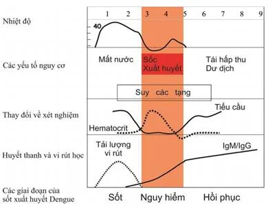
        

          
Figure 1. Sơ Đồ Các Giai Đoạn Lâm Sàng Của Sốt Xuất Huyết Dengue (QĐ 2760/QĐ-BYT)

          Sơ đồ động học 3 giai đoạn của bệnh theo trục thời gian (từ Ngày 1 đến Ngày 9): Mô tả diễn biến đường cong nhiệt độ cơ thể; các nguy cơ lâm sàng chính (mất nước, sốc thoát huyết tương, xuất huyết nội tạng, suy đa tạng, hiện tượng tái hấp thu dịch quá tải); động học cận lâm sàng (Hct tăng cao và tiểu cầu tụt dốc trong giai đoạn nguy hiểm Ngày 3–7); và động học kháng nguyên NS1, kháng thể IgM/IgG.
        

      

      

        ⚠️
        

          <strong>Cạm Bẫy Lâm Sàng Sống Còn:</strong> 
          Thời điểm bệnh nhân <strong>hạ sốt (Ngày thứ 3 đến thứ 6) KHÔNG PHẢI là dấu hiệu khỏi bệnh</strong>! Đây chính là lúc người bệnh bước vào <strong>Giai đoạn Nguy hiểm</strong>. Đa số các trường hợp sốc giảm thể tích tuần hoàn, xuất huyết ồ ạt và tử vong đều xảy ra trong cửa sổ thời gian 24–48 giờ này. Bác sĩ và gia đình tuyệt đối không được chủ quan hạ sốt là khỏi.
        

      

    

  

  <!-- ====================================================================== -->
  <!-- SECTION 2: CHẨN ĐOÁN CĂN NGUYÊN, PHÂN ĐỘ & PHÂN NHÓM TUYẾN (FIG 2)   -->
  <!-- ====================================================================== -->
  

    

      📑
      <h2 class="sec-title">Phần 2: Chẩn Đoán Căn Nguyên, Phân Độ Lâm Sàng &amp; Cây Phân Nhóm Tuyến Điều Trị</h2>
      Phân Tuyến &amp; Tiêu Chuẩn
    

    

      
Chiến Lược Xét Nghiệm Căn Nguyên Vi Rút Theo Ngày Bệnh

      

        

          

          

            
🔬

            
Kháng Nguyên Dengue NS1 (Test Nhanh)

          

          

            <ul style="margin-left: 1rem; line-height: 1.7;">
              <li><strong>Thời điểm chỉ định:</strong> Từ Ngày 1 đến Ngày 7 của bệnh.</li>
              <li><strong>Độ nhạy tối ưu:</strong> Cao nhất trong <strong>5 ngày đầu tiên</strong> của giai đoạn sốt.</li>
              <li>Âm tính không loại trừ hoàn toàn SXHD nếu lâm sàng và dịch tễ điển hình.</li>
            </ul>
          

          
Ưu Tiên Pha Sốt Cấp

        

        

          

          

            
🩸

            
Kháng Thể IgM &amp; IgG (ELISA / Test Nhanh)

          

          

            <ul style="margin-left: 1rem; line-height: 1.7;">
              <li><strong>Thời điểm chỉ định:</strong> Từ <strong>Ngày thứ 5 trở đi</strong> của bệnh.</li>
              <li>Đặc biệt có giá trị khi NS1 âm tính nhưng lâm sàng nghi ngờ SXHD.</li>
              <li>IgM (+) xác nhận nhiễm cấp; IgG tăng hiệu giá 4 lần phân biệt nhiễm thứ phát.</li>
            </ul>
          

          
Ưu Tiên Từ Ngày Thứ 5

        

        

          

          

            
🧬

            
RT-PCR &amp; Phân Lập Vi Rút

          

          

            <ul style="margin-left: 1rem; line-height: 1.7;">
              <li>Thực hiện lấy mẫu máu trong pha sốt (trước Ngày 5).</li>
              <li>Xác định chính xác typ huyết thanh (DEN-1, DEN-2, DEN-3, DEN-4) phục vụ giám sát dịch tễ học và các ca bệnh nặng phức tạp.</li>
            </ul>
          

          
Giám Sát Chuyên Sâu

        

      

      
Bảng Phân Độ Lâm Sàng Sốt Xuất Huyết Dengue (Phụ Lục 2 BYT 2023)

      

        <table class="table-modern">
          <thead>
            <tr>
              <th style="width: 22%;">Phân Độ Lâm Sàng</th>
              <th style="width: 78%;">Tiêu Chuẩn Lâm Sàng &amp; Cận Lâm Sàng Chi Tiết</th>
            </tr>
          </thead>
          <tbody>
            <tr>
              <td>
                <strong style="color: #0284c7;">1. Sốt Xuất Huyết Dengue</strong> 
                Thể Thông Thường
              </td>
              <td>
                • Sốt cấp tính ≤ 7 ngày tại vùng dịch tễ kèm <strong>ít nhất 2 trong các dấu hiệu</strong>: Buồn nôn/nôn; phát ban; đau cơ/đau khớp, nhức 2 hố mắt; xuất huyết da hoặc nghiệm pháp dây thắt (Lacet) (+). 
                • Cận lâm sàng: Hematocrit bình thường hoặc tăng nhẹ; số lượng bạch cầu và tiểu cầu bình thường hoặc giảm nhẹ.
              </td>
            </tr>
            <tr>
              <td>
                <strong style="color: #d97706;">2. SXHD Có Dấu Hiệu Cảnh Báo (DHCB)</strong> 
                Chỉ Định Nhập Viện Nội Trú
              </td>
              <td>
                Có <strong>ít nhất 1 trong 7 dấu hiệu cảnh báo</strong> sau đây: 
                <strong>1. Tri giác:</strong> Vật vã, lừ đừ, li bì, mệt mỏi bứt rứt. 
                <strong>2. Tiêu hóa:</strong> Đau bụng nhiều liên tục hoặc tăng cảm giác đau vùng gan. 
                <strong>3. Nôn ói:</strong> Nôn ói nhiều (≥ 3 lần/1 giờ hoặc ≥ 4 lần/6 giờ). 
                <strong>4. Xuất huyết:</strong> Xuất huyết niêm mạc tự nhiên (chảy máu chân răng, mũi, nôn ra máu, tiêu phân đen/máu, xuất huyết âm đạo hoặc tiểu máu). 
                <strong>5. Thăm khám:</strong> Gan to &gt; 2cm dưới bờ sườn. 
                <strong>6. Tiết niệu:</strong> Lượng nước tiểu giảm, tiểu ít (&lt; 0.5 ml/kg/giờ). 
                <strong>7. Cận lâm sàng:</strong> Dung tích hồng cầu (Hct) tăng cao kèm theo số lượng tiểu cầu giảm nhanh chóng; men gan AST hoặc ALT ≥ 400 U/L; siêu âm hoặc X-quang phát hiện có tràn dịch màng phổi, màng bụng.
              </td>
            </tr>
            <tr>
              <td>
                <strong style="color: #dc2626;">3. Sốt Xuất Huyết Dengue Nặng</strong> 
                Chỉ Định Nhập Hồi Sức Tích Cực (ICU)
              </td>
              <td>
                Có <strong>ít nhất 1 trong 3 biểu hiện nặng</strong> sau đây: 
                • <strong>1. Thoát huyết tương nặng:</strong> Dẫn đến <em>Sốc SXHD</em> (mạch nhanh nhỏ, HA kẹt hoặc tụt); <em>Sốc SXHD nặng</em> (mạch không bắt được, HA không đo được); hoặc ứ dịch mô kẽ/tràn dịch màng phổi gây suy hô hấp cấp. 
                • <strong>2. Xuất huyết nặng:</strong> Xuất huyết đường tiêu hóa ồ ạt, nôn ra máu tươi, tiêu phân máu đỏ tươi, xuất huyết âm đạo nặng, xuất huyết trong cơ và mô mềm, xuất huyết phổi hoặc xuất huyết não. 
                • <strong>3. Suy tạng nặng:</strong> Tổn thương gan nặng/suy gan cấp (men gan AST hoặc ALT ≥ 1000 U/L); tổn thương thần kinh trung ương (thể não: rối loạn tri giác, co giật, hôn mê); tổn thương tim (viêm cơ tim, suy tim cấp) hoặc tổn thương thận cấp (AKI).
              </td>
            </tr>
          </tbody>
        </table>
      

      
Sơ Đồ Phân Nhóm Tuyến Điều Trị Người Bệnh (Phụ Lục 3 BYT 2023)

      

        Quy định xử trí phân tuyến ngay khi tiếp nhận ca bệnh nghi ngờ SXHD nhằm tránh tình trạng chuyển viện trễ gây tử vong hoặc quá tải bệnh viện tuyến trên:
      

      <!-- FIGURE 2 EMBEDDED CARD -->
      

        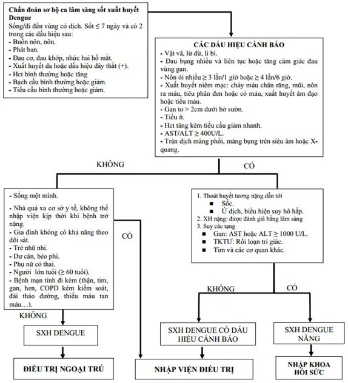
        

          
Figure 2. Sơ Đồ Phân Nhóm Điều Trị Người Bệnh Sốt Xuất Huyết Dengue (QĐ 2760/QĐ-BYT)

          Cây quyết định phân loại tiếp nhận người bệnh: Nhánh SXHD nặng → Chuyển vào Khoa Hồi sức tích cực (Nhóm C); Nhánh SXHD có DHCB HOẶC SXHD kèm yếu tố cơ địa nguy cơ cao → Nhập viện điều trị nội trú (Nhóm B); Nhánh SXHD thông thường không có DHCB và không có yếu tố nguy cơ → Theo dõi và điều trị ngoại trú (Nhóm A).
        

      

      

        

          

            
A

            

          

          

            

              
Nhóm A: Điều Trị Ngoại Trú Có Theo Dõi Hàng Ngày

              Tuyến Cơ Sở
            

            

              Áp dụng cho bệnh nhân SXHD thể thông thường, <strong>không có dấu hiệu cảnh báo</strong> và <strong>không có yếu tố cơ địa nguy cơ</strong>. Hướng dẫn nghỉ ngơi, bù dịch đường uống (Oresol, nước hoa quả), hạ sốt bằng Paracetamol đơn chất (10–15 mg/kg mỗi 4–6h, tối đa 60 mg/kg/ngày). <strong>Tuyệt đối không dùng Aspirin, Ibuprofen</strong>. Tái khám và kiểm tra công thức máu, Hct mỗi ngày cho đến khi hết sốt ít nhất 48 giờ.
            

          

        

        

          

            
B

            

          

          

            

              
Nhóm B: Nhập Viện Điều Trị Nội Trú Tại Khoa Truyền Nhiễm / Nhi / Nội

              Nhập Viện Nội Trú
            

            

              Áp dụng cho: (1) Bệnh nhân <strong>SXHD có dấu hiệu cảnh báo</strong>; HOẶC (2) Bệnh nhân SXHD thể thông thường nhưng có <strong>yếu tố cơ địa nguy cơ cao</strong>:
              <ul style="margin-left: 1.25rem; margin-top: 4px; line-height: 1.6;">
                <li>Sống một mình, nhà quá xa cơ sở y tế không thể cấp cứu kịp thời khi trở nặng.</li>
                <li>Gia đình không có khả năng theo dõi sát diễn biến của người bệnh.</li>
                <li>Trẻ nhũ nhi (≤ 12 tháng tuổi), người béo phì hoặc thừa cân.</li>
                <li>Phụ nữ có thai, người cao tuổi (≥ 60 tuổi).</li>
                <li>Có bệnh lý mạn tính đi kèm: Bệnh tim mạch, bệnh phổi mạn (COPD, hen), suy thận, xơ gan, đái tháo đường, Thalassemia hoặc các bệnh huyết học tan máu.</li>
              </ul>
            

          

        

        

          

            
C

            

          

          

            

              
Nhóm C: Cấp Cứu Khẩn Cấp &amp; Nhập Khoa Hồi Sức Tích Cực (ICU)

              Cấp Cứu ICU
            

            

              Chỉ định bắt buộc cho tất cả bệnh nhân <strong>SXHD Nặng</strong>: Sốc SXHD, Sốc nguy kịch (mạch không bắt được, HA không đo được), xuất huyết nội tạng nặng, suy gan cấp, suy thận cấp, tổn thương thể não hoặc suy hô hấp do tràn dịch đa màng.
            

          

        

      

    

  

  <!-- ====================================================================== -->
  <!-- SECTION 3: BÙ DỊCH SXHD CÓ DẤU HIỆU CẢNH BÁO (FIG 3, 4, 5)           -->
  <!-- ====================================================================== -->
  

    

      💧
      <h2 class="sec-title">Phần 3: Phác Đồ Bù Dịch Tĩnh Mạch SXHD Có Dấu Hiệu Cảnh Báo (DHCB)</h2>
      Phác Đồ Bậc Thang
    

    

      
Nguyên Tắc Bù Dịch Điện Giải Đẳng Trương

      

        Dịch truyền tĩnh mạch chỉ định khi bệnh nhân nôn ói nhiều, không uống được, mệt lả, có dấu mất nước rõ rệt hoặc Hematocrit (Hct) tăng cao. Dung dịch lựa chọn hàng đầu là <strong>dịch điện giải đẳng trương: Ringer lactate, Ringer acetate hoặc NaCl 0.9%</strong>.
      

      <!-- SUB-SECTION 3.1: TRẺ EM -->
      
<i class="fa-solid fa-child"></i> 1. Phác Đồ Bù Dịch Ở Trẻ Em (&lt; 16 Tuổi)

      

        Bắt đầu truyền điện giải tốc độ <strong>6–7 ml/kg/giờ trong 1–3 giờ đầu</strong>, sau đó giảm xuống <strong>5 ml/kg/giờ trong 2–4 giờ tiếp theo</strong>. Theo dõi sát lâm sàng và xét nghiệm Hct mỗi 2–4 giờ:
      

      

        

          

            <i class="fa-solid fa-circle-check"></i> Nhánh Đáp Ứng Tốt (Lâm sàng &amp; Hct cải thiện)
          

          

            Nếu mạch rõ, HA ổn định, Hct giảm và nước tiểu <strong>≥ 0.5–1 ml/kg/giờ</strong> → Giảm tốc độ truyền xuống <strong>3 ml/kg/giờ trong 2–4 giờ</strong>. Nếu lâm sàng tiếp tục cải thiện ổn định, xem xét <strong>ngừng truyền dịch sau 24–48 giờ</strong>.
          

        

        

          

            <i class="fa-solid fa-triangle-exclamation"></i> Nhánh Không Đáp Ứng / Xấu Đi
          

          

            Nếu mạch nhanh, HA kẹt hoặc tụt, Hct tăng cao trở lại: Kiểm tra và điều chỉnh toan máu, xuất huyết, hạ đường huyết, hạ calci. 
            • Nếu tổng dịch truyền <strong>&gt; 60 ml/kg</strong> → Chuyển sang truyền <strong>Cao phân tử (CPT) 10–20 ml/kg/giờ trong 1 giờ</strong> và xử trí theo phác đồ sốc. 
            • Nếu tổng dịch truyền <strong>≤ 60 ml/kg</strong> → Tăng dịch tinh thể lên <strong>10–20 ml/kg/giờ trong 1 giờ</strong> và xử trí theo phác đồ sốc.
          

        

      

      

        ⚠️
        

          <strong>Lưu Ý Lâm Sàng Đặc Biệt Trong Phác Đồ Bù Dịch Trẻ Em (Phụ Lục 4 BYT 2023):</strong> 
          • <em>Nếu SXHD cảnh báo kèm chi lạnh (mát), mạch nhanh, HA bình thường:</em> Truyền Ringer lactate, Ringer acetate hoặc NaCl 0.9% tốc độ <strong>10 ml/kg/giờ trong 1 giờ</strong> rồi đánh giá lại. Nếu cải thiện (chi ấm, mạch chậm lại, HA bình thường) → tiếp tục giảm dịch 6–7 ml/kg/h (1–3h) → 5 ml/kg/h (2–4h) → 3 ml/kg/h (2–4h); nếu vào sốc → truyền điện giải <strong>20 ml/kg/giờ trong 1 giờ</strong> theo phác đồ sốc. 
          • <em>Nếu SXHD cảnh báo kèm chi lạnh ẩm, thời gian đổ đầy mao mạch (CRT) ≥ 3 giây, lừ đừ hoặc vật vã, bứt rứt, HA bình thường hoặc hiệu áp = 25 mmHg:</em> <strong>Điều trị ngay như SỐC SXHD</strong>!
        

      

      <!-- FIGURE 3 EMBEDDED CARD -->
      

        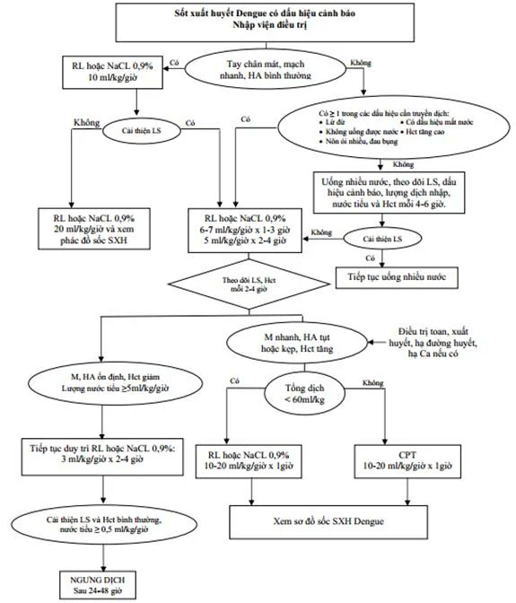
        

          
Figure 3. Sơ Đồ Xử Trí SXHD Có Dấu Hiệu Cảnh Báo Ở Trẻ Em (Phụ Lục 4 BYT 2023)

          Thuật toán bù dịch chi tiết cho bệnh nhi: Phân nhánh tay chân mát, mạch nhanh (bù 10 ml/kg/h) vs có chỉ định truyền dịch (bù 6–7 ml/kg/h x 1–3h → 5 ml/kg/h x 2–4h); lộ trình giảm dịch xuống 3 ml/kg/h và ngưng dịch sau 24–48h; quy tắc nâng liều hoặc chuyển Cao phân tử khi tổng dịch vượt 60 ml/kg.
        

      

      <!-- SUB-SECTION 3.2: THIẾU NIÊN -->
      
<i class="fa-solid fa-user-group"></i> 2. Phác Đồ Bù Dịch Ở Trẻ Thiếu Niên (13 – 16 Tuổi)

      

        Trẻ thiếu niên có đặc điểm sinh lý chuyển tiếp giữa trẻ em và người lớn: Hiện tượng thoát huyết tương thường ít rầm rộ hơn trẻ nhỏ nhưng diện tích da và thể tích phân bố lớn hơn. Do đó, <strong>thời gian duy trì ở mỗi nấc tốc độ dịch truyền chỉ bằng 1/2 so với trẻ em</strong> nhằm ngăn ngừa biến chứng quá tải tuần hoàn:
      

      <!-- FIGURE 4 EMBEDDED CARD -->
      

        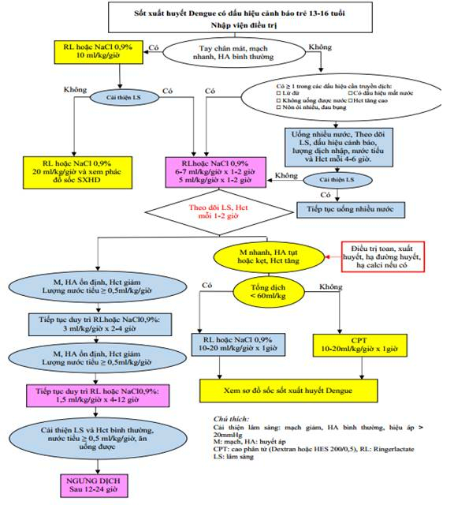
        

          
Figure 4. Sơ Đồ Xử Trí SXHD Có Dấu Hiệu Cảnh Báo Ở Trẻ Thiếu Niên (Phụ Lục 5 BYT 2023)

          Thuật toán tối ưu cho lứa tuổi 13–16 tuổi: Bù dịch tinh thể giảm dần nhanh chóng (6–7 ml/kg/h → 5 ml/kg/h → 3 ml/kg/h) với thời gian rút ngắn một nửa, bổ sung nấc truyền duy trì tối thiểu 1.5 ml/kg/h trong 4–12 giờ trước khi ngưng dịch sau 12–24 giờ.
        

      

      <!-- SUB-SECTION 3.3: NGƯỜI LỚN -->
      
<i class="fa-solid fa-person"></i> 3. Phác Đồ Bù Dịch Ở Người Lớn (≥ 16 Tuổi)

      

        Ở người lớn, chỉ định truyền dịch khi nôn nhiều, không uống được, có biểu hiện mất nước hoặc Hct tăng cao. Tốc độ bù khởi đầu bằng <strong>dịch điện giải 6 ml/kg/giờ trong 1–2 giờ</strong>, sau đó giảm xuống <strong>3 ml/kg/giờ trong 2–4 giờ</strong>.
      

      

        <table class="table-modern">
          <thead>
            <tr>
              <th style="width: 25%;">Tốc Độ Bù Dịch</th>
              <th style="width: 35%;">Thời Gian &amp; Đánh Giá</th>
              <th style="width: 40%;">Hướng Xử Trí Tiếp Theo</th>
            </tr>
          </thead>
          <tbody>
            <tr>
              <td><strong>Bậc 1: 6 ml/kg/giờ</strong></td>
              <td>Truyền trong <strong>1–2 giờ đầu</strong></td>
              <td>Nếu Hct giảm, sinh hiệu ổn định → Chuyển Bậc 2.</td>
            </tr>
            <tr>
              <td><strong>Bậc 2: 3 ml/kg/giờ</strong></td>
              <td>Truyền trong <strong>2–4 giờ tiếp theo</strong></td>
              <td>Nếu mạch, HA ổn định, nước tiểu ≥ 0.5 ml/kg/h → Chuyển Bậc 3.</td>
            </tr>
            <tr>
              <td><strong>Bậc 3: 1.5 ml/kg/giờ</strong></td>
              <td>Truyền duy trì trong <strong>6–18 giờ</strong></td>
              <td><strong>Ngừng truyền dịch hoàn toàn sau 12–24 giờ</strong> khi người bệnh tự uống được.</td>
            </tr>
            <tr>
              <td>Khi Xuất Hiện Sốc</td>
              <td>Mạch nhanh nhẹ, khó bắt, HA kẹt hoặc tụt, Hct tăng cao</td>
              <td><strong>Chống sốc ngay bằng dịch Cao phân tử 10–15 ml/kg/giờ trong 1 giờ đầu</strong> (theo mục B2 BYT 2023, do đã thất bại với điện giải ở liều DHCB nên liều chống sốc đầu tiên bắt buộc là Cao phân tử).</td>
            </tr>
          </tbody>
        </table>
      

      <!-- FIGURE 5 EMBEDDED CARD -->
      

        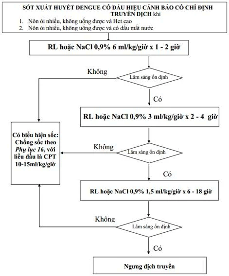
        

          
Figure 5. Sơ Đồ Xử Trí SXHD Có Dấu Hiệu Cảnh Báo Ở Người Lớn (Phụ Lục 6 BYT 2023)

          Lộ trình bù dịch tĩnh mạch cho người lớn: Khởi đầu 6 ml/kg/h (1–2h) → 3 ml/kg/h (2–4h) → 1.5 ml/kg/h (6–18h); ngưng dịch sớm sau 12–24h; chỉ định chuyển Cao phân tử 10–15 ml/kg/h khi có dấu hiệu tiến triển vào sốc.
        

      

    

  

  <!-- ====================================================================== -->
  <!-- SECTION 4: PHÁC ĐỒ CHỐNG SỐC & SỐC NẶNG (FIG 6, 7, 8, 9)              -->
  <!-- ====================================================================== -->
  

    

      ⚡
      <h2 class="sec-title">Phần 4: Phác Đồ Chống Sốc SXHD &amp; Sốc Nặng Nguy Kịch (M = 0, HA = 0)</h2>
      Hồi Sức Cấp Cứu
    

    

      
Chống Sốc Ở Trẻ Em (&lt; 16 Tuổi)

      

        <strong>Giờ đầu tiên:</strong> Truyền dịch điện giải (Ringer lactate hoặc NaCl 0.9%) tốc độ <strong>20 ml/kg/giờ trong 1 giờ</strong> (nếu tụt huyết áp nặng: truyền 20 ml/kg trong vòng 30 phút). Đánh giá lại lâm sàng và đo Hct sau 1 giờ:
      

      

        

          

            ✓ Cải Thiện Lâm Sàng (Ra sốc, mạch rõ, HA lên)
          

          

            Giảm dần tốc độ dịch điện giải theo bậc: 
            <strong>10 ml/kg/giờ trong 1–2 giờ</strong> → <strong>7.5 ml/kg/giờ trong 1–2 giờ</strong> → <strong>5 ml/kg/giờ trong 3–4 giờ</strong> → <strong>3 ml/kg/giờ trong 4–6 giờ</strong>. Xem xét ngừng dịch hoàn toàn sau 24–48 giờ.
          

        

        

          

            ✗ Không Cải Thiện (Sốc kéo dài / Tái sốc)
          

          

            Đánh giá ngay động học Hct: 
            • <strong>Nếu Hct còn tăng cao hoặc ≥ 40%:</strong> Chuyển sang <strong>Cao phân tử (Dextran 40/70 hoặc HES 200) tốc độ 10–20 ml/kg/giờ trong 1 giờ</strong>. 
            • <strong>Nếu Hct giảm thấp hoặc ≤ 35% (nghi ngờ xuất huyết nội):</strong> Truyền ngay <strong>Hồng cầu lắng 5–10 ml/kg</strong> hoặc Máu toàn phần 10–20 ml/kg.
          

        

      

      <!-- FIGURE 6 EMBEDDED CARD -->
      

        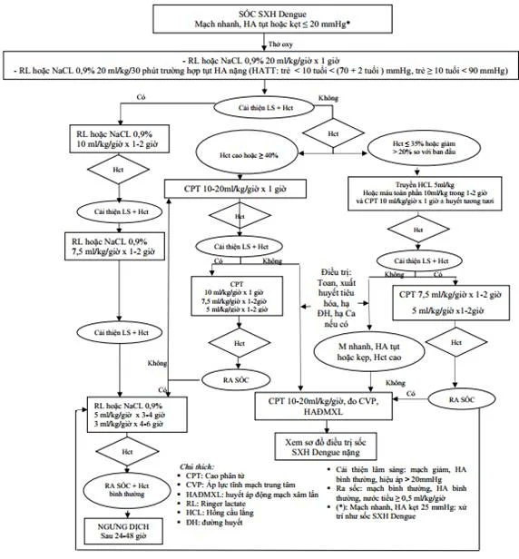
        

          
Figure 6. Sơ Đồ Truyền Dịch Trong Sốc Sốt Xuất Huyết Dengue Ở Trẻ Em (Phụ Lục 8 BYT 2023)

          Thuật toán chống sốc hoàn chỉnh ở trẻ em: Bắt đầu điện giải 20 ml/kg/h x 1h; rẽ nhánh xử trí tinh tế theo động học Hct (Hct ≥ 40% dùng Cao phân tử vs Hct ≤ 35% truyền máu cấp cứu); bậc thang giảm dịch chi tiết đến khi ngưng truyền an toàn.
        

      

      <!-- FIGURE 7 EMBEDDED CARD: SỐC NẶNG TRẺ EM -->
      
<i class="fa-solid fa-skull-crossbones" style="color: #dc2626;"></i> Sốc SXHD Nặng Ở Trẻ Em (Mạch = 0, Huyết Áp = 0 Hoặc Hiệu Áp ≤ 10 mmHg)

      

        Tình huống tối khẩn cấp đe dọa tính mạng: Cho trẻ nằm đầu phẳng, thở oxy lưu lượng cao qua mask. <strong>Dùng bơm tiêm to bơm trực tiếp vào tĩnh mạch dịch điện giải với liều 20 ml/kg trong vòng 15 phút</strong>. Sau đó đánh giá lại tức thì:
      

      

        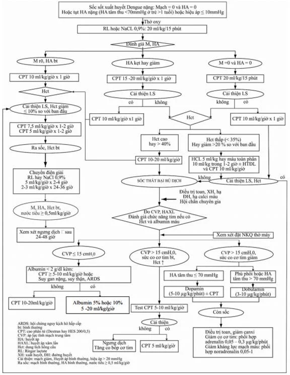
        

          
Figure 7. Sơ Đồ Truyền Dịch Trong Sốc SXHD Nặng Ở Trẻ Em (Phụ Lục 12 BYT 2023)

          Xử trí tối khẩn cấp khi mạch bằng 0, HA bằng 0: Bơm tĩnh mạch trực tiếp dịch điện giải 20 ml/kg/15 phút; nếu mạch rõ chuyển CPT 10 ml/kg/h; nếu chưa cải thiện dùng CPT 15–20 ml/kg/h hoặc bolus CPT 20 ml/kg/15 phút; chỉ định đặt nội khí quản, đo CVP, HA động mạch xâm lấn và phối hợp Albumin khi CPT tích lũy ≥ 60 ml/kg.
        

      

      
      <!-- SUB-SECTION 4.1b: THIẾU NIÊN 13 - 16 TUỔI (PHỤ LỤC 11 BYT 2023) -->
      
<i class="fa-solid fa-user-graduate" style="color: #0284c7;"></i> Sơ Đồ Xử Trí Sốc SXHD Ở Trẻ Thiếu Niên 13 – 16 Tuổi (Phụ Lục 11 BYT 2023)

      

        Quyết định 2760/QĐ-BYT năm 2023 lần đầu tiên thiết lập phác đồ chống sốc riêng biệt cho lứa tuổi <strong>thiếu niên 13 – 16 tuổi</strong>. Lứa tuổi này có cân nặng tiệm cận người lớn nhưng cơ chế điều hòa thành mạch và nguy cơ quá tải dịch vẫn mang đặc điểm nhi khoa. Trẻ béo phì hoặc dư cân bắt buộc sử dụng <strong>cân nặng hiệu chỉnh CDC</strong>:
      

      

        ⚠️
        

          <strong>Dấu Hiệu Nhận Biết Sốc Ở Trẻ Thiếu Niên 13–16 Tuổi (Phụ Lục 11 BYT 2023):</strong> 
          • Mạch nhanh, huyết áp tụt hoặc huyết áp kẹt (hiệu áp ≤ 20 mmHg). 
          • <strong>(*) Lưu ý quan trọng:</strong> Nếu trẻ có <strong>mạch nhanh kèm hiệu áp kẹt = 25 mmHg</strong> (ví dụ 100/75 mmHg hoặc 95/70 mmHg): <strong>XỬ TRÍ NGAY NHƯ SỐC SXHD</strong>! 
          • Cho trẻ nằm đầu phẳng, thở oxy qua gọng mũi 1–6 lít/phút.
        

      

      

        

          <i class="fa-solid fa-diagram-project"></i> Thuật Toán Truyền Dịch Sốc Thiếu Niên 13–16 Tuổi (Bậc Thang Phụ Lục 11):
        

        

          <strong>BƯỚC 1 (Giờ Đầu Tiên):</strong> Truyền tĩnh mạch nhanh <strong>Ringer lactate hoặc NaCl 0.9% tốc độ 20 ml/kg/giờ trong 1 giờ</strong>. Đánh giá lại lâm sàng và Hematocrit sau 1 giờ:
        

        

          

            

              ✓ Cải Thiện Lâm Sàng &amp; Hct (Ra sốc, mạch giảm, HA bình thường, hiệu áp &gt; 20 mmHg)
            

            

              Giảm tốc độ Ringer lactate hoặc NaCl 0.9% tuần tự theo các bậc thời gian chuẩn: 
              • <strong>10 ml/kg/giờ trong 1 giờ</strong> → 
              • <strong>7.5 ml/kg/giờ trong 1 giờ</strong> → 
              • <strong>5.0 ml/kg/giờ trong 1 giờ</strong> → 
              • <strong>3.0 ml/kg/giờ trong 4 – 6 giờ</strong> → 
              • <strong>1.5 ml/kg/giờ trong 12 – 18 giờ</strong>. 
              <strong style="color: #047857;">🎯 Tiêu chuẩn ra sốc hoàn toàn:</strong> Mạch bình thường, HA bình thường, lưu lượng nước tiểu đạt ≥ 0.5 ml/kg/giờ. <strong>NGƯNG DỊCH TRUYỀN SAU 24 GIỜ</strong> nếu lâm sàng ổn định.
            

          

          

            

              ✗ Không Cải Thiện Lâm Sàng (Mạch còn nhanh, HA còn tụt hoặc kẹt)
            

            

              Khẩn trương phân định động học Hematocrit (Hct): 
              • <strong>Trường hợp 1 (Hct cao hoặc ≥ 40%):</strong> Chuyển sang <strong>Cao phân tử (CPT) 10 – 20 ml/kg/giờ trong 1 giờ</strong>. 
              &nbsp;&nbsp;+ Nếu cải thiện: Giảm CPT 10 ml/kg/h (1h) → CPT 7.5 ml/kg/h (1–2h) → CPT 5 ml/kg/h (1–2h) → chuyển sang điện giải (RL/NaCl 0.9%) 5 ml/kg/h (1h) → 3 ml/kg/h (4–6h) → Ra sốc. 
              &nbsp;&nbsp;+ Nếu không cải thiện: Lặp lại CPT 10–20 ml/kg/h, đo CVP, đặt HA động mạch xâm lấn, chuyển sơ đồ sốc nặng. 
              • <strong>Trường hợp 2 (Hct ≤ 35% hoặc giảm nhanh &gt; 20% so với ban đầu):</strong> Nghi ngờ xuất huyết nội tạng → <strong>Truyền ngay Hồng cầu lắng 5 ml/kg</strong> (hoặc Máu toàn phần 10 ml/kg trong 1–2 giờ) ± Huyết tương tươi đông lạnh. 
              • <strong>Kiểm tra &amp; điều trị đồng thời:</strong> Toan chuyển hóa, xuất huyết tiêu hóa, hạ đường huyết, hạ Canxi máu.
            

          

        

      

      <!-- SUB-SECTION 4.2: NGƯỜI LỚN -->
      
<i class="fa-solid fa-person-burst"></i> Chống Sốc Ở Người Lớn (≥ 16 Tuổi)

      

        <strong>Giờ đầu tiên:</strong> Truyền dịch điện giải <strong>15 ml/kg/giờ trong 1 giờ</strong>. Đánh giá lại:
         • <em>Nếu cải thiện:</em> Giảm dần dịch tinh thể: <strong>10 ml/kg/h x 2h</strong> → <strong>6 ml/kg/h x 2h</strong> → <strong>3 ml/kg/h x 5–7h</strong> → <strong>1.5 ml/kg/h x 12h</strong> rồi ngừng truyền.
         • <em>Nếu không cải thiện:</em> Đo Hct: Hct giảm &gt; 20% hoặc Hct &lt; 35% → Truyền máu khẩn; Hct tăng hoặc không đổi → Chuyển <strong>Cao phân tử 10–15 ml/kg/giờ trong 1 giờ</strong>.
      

      <!-- FIGURE 8 & FIGURE 9 EMBEDDED CARDS -->
      

        

          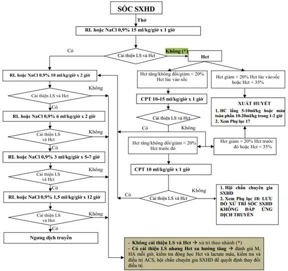
          

            
Figure 8. Sơ Đồ Chống Sốc SXHD Ở Người Lớn (Phụ Lục 16.1 BYT 2023)

            Phác đồ khởi đầu điện giải 15 ml/kg/h x 1h; rẽ nhánh theo dõi Hct và lactate mỗi giờ; giảm dịch từng bậc đến ngưng truyền.
          

        

        

          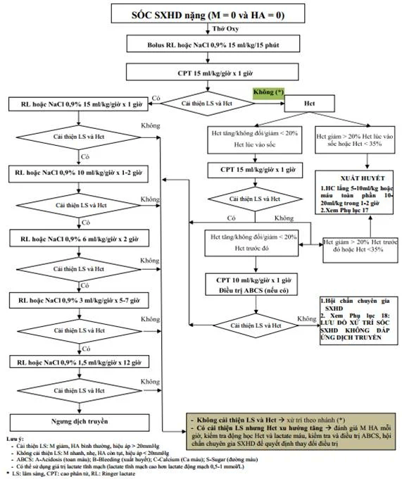
          

            
Figure 9. Sơ Đồ Chống Sốc SXHD Nặng Ở Người Lớn (Phụ Lục 16.2 BYT 2023)

            Xử trí sốc mất mạch (M=0, HA=0): Bolus nhanh tinh thể 15 ml/kg trong 15 phút, sau đó truyền CPT 15 ml/kg/h trong 1 giờ.
          

        

      

      
<i class="fa-solid fa-weight-scale"></i> Quy Tắc Tính Cân Nặng Chống Sốc Ở Người Lớn &amp; Bảng Tra Cứu Trẻ Em (Phụ Lục 9 BYT 2023)

      
      <!-- CÂN NẶNG HIỆU CHỈNH NGƯỜI LỚN -->
      

        

          <i class="fa-solid fa-calculator"></i> 1. Công Thức Cân Nặng Chống Sốc Ở Người Lớn (Mục C.2.1 &amp; Phụ Lục 9 BYT 2023)
        

        

          • <strong>Nếu BMI &lt; 25 kg/m²:</strong> Sử dụng <strong>Cân nặng thực tế</strong>. 
          • <strong>Nếu BMI ≥ 25 kg/m²</strong> (hoặc Phụ nữ mang thai 3 tháng cuối): Bắt buộc sử dụng <strong>Cân nặng hiệu chỉnh</strong> theo công thức Devine: 
          

            <strong>• Cân nặng lý tưởng (IBW):</strong> 
            - Nam: <code>IBW (kg) = 50.0 + 0.91 × [Chiều cao (cm) - 152.4]</code> 
            - Nữ: <code>IBW (kg) = 45.5 + 0.91 × [Chiều cao (cm) - 152.4]</code> 
            <strong>• Cân nặng hiệu chỉnh (AdjBW):</strong> 
            <code>CN hiệu chỉnh (kg) = CN lý tưởng + 0.4 × [CN thực tế - CN lý tưởng]</code>
          

          <em>Áp dụng cân nặng này để tính toàn bộ thể tích dịch điện giải và cao phân tử chống sốc nhằm phòng ngừa biến chứng phù phổi cấp và quá tải thể tích!</em>
        

      

      

        2. Bảng Tra Cứu Cân Nặng Hiệu Chỉnh Ở Trẻ Dư Cân, Béo Phì (Phụ Lục 9 BYT 2023 / CDC 2014)
      

      

        Ở trẻ em dư cân hoặc béo phì, thể tích mô mỡ lớn nhưng tuần hoàn mao mạch ít. Nếu tính lượng dịch chống sốc theo cân nặng thực tế sẽ gây <strong>quá liều thể tích dịch nghiêm trọng dẫn đến phù phổi cấp và tràn dịch màng phổi chèn ép</strong>. Bắt buộc tra cứu <strong>cân nặng hiệu chỉnh (kg)</strong> theo lứa tuổi và giới tính:
      

      

        <table class="table-modern">
          <thead>
            <tr>
              <th style="width: 20%; text-align: center;">Độ Tuổi (Năm)</th>
              <th style="width: 40%; text-align: center; color: #0284c7;">Cân Nặng Hiệu Chỉnh Bé Nam (kg)</th>
              <th style="width: 40%; text-align: center; color: #e11d48;">Cân Nặng Hiệu Chỉnh Bé Nữ (kg)</th>
            </tr>
          </thead>
          <tbody>
            <tr><td style="text-align: center;"><strong>2 Tuổi</strong></td><td style="text-align: center; font-weight: 700;">13 kg</td><td style="text-align: center; font-weight: 700;">12 kg</td></tr>
            <tr><td style="text-align: center;"><strong>3 Tuổi</strong></td><td style="text-align: center; font-weight: 700;">14 kg</td><td style="text-align: center; font-weight: 700;">14 kg</td></tr>
            <tr><td style="text-align: center;"><strong>4 Tuổi</strong></td><td style="text-align: center; font-weight: 700;">16 kg</td><td style="text-align: center; font-weight: 700;">16 kg</td></tr>
            <tr><td style="text-align: center;"><strong>5 Tuổi</strong></td><td style="text-align: center; font-weight: 700;">18 kg</td><td style="text-align: center; font-weight: 700;">18 kg</td></tr>
            <tr><td style="text-align: center;"><strong>6 Tuổi</strong></td><td style="text-align: center; font-weight: 700;">21 kg</td><td style="text-align: center; font-weight: 700;">20 kg</td></tr>
            <tr><td style="text-align: center;"><strong>7 Tuổi</strong></td><td style="text-align: center; font-weight: 700;">23 kg</td><td style="text-align: center; font-weight: 700;">23 kg</td></tr>
            <tr><td style="text-align: center;"><strong>8 Tuổi</strong></td><td style="text-align: center; font-weight: 700;">26 kg</td><td style="text-align: center; font-weight: 700;">26 kg</td></tr>
            <tr><td style="text-align: center;"><strong>9 Tuổi</strong></td><td style="text-align: center; font-weight: 700;">29 kg</td><td style="text-align: center; font-weight: 700;">29 kg</td></tr>
            <tr><td style="text-align: center;"><strong>10 Tuổi</strong></td><td style="text-align: center; font-weight: 700;">32 kg</td><td style="text-align: center; font-weight: 700;">33 kg</td></tr>
            <tr><td style="text-align: center;"><strong>11 Tuổi</strong></td><td style="text-align: center; font-weight: 700;">36 kg</td><td style="text-align: center; font-weight: 700;">37 kg</td></tr>
            <tr><td style="text-align: center;"><strong>12 Tuổi</strong></td><td style="text-align: center; font-weight: 700;">40 kg</td><td style="text-align: center; font-weight: 700;">42 kg</td></tr>
            <tr><td style="text-align: center;"><strong>13 Tuổi</strong></td><td style="text-align: center; font-weight: 700;">45 kg</td><td style="text-align: center; font-weight: 700;">46 kg</td></tr>
            <tr><td style="text-align: center;"><strong>14 Tuổi</strong></td><td style="text-align: center; font-weight: 700;">51 kg</td><td style="text-align: center; font-weight: 700;">49 kg</td></tr>
            <tr><td style="text-align: center;"><strong>15 Tuổi</strong></td><td style="text-align: center; font-weight: 700;">56 kg</td><td style="text-align: center; font-weight: 700;">52 kg</td></tr>
            <tr><td style="text-align: center;"><strong>16 Tuổi</strong></td><td style="text-align: center; font-weight: 700;">61 kg</td><td style="text-align: center; font-weight: 700;">54 kg</td></tr>
          </tbody>
        </table>
      

    

  

  <!-- ====================================================================== -->
  <!-- SECTION 5: SỐC KHÔNG ĐÁP ỨNG, ĐO CVP & THUỐC VẬN MẠCH (FIG 10)       -->
  <!-- ====================================================================== -->
  

    

      📈
      <h2 class="sec-title">Phần 5: Sốc Trơ Dịch Truyền, Quy Trình Đo CVP &amp; Sử Dụng Thuốc Vận Mạch</h2>
      Huyết Động Nâng Cao
    

    

      
Chỉ Định Đo Áp Lực Tĩnh Mạch Trung Tâm (CVP) &amp; Kỹ Thuật

      

        Đo CVP được chỉ định khi: Sốc kéo dài, tái sốc, sốc không đáp ứng với tổng lượng bù dịch ≥ 60 ml/kg; có biểu hiện quá tải dịch hoặc nghi ngờ quá tải; sốc trên bệnh nhân có bệnh tim, phổi, thận mạn tính hoặc trẻ nhũ nhi béo phì.
      

      

        🛑
        

          <strong>Quy Tắc Vàng An Toàn Thủ Thuật Trong SXHD:</strong> 
          Bắt buộc đặt catheter tĩnh mạch trung tâm qua <strong>Tĩnh mạch nền ở khuỷu tay (PICC)</strong> bằng phương pháp Seldinger cải tiến dưới hướng dẫn siêu âm. <strong>TUYỆT ĐỐI KHÔNG đặt qua tĩnh mạch cảnh trong hoặc tĩnh mạch dưới đòn</strong> vì nguy cơ xuất huyết tạo khối máu tụ chèn ép đường thở không thể băng ép cầm máu!
        

      

      
Sử Dụng Thuốc Vận Mạch &amp; Tăng Co Bóp Cơ Tim

      

        Thuốc vận mạch chỉ được chỉ định khi <strong>đã bù đủ thể tích lòng mạch mà huyết áp vẫn chưa đạt và áp lực tĩnh mạch trung tâm đã trên 10 cmH₂O</strong> (hoặc IVC căng to suốt chu kỳ thở trên siêu âm):
      

      

        

          

          

            
💊

            
1. Dopamin (Lựa Chọn Đầu Tay)

          

          

            <ul style="margin-left: 1rem; line-height: 1.7;">
              <li><strong>Chỉ định:</strong> Lựa chọn đầu tiên trong sốc SXHD kéo dài ở trẻ em.</li>
              <li><strong>Liều dùng:</strong> <strong>5 – 10 µg/kg/phút</strong>.</li>
              <li><strong>Công thức pha bơm tiêm điện 50ml:</strong> <em>Tổng liều Dopamin (mg) = 3 × Cân nặng (kg)</em> pha trong Glucose 5% hoặc NaCl 0.9% vừa đủ 50ml; khi đó <strong>tốc độ bơm tiêm (ml/giờ) = liều truyền (µg/kg/phút)</strong>.</li>
            </ul>
          

          
Vận Mạch Hàng Đầu

        

        

          

          

            
🫀

            
2. Dobutamin (Khi Có Suy Tim / Quá Tải)

          

          

            <ul style="margin-left: 1rem; line-height: 1.7;">
              <li><strong>Chỉ định:</strong> Sốc kèm suy giảm sức co bóp cơ tim, có biểu hiện quá tải tuần hoàn hoặc thất bại với Dopamin.</li>
              <li><strong>Liều dùng:</strong> <strong>3 – 10 µg/kg/phút</strong> (pha tương tự công thức Dopamin).</li>
            </ul>
          

          
Tăng Co Bóp Cơ Tim

        

        

          

          

            
⚡

            
3. Noradrenaline &amp; Adrenaline

          

          

            <ul style="margin-left: 1rem; line-height: 1.7;">
              <li><strong>Noradrenaline:</strong> <strong>0.05 – 0.3 µg/kg/phút</strong> (chuẩn Phụ lục 15 BYT 2023 ở trẻ em) khi có sốc giãn mạch (giảm kháng lực mạch máu hệ thống, hiệu áp rộng).</li>
              <li><strong>Adrenaline:</strong> <strong>0.05 – 0.3 µg/kg/phút</strong> khi sốc kháng trị có suy giảm nặng lực co bóp cơ tim.</li>
            </ul>
          

          
Sốc Kháng Trị

        

      

      <!-- FIGURE 10 EMBEDDED CARD -->
      

        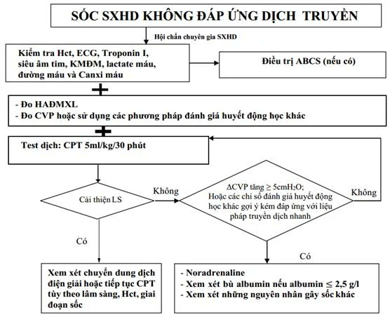
        

          
Figure 10. Lưu Đồ Xử Trí Sốc SXHD Không Đáp Ứng Dịch Truyền (Phụ Lục 18 BYT 2023)

          Quy trình tiếp cận sốc trơ: Hội chẩn khẩn cấp, đặt HA động mạch xâm lấn, đo CVP, làm khí máu và lactate; thực hiện test dịch Cao phân tử 5 ml/kg trong 30 phút; nếu CVP tăng vọt ≥ 5 cmH₂O hoặc kém đáp ứng → Dùng Noradrenaline và xem xét phối hợp bù Albumin 5%–20%.
        

      

      
      <!-- BẢNG CHI TIẾT SỬ DỤNG THUỐC VẬN MẠCH TRẺ EM (PHỤ LỤC 15 BYT 2023) -->
      
<i class="fa-solid fa-syringe" style="color: #0284c7;"></i> Hướng Dẫn Sử Dụng Thuốc Vận Mạch Trong Sốc SXHD Ở Trẻ Em (Phụ Lục 15 BYT 2023)

      

        Khi sốc kéo dài dù đã bù đủ dịch theo phác đồ, bắt buộc phải <strong>đo CVP (hoặc siêu âm tại giường khảo sát sự thay đổi kích thước tĩnh mạch chủ dưới IVC)</strong> trước khi quyết định dùng thuốc vận mạch:
      

      

        

          

            1. CVP &lt; 10 cmH₂O (Hoặc IVC xẹp &gt; 50% theo nhịp thở)
          

          

            Lòng mạch vẫn còn thiếu thể tích hiệu dụng do hiện tượng thoát huyết tương tiếp diễn. 
            → <strong>Tiếp tục bù dịch Cao phân tử (CPT) test 5 – 10 ml/kg trong 30 – 60 phút</strong> và đánh giá lại đáp ứng huyết động.
          

        

        

          

            2. CVP ≥ 10 – 12 cmH₂O (Hoặc IVC căng phồng &gt; 50% không đổi theo hô hấp)
          

          

            Lòng mạch đã đủ thể tích; sốc dai dẳng do giảm trương lực mạch hoặc suy giảm sức co bóp cơ tim. 
            → <strong>Chỉ định dùng ngay thuốc vận mạch</strong>, lựa chọn theo thể lâm sàng của sốc.
          

        

      

      

        <table class="table-modern">
          <thead>
            <tr>
              <th style="width: 25%;">Thuốc Vận Mạch &amp; Tăng Co Bóp</th>
              <th style="width: 35%;">Thể Lâm Sàng &amp; Chỉ Định Cụ Thể</th>
              <th style="width: 40%;">Liều Khởi Đầu, Phạm Vi &amp; Công Thức Pha Chuẩn</th>
            </tr>
          </thead>
          <tbody>
            <tr>
              <td>
                <strong style="color: #dc2626;">Noradrenalin</strong> 
                Sốc Giãn Mạch / Tụt HA
              </td>
              <td>
                • Sốc có <strong>huyết áp tụt sâu</strong> (sốc ấm, mạch nhanh nảy, chi ấm/mát, thời gian CRT &lt; 2 giây). 
                • CVP đã đạt ≥ 10–12 cmH₂O mà huyết áp vẫn chưa lên.
              </td>
              <td>
                • <strong>Liều khởi đầu:</strong> <strong>0.05 – 0.1 µg/kg/phút</strong>, tăng dần mỗi 10–15 phút theo đáp ứng HA, tối đa <strong>1.0 µg/kg/phút</strong>. 
                • <strong>Công thức pha bơm tiêm 50ml:</strong> <code>Liều (mg) = 0.3 × Cân nặng (kg)</code> pha vừa đủ 50ml dung dịch G5% hoặc NaCl 0.9%; khi đó <strong>1 ml/giờ = 0.1 µg/kg/phút</strong>.
              </td>
            </tr>
            <tr>
              <td>
                <strong style="color: #0284c7;">Dopamin</strong> 
                Sốc Lạnh / HA Kẹt
              </td>
              <td>
                • Sốc có <strong>huyết áp kẹt (hiệu áp ≤ 20 mmHg)</strong>, mạch nhanh nhỏ, chi lạnh ẩm, CRT kéo dài ≥ 3 giây. 
                • Lựa chọn ban đầu phổ biến khi chưa có catheter đo huyết áp động mạch xâm lấn.
              </td>
              <td>
                • <strong>Liều dùng:</strong> <strong>5 – 10 µg/kg/phút</strong> (tối đa 20 µg/kg/phút). 
                • <strong>Công thức pha bơm tiêm 50ml:</strong> <code>Tổng liều Dopamin (mg) = 3 × Cân nặng (kg)</code> pha đủ 50ml G5%/NaCl 0.9%; khi đó <strong>1 ml/giờ = 1.0 µg/kg/phút</strong>.
              </td>
            </tr>
            <tr>
              <td>
                <strong style="color: #10b981;">Dobutamin</strong> 
                Suy Tim / Quá Tải Dịch
              </td>
              <td>
                • Sốc kèm <strong>suy giảm sức co bóp cơ tim</strong> (siêu âm tim EF &lt; 50%), gan to nhanh, CVP tăng cao &gt; 12–15 cmH₂O, có dấu hiệu quá tải tuần hoàn hoặc phù phổi. 
                • Thường phối hợp với Dopamin hoặc Noradrenalin.
              </td>
              <td>
                • <strong>Liều dùng:</strong> <strong>5 – 10 µg/kg/phút</strong> (tối đa 20 µg/kg/phút). 
                • <strong>Công thức pha bơm tiêm 50ml:</strong> <code>Tổng liều Dobutamin (mg) = 3 × Cân nặng (kg)</code> pha đủ 50ml G5%/NaCl 0.9%; khi đó <strong>1 ml/giờ = 1.0 µg/kg/phút</strong>.
              </td>
            </tr>
            <tr>
              <td>
                <strong style="color: #e11d48;">Adrenalin (Epinephrine)</strong> 
                Sốc Nguy Kịch / Nhịp Chậm
              </td>
              <td>
                • Sốc kháng trị thất bại với Noradrenalin và Dopamin. 
                • Sốc kèm <strong>nhịp tim chậm</strong>, đe dọa ngưng tuần hoàn.
              </td>
              <td>
                • <strong>Liều dùng:</strong> <strong>0.05 – 0.2 µg/kg/phút</strong> (tối đa 1.0 µg/kg/phút). 
                • <strong>Công thức pha:</strong> Tương tự Noradrenalin (<code>0.3 × Cân nặng mg trong 50ml</code>; 1 ml/h = 0.1 µg/kg/phút).
              </td>
            </tr>
          </tbody>
        </table>
      

      <!-- XỬ TRÍ RỐI LOẠN TOAN KIỀM & ĐIỆN GIẢI (MỤC C.1.4 BYT 2023) -->
      
<i class="fa-solid fa-atom" style="color: #f59e0b;"></i> Điều Trị Rối Loạn Toan Kiềm, Điện Giải &amp; Gói Hỗ Trợ ABCS (Mục C.1.4 &amp; Phụ Lục 18)

      

        Trong sốc kéo dài hoặc sốc trơ dịch, các rối loạn toan chuyển hóa và điện giải làm cơ tim giảm đáp ứng với catecholamin, gây dãn mạch liệt kháng và làm nặng thêm rối loạn đông máu:
      

      

        

          

          

            
🧪

            
1. Toan Chuyển Hóa (Acidosis - A)

          

          

            • <strong>Chỉ định:</strong> Khi pH &lt; 7.35 và/hoặc HCO₃⁻ &lt; 17 mmol/L kèm lactate máu tăng cao do giảm tưới máu mô. 
            • <strong>Xử trí:</strong> Bù thể tích tuần hoàn tối ưu là biện pháp tiên quyết. Nếu toan nặng mất bù: 
            • <strong>Natri bicarbonat 4.2%: 2 ml/kg tiêm tĩnh mạch chậm</strong> (hoặc Natri bicarbonat 8.4% 1 ml/kg pha loãng gấp đôi). 
            • Có thể tính theo độ kiềm dư: <code>Lượng Bicarbonat (mEq) = 0.3 × Cân nặng (kg) × BE</code>.
          

        

        

          

          

            
🍬

            
2. Hạ Đường Huyết (Sugar - S)

          

          

            • <strong>Chỉ định:</strong> Đường huyết mao mạch &lt; 40 mg/dL (2.2 mmol/L), rất hay gặp ở trẻ nhỏ và bệnh nhân suy gan cấp. 
            • <strong>Xử trí cấp cứu:</strong> 
            • <strong>Trẻ &lt; 1 tuổi:</strong> Bơm tĩnh mạch chậm <strong>Dextrose 10% liều 2 ml/kg</strong>. 
            • <strong>Trẻ ≥ 1 tuổi &amp; người lớn:</strong> Bơm tĩnh mạch chậm <strong>Dextrose 30% liều 1 – 2 ml/kg</strong>. 
            • Sau đó duy trì đường truyền tĩnh mạch có Glucose 5% – 10% phòng ngừa hạ đường huyết tái phát.
          

        

        

          

          

            
🦴

            
3. Hạ Calci Huyết (Calcium - C)

          

          

            • <strong>Chỉ định:</strong> Calci ion hóa (iCa) &lt; 1.0 mmol/L, thường xuất hiện sau khi truyền lượng lớn dung dịch hoặc chế phẩm máu có chất chống đông citrate. 
            • <strong>Xử trí:</strong> 
            • <strong>Calci clorua 10%:</strong> <strong>0.1 – 0.2 ml/kg</strong> (tối đa 2–5 ml/liều) pha loãng trong Dextrose 5% 10–20 ml, tiêm tĩnh mạch rất chậm trong 5 – 10 phút. 
            • Hoặc <strong>Calci gluconate 10%:</strong> <strong>1.0 ml/kg</strong> (tối đa 10 ml) tiêm tĩnh mạch chậm dưới theo dõi nhịp tim trên monitor.
          

        

        

          

          

            
💧

            
4. Hạ Natri Máu Nặng &amp; Bù Albumin

          

          

            • <strong>Hạ Natri máu nặng (&lt; 125 mEq/L) có rối loạn tri giác/co giật:</strong> Truyền tĩnh mạch <strong>Natriclorua 3% liều 4 ml/kg trong 30 phút</strong>, lặp lại khi cần. 
            • <strong>Chỉ định bù Albumin trong sốc trơ (Phụ Lục 18 BYT 2023):</strong> Khi Albumin máu ≤ 2.5 g/L hoặc khi tổng lượng Cao phân tử đã truyền đạt <strong>≥ 60 ml/kg</strong> để tránh độc thận của tinh bột HES: <strong>Truyền Albumin liều 1 g/kg TTM trong 4 – 6 giờ</strong>.
          

        

      

      
Bảng Điều Kiện Chuyển Đổi Giữa Cao Phân Tử &amp; Dịch Điện Giải (Phụ Lục 10 BYT 2023)

      

        <table class="table-modern">
          <thead>
            <tr>
              <th style="width: 50%; color: #047857;">Chuyển Từ Cao Phân Tử (CPT) Sang Điện Giải</th>
              <th style="width: 50%; color: #b45309;">Chuyển Ngược Lại Từ Điện Giải Sang Cao Phân Tử</th>
            </tr>
          </thead>
          <tbody>
            <tr>
              <td>
                Được thực hiện khi thỏa mãn <strong>đồng thời các điều kiện lâm sàng &amp; ít nhất 1 tiêu chuẩn cận lâm sàng (*)</strong>: 
                <strong>a) Tiêu chuẩn lâm sàng:</strong> 
                1. Cao phân tử đang duy trì ở tốc độ <strong>5 ml/kg/giờ</strong> trong 1–2 giờ liên tục. 
                2. Người bệnh tỉnh táo, tiếp xúc tốt. 
                3. Huyết động ổn định: Mạch rõ, HA bình thường theo tuổi, chi ấm, CRT &lt; 2 giây. 
                4. <em>Huyết áp trung bình (MAP):</em> 
                &nbsp;&nbsp;• Trẻ ≤ 1 tuổi: <strong>MAP ≥ 50 mmHg</strong> 
                &nbsp;&nbsp;• Trẻ ≤ 10 tuổi: <strong>MAP ≥ 60 mmHg</strong> 
                &nbsp;&nbsp;• Trẻ &gt; 10 tuổi: <strong>MAP ≥ 65 mmHg</strong> 
                5. Nước tiểu đạt <strong>&gt; 0.5 ml/kg/giờ</strong>. 
                <strong>b) Tiêu chuẩn cận lâm sàng (*)</strong> (Ít nhất 1 tiêu chuẩn): 
                • CVP đạt <strong>10 – 15 cmH₂O</strong>. 
                • ScvO₂ đạt <strong>≥ 70%</strong>. 
                • Lactate máu bình thường <strong>&lt; 2 mmol/L</strong>. 
                • Khí máu động mạch pH và HCO₃⁻ bình thường. 
                • Hct giảm về bình thường hoặc hết cô đặc máu. 
                

                  <strong>⚡ Quy tắc chuyển dịch bắt buộc:</strong> Khi chuyển sang điện giải (RL hoặc NaCl 0.9%), tốc độ truyền ban đầu <strong>phải ít nhất bằng tốc độ Cao phân tử đang điều trị trong 2 giờ đầu</strong> (ví dụ: đang CPT 5 ml/kg/h thì điện giải phải bắt đầu 5 ml/kg/h x 2h, không được hạ ngay xuống 3 ml/kg/h). Theo dõi sát sinh hiệu mỗi giờ và lặp lại Hct sau 1 giờ trong 2 giờ đầu, sau đó mỗi 4–6 giờ.
                

              </td>
              <td>
                Chỉ định chuyển ngược lại sang CPT khi: 
                1. Bệnh nhân có biểu hiện <strong>tái sốc</strong> (mạch nhanh nhỏ, HA kẹt hoặc tụt). 
                2. HOẶC Dung tích hồng cầu (Hct) <strong>tăng cao trở lại (&gt; 10% so với trị số ngay trước đó)</strong> kèm theo huyết động học không ổn định mặc dù đang được truyền dịch điện giải đúng liều.
              </td>
            </tr>
          </tbody>
        </table>
      

    

  

  <!-- ====================================================================== -->
  <!-- SECTION 6: XỬ TRÍ XUẤT HUYẾT NẶNG & CHẾ PHẨM MÁU (FIG 11, 12)        -->
  <!-- ====================================================================== -->
  

    

      🩸
      <h2 class="sec-title">Phần 6: Xử Trí Xuất Huyết Nặng, Xuất Huyết Tiêu Hóa &amp; Chỉ Định Chế Phẩm Máu</h2>
      Huyết Học &amp; Cầm Máu
    

    

      
Chỉ Định Truyền Máu &amp; Các Chế Phẩm Máu (Phụ Lục 17 BYT 2023)

      <!-- FIGURE 11 EMBEDDED CARD -->
      

        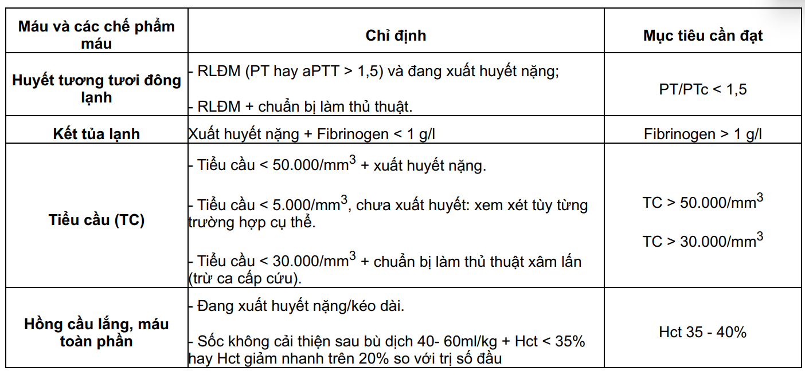
        

          
Figure 11. Bảng Chỉ Định Truyền Máu &amp; Chế Phẩm Máu Trong Sốc SXHD (Phụ Lục 17 BYT 2023)

          Ngưỡng xét nghiệm và chỉ định nghiêm ngặt: Hồng cầu lắng (Hct ≤ 35% hoặc giảm nhanh &gt; 20%), Huyết tương tươi đông lạnh (INR &gt; 1.5, PT &gt; 2 lần), Kết tủa lạnh (Fibrinogen &lt; 1 g/L), Khối tiểu cầu (tiểu cầu &lt; 50.000/mm³ có XH nặng hoặc &lt; 5.000/mm³ dự phòng).
        

      

      

        <table class="table-modern">
          <thead>
            <tr>
              <th style="width: 25%;">Chế Phẩm Máu</th>
              <th style="width: 45%;">Chỉ Định Nghiêm Ngặt</th>
              <th style="width: 30%;">Liều Lượng &amp; Mục Tiêu</th>
            </tr>
          </thead>
          <tbody>
            <tr>
              <td><strong>Hồng Cầu Lắng (HCL)</strong> (Hoặc Máu toàn phần mới)</td>
              <td>
                • Đang có xuất huyết nặng hoặc kéo dài. 
                • Sốc không cải thiện sau bù dịch <strong>40 – 60 ml/kg</strong> kèm <strong>Hct &lt; 35%</strong> hoặc Hct giảm nhanh <strong>&gt; 20%</strong> so với trị số ban đầu. 
                • Sốt xuất huyết có xuất huyết nội tạng nghi ngờ.
              </td>
              <td>
                • HCL: <strong>5 – 10 ml/kg</strong> truyền trong 1–2 giờ. 
                • Máu toàn phần: <strong>10 – 20 ml/kg</strong>. 
                • <strong>Mục tiêu BYT 2023: Đạt Hct 35% – 40%</strong> (tránh nâng Hct &gt; 40% vì nguy cơ tăng độ nhớt máu và cô đặc vi tuần hoàn).
              </td>
            </tr>
            <tr>
              <td><strong>Huyết Tương Tươi Đông Lạnh (FFP)</strong></td>
              <td>
                Rối loạn đông máu nặng (PT kéo dài &gt; 2 lần bình thường hoặc <strong>INR &gt; 1.5</strong>) kèm ít nhất một trong các tiêu chuẩn: 
                1. Đang có xuất huyết nặng. 
                2. Có chỉ định chọc hút màng bụng/màng phổi. 
                3. Đang truyền máu khối lượng lớn (≥ 1/2 thể tích máu).
              </td>
              <td>
                • Liều: <strong>10 – 20 ml/kg</strong> truyền trong 2–4 giờ. 
                • Mục tiêu: Đưa INR &lt; 1.5 và PT &lt; 1.5 lần.
              </td>
            </tr>
            <tr>
              <td><strong>Tủa Lạnh (Cryoprecipitate)</strong></td>
              <td>
                Đang có xuất huyết nặng kèm theo nồng độ <strong>Fibrinogen &lt; 1.0 g/L (100 mg/dL)</strong>.
              </td>
              <td>
                • Liều: <strong>1 túi / 6 kg cân nặng</strong> (mỗi túi chứa ~150 mg Fibrinogen). 
                • Mục tiêu: Nâng Fibrinogen &gt; 1.5 g/L.
              </td>
            </tr>
            <tr>
              <td><strong>Khối Tiểu Cầu (Platelets)</strong></td>
              <td>
                • <strong>Tiểu cầu &lt; 50.000/mm³</strong> kèm theo <strong>đang xuất huyết nặng</strong> (Mục tiêu: TC &gt; 50.000/mm³). 
                • <strong>Tiểu cầu &lt; 30.000/mm³</strong> kèm theo <strong>chuẩn bị làm thủ thuật xâm lấn</strong> (trừ trường hợp cấp cứu) (Mục tiêu: TC &gt; 30.000/mm³). 
                • <strong>Tiểu cầu &lt; 5.000/mm³ chưa xuất huyết:</strong> <em>Xem xét tùy từng trường hợp cụ thể</em> (BYT 2023 không khuyến cáo truyền dự phòng thường quy cho mọi ca).
              </td>
              <td>
                • <strong>1 đơn vị tiểu cầu đậm đặc / 5 kg</strong>; HOẶC <strong>1 đơn vị gạn tách (Apheresis) / 10 kg</strong>. 
                • Mục tiêu: &gt; 50.000/mm³ (nếu có xuất huyết nặng) hoặc &gt; 30.000/mm³ (nếu làm thủ thuật).
              </td>
            </tr>
          </tbody>
        </table>
      

      <!-- FIGURE 12 EMBEDDED CARD: XHTH TRÊN -->
      
<i class="fa-solid fa-notes-medical"></i> Xử Trí Xuất Huyết Tiêu Hóa Trên &amp; Chỉ Định Nội Soi Cầm Máu

      

        Bệnh nhân xuất huyết tiêu hóa nặng bắt buộc phải <strong>nhịn ăn hoàn toàn bằng đường miệng</strong>, đặt 2 đường truyền tĩnh mạch lớn và dùng ngay thuốc ức chế bơm proton (PPI) liều cao:
      

      

        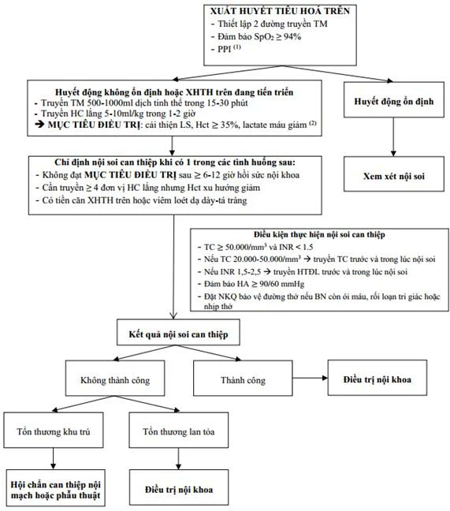
        

          
Figure 12. Lưu Đồ Xử Trí Xuất Huyết Tiêu Hóa Trên Ở Bệnh Nhân SXHD (Phụ Lục 17 BYT 2023)

          Thuật toán: Nhịn ăn uống, thiết lập 2 đường truyền tĩnh mạch lớn; Omeprazole/Esomeprazole/Pantoprazole bolus 80 mg TM, sau đó duy trì 40 mg mỗi 12 giờ; điều kiện an toàn để nội soi can thiệp cầm máu (Tiểu cầu ≥ 50.000/mm³, INR &lt; 1.5; nếu TC 20.000–50.000/mm³ bắt buộc truyền tiểu cầu trước và trong khi nội soi).
        

      

    

  

  <!-- ====================================================================== -->
  <!-- SECTION 7: XỬ TRÍ SUY TẠNG NẶNG (FIG 13)                              -->
  <!-- ====================================================================== -->
  

    

      ⚠️
      <h2 class="sec-title">Phần 7: Xử Trí Suy Tạng Nặng (Suy Gan Cấp, SXHD Thể Não, AKI &amp; Quá Tải Dịch)</h2>
      Hồi Sức Đa Tạng
    

    

      <!-- 7.1 SUY GAN CẤP -->
      
<i class="fa-solid fa-liver"></i> 1. Tổn Thương Gan &amp; Suy Gan Cấp (AST, ALT ≥ 1000 U/L)

      

        Tổn thương gan trong SXHD chia làm 3 mức: Nhẹ (AST/ALT 120–&lt; 400 U/L); Trung bình (400–&lt; 1000 U/L); Nặng/Suy gan cấp (<strong>AST hoặc ALT ≥ 1000 U/L</strong>). Khi có tổn thương gan từ mức trung bình: <strong>TUYỆT ĐỐI KHÔNG dùng Paracetamol và KHÔNG dùng dung dịch Ringer lactate</strong> (do gan giảm khả năng chuyển hóa lactate thành bicarbonate gây tăng toan lactic). Dung dịch thay thế là <strong>NaCl 0.9% hoặc Ringer acetate</strong>.
      

      <!-- FIGURE 13 EMBEDDED CARD -->
      

        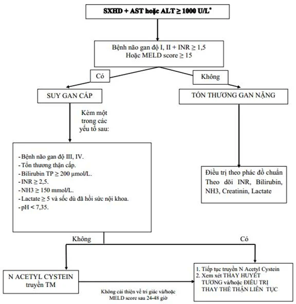
        

          
Figure 13. Lưu Đồ Xử Trí Suy Gan Cấp Ở Bệnh Nhân SXHD Nặng (Phụ Lục 26 BYT 2023)

          Chẩn đoán khi có bệnh não gan độ I–II kèm INR ≥ 1.5 hoặc MELD ≥ 15; chỉ định truyền N-Acetylcystein đường tĩnh mạch; theo dõi tri giác sau 24–48 giờ; xem xét chỉ định Thay huyết tương (PE) và/hoặc Lọc máu liên tục (CRRT / CVVHDF).
        

      

      

        

          <i class="fa-solid fa-circle-check"></i> PHÁC ĐỒ N-ACETYLCYSTEIN (NAC) TĨNH MẠCH TRONG SUY GAN CẤP (MỤC C.2.5.1 &amp; PHỤ LỤC 26 BYT 2023)
          <i class="fa-solid fa-layer-group"></i> Phác Đồ Quốc Gia
        

        

          • <strong>Chỉ định truyền tĩnh mạch NAC:</strong> Khi bệnh nhân có biểu hiện suy gan cấp gồm 1 trong các tình huống sau: 
          &nbsp;&nbsp;1. Có bệnh cảnh não gan (độ I, II) kèm theo <strong>INR ≥ 1.5</strong>. 
          &nbsp;&nbsp;2. Hoặc chỉ số <strong>MELD score ≥ 15</strong>. 
          • <strong>Liều lượng chuẩn BYT 2023:</strong> Sử dụng <strong>N-Acetylcystein liều 100 mg/kg/24 giờ</strong> pha trong <strong>1000 ml Glucose 5% hoặc Natriclorid 0.9%</strong>, truyền tĩnh mạch liên tục trong <strong>3 – 5 ngày</strong>. 
          • <strong>Cảnh báo an toàn:</strong> Cần theo dõi phản ứng phản vệ khi truyền NAC; <strong>không nên sử dụng NAC ở phụ nữ có thai hoặc bệnh nhân có cơ địa thiếu men G6PD</strong>. 
          • <strong>Chỉ định Thay huyết tương (TPE) và/hoặc Lọc máu liên tục (CRRT):</strong> Xem xét khi bệnh nhân <strong>thất bại với NAC sau 24–48 giờ</strong> (tri giác và/hoặc MELD score không cải thiện), hoặc khi suy gan cấp kèm một trong các tiêu chuẩn nguy kịch: Bệnh não gan độ III–IV, Tổn thương thận cấp (AKI), Bilirubin toàn phần ≥ 200 µmol/L, INR ≥ 2.5, NH₃ ≥ 150 µmol/L, Lactate ≥ 5 kèm sốc trơ hồi sức nội khoa, hoặc pH &lt; 7.35 (Phụ lục 26).
        

      

      
      <!-- PHÁC ĐỒ NAC TRẺ EM (MỤC C.1.5 a) ĐỐI CHIẾU NGƯỜI LỚN -->
      

        

          <i class="fa-solid fa-code-compare"></i> So Sánh Phác Đồ N-Acetylcystein (NAC) Truyền Tĩnh Mạch Giữa Trẻ Em &amp; Người Lớn
        

        

          • <strong>Phác đồ Trẻ Em 3 Giai Đoạn (Mục C.1.5 a BYT 2023):</strong> 
          &nbsp;&nbsp;1. <em>Liều tấn công:</em> <strong>150 mg/kg</strong> truyền tĩnh mạch (TTM) trong <strong>1 giờ</strong>. 
          &nbsp;&nbsp;2. <em>Liều duy trì 1:</em> <strong>50 mg/kg</strong> TTM trong <strong>4 giờ</strong>. 
          &nbsp;&nbsp;3. <em>Liều duy trì 2:</em> <strong>100 mg/kg</strong> TTM trong <strong>16 giờ</strong>. 
          &nbsp;&nbsp;4. <em>Duy trì kéo dài:</em> Tiếp tục TTM <strong>6.25 mg/kg/giờ</strong> trong <strong>48 – 72 giờ</strong> tiếp theo cho đến khi chức năng gan cải thiện. 
          • <strong>Phác đồ Người Lớn Liên Tục 24 Giờ (Mục C.2.5.1 BYT 2023):</strong> <strong>100 mg/kg/24 giờ</strong> pha trong 1000 ml Glucose 5% hoặc NaCl 0.9%, truyền tĩnh mạch liên tục trong <strong>3 – 5 ngày</strong>.
        

      

      <!-- TIÊU CHUẨN TỔN THƯƠNG THẬN CẤP KDIGO 2012 -->
      

        

          <i class="fa-solid fa-kidneys"></i> Tiêu Chuẩn Chẩn Đoán Tổn Thương Thận Cấp (AKI) Theo KDIGO 2012 (Mục C.2.5.2)
        

        

          Chẩn đoán AKI khi có ít nhất 1 trong 3 tiêu chuẩn sau: 
          1. Creatinine máu tăng <strong>≥ 0.3 mg/dL (26.5 µmol/L)</strong> trong vòng 48 giờ. 
          2. Creatinine máu tăng <strong>≥ 1.5 lần</strong> so với giá trị nền trong vòng 7 ngày trước đó. 
          3. Thể tích nước tiểu <strong>&lt; 0.5 ml/kg/giờ kéo dài trong 6 giờ liên tục</strong>. 
          <em>Xử trí: Chống sốc tối ưu, cân bằng dịch xuất nhập sát sao, tránh dùng thuốc độc thận; chỉ định Thận nhân tạo ngắt quãng (IHD) khi huyết động ổn định hoặc Lọc máu liên tục (CRRT) khi huyết động không ổn định / suy đa tạng.</em>
        

      

      <!-- 7.2 SXHD THỂ NÃO -->
      
<i class="fa-solid fa-brain"></i> 2. Sốt Xuất Huyết Dengue Thể Não (Tổn Thương Thần Kinh Trung Ương)

      

        Bệnh nhân có biểu hiện co giật, lơ mơ, hôn mê, đồng tử co dãn không đều hoặc dấu hiệu tăng áp lực nội sọ:
      

      <ul style="margin-left: 1.25rem; line-height: 1.7;">
        <li>Cho nằm đầu cao 30°, thở oxy, đặt nội khí quản bảo vệ đường thở nếu GCS ≤ 8 điểm.</li>
        <li><strong>Cắt cơn co giật:</strong> <strong>Diazepam 0.2 mg/kg tiêm TM chậm</strong> (hoặc bơm hậu môn 0.5 mg/kg); nếu thất bại lặp lại liều 2 sau 10 phút (tối đa 3 liều). Nếu vẫn kháng trị: dùng <strong>Phenobarbital 10–20 mg/kg</strong> truyền tĩnh mạch trong 15–30 phút.</li>
        <li><strong>Chống phù não hạ áp lực nội sọ:</strong> Truyền nhanh <strong>Mannitol 20% liều 0.5 g/kg trong 30 phút</strong>, nhắc lại mỗi 8 giờ; có thể phối hợp xen kẽ với <strong>Natri clorua 3% liều 4 ml/kg truyền trong 30 phút</strong>.</li>
      </ul>

      <!-- 7.3 QUÁ TẢI DỊCH & PHÙ PHỔI -->
      
<i class="fa-solid fa-water"></i> 3. Quá Tải Dịch Tuần Hoàn &amp; Phù Phổi Cấp (Ngày 6 – Ngày 8)

      

        🛑
        

          <strong>Xử Trí Cấp Cứu Khi Quá Tải Dịch:</strong> 
          Khi bệnh nhân ho đột ngột, thở nhanh khó thở co kéo, tĩnh mạch cổ nổi, phổi có ran ẩm lan nhanh, khạc bọt hồng (Hct thường giảm thấp do pha loãng máu): 
          1. <strong>NGỪNG TRUYỀN DỊCH TĨNH MẠCH NGAY LẬP TỨC!</strong> 
          2. Cho ngồi đầu cao 90°, thở oxy lưu lượng cao hoặc NCPAP / đặt nội khí quản thở máy PEEP cao. 
          3. <strong>Furosemide liều 0.5 – 1.0 mg/kg tiêm tĩnh mạch chậm</strong> (chỉ dùng khi huyết áp ổn định). 
          4. Nếu huyết động không ổn định hoặc có suy tim: Truyền Dobutamin 5–10 µg/kg/phút để nâng đỡ cơ tim.
        

      

    

  

  <!-- ====================================================================== -->
  <!-- SECTION 8: ĐỐI TƯỢNG ĐẶC BIỆT                                          -->
  <!-- ====================================================================== -->
  

    

      🤰
      <h2 class="sec-title">Phần 8: Hồi Sức SXHD Trên Các Đối Tượng Đặc Biệt (Thai Phụ, Thalassemia, Nhũ Nhi)</h2>
      Cơ Địa Nguy Cơ
    

    

      <!-- SUB-SECTION 8.1: PHỤ NỮ CÓ THAI TOÀN DIỆN (MỤC C.2.6 BYT 2023) -->
      
<i class="fa-solid fa-person-pregnant" style="color: #e11d48;"></i> 1. Hướng Dẫn Quốc Gia Quản Lý SXHD Ở Phụ Nữ Có Thai (PNCT) (Mục C.2.6 BYT 2023)

      

        Phụ nữ mang thai mắc SXHD là đối tượng nguy cơ rất cao đe dọa tử vong cho cả mẹ và thai nhi do những biến đổi sinh lý thai kỳ làm che lấp hoặc chậm trễ phát hiện dấu hiệu sốc và xuất huyết nặng:
      

      

        <table class="table-modern">
          <thead>
            <tr>
              <th style="width: 20%;">Phân Định Lâm Sàng</th>
              <th style="width: 45%;">Đặc Điểm Sinh Lý Thai Kỳ &amp; Chẩn Đoán Phân Biệt</th>
              <th style="width: 35%;">Phác Đồ Xử Trí &amp; Lưu Ý Đặc Biệt</th>
            </tr>
          </thead>
          <tbody>
            <tr>
              <td>
                <strong style="color: #0284c7;">1. Đặc Điểm Sinh Lý Thai Kỳ</strong>
              </td>
              <td>
                • <strong>Hct nền thấp sinh lý:</strong> Thể tích huyết tương tăng 40–50% khiến Hct bình thường ở thai phụ chỉ từ <strong>28% đến 40%</strong>. Chẩn đoán cô đặc máu khi <strong>Hct tăng &gt; 10%</strong> hoặc <strong>Hct &gt; 38–40%</strong> (nếu không có Hct nền D1–D2). 
                • <strong>Huyết động:</strong> Tần số tim sinh lý nhanh hơn 10–15 nhịp/phút, huyết áp động mạch giảm nhẹ trong 3 tháng giữa. 
                • <strong>Thăm khám:</strong> Khó phát hiện gan to và tràn dịch màng bụng do tử cung to đẩy tạng lên trên. 
                • <strong>Chẩn đoán phân biệt:</strong> Dễ nhầm với dọa sảy thai, dọa sinh non, tiền sản giật, hội chứng HELLP, thoái hóa mỡ gan cấp thai kỳ.
              </td>
              <td>
                • Làm công thức máu và Hct ngay từ ngày 1–2 để lấy trị số nền. 
                • Nghi ngờ SXHD nếu <strong>tiểu cầu giảm kèm Hct tăng &gt; 10%</strong>. 
                • Theo dõi tim thai liên tục qua Doppler hoặc Monitoring sản khoa.
              </td>
            </tr>
            <tr>
              <td>
                <strong style="color: #b45309;">2. SXHD Có Dấu Hiệu Cảnh Báo</strong>
              </td>
              <td>
                • <strong>Đau bụng:</strong> Bắt buộc phân biệt đau bụng do gan ứ máu/thoát huyết tương với đau bụng do co bóp chuyển dạ sản khoa. 
                • Dấu hiệu mệt lả, nôn ói nhiều, tiểu ít cần phát hiện sớm.
              </td>
              <td>
                • Nhập viện điều trị tại <strong>Bệnh viện Phụ Sản, Sản Nhi hoặc Bệnh viện Đa khoa có đơn vị Sản và Hồi sức</strong>. 
                • <strong>Tuyệt đối tránh khởi phát chuyển dạ hoặc can thiệp phẫu thuật trong giai đoạn này!</strong> 
                • Bù dịch điện giải tĩnh mạch thận trọng, tránh quá tải tuần hoàn.
              </td>
            </tr>
            <tr>
              <td>
                <strong style="color: #dc2626;">3. Sốc SXHD Ở Thai Phụ</strong>
              </td>
              <td>
                • Tử cung to chèn ép tĩnh mạch chủ dưới làm giảm nặng lượng máu hồi lưu về tim, làm sốc tụt huyết áp trầm trọng hơn. 
                • Tình trạng thiếu oxy máu mẹ gây suy thai cấp nhanh chóng.
              </td>
              <td>
                • <strong>Tư thế bắt buộc:</strong> Cho sản phụ <strong>nằm nghiêng trái 15° – 30°</strong> (hoặc chèn gối dưới mông phải) để giải áp tử cung khỏi TM chủ dưới. 
                • <strong>Tính cân nặng chống sốc:</strong> 
                &nbsp;&nbsp;+ <em>3 Tháng đầu &amp; giữa:</em> Dùng cân nặng người lớn bình thường. 
                &nbsp;&nbsp;+ <em>3 Tháng cuối:</em> <strong>Bắt buộc dùng Cân nặng hiệu chỉnh</strong> (với CN thực là cân nặng lúc nhập viện). 
                • Bù dịch điện giải và Cao phân tử khẩn cấp; hội chẩn chuyên gia SXHD.
              </td>
            </tr>
            <tr>
              <td>
                <strong style="color: #e11d48;">4. Xuất Huyết Nặng &amp; Can Thiệp Sản Khoa</strong>
              </td>
              <td>
                • Nguy cơ băng huyết sau sinh đe dọa tính mạng người mẹ. 
                • Cần loại trừ nguyên nhân sản khoa: Nhau bong non, nhau tiền đạo, nhau cài răng lược, vỡ tử cung, thai ngoài tử cung vỡ.
              </td>
              <td>
                • <strong>Mục tiêu truyền máu:</strong> Duy trì Hct ≥ 35%. 
                • <strong>Giai đoạn D1–D3:</strong> Cân nhắc chấm dứt thai kỳ nếu bắt buộc khi <strong>tiểu cầu ≥ 130.000/mm³</strong>. 
                • <strong>Giai đoạn nguy hiểm (D3–D7):</strong> <strong>TUYỆT ĐỐI TRÌ HOÃN chuyển dạ hoặc mổ lấy thai</strong> bằng thuốc cắt cơn co tử cung. Chỉ mổ khi có nguy cơ tính mạng mẹ hoặc suy thai cấp sau hội chẩn đa chuyên khoa. 
                • <strong>Nếu chuyển dạ tự nhiên:</strong> Ưu tiên sinh thường đường âm đạo; truyền tiểu cầu đậm đặc trong 6 giờ trước và trong khi sinh, duy trì <strong>tiểu cầu &gt; 50.000/mm³ (sinh thường)</strong> hoặc <strong>&gt; 75.000/mm³ (mổ lấy thai)</strong>. 
                • <strong>Thai lưu:</strong> Trì hoãn can thiệp ≥ 1 tuần nếu an toàn; kiểm tra đông máu ≥ 2 lần/tuần nếu trì hoãn &gt; 48 giờ.
              </td>
            </tr>
            <tr>
              <td>
                <strong style="color: #8b5cf6;">5. Trẻ Sinh Ra Từ Mẹ Bị SXHD</strong>
              </td>
              <td>
                • Tỷ lệ lây truyền dọc từ mẹ sang con khoảng <strong>6%</strong>. 
                • Phần lớn trẻ sơ sinh biểu hiện bệnh nhẹ, sốt xuất hiện sớm từ <strong>ngày 1 đến ngày 6 sau sinh</strong>.
              </td>
              <td>
                • Làm công thức máu và xét nghiệm kháng nguyên NS1, kháng thể Dengue cho trẻ sơ sinh. 
                • <strong>Tiếp tục cho trẻ bú mẹ bình thường</strong>. 
                • Chuyển khoa Hồi sức Sơ sinh ngay khi trẻ có dấu hiệu sốt, suy hô hấp, hạ thân nhiệt hoặc xuất huyết.
              </td>
            </tr>
          </tbody>
        </table>
      

      <!-- SUB-SECTION 8.2: NGOẠI KHOA & CÁC ĐỐI TƯỢNG BỆNH NỀN -->
      
<i class="fa-solid fa-hospital-user" style="color: #0284c7;"></i> 2. Hồi Sức SXHD Trên Bệnh Nhân Có Bệnh Lý Nền Mạn Tính &amp; Can Thiệp Ngoại Khoa (Mục C.2.7)

      

        

          

          

            
🩸

            
Bệnh Nhân Thalassemia

          

          

            • Có Hct nền rất thấp (20–25%): Cô đặc máu được xác định khi <strong>Hct hiện tại tăng &gt; 20% so với Hct nền của chính người bệnh</strong>. 
            • Nguy cơ quá tải sắt cơ tim và xơ gan sẵn có khiến suy tim, suy gan diễn tiến nhanh. 
            • <strong>Dịch truyền:</strong> Tránh Ringer lactate, ưu tiên dùng <strong>NaCl 0.9% hoặc Ringer acetate</strong>. 
            • <strong>Truyền máu sớm:</strong> Duy trì Hct trong khoảng <strong>25% – 30%</strong>.
          

          
Truyền Máu Sớm Hct 25–30%

        

        

          

          

            
👶

            
Trẻ Nhũ Nhi (&lt; 12 Tháng Tuổi)

          

          

            • Dấu hiệu sốc rất kín đáo (chỉ có lừ đừ, bú kém, chi mát); Hct nền sinh lý thấp (30–35%). 
            • Rất dễ hạ đường huyết và hạ Canxi máu do dự trữ glycogen gan và mô xương kém. 
            • Nguy cơ quá tải dịch và phù phổi cực cao. 
            • Khuyến cáo <strong>sử dụng siêu âm tại giường đo độ xẹp IVC</strong> để theo dõi thể tích lòng mạch thay vì đặt catheter tĩnh mạch cảnh/dưới đòn.
          

          
Siêu Âm IVC Đánh Giá Dịch

        

        

          

          

            
🧓

            
Người Cao Tuổi &amp; Bệnh Tim Phổi Mạn

          

          

            • Thường có tăng huyết áp, suy tim mạn, bệnh thận mạn (CKD) hoặc đái tháo đường. 
            • Ranh giới giữa thiếu dịch gây suy thận trước thận và thừa dịch gây phù phổi cấp rất mong manh. 
            • Phải đo CVP sớm hoặc siêu âm tim, phổi tại giường định kỳ. 
            • Điều chỉnh liều thuốc hạ áp và thuốc hạ đường huyết chặt chẽ trong giai đoạn sốt và giai đoạn sốc.
          

          
Giám Sát Huyết Động Sát

        

        

          

          

            
🔪

            
Can Thiệp Ngoại Khoa (Mục C.2.7)

          

          

            • Các tình huống cấp cứu ngoại khoa (viêm ruột thừa cấp, thủng tạng rỗng, tắc ruột...): Bắt buộc <strong>hội chẩn khẩn cấp với bác sĩ chuyên khoa ngoại</strong>. 
            • <strong>Chuẩn bị truyền tiểu cầu bắt buộc:</strong> Truyền khối tiểu cầu đậm đặc trong vòng <strong>6 giờ trước và trong khi can thiệp phẫu thuật</strong> để nâng và duy trì <strong>tiểu cầu &gt; 75.000/mm³</strong>. 
            • Dự trù sẵn sàng máu toàn phần, hồng cầu lắng và các yếu tố đông máu tại phòng mổ.
          

          
Tiểu Cầu &gt; 75.000 Trước Mổ

        

      

    

  

  <!-- ====================================================================== -->
  <!-- SECTION 9: HỒI SỨC HÔ HẤP & CAN THIỆP GIẢM ÁP                         -->
  <!-- ====================================================================== -->
  

    

      🫁
      <h2 class="sec-title">Phần 9: Hồi Sức Hô Hấp Chuyên Sâu &amp; Quy Trình Can Thiệp Giảm Chèn Ép Khoang</h2>
      Kỹ Thuật Can Thiệp
    

    

      
1. Liệu Pháp Hỗ Trợ Hô Hấp Phân Tầng &amp; Thông Số Cài Đặt Thở Máy Chuẩn (Phụ Lục 7 BYT 2023)

      

        Suy hô hấp cấp trong SXHD thường gặp trong sốc nặng, sốc kéo dài do: Toan chuyển hóa nặng, Quá tải dịch gây phù phổi cấp, Tràn dịch màng phổi - màng bụng lượng nhiều chèn ép cơ hoành, ARDS, hoặc SXHD thể não. Áp dụng các phương thức hỗ trợ hô hấp theo đúng bậc thang:
      

      

        <table class="table-modern">
          <thead>
            <tr>
              <th style="width: 25%;">Phương Thức Hỗ Trợ</th>
              <th style="width: 40%;">Chỉ Định Cụ Thể (Phụ Lục 7 BYT 2023)</th>
              <th style="width: 35%;">Thông Số Cài Đặt Ban Đầu Quy Chuẩn</th>
            </tr>
          </thead>
          <tbody>
            <tr>
              <td>
                <strong style="color: #0284c7;">1. Oxy Gọng Kính (Canula)</strong> 
                Đầu Tay
              </td>
              <td>
                • <strong>Chỉ định cho 100% bệnh nhân có sốc SXHD</strong>. 
                • Người bệnh có SpO₂ &lt; 95% hoặc thở nhanh, khó thở nhẹ.
              </td>
              <td>Tốc độ dòng <strong>1 – 6 lít/phút</strong> để duy trì SpO₂ ≥ 95%. Nếu không đáp ứng chuyển thở mask có túi dự trữ <strong>6 – 10 lít/phút</strong>.</td>
            </tr>
            <tr>
              <td>
                <strong style="color: #f59e0b;">2. Thở Áp Lực Dương Liên Tục (NCPAP)</strong> 
                Không Xâm Lấn
              </td>
              <td>
                • Thất bại với thở oxy gọng kính (người bệnh còn thở nhanh, rút lõm ngực, SpO₂ &lt; 92%). 
                • Tràn dịch màng phổi hoặc màng bụng gây khó thở. 
                • <em>Chống chỉ định:</em> Không dùng cho SXHD thể não có hôn mê sâu, ngưng thở.
              </td>
              <td>
                • <strong>Áp lực PEEP ban đầu:</strong> <strong>4 – 6 cmH₂O</strong>, FiO₂ <strong>40% – 60%</strong>. 
                • Tăng dần áp lực lên tối đa <strong>8 – 10 cmH₂O</strong> và FiO₂ 100% theo đáp ứng. 
                • <em>Cảnh báo:</em> Tránh PEEP &gt; 10 cmH₂O vì cản trở máu về tim làm nặng thêm sốc.
              </td>
            </tr>
            <tr>
              <td>
                <strong style="color: #dc2626;">3. Đặt Nội Khí Quản &amp; Thở Máy Xâm Lấn</strong> 
                Xâm Lấn Hồi Sức
              </td>
              <td>
                <strong>Bắt buộc đặt NKQ thở máy khi có ít nhất 1 trong các tình huống:</strong> 
                1. Sốc SXHD thất bại với CPAP kết hợp dẫn lưu dịch màng bụng. 
                2. Phù phổi cấp / quá tải dịch thất bại với CPAP và thuốc vận mạch. 
                3. Hội chứng ARDS thất bại với CPAP. 
                4. Thất bại với CPAP ở bệnh nhân tràn dịch màng bụng/màng phổi lượng nhiều vào N3, 4, đầu N5 của bệnh. 
                5. Đang thở CPAP kèm tổn thương gan nặng (men gan tăng &gt; 1000 U/L hoặc tăng nhanh). 
                6. Đang sốc còn thở nhanh rút lõm ngực với NCPAP kể cả khi SpO₂ ≥ 95% (tốc độ dịch ≥ 7 ml/kg/h kéo dài). 
                7. SXHD thể não có ngưng thở hoặc suy hô hấp thất bại với thở oxy.
              </td>
              <td>
                • <strong>Chế độ:</strong> Kiểm soát áp lực (PCV). 
                • <strong>Tần số thở (f):</strong> 
                &nbsp;&nbsp;+ Nhũ nhi: <strong>25 – 30 lần/phút</strong>. 
                &nbsp;&nbsp;+ Trẻ nhỏ: <strong>20 – 25 lần/phút</strong>. 
                &nbsp;&nbsp;+ Trẻ lớn &amp; người lớn: <strong>16 – 20 lần/phút</strong>. 
                • <strong>Tỷ lệ I:E:</strong> <strong>1/2</strong>. 
                • <strong>PEEP ban đầu:</strong> <strong>6 – 8 cmH₂O</strong>. 
                • <strong>Áp lực hít vào (IP):</strong> <strong>10 – 20 cmH₂O</strong> (điều chỉnh để đạt thể tích khí lưu thông <strong>Vt = 6 – 8 ml/kg</strong>). 
                • <strong>Khi có tăng áp lực ổ bụng (ALOB):</strong> Tăng PEEP ≤ ALOB (thường bằng <strong>1/2 ALOB</strong>). Giới hạn áp lực đỉnh <code>PIP = IP + PEEP ≤ 30 + 1/2 ALOB (cmH₂O)</code>. 
                • <strong>Chiến lược ARDS:</strong> Vt bảo vệ phổi 6 ml/kg, PEEP 8 – 16 cmH₂O.
              </td>
            </tr>
          </tbody>
        </table>
      

      
2. Quy Trình Chọc Hút Màng Bụng &amp; Màng Phổi Giảm Áp Chuẩn Phụ Lục 7 BYT 2023

      

        ⚠️
        

          <strong>Cảnh Báo An Toàn Của Ban Biên Soạn BYT:</strong> 
          Chọc hút màng bụng và màng phổi cần hết sức hạn chế do nguy cơ <strong>xuất huyết ổ bụng và tràn máu màng phổi nặng có thể gây tử vong</strong>! Bắt buộc phải điều chỉnh rối loạn đông máu trước khi chọc: Truyền huyết tương tươi đông lạnh (INR &lt; 1.5), kết tủa lạnh (Fibrinogen &gt; 1 g/L) và khối tiểu cầu (TC &gt; 50.000/mm³) để phòng biến chứng chảy máu.
        

      

      

        

          

            <i class="fa-solid fa-syringe"></i> Chọc Hút - Dẫn Lưu Màng Bụng Giải Áp (Phụ Lục 7)
          

          

            • <strong>Chỉ định bắt buộc:</strong> 
            &nbsp;&nbsp;1. Suy hô hấp thất bại với NCPAP kèm tràn dịch màng bụng lượng nhiều có dấu hiệu chèn ép (siêu âm: dịch nhiều, cơ hoành nâng cao kém/không di động) và <strong>áp lực bàng quang &gt; 27 cmH₂O</strong>. 
            &nbsp;&nbsp;2. Bệnh nhân thở máy: <strong>Áp lực bàng quang &gt; 34 cmH₂O</strong> kèm áp lực tưới máu ổ bụng <code>APP = MAP – ALOB &lt; 60 mmHg</code> và thông số máy thở cao (PEEP 14–16 kèm IP 28–30 mà Vt &lt; 6 ml/kg). 
            • <strong>Tư thế:</strong> Nằm ngửa, đầu cao. 
            • <strong>Vị trí chọc:</strong> <strong>Đường giữa, 2 – 3 cm dưới rốn</strong>. 
            • <strong>Kỹ thuật:</strong> Đâm kim luồn <strong>16 – 18G</strong> có gắn ống tiêm 20ml thẳng góc mặt da, vừa đâm vừa hút đến khi thấy dịch chảy ra. Gỡ ống tiêm, rút nòng kim cùng lúc đẩy nhẹ catheter vào sâu khoang màng bụng. Gắn ba chia và nối vào <strong>hệ thống túi dẫn lưu kín nước tiểu</strong> để dịch chảy chậm rãi. 
            • <strong>Kết thúc:</strong> Ngừng dẫn lưu khi không còn dịch chảy ra. Rút kim luồn, <strong>ấn chặt 5 – 10 phút sau đó băng ép</strong> để dịch không rỉ qua vết thương.
          

        

        

          

            <i class="fa-solid fa-lungs"></i> Chọc Hút Màng Phổi Giải Áp (Phụ Lục 7)
          

          

            • <strong>Chỉ định:</strong> Tràn dịch màng phổi lượng nhiều có dấu hiệu chèn ép phổi (phế âm giảm hoặc mất hẳn, X-quang mờ hơn 1/2 hoặc toàn bộ phế trường, siêu âm phổi co nhỏ) gây suy hô hấp cấp. 
            • <strong>Yêu cầu thực hiện:</strong> Đòi hỏi bác sĩ nhiều kinh nghiệm vì nguy cơ tai biến tràn máu màng phổi tử vong; có thể đặt NKQ thở máy trước nếu có điều kiện. 
            • <strong>Tư thế:</strong> Nằm đầu cao. 
            • <strong>Vị trí chọc:</strong> <strong>Khoang liên sườn 4 – 5 đường nách giữa, ngang mức núm vú</strong>. 
            • <strong>Kỹ thuật:</strong> Đâm kim luồn <strong>18 – 20G</strong> có gắn ống tiêm 20ml thẳng góc mặt da, <strong>ngay sát bờ trên xương sườn dưới</strong> (để tránh tổn thương bó mạch thần kinh liên sườn nằm ở bờ dưới). Vừa đâm vừa hút thấy dịch, rút nòng đẩy catheter vào sâu, gắn ba chia và ống tiêm hút dịch chậm rãi. 
            • <strong>CẢNH BÁO QUAN TRỌNG NHẤT:</strong> Ngừng hút khi không còn dịch. <strong>TUYỆT ĐỐI KHÔNG ĐƯỢC ĐẶT ỐNG DẪN LƯU MÀNG PHỔI LIÊN TỤC</strong> vì sẽ gây rỉ máu tạo khối máu tụ màng phổi đe dọa tử vong!
          

        

      

    

  

  <!-- ====================================================================== -->
  <!-- SECTION 10: QUY TRÌNH KỸ THUẬT LÂM SÀNG & ĐIỀU DƯỠNG (FIG 14, 15)     -->
  <!-- ====================================================================== -->
  

    

      🩺
      <h2 class="sec-title">Phần 10: Quy Trình Kỹ Thuật Lâm Sàng Tại Giường &amp; Can Thiệp Chăm Sóc Điều Dưỡng</h2>
      Kỹ Thuật Thực Hành
    

    

      <!-- SUB-SECTION 10.1: HƯỚNG DẪN CHĂM SÓC SXHD NGƯỜI LỚN (PHỤ LỤC 23 BYT 2023) -->
      
<i class="fa-solid fa-user-nurse" style="color: #0284c7;"></i> 1. Hướng Dẫn Chăm Sóc Sốt Xuất Huyết Dengue Người Lớn (≥ 16 Tuổi) (Phụ Lục 23 BYT 2023)

      

        Sốt xuất huyết Dengue ở người lớn có nhiều đặc điểm lâm sàng khác biệt so với trẻ em: Biến chứng sốc ít khi kéo dài hoặc tái sốc nhiều lần như trẻ em, nhưng <strong>các biểu hiện xuất huyết (xuất huyết tiêu hóa, chảy máu cam, rong kinh ở phụ nữ) thường nặng nề hơn rất nhiều và dễ đe dọa tính mạng</strong>. Đặc biệt, <em>hiện tượng phát ban hồi phục</em> thường gây lo lắng quá mức cho người bệnh và nhân viên y tế, dẫn đến chỉ định truyền dịch không cần thiết gây quá tải tuần hoàn:
      

      

        <table class="table-modern">
          <thead>
            <tr>
              <th style="width: 20%;">Phân Nhóm Chăm Sóc</th>
              <th style="width: 45%;">Quy Trình Theo Dõi Lâm Sàng &amp; Cận Lâm Sàng</th>
              <th style="width: 35%;">Can Thiệp Điều Dưỡng Trọng Tâm</th>
            </tr>
          </thead>
          <tbody>
            <tr>
              <td>
                <strong style="color: #0284c7;">1. Người Lớn Không Sốc</strong> 
                Khám Bệnh &amp; Nội Trú
              </td>
              <td>
                • <strong>Theo dõi sinh hiệu mỗi 3 – 6 giờ:</strong> Bắt mạch quay đếm tần số và biên độ; đo huyết áp bằng ống nghe; đo nhiệt độ, nhịp thở. 
                • <strong>Nước tiểu:</strong> Đo thể tích trong ngày, quan sát màu sắc phát hiện tiểu máu. 
                • <strong>Da niêm:</strong> Kiểm tra chi ấm, móng tay hồng (CRT &lt; 2s) hay chi mát ẩm; kiểm tra vết bầm tím, chảy máu mũi, chân răng, rong kinh; kiểm tra xuất huyết nội (nôn máu, tiêu phân đen). 
                • <strong>Xét nghiệm báo BS ngay:</strong> Hct tăng &gt; 20% so với giá trị bình thường (nam 43%, nữ 38%) hoặc tiểu cầu ≤ 100.000/mm³.
              </td>
              <td>
                • <strong>Khuyên người bệnh uống nhiều nước:</strong> Bù dịch bằng nước trái cây, sữa, nước cháo súp để cung cấp vitamin, khoáng chất và glucose tự nhiên phòng hạ đường huyết. 
                • <strong>Hạn chế tối đa truyền dịch tĩnh mạch:</strong> Chỉ truyền khi có chỉ định nghiêm ngặt. 
                • <strong>Nghỉ ngơi tuyệt đối tại giường:</strong> Tránh đi lại nhiều, tránh vận động gắng sức. 
                • <strong>Xử trí xuất huyết tại chỗ:</strong> Chảy máu mũi dùng bấc tẩm Adrenalin nhét từ trước ra sau; băng ép chặt các khối máu tụ nơi tiêm chích; theo dõi sát lượng máu mất do rong kinh.
              </td>
            </tr>
            <tr>
              <td>
                <strong style="color: #dc2626;">2. Người Lớn Sốc SXHD</strong> 
                Hồi Sức Cấp Cứu (ICU)
              </td>
              <td>
                • <strong>Dấu hiệu sinh tồn:</strong> Theo dõi mạch, huyết áp, tần số và biên độ thở <strong>15 – 30 phút/lần</strong> trong giai đoạn chống sốc; khi ổn định theo dõi mỗi 1 giờ; sau 24 giờ ổn định giãn cách 3–6 giờ/lần. 
                • <strong>Theo dõi SpO₂ liên tục:</strong> Báo BS ngay khi SpO₂ &lt; 92%. Cho thở oxy gọng mũi 1–5 lít/phút hoặc thở mask nếu người bệnh bứt rứt. 
                • <strong>Lượng nước tiểu mỗi 1 giờ:</strong> Đặt thông tiểu lưu có túi chia vạch chính xác (mục tiêu ≥ 0.5 ml/kg/giờ). 
                • <strong>Hct tại giường:</strong> Thử lại mỗi 1, 2, 3, 6 giờ tuần tự các bước chống sốc. 
                • <strong>Đường huyết tại giường:</strong> Đo ngay khi vào sốc và mỗi lần tái sốc.
              </td>
              <td>
                • <strong>Đường truyền tĩnh mạch:</strong> Đặt 2 đường truyền lớn (kim 18–20G), kiểm tra lưu thông, chống thoát mạch cao phân tử. 
                • <strong>Hút đờm thông đường thở:</strong> Khi có rối loạn tri giác hoặc thở máy. 
                • <strong>Vệ sinh răng miệng bằng gạc mềm:</strong> Tuyệt đối không dùng bàn chải cứng. 
                • <strong>Dinh dưỡng:</strong> Cho ăn sớm qua đường miệng thức ăn lỏng khi ra sốc; nuôi dưỡng tĩnh mạch nếu nôn máu. 
                • <strong>Kiểm soát nhiễm khuẩn:</strong> Giữ giường bệnh sạch sẽ, thay gạc tiêm chích vô trùng phòng bội nhiễm vi khuẩn bệnh viện.
              </td>
            </tr>
          </tbody>
        </table>
      

      <!-- SUB-SECTION 10.2: CHI TIẾT 4 QUY TRÌNH KỸ THUẬT LÂM SÀNG CỐT LÕI (PHỤ LỤC 24 BYT 2023) -->
      
<i class="fa-solid fa-toolbox" style="color: #0284c7;"></i> 2. Chi Tiết 4 Quy Trình Kỹ Thuật Lâm Sàng Cốt Lõi (Phụ Lục 24 BYT 2023)

      

        Phụ lục 24 ban hành các hướng dẫn kỹ thuật chuẩn hóa nhằm giảm thiểu tối đa tai biến xuất huyết và sai lệch kết quả trong quá trình chăm sóc bệnh nhân SXHD:
      

      

        

          

          

            
🩺

            
I. Quy Trình Nghiệm Pháp Dây Thắt (Lacet)

          

          

            • <strong>Chỉ định:</strong> Đánh giá sức bền thành mao mạch ở bệnh nhân nghi ngờ SXHD chưa có xuất huyết tự nhiên. 
            • <strong>Bước 1:</strong> Đo huyết áp theo quy chuẩn, xác định huyết áp tâm thu (HATT) và tâm trương (HATTr). 
            • <strong>Bước 2:</strong> Bơm bóng duy trì áp lực ở mức <strong>huyết áp trung bình: <code>HA_TB = (HATT + HATTr) / 2</code> liên tục trong đúng 5 phút</strong>. 
            • <strong>Bước 3:</strong> Xả băng quấn, chờ 1 – 2 phút cho da cẳng tay bớt đỏ tím. 
            • <strong>Bước 4:</strong> Đặt khung diện tích <strong>1 inch vuông (2.5 × 2.5 cm = 6.25 cm²)</strong> ở mặt trước cẳng tay, dưới nếp gấp khuỷu 2–3 cm để đếm số nốt xuất huyết. 
            • <strong>Đánh giá:</strong> Dương tính (+) khi có <strong>&gt; 20 chấm xuất huyết / 6.25 cm²</strong>. <em>Lưu ý: Không làm khi đã có xuất huyết tự nhiên hoặc bệnh nhân đang sốc (sẽ âm tính giả do giảm tưới máu ngoại vi).</em>
          

        

        

          

          

            
🩸

            
II. Quy Trình Đo Hct Ly Tâm Tại Chỗ

          

          

            • <strong>Mục đích:</strong> Đo nhanh Hematocrit ngay tại giường trong vòng 5 phút để điều chỉnh dịch chống sốc. 
            • <strong>Bước 1:</strong> Sát khuẩn đầu ngón tay (hoặc gót chân trẻ nhỏ), dùng lancet chích dứt khoát, lau bỏ giọt máu đầu, để máu tự chảy (không nặn ép làm pha loãng dịch kẽ). 
            • <strong>Bước 2:</strong> Hút máu vào ống mao quản tráng sẵn heparin đạt <strong>2/3 đến 3/4 chiều dài ống</strong>. 
            • <strong>Bước 3:</strong> Trám kín một đầu ống bằng sáp chuyên dụng (dày khoảng 2–3 mm). 
            • <strong>Bước 4:</strong> Đặt ống vào máy ly tâm đối xứng nhau (đầu sáp hướng ra ngoài), đậy nắp an toàn. Quay ly tâm tốc độ <strong>12.000 vòng/phút trong đúng 5 phút</strong>. 
            • <strong>Bước 5:</strong> Lấy ống ra đặt lên thước đo chuyên dụng: Đọc tỷ lệ % chiều cao cột hồng cầu lắng so với tổng chiều cao cột máu.
          

        

        

          

          

            
💧

            
III. Kỹ Thuật Tiêm Truyền TM &amp; Xử Trí Sự Cố

          

          

            • <strong>Chọn kim luồn:</strong> Cỡ <strong>18–20G ở người lớn, 22–24G ở trẻ em</strong> để đảm bảo tốc độ dòng chảy chống sốc lớn. Cố định chắc chắn, không băng kín che mất vị trí chích kim. 
            • <strong>Tuyệt đối không tiêm bắp:</strong> Gây tụ máu sâu lớn không thể băng ép, dễ nhiễm trùng. 
            • <strong>Sau khi rút kim lấy máu/truyền:</strong> <strong>Bắt buộc ép chặt vị trí chọc từ 5 – 10 phút</strong> bằng gạc vô khuẩn do bệnh nhân có giảm tiểu cầu và rối loạn đông máu. 
            • <strong>Xử trí tắc kim:</strong> <strong>TUYỆT ĐỐI KHÔNG dùng bơm tiêm bơm đẩy cục máu đông vào lòng mạch</strong> (nguy cơ thuyên tắc mạch não/phổi)! Rút bỏ kim luồn và đặt đường truyền mới. 
            • <strong>Xử trí thoát mạch dung dịch cao phân tử:</strong> Thoát mạch Dextran/HES gây chèn ép khoang và hoại tử mô nghiêm trọng. Phải <strong>ngừng truyền ngay lập tức</strong>, dùng bơm tiêm hút dịch thoát mạch nếu được, nâng cao chi và theo dõi sát khoang cơ.
          

        

        

          

          

            
🔬

            
IV. Thiết Lập PICC Seldinger Cải Tiến Kim 22G

          

          

            • <strong>Ưu việt tuyệt đối:</strong> Đặt qua <strong>Tĩnh mạch nền ở nếp khuỷu tay</strong> dưới siêu âm. Tránh hoàn toàn nguy cơ tràn máu màng phổi hay tụ máu cổ gây ngạt thở khi đặt CVP cảnh trong/dưới đòn. 
            • <strong>11 Bước chuẩn hóa (Phụ Lục 24 BYT 2023):</strong> 
            1. Chuẩn bị 02 điều dưỡng phụ, bệnh nhân nằm phẳng đầu nghiêng bên đối diện. 
            2. Siêu âm định vị tĩnh mạch nền (đường kính ≥ 2–3 mm). 
            3. Chích kim luồn 22G góc 30° dưới hướng dẫn siêu âm vào lòng mạch. 
            4. Luồn dây dẫn (guidewire) 4F đầu cong J sâu 5–10 cm (quan sát monitor ECG). 
            5. Rút kim 22G, rạch da ngắn vài mm tại chân dây dẫn. 
            6. Nong da tuần tự bằng catheter 20G → 18G qua guidewire 4F. 
            7. Luồn guidewire của bộ Seldinger qua kim 18G, rút kim 18G, nong bằng kim 16G. 
            8. Bơm tráng catheter với NaCl 0.9%, luồn catheter Seldinger qua guidewire nhẹ nhàng mỗi lần 2–3 cm. 
            9. Rút guidewire, kiểm tra hút máu và bơm đẩy nhẹ tay. 
            10. Khâu da cố định cánh bướm, băng trong Tegaderm. 
            11. Chụp X-quang hoặc siêu âm kiểm tra đầu catheter tại ngã ba tĩnh mạch chủ trên - nhĩ phải.
          

        

      

      <!-- PHỤ LỤC 20: CÁC DẤU HIỆU CẦN THEO DÕI KHI HỒI SỨC SỐC -->
      
<i class="fa-solid fa-heart-pulse"></i> Các Dấu Hiệu &amp; Thông Số Vàng Cần Theo Dõi Khi Hồi Sức Sốc (Phụ Lục 20 BYT 2023)

      

        

          

          

            
🎯

            
Mục Tiêu Hiệu Áp &amp; Sinh Hiệu

          

          

            • <strong>Hiệu áp (HATT – HATTr):</strong> Mục tiêu là duy trì hiệu áp ở mức <strong>≥ 30 mmHg</strong> suốt giai đoạn nguy hiểm. 
            • Mạch, huyết áp, nhịp thở, độ ấm chi và thời gian đổ đầy mao mạch (CRT &lt; 2s).
          

        

        

          

          

            
🧪

            
Quy Chuẩn Thử Lại Hematocrit (Hct)

          

          

            • <strong>Sau khi truyền dịch chống sốc:</strong> Nếu lâm sàng cải thiện thì <strong>thử lại sau 2 giờ</strong>; nếu lâm sàng không cải thiện thì <strong>thử lại ngay sau 1 giờ</strong>. 
            • <strong>Khi bệnh nhân ra sốc:</strong> Theo dõi Hct mỗi <strong>2 – 4 giờ</strong>, sau đó cách mỗi <strong>4 – 6 giờ</strong>.
          

        

        

          

          

            
💧

            
Mục Tiêu Lưu Lượng Nước Tiểu

          

          

            • Đo thể tích nước tiểu mỗi giờ (đặt thông tiểu lưu có túi đo chính xác). 
            • <strong>Mục tiêu:</strong> Đạt lưu lượng từ <strong>0.5 – 1.0 ml/kg/giờ</strong> tính theo cân nặng truyền dịch.
          

        

      

      <!-- FIGURE 14 & FIGURE 15 EMBEDDED CARDS -->
      

        

          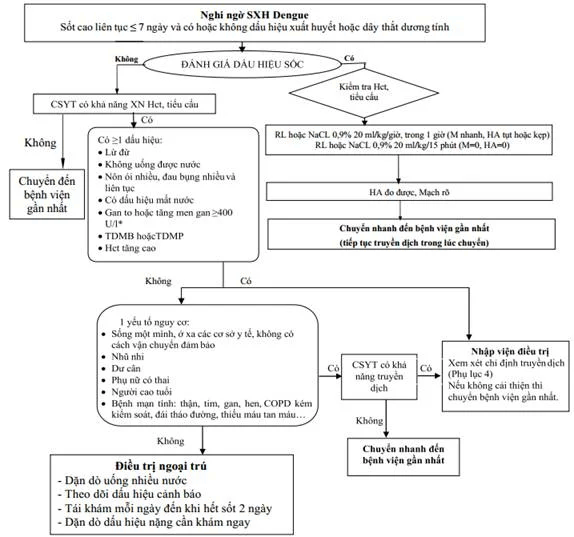
          

            
Figure 14. Lưu Đồ Xử Trí SXHD Ở Tuyến Cơ Sở Khi Có Dịch (Phụ Lục 21 BYT 2023)

            Phân luồng trạm y tế: Đánh giá có/không có khả năng xét nghiệm Hct và truyền dịch; chỉ định chuyển tuyến an toàn hoặc bù dịch cấp cứu trước khi chuyển viện.
          

        

        

          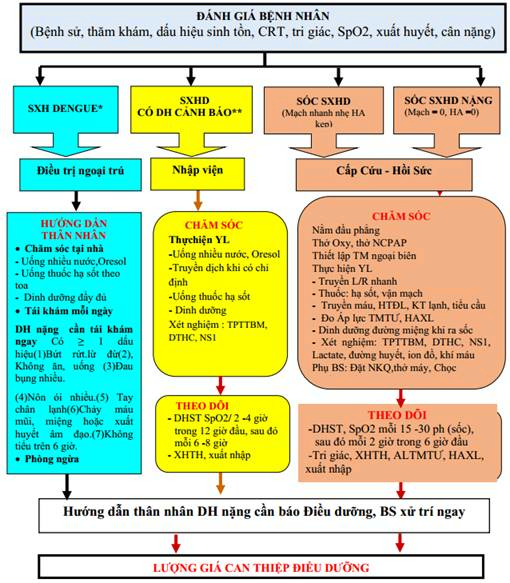
          

            
Figure 15. Lưu Đồ Chăm Sóc Bệnh Nhi SXHD Của Điều Dưỡng (Phụ Lục 22 BYT 2023)

            Quy trình điều dưỡng tiếp nhận, phân loại 3 nhánh chăm sóc (ngoại trú, nội trú DHCB, hồi sức cấp cứu sốc); hướng dẫn theo dõi sinh hiệu và phát hiện sớm biến chứng.
          

        

      

      
<i class="fa-solid fa-list-check"></i> Bảng Lượng Giá Can Thiệp Điều Dưỡng Phòng Ngừa Biến Chứng (Phụ Lục 22 BYT 2023)

      

        <table class="table-modern">
          <thead>
            <tr>
              <th style="width: 20%;">Nguy Cơ Lâm Sàng</th>
              <th style="width: 30%;">Can Thiệp Điều Dưỡng Chủ Chốt</th>
              <th style="width: 25%;">Cơ Sở Lý Giải Khoa Học</th>
              <th style="width: 25%;">Tiêu Chuẩn Lượng Giá Đạt Yêu Cầu</th>
            </tr>
          </thead>
          <tbody>
            <tr>
              <td><strong>Giảm thể tích tuần hoàn do thoát huyết tương</strong></td>
              <td>• Hướng dẫn uống nhiều Oresol, nước hoa quả. • Tránh nước màu đỏ, nâu. • Theo dõi sát lượng nước uống và nôn. • Báo bác sĩ khi Hct &gt; 41%.</td>
              <td>• Bù đắp thể tích lòng mạch bị thất thoát do tăng tính thấm thành mạch. • Tránh nhầm lẫn dịch nôn với XHTH. • Hct tăng cao phản ánh cô đặc máu tiến triển.</td>
              <td>Bệnh nhi tỉnh táo, chi ấm, mạch rõ, HA ổn định trong giới hạn tuổi, lượng nước tiểu <strong>≥ 0.5 ml/kg/giờ</strong>.</td>
            </tr>
            <tr>
              <td><strong>Xuất huyết da, niêm mạc do giảm tiểu cầu</strong></td>
              <td>• Chỉ lấy máu xét nghiệm tại tĩnh mạch chi (tránh TM đùi). • Ép chặt vị trí tiêm từ <strong>1–2 phút</strong> sau lấy máu. • Tuyệt đối <strong>không tiêm bắp</strong>.</td>
              <td>• Tránh tạo khối máu tụ lớn gây chèn ép mạch máu chi dưới. • Tiêm bắp ở bệnh nhân giảm tiểu cầu dễ gây tụ máu trong cơ và nhiễm trùng.</td>
              <td>Không xuất hiện thêm các vết bầm máu mới, không chảy máu nơi tiêm chích sau khi làm thủ thuật.</td>
            </tr>
            <tr>
              <td><strong>Dư dịch, quá tải tuần hoàn khi bù dịch nhanh</strong></td>
              <td>• Thực hiện chính xác tốc độ truyền theo y lệnh (dùng máy truyền dịch). • Theo dõi sát: ho đột ngột, khó thở, tĩnh mạch cổ nổi. • Phụ bác sĩ đo áp lực CVP.</td>
              <td>• Đảm bảo lượng dịch nhập vừa đủ ra sốc, tránh quá mức gây phù phổi. • CVP &gt; 12 cmH₂O cảnh báo nguy cơ quá tải tuần hoàn hệ thống.</td>
              <td>Bệnh nhi hết khó thở, phế trường phổi trong, không có ran ẩm, CVP duy trì ở mức an toàn.</td>
            </tr>
          </tbody>
        </table>
      

      
<i class="fa-solid fa-heart-pulse"></i> Phân Tầng Nhịp Tim &amp; Huyết Áp Sinh Lý Theo Lứa Tuổi Trẻ Em (Phụ Lục 22 BYT 2023)

      

        <table class="table-modern">
          <thead>
            <tr>
              <th style="width: 35%; text-align: center;">Nhóm Tuổi Bệnh Nhi</th>
              <th style="width: 35%; text-align: center; color: #0284c7;">Nhịp Tim Sinh Lý Bình Thường (Lần/phút)</th>
              <th style="width: 30%; text-align: center; color: #10b981;">Huyết Áp Tâm Thu Tối Thiểu (mmHg)</th>
            </tr>
          </thead>
          <tbody>
            <tr>
              <td style="text-align: center;"><strong>Trẻ nhũ nhi (&lt; 1 tuổi)</strong></td>
              <td style="text-align: center; font-weight: 700;">110 – 160 lần/phút</td>
              <td style="text-align: center; font-weight: 700;">70 – 90 mmHg</td>
            </tr>
            <tr>
              <td style="text-align: center;"><strong>Trẻ nhỏ (2 – 5 tuổi)</strong></td>
              <td style="text-align: center; font-weight: 700;">95 – 140 lần/phút</td>
              <td style="text-align: center; font-weight: 700;">80 – 100 mmHg</td>
            </tr>
            <tr>
              <td style="text-align: center;"><strong>Trẻ lớn (5 – 12 tuổi)</strong></td>
              <td style="text-align: center; font-weight: 700;">80 – 120 lần/phút</td>
              <td style="text-align: center; font-weight: 700;">90 – 110 mmHg</td>
            </tr>
            <tr>
              <td style="text-align: center;"><strong>Trẻ vị thành niên (&gt; 12 tuổi)</strong></td>
              <td style="text-align: center; font-weight: 700;">60 – 100 lần/phút</td>
              <td style="text-align: center; font-weight: 700;">100 – 120 mmHg</td>
            </tr>
          </tbody>
        </table>
      

    

  

  <!-- ====================================================================== -->
  <!-- SECTION 11: DINH DƯỠNG, HKKK & HỘI CHẨN CẤP CỨU                       -->
  <!-- ====================================================================== -->
  

    

      🥗
      <h2 class="sec-title">Phần 11: Chế Độ Dinh Dưỡng Phục Hồi, Quy Trình Tư Vấn HKKK &amp; Tiêu Chuẩn Hội Chẩn</h2>
      Chăm Sóc Toàn Diện
    

    

      <!-- 1. NUÔI DƯỠNG NGƯỜI BỆNH SXHD TOÀN DIỆN (PHỤ LỤC 19 BYT 2023) -->
      
<i class="fa-solid fa-utensils" style="color: #0284c7;"></i> 1. Nuôi Dưỡng Người Bệnh Sốt Xuất Huyết Dengue Toàn Diện (Phụ Lục 19 BYT 2023)

      

        Bệnh nhân SXHD có tình trạng <strong>tăng dị hóa mạnh mẽ, tiêu hao năng lượng nhanh và mất nhiều dưỡng chất</strong>. Đồng thời, bệnh nhân thường chán ăn, tiêu hóa chậm (đặc biệt khi có biến chứng gan hoặc xuất huyết tiêu hóa) hoặc không thể ăn bằng miệng (khi có biến chứng thể não). Chế độ dinh dưỡng phải linh hoạt theo diễn biến bệnh:
      

      

        

          

          

            
🔥

            
Nhu Cầu Năng Lượng &amp; Tỷ Lệ Đạm Chuẩn

          

          

            • <strong>Tổng năng lượng (E):</strong> <code>E = Nhu cầu sinh lý + (20% – 60%)</code> HOẶC <code>E = Nhu cầu sinh lý × K (1.2 – 1.6)</code>. 
            • <strong>Tỷ lệ Protein theo mức độ bệnh (Phụ Lục 19):</strong> 
            &nbsp;&nbsp;+ <em>Mức nặng:</em> Tổng E : Nitơ = <strong>100 : 1</strong> (Kcal do protein chiếm <strong>25%</strong> tổng E). 
            &nbsp;&nbsp;+ <em>Mức vừa:</em> Tổng E : Nitơ = <strong>120 : 1</strong> (Kcal do protein chiếm <strong>21%</strong> tổng E). 
            &nbsp;&nbsp;+ <em>Mức nhẹ:</em> Tổng E : Nitơ = <strong>150 : 1</strong> (Kcal do protein chiếm <strong>16%</strong> tổng E). 
            • <strong>Nguồn đạm ưu tiên:</strong> Protein có giá trị sinh học cao (trứng, sữa, thịt nạc, cá). 
            • <strong>Lipid &amp; Glucid:</strong> Nguồn cung cấp năng lượng chủ yếu; ưu tiên đường đơn/đôi (fructose, sucrose từ nước đường, nước trái cây, mật ong) và lipid thực vật. 
            • <strong>Số bữa ăn:</strong> Chia nhỏ nhiều bữa trong ngày (<strong>trẻ em: 6–8 bữa/ngày; người lớn: 4–6 bữa/ngày</strong>).
          

          
E = Sinh Lý + 20%–60%

        

        

          

          

            
🍲

            
Chế Độ Ăn Theo Từng Thể Biến Chứng

          

          

            • <strong>SXHD không biến chứng:</strong> Hạn chế kiêng khem khắt khe; thức ăn mềm lỏng (cháo súp, sữa, phở, mì, sữa chua). Khuyến khích ăn bằng món hấp dẫn hơn là ép ăn. 
            • <strong>Sốc SXHD:</strong> Trong lúc chống sốc chú ý theo dõi đường huyết, xử trí glucose ưu trương khi hạ ĐH. Khi người bệnh ra sốc, <strong>cho ăn sớm qua đường miệng với thức ăn lỏng</strong>. Xem xét dinh dưỡng tĩnh mạch một phần nếu cung cấp không đủ năng lượng. 
            • <strong>Xuất huyết tiêu hóa:</strong> <strong>Nhịn ăn đường miệng hoàn toàn</strong>, nuôi dưỡng tĩnh mạch (Glucose 5–10% và Acid amin 10%). Khi xuất huyết ổn định: Thử cho uống <strong>nước đường lạnh 1 ngày</strong>, sau đó thay dần bằng thức ăn mềm lạnh để theo dõi nguy cơ tái xuất huyết. 
            • <strong>Biến chứng gan:</strong> Chế độ ăn viêm gan: Đạm bình thường 1.1–1.3 g/kg, giảm lipid &lt; 15% tổng E. Nếu có <strong>hôn mê gan (bệnh não gan): Giảm đạm xuống 0.3 – 0.6 g/kg</strong> và lipid &lt; 10% tổng E. 
            • <strong>Biến chứng não (hôn mê):</strong> Nuôi ăn qua sonde dạ dày (chú ý đặt qua đường miệng) phối hợp tĩnh mạch. Khi hồi tỉnh tập ăn lại bằng đường miệng. 
            • <strong>Giai đoạn hồi phục:</strong> Tăng năng lượng, tăng đạm, ăn bù thêm 1 bữa phụ/ngày (chè, sữa chua, cháo, trái cây). Vẫn nên duy trì thức ăn mềm trong 3 ngày đầu để phòng ngừa xuất huyết.
          

          
Ăn Sớm Khi Ra Sốc

        

        

          

          

            
⛔

            
Thực Phẩm Cấm Tuyệt Đối (Nguy Cơ Nhầm Lẫn)

          

          

            • <strong>CẤM TUYỆT ĐỐI các loại thức ăn, nước uống có màu ĐEN, NÂU, ĐỎ:</strong> Nước ngọt có ga màu tối (coca, xá xị), sô-cô-la, trà đậm, cà phê, huyết lợn/tiết canh, củ dền, thanh long ruột đỏ, dưa hấu đậm màu... 
            • <strong>Lý do lâm sàng sống còn:</strong> Khi bệnh nhân nôn trớ hoặc đại tiện, các thực phẩm này có màu sắc hoàn toàn giống với máu cũ hoặc máu tươi trong xuất huyết tiêu hóa, dẫn đến chẩn đoán nhầm hoặc che lấp mất dấu hiệu xuất huyết nội tạng thật sự!
          

          
Cấm Thức Ăn Màu Đen, Đỏ, Nâu

        

      

      <!-- 2. HƯỚNG DẪN TƯ VẤN BÀ MẸ (PHỤ LỤC 25 BYT 2023) -->
      
<i class="fa-solid fa-person-breastfeeding" style="color: #e11d48;"></i> 2. Hướng Dẫn Tư Vấn Bà Mẹ &amp; Thân Nhân Về Sốt Xuất Huyết Dengue (Phụ Lục 25 BYT 2023)

      

        Điều dưỡng là người tiếp xúc đầu tiên và thường xuyên nhất với bệnh nhân và thân nhân. Kỹ năng tư vấn chuẩn mực giúp gia đình hiểu đúng bệnh, an tâm phối hợp điều trị và phát hiện kịp thời các dấu hiệu nguy hiểm:
      

      

        

          

          

            
💬

            
Kỹ Năng Giao Tiếp Điều Dưỡng Chuẩn HKKK

          

          

            • <strong>Thái độ:</strong> Tôn trọng bà mẹ, lắng nghe chân thành, ngôn ngữ mộc mạc dễ hiểu, không dùng thuật ngữ chuyên môn phức tạp. 
            • <strong>Cách đặt câu hỏi:</strong> Phối hợp linh hoạt câu hỏi đóng (có/không?) để xác nhận thông tin ngắn và câu hỏi mở (tại sao?, cái gì?, như thế nào?) để thân nhân trình bày chi tiết. 
            • <strong>Quy trình 4 bước HKKK:</strong> 
            &nbsp;&nbsp;+ <em>H – Hỏi:</em> Tìm hiểu kiến thức chăm sóc của bà mẹ. 
            &nbsp;&nbsp;+ <em>K – Khen:</em> Động viên những việc làm chăm sóc đúng. 
            &nbsp;&nbsp;+ <em>K – Khuyên:</em> Uốn nắn quan niệm sai lầm (kiêng ăn, cạo gió, chích lể, tự ý dùng aspirin/kháng sinh). 
            &nbsp;&nbsp;+ <em>K – Kiểm tra:</em> Đề nghị bà mẹ nhắc lại 7 dấu hiệu nguy hiểm cần tái khám cấp cứu.
          

        

        

          

          

            
🧒

            
Nhận Biết &amp; Xử Trí Đúng Tại Nhà

          

          

            • <strong>Dấu hiệu nhận biết:</strong> Sốt cao đột ngột 39–41°C liên tục 2–7 ngày; chấm xuất huyết dưới da, chảy máu mũi/răng; đau bụng (do gan sưng to). Trẻ sốt cao &gt; 2 ngày bắt buộc đưa đi khám. 
            • <strong>Hạ sốt đúng:</strong> Uống Paracetamol đơn chất liều <strong>10–15 mg/kg/lần</strong> cách 4–6 giờ (tối đa không quá 60 mg/kg/24 giờ). Lau mát bằng nước ấm (không chườm đá lạnh, không dùng cồn). 
            • <strong>Cấm tuyệt đối:</strong> Aspirin, Ibuprofen (dễ gây xuất huyết nội tạng tử vong). Không quấn quá nhiều chăn mền khi đang sốt cao. 
            • <strong>Dinh dưỡng:</strong> Ăn thức ăn mềm, lỏng, dễ tiêu; uống nhiều Oresol, nước cam chanh, nước dừa.
          

        

        

          

          

            
🚨

            
Dấu Hiệu Nguy Hiểm Đưa Đi Cấp Cứu Ngay

          

          

            <strong>Dặn dò thân nhân đưa trẻ đến bệnh viện cấp cứu NGAY LẬP TỨC nếu có bất kỳ dấu hiệu nào sau đây (đặc biệt vào ngày thứ 3–6 khi trẻ hạ sốt):</strong> 
            1. Trẻ hết sốt nhưng mệt lả, bứt rứt, lừ đừ, li bì. 
            2. Tay chân lạnh ẩm, vã mồ hôi toàn thân. 
            3. Nôn ói nhiều liên tục, không ăn uống được. 
            4. Đau bụng nhiều dữ dội liên tục. 
            5. Nôn ra máu, đi ngoài phân đen hoặc chảy máu mũi, chảy máu chân răng không cầm. 
            6. Không đi tiểu trong vòng trên 6 giờ liên tục.
          

        

        

          

          

            
🦟

            
Phòng Ngừa Muỗi Đốt &amp; Diệt Lăng Quăng

          

          

            • <strong>Đặc điểm vector:</strong> Muỗi vằn đốt trẻ chủ yếu vào ban ngày (sáng sớm và chiều tối), sống trong nhà, trú ẩn ở chỗ treo quần áo và góc tối. 
            • <strong>Tránh muỗi đốt:</strong> Cho trẻ ngủ màn kể cả ban ngày; mặc quần áo dài tay; sử dụng kem thoa chống muỗi hoặc nhang muỗi an toàn. 
            • <strong>Diệt lăng quăng/bọ gậy:</strong> Đậy kín nắp lu, hồ, thùng chứa nước; cọ rửa súc lu vại hàng tuần; dọn dẹp các vật chứa nước đọng quanh nhà (vỏ dừa, lốp xe cũ, chai lọ); thả cá bảy màu vào bể cảnh ăn lăng quăng.
          

        

      

      <!-- 3. TIÊU CHUẨN HỘI CHẨN PHÂN TUYẾN 4 CẤP (PHỤ LỤC 13 BYT 2023) -->
      
<i class="fa-solid fa-handshake-angle" style="color: #0284c7;"></i> 3. Tiêu Chuẩn Hội Chẩn Phân Tuyến 4 Cấp (Phụ Lục 13 BYT 2023)

      

        Nhằm xử trí kịp thời các ca bệnh diễn biến phức tạp và ngăn ngừa tử vong, Quyết định 2760/QĐ-BYT quy định nghiêm ngặt các tiêu chuẩn hội chẩn đa cấp độ:
      

      

        

          

            I. Chỉ Định Hội Chẩn Tại Khoa &amp; Hội Chẩn Bệnh Viện (13 Tiêu Chuẩn)
          

          

            Bắt buộc kích hoạt hội chẩn khoa hoặc toàn viện khi xuất hiện bất kỳ tiêu chuẩn nào sau đây: 
            1. <strong>Sốc SXHD nặng</strong> (mạch = 0, huyết áp = 0 hoặc hiệu áp ≤ 10 mmHg). 
            2. <strong>Tái sốc</strong> (sốc trở lại sau khi huyết động đã ổn định). 
            3. SXHD có dấu hiệu cảnh báo kèm <strong>Hematocrit tiếp tục tăng cao</strong> sau khi đã bù dịch điện giải theo đúng phác đồ. 
            4. Sốc SXHD <strong>thất bại với bù dịch điện giải trong giờ đầu tiên</strong>. 
            5. <strong>Khó thở hoặc suy hô hấp</strong> xuất hiện trong quá trình truyền dịch. 
            6. Hematocrit tăng quá cao <strong>≥ 50%</strong> hoặc giảm sâu <strong>≤ 35%</strong>. 
            7. <strong>Xuất huyết tiêu hóa:</strong> Nôn ra máu hoặc đi cầu phân đen. 
            8. Có tổn thương gan cấp (<strong>men gan AST hoặc ALT ≥ 400 U/L</strong>). 
            9. Rối loạn tri giác (lơ mơ, bứt rứt, li bì, co giật). 
            10. Cần chẩn đoán phân biệt với sốc nhiễm khuẩn / nhiễm khuẩn huyết. 
            11. Người bệnh là <strong>trẻ nhũ nhi &lt; 1 tuổi hoặc dư cân, béo phì</strong>. 
            12. Người bệnh có <strong>bệnh lý tim, phổi, thận, gan mạn tính</strong> sẵn có. 
            13. <em>Tiêu chuẩn an toàn mở:</em> <strong>Bác sĩ điều trị cảm thấy lo lắng hoặc không an tâm khi xử trí ca bệnh</strong>!
          

        

        

          

            II. Chỉ Định Hội Chẩn Với Bệnh Viện Tuyến Trên (10 Tiêu Chuẩn)
          

          

            Bắt buộc liên hệ hội chẩn khẩn cấp với chuyên gia hoặc bệnh viện tuyến trên (Bệnh viện Nhi đồng 1, 2, ĐT; Bệnh viện Bệnh Nhiệt đới; Bệnh viện Nhi Trung ương; BV Bệnh Nhiệt đới TW): 
            1. Sốc kéo dài <strong>thất bại với dung dịch Cao phân tử &gt; 100 ml/kg</strong> và thuốc vận mạch, trợ tim. 
            2. <strong>Tái sốc nhiều lần (≥ 2 lần)</strong>. 
            3. <strong>Suy hô hấp thất bại với thở máy</strong>. 
            4. Hội chứng suy hô hấp cấp tiến triển (<strong>ARDS</strong>). 
            5. <strong>Tổn thương thận cấp (AKI)</strong> tiến triển. 
            6. <strong>Suy gan cấp</strong> (MELD ≥ 15 hoặc Bệnh não gan kèm INR ≥ 1.5). 
            7. <strong>Hôn mê, co giật</strong> hoặc tổn thương hệ thần kinh trung ương. 
            8. Xuất huyết tiêu hóa nặng <strong>thất bại với bù máu và chế phẩm máu</strong>. 
            9. Người bệnh <strong>có chỉ định lọc máu liên tục (CRRT) hoặc thay huyết tương (TPE)</strong>. 
            10. <strong>Trước khi quyết định chuyển viện</strong> hoặc theo ý kiến của buổi hội chẩn toàn viện cần tham vấn tuyến trên.
          

        

      

      <!-- 4. MẪU GIẤY TÓM TẮT CHUYỂN TUYẾN PHỤ LỤC 14 -->
      
<i class="fa-solid fa-file-medical"></i> 4. Mẫu Giấy Tóm Tắt Kèm Theo Giấy Chuyển Tuyến Trong Sốc SXHD (Phụ Lục 14 BYT 2023)

      

        Khi chuyển bệnh nhân sốc SXHD lên tuyến trên, ngoài Giấy chuyển tuyến theo quy định, <strong>bắt buộc đính kèm Bảng Tóm Tắt Theo Dõi Diễn Tiến Lâm Sàng &amp; Xử Trí Dọc Đường</strong> để bảo đảm liên tục hồi sức:
      

      

        <table class="table-modern" style="font-size: 0.85rem;">
          <thead>
            <tr>
              <th>Ngày Giờ</th>
              <th>Mạch (l/p)</th>
              <th>Huyết Áp (mmHg)</th>
              <th>SpO₂ (%)</th>
              <th>CVP (cmH₂O)</th>
              <th>Hct (%)</th>
              <th>Lactate (mmol/L)</th>
              <th>Nhịp Thở &amp; Hỗ Trợ Hô Hấp</th>
              <th>Dịch Truyền (Loại &amp; Tốc độ ml/h)</th>
              <th>Nước Tiểu (ml)</th>
              <th>Thuốc Vận Mạch / Máu</th>
            </tr>
          </thead>
          <tbody>
            <tr>
              <td style="text-align: center;"><em>Ghi chi tiết từng giờ</em></td>
              <td style="text-align: center;">...</td>
              <td style="text-align: center;">...</td>
              <td style="text-align: center;">...</td>
              <td style="text-align: center;">...</td>
              <td style="text-align: center;">...</td>
              <td style="text-align: center;">...</td>
              <td style="text-align: center;">Canula / NCPAP / NKQ</td>
              <td style="text-align: center;">RL / CPT / Tốc độ</td>
              <td style="text-align: center;">Theo dõi mỗi giờ</td>
              <td style="text-align: center;">Dopamin / Nora / HCL</td>
            </tr>
          </tbody>
        </table>
      

      <!-- 5. TIÊU CHUẨN XUẤT VIỆN -->
      
<i class="fa-solid fa-door-open"></i> 5. Tiêu Chuẩn Cho Người Bệnh Xuất Viện (Discharge Criteria)

      

        

          <i class="fa-solid fa-clipboard-check"></i> 8 Tiêu Chuẩn Vàng Xuất Viện Theo Quyết Định 2760/QĐ-BYT (Bệnh Nhân Phải Thỏa Mãn Tất Cả)
        

        

          

            <strong>1. Hết sốt ít nhất 2 ngày</strong> liên tục mà không cần dùng thuốc hạ sốt.
          

          

            <strong>2. Tỉnh táo</strong>, tinh thần tốt, sinh hoạt bình thường.
          

          

            <strong>3. Ăn uống được</strong>, cảm giác thèm ăn hồi phục.
          

          

            <strong>4. Mạch và huyết áp bình thường</strong> trong giới hạn sinh lý lứa tuổi.
          

          

            <strong>5. Không khó thở</strong> hoặc suy hô hấp do tràn dịch màng bụng, màng phổi.
          

          

            <strong>6. Không xuất huyết tiến triển</strong> (không có chấm xuất huyết mới, không chảy máu niêm mạc).
          

          

            <strong>7. Men gan ổn định:</strong> <strong>AST, ALT &lt; 400 U/L</strong>.
          

          

            <strong>8. Cận lâm sàng hồi phục:</strong> <strong>Hct trở về bình thường</strong> và <strong>Số lượng tiểu cầu có khuynh hướng hồi phục &gt; 50.000/mm³</strong>.
          

        

      

    

  

      <!-- ====================================================================== -->
  <!-- SECTION 12: BỘ CÔNG CỤ CDSS TÍNH TOÁN DỊCH TRUYỀN & CHỐNG SỐC         -->
  <!-- ====================================================================== -->
  

    

      💻
      <h2 class="sec-title">Phần 12: Bộ Công Cụ CDSS Tính Toán Dịch Truyền &amp; Lập Kế Hoạch Chai Dịch Từng Cữ</h2>
      CDSS Tương Tác
    

    

      

        Hệ thống Hỗ trợ Quyết định Lâm sàng (CDSS) phân định theo <strong>3 đối tượng</strong> (Người lớn, Trẻ em, Thiếu niên), <strong>3 phân độ</strong> (DHCB, Sốc, Sốc nặng M=0 HA=0), tự động áp dụng <em>Cân nặng hiệu chỉnh CDC 2014</em> và lập <strong>Bảng Kế Hoạch &amp; Theo Dõi Chai Dịch Truyền Từng Cữ (Fluid Bottle Logistics Schedule)</strong> giúp nhân viên y tế theo dõi chính xác từng mốc giờ linh hoạt theo phác đồ, tốc độ, lượng dịch cần truyền và điều phối chai dịch treo tại cọc:
      

      

        

          

            <i class="fa-solid fa-calculator"></i> CDSS: Máy Tính Dịch Truyền &amp; Lập Bảng Cọc Dịch SXHD Chuẩn BYT 2023
          

          
            <i class="fa-solid fa-clock-rotate-left"></i> Chuẩn Hóa Logistics Cọc Dịch
          
        

        <!-- Quick Presets Toolbar -->
        

          
            <i class="fa-solid fa-bolt" style="color: #f59e0b;"></i> Ca Mẫu Lâm Sàng:
          
          <button type="button" id="btn-preset-adult-shock" style="padding: 4px 10px; font-size: 0.8rem; font-weight: 600; border-radius: 6px; border: 1px solid #0284c7; background: rgba(2, 132, 199, 0.08); color: #0284c7; cursor: pointer;">
            Người lớn Sốc (46 kg, 11h20)
          </button>
          <button type="button" id="btn-preset-child-shock" style="padding: 4px 10px; font-size: 0.8rem; font-weight: 600; border-radius: 6px; border: 1px solid #10b981; background: rgba(16, 185, 129, 0.08); color: #047857; cursor: pointer;">
            Trẻ 8 tuổi béo phì Sốc (38 kg → CDC 26 kg)
          </button>
          <button type="button" id="btn-preset-teen-warning" style="padding: 4px 10px; font-size: 0.8rem; font-weight: 600; border-radius: 6px; border: 1px solid #8b5cf6; background: rgba(139, 92, 246, 0.08); color: #7c3aed; cursor: pointer;">
            Thiếu niên 14 tuổi DHCB (50 kg)
          </button>
          <button type="button" id="btn-preset-adult-severe" style="padding: 4px 10px; font-size: 0.8rem; font-weight: 600; border-radius: 6px; border: 1px solid #dc2626; background: rgba(220, 38, 38, 0.08); color: #dc2626; cursor: pointer;">
            Người lớn Sốc nặng M=0 HA=0 (55 kg)
          </button>
        

        <!-- Input Parameters Grid -->
        

          

            <label style="display: block; font-size: 0.8rem; font-weight: 700; margin-bottom: 4px;">
              <i class="fa-solid fa-users" style="color: #0284c7;"></i> Đối Tượng Bệnh Nhân:
            </label>
            <select id="select-dengue-group" style="width: 100%; padding: 0.55rem 0.75rem; border-radius: 8px; border: 1.5px solid var(--color-border, #cbd5e1); font-weight: 700; font-size: 0.92rem; background: var(--color-surface, #fff); color: var(--color-text, #1e293b);">
              <option value="adult" selected>Người lớn (≥ 16 tuổi)</option>
              <option value="child">Trẻ em (&lt; 13 tuổi)</option>
              <option value="teen">Trẻ thiếu niên (13–16 tuổi)</option>
            </select>
          

          

            <label style="display: block; font-size: 0.8rem; font-weight: 700; margin-bottom: 4px;">
              <i class="fa-solid fa-heart-pulse" style="color: #ef4444;"></i> Phân Độ Lâm Sàng:
            </label>
            <select id="select-dengue-stage" style="width: 100%; padding: 0.55rem 0.75rem; border-radius: 8px; border: 1.5px solid var(--color-border, #cbd5e1); font-weight: 700; font-size: 0.92rem; background: var(--color-surface, #fff); color: var(--color-text, #1e293b);">
              <option value="shock" selected>Sốc SXHD (Mạch nhanh nhỏ, HA kẹt/tụt)</option>
              <option value="warning">SXHD có Dấu hiệu cảnh báo (DHCB)</option>
              <option value="severe_shock">Sốc SXHD nặng (Mạch = 0, Huyết áp = 0)</option>
            </select>
          

          

            <label style="display: block; font-size: 0.8rem; font-weight: 700; margin-bottom: 4px;">
              <i class="fa-solid fa-clock" style="color: #f59e0b;"></i> Mốc Giờ Bắt Đầu Truyền:
            </label>
            <input type="text" id="input-dengue-time" value="11:20" placeholder="11:20" style="width: 100%; padding: 0.55rem 0.75rem; border-radius: 8px; border: 1.5px solid var(--color-border, #cbd5e1); font-weight: 700; font-size: 0.92rem; background: var(--color-surface, #fff); color: var(--color-text, #1e293b);" />
          

          

            <label style="display: block; font-size: 0.8rem; font-weight: 700; margin-bottom: 4px;">
              <i class="fa-solid fa-weight-scale" style="color: #10b981;"></i> Cân Nặng Thực Tế (kg):
            </label>
            <input type="number" id="input-dengue-weight" value="46" min="3" max="150" step="0.5" style="width: 100%; padding: 0.55rem 0.75rem; border-radius: 8px; border: 1.5px solid var(--color-border, #cbd5e1); font-weight: 700; font-size: 0.92rem; background: var(--color-surface, #fff); color: var(--color-text, #1e293b);" />
          

          

            <label style="display: block; font-size: 0.8rem; font-weight: 700; margin-bottom: 4px;">
              <i class="fa-solid fa-cake-candles" style="color: #8b5cf6;"></i> Độ Tuổi (Năm):
            </label>
            <input type="number" id="input-dengue-age" value="25" min="0" max="99" style="width: 100%; padding: 0.55rem 0.75rem; border-radius: 8px; border: 1.5px solid var(--color-border, #cbd5e1); font-weight: 700; font-size: 0.92rem; background: var(--color-surface, #fff); color: var(--color-text, #1e293b);" />
          

          

            <label style="display: block; font-size: 0.8rem; font-weight: 700; margin-bottom: 4px;">
              <i class="fa-solid fa-venus-mars" style="color: #ec4899;"></i> Giới Tính:
            </label>
            <select id="select-dengue-gender" style="width: 100%; padding: 0.55rem 0.75rem; border-radius: 8px; border: 1.5px solid var(--color-border, #cbd5e1); font-weight: 700; font-size: 0.92rem; background: var(--color-surface, #fff); color: var(--color-text, #1e293b);">
              <option value="male" selected>Nam</option>
              <option value="female">Nữ</option>
            </select>
          

          

            <label style="display: block; font-size: 0.8rem; font-weight: 700; margin-bottom: 4px;">
              <i class="fa-solid fa-bottle-droplet" style="color: #06b6d4;"></i> Quy Cách Chai Dịch:
            </label>
            <select id="select-bottle-size" style="width: 100%; padding: 0.55rem 0.75rem; border-radius: 8px; border: 1.5px solid var(--color-border, #cbd5e1); font-weight: 700; font-size: 0.92rem; background: var(--color-surface, #fff); color: var(--color-text, #1e293b);">
              <option value="500" selected>Chai 500 ml (Chuẩn BV / BYT)</option>
              <option value="250">Chai 250 ml</option>
            </select>
          

        

        

          <button type="button" id="btn-calc-dengue" style="padding: 0.65rem 1.4rem; border-radius: 8px; background: #0284c7; color: #fff; font-weight: 800; font-size: 0.92rem; border: none; cursor: pointer; display: inline-flex; align-items: center; gap: 8px; box-shadow: 0 2px 6px rgba(2, 132, 199, 0.35);">
            <i class="fa-solid fa-calculator"></i> Tính Toán &amp; Lập Bảng Kế Hoạch Cọc Dịch
          </button>
          <button type="button" id="btn-copy-dengue-table" style="padding: 0.65rem 1.25rem; border-radius: 8px; background: var(--color-surface, #fff); color: var(--color-text, #334155); font-weight: 700; font-size: 0.88rem; border: 1.5px solid var(--color-border, #cbd5e1); cursor: pointer; display: inline-flex; align-items: center; gap: 6px;">
            <i class="fa-solid fa-copy"></i> Sao Chép Bảng Bàn Giao Cữ
          </button>
        

        <!-- Render Target Box -->
        

          <!-- Dynamic Results Content will be injected here -->
        

      

    

  

  <!-- ====================================================================== -->
  <!-- SECTION 13: TÀI LIỆU THAM KHẢO CHUẨN AMA                               -->
  <!-- ====================================================================== -->
  

    

      📚
      <h2 class="sec-title">Phần 13: Tài Liệu Tham Khảo EBM (Chuẩn Định Dạng AMA)</h2>
      Evidence Base
    

    

      
      

        <strong>Văn bản pháp quy &amp; Hướng dẫn chuyên môn cốt lõi (AMA Format):</strong> 
        1. <strong>Bộ Y tế Việt Nam.</strong> <em>Hướng dẫn chẩn đoán, điều trị Sốt xuất huyết Dengue</em>. Ban hành kèm theo Quyết định số 2760/QĐ-BYT ngày 04 tháng 7 năm 2023 của Bộ trưởng Bộ Y tế. Hà Nội: Bộ Y tế; 2023. 
        2. <strong>World Health Organization.</strong> <em>Dengue: Guidelines for Diagnosis, Treatment, Prevention and Control</em>. New edition. Geneva: World Health Organization; 2009. 
        3. <strong>Centers for Disease Control and Prevention (CDC).</strong> Adjusted body weight calculation tables for pediatric fluid resuscitation in critical care. <em>CDC MMWR Recomm Rep</em>. 2014;63(RR-03):1-24. 
        4. <strong>Wills BA, Nguyen MD, Ha TL, et al.</strong> Comparison of three fluid solutions for resuscitation in dengue shock syndrome. <em>N Engl J Med</em>. 2005;353(9):877-889. doi:10.1056/NEJMoa044057. 
        5. <strong>Dung NM, Day NP, Tam DT, et al.</strong> Fluid replacement in dengue shock syndrome: a randomized, double-blind comparison of four intravenous-fluid regimens. <em>Clin Infect Dis</em>. 1999;29(4):787-794.
      

      

        <h4 style="font-family: 'Plus Jakarta Sans', sans-serif; font-size: 0.95rem; font-weight: 700; margin-bottom: 0.75rem;">🌐 Khám Phá Thêm Trong Hệ Sinh Thái CliniPortal:</h4>
        

          <a href="#/ebm/kho-guidelines" class="btn btn-primary">
            <i class="fa-solid fa-arrow-left"></i> Quay lại Kho Guidelines
          </a>
          <a href="#sec-1" class="btn">
            <i class="fa-solid fa-arrow-up"></i> Lên đầu trang
          </a>
        

      

    

  

<!-- SCRIPT CDSS EMBEDDED TỰ ĐỘNG TƯƠNG TÁC -->

